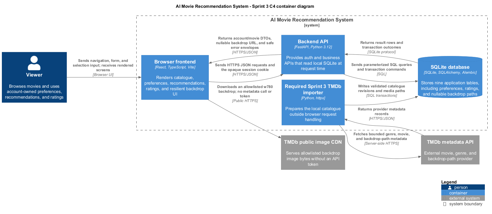
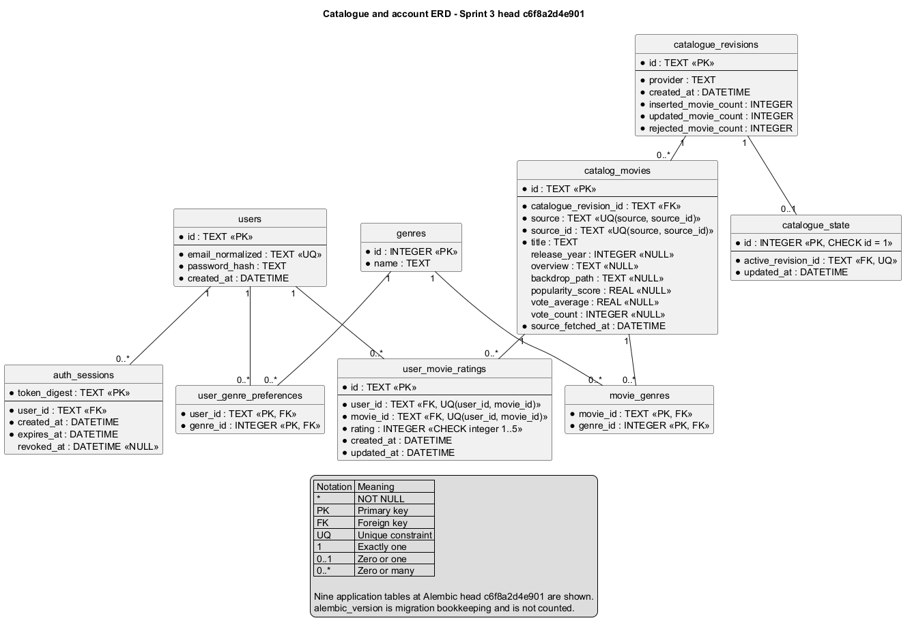
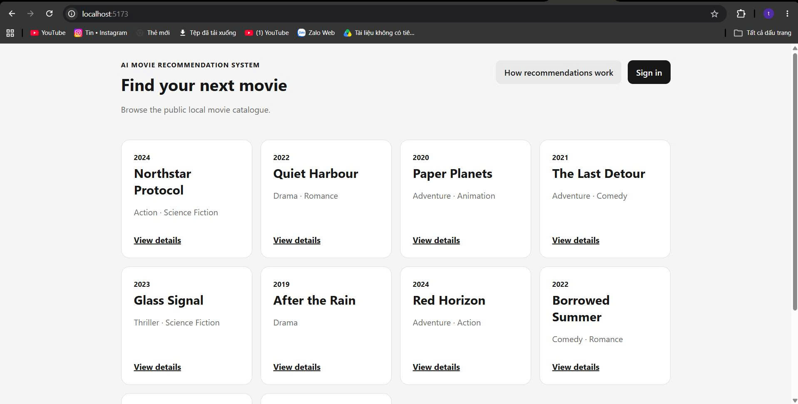

# Design contract: Sprint 3 evidence and Sprint 4 extensions

This document was reconciled on 2026-10-18 against Sprint 3 `main` SHA
`bf18ab860fc3e486b57fc3b5ccac4db94c283995`. Tables, endpoints, modules, and
evidence below reflect that source. Profile/reset UI and NLP product scope
remain separate work. S4-T03 adds the backend rating-aware ranking described
in section 12.5 and [its evidence](evidence/s4-t03-rating-ranking/README.md).
Section 12 is the proposed Sprint 4 C03 design contract dated 2026-10-24;
its implementation status is stated by the feature amendments, including
section 12.5. It does not establish independent review of those features.
Request and response shapes are in
[api.md](api.md), UI state is in [ui.md](ui.md), and ownership/persistence is
in [architecture.md](architecture.md).

Sprint 3 decision update, 2026-10-06: TMDb is the required catalogue source for
development, staging and demos. The existing importer is reused; operational
readiness and verification are recorded under
[#128](https://github.com/SE-FDA-NEU/ai66a_group3_C1_SE/issues/128) and
[#135](https://github.com/SE-FDA-NEU/ai66a_group3_C1_SE/issues/135).
Historical M2 seed screenshots/test results below remain M2 evidence, not a
substitute for the separate Sprint 3 live-import/acceptance records. See the tracked
[TMDb Sprint 3 runbook](tmdb-sprint3-runbook.md).

Post-M3 amendment (2026-10-19): Home, Popular and Recommendations use
database-backed pages of at most ten. Their page controls use API totals;
Home orders every active movie by title (A–Z default, optional Z–A), Popular ranks every eligible
finite-popularity movie, and recommendation view filters apply to the complete
selected base mode before slicing. Page, Home sort and view genre live in the URL, while
the existing AuthProvider owns session identity and shared navigation. These
current rules supersede the Sprint 3 single-page UI descriptions below without
changing recorded Sprint 3 acceptance evidence.

## 1. Architecture



PlantUML source: [images/architecture.puml](images/architecture.puml).

The diagram is the current Sprint 3 topology: the importer is mandatory
catalogue preparation, application APIs read SQLite instead of TMDb at page
open, and the browser may fetch only allowlisted backdrop bytes from the public
image CDN. Historical M2 diagram assets are preserved as
[architecture-m2.png](images/architecture-m2.png) and
[architecture-m2.puml](images/architecture-m2.puml).

The browser sends all application/API traffic to the backend and may separately
download an allowlisted backdrop from the public image CDN. The backend is the
only component that reads or writes accounts and sessions. The TMDb importer
is a separate command that never runs during a browser request, so movie pages
read the local database and never call the TMDb metadata API.

| Component | Technology | Responsibility |
|---|---|---|
| Browser frontend | React, TypeScript, Vite, React Router | Renders public and signed-in experiences, including preferences, recommendations, rating controls, and backdrop fallback. Calls relative `/api` paths; a detail backdrop loads only from the allowlisted public image CDN URL returned by the API. |
| Backend API | Python 3.12, FastAPI, Pydantic | Validates input, resolves the session cookie to an account, applies the business rules, and returns DTOs and error envelopes. |
| SQLite database | SQLite, SQLAlchemy, Alembic | Stores all nine application tables, including preferences, ratings, and nullable backdrop paths. The backend turns on `PRAGMA foreign_keys` for every connection. |
| TMDb importer | Python command, httpx | Required catalogue preparation for Sprint 3 dev/staging/demo. Fetches genres and a bounded number of popular pages (default 50; `--pages` accepts 1–50), writes a new revision, and activates it only after every write succeeds. |
| TMDb API | External service | Source of movie, genre, and backdrop-path metadata for the importer only. It is not called when a user opens a page. |
| TMDb image CDN | External public CDN | Serves backdrop image bytes to the browser without exposing or requiring the metadata API token. |

In development, Vite listens on port 5173 and proxies `/api` to the backend on `http://127.0.0.1:8000`, so the browser sees one origin. The backend does not serve the built frontend in M2, so the application runs as two processes. The session cookie is named `ams_session`; it is opaque, `HttpOnly` and `SameSite=Lax`.

### Modules and owners

The table records the existing Sprint 2 module owners and the dedicated
popular contract's #134 handoff. The dedicated popular route is now
implemented under Sprint 3 T19 (#121).

| Module | What it does | Owner (task) |
|---|---|---|
| Catalogue storage and repository: `backend/app/db/models.py`, `backend/app/repositories/movies.py` | Stable internal movie IDs, the active-revision pointer, and the list and detail queries. | Nguyen Xuan Kiet, `@kietxuan` (#47) |
| M2 seed and bootstrap: `backend/app/catalogue/m2_seed.py`, `backend/app/cli/bootstrap_m2_catalogue.py` | One idempotent command that migrates the database and loads the 12-movie dataset. | `@kietxuan` (#74) |
| TMDb importer: `backend/app/integrations/tmdb.py`, `backend/app/catalogue/tmdb_import.py`, `backend/app/cli/import_tmdb_catalogue.py` | Server-side atomic catalogue import; required from Sprint 3. | `@kietxuan` (#48); S3 T29 setup, `@hoang3003` independent review |
| Account storage and password hashing: `backend/app/repositories/users.py`, `backend/app/security/passwords.py` | Users table access, email normalisation, Argon2id hashing. | Nguyen Tuan Anh, `@NguyenTuanAnh0608` (#49) |
| Rating storage: `backend/app/db/models.py`, `backend/app/repositories/ratings.py`, migration `b7e4c2d91f30` | Account-scoped current rating storage and repository reads/upserts. | S3-T30 ([#137](https://github.com/SE-FDA-NEU/ai66a_group3_C1_SE/issues/137)) |
| Rating API: `backend/app/schemas/ratings.py`, `GET` and `PUT /api/me/ratings/{movieId}` | Session-owned, same-origin-protected, atomic rating reads and writes. | S3-T31 ([#138](https://github.com/SE-FDA-NEU/ai66a_group3_C1_SE/issues/138)) |
| Rating UI: `frontend/src/api/ratings.ts`, `frontend/src/components/MovieRating.tsx` | Account/movie-keyed draft, commit, retry, central 401 recovery, and stale-response rejection on public details. | S3-T33/T34 ([#139](https://github.com/SE-FDA-NEU/ai66a_group3_C1_SE/issues/139), [#141](https://github.com/SE-FDA-NEU/ai66a_group3_C1_SE/issues/141)) |
| Profile-reset backend: `backend/app/repositories/profile.py`, `backend/app/schemas/profile.py`, `POST /api/me/profile/reset` | Explicitly confirmed, session-owned atomic deletion of the current account's preferences and ratings. | S3-T35 ([#142](https://github.com/SE-FDA-NEU/ai66a_group3_C1_SE/issues/142)) |
| Server sessions: `backend/app/security/sessions.py` | Creates, resolves and revokes sessions. | `@NguyenTuanAnh0608` (#53) |
| Registration endpoint: `backend/app/schemas/auth.py`, `POST /api/auth/register` | Validates the email and password and creates the account. | Vu Quoc Huy, `@vu-huzy` (#52) |
| Login, logout, current account: `backend/app/main.py`, `backend/app/security/origin.py` | Sign-in and sign-out endpoints and the same-origin check. | Tran Minh Hoang, `@hoang3003` (#54) |
| Catalogue and detail endpoints: `GET /api/movies`, `GET /api/movies/{movieId}` | Public list and detail reads from the active catalogue. | `@vu-huzy` (#60) |
| Dedicated popular endpoint: `GET /api/movies/popular` | Implemented S09/T19 public popular subset; only finite-popularity movies are eligible. | `@hoang3003` (#134 contract handoff); S09/T19 implementation task #121 |
| Popular ranking: `backend/app/recommendations/ranker.py`, `GET /api/me/recommendations` | Shared popularity ordering and the signed-in cold-start list. | Tran Tuan Anh, `@anotify-vie` (#58) |
| Catalogue and detail pages: `frontend/src/pages/HomePage.tsx`, `MovieDetailPage.tsx` | Ten movie cards at `/` and the detail page at `/movies/:movieId`. | `@anotify-vie` (#61) |
| Registration and sign-in forms: `RegisterPage.tsx`, `LoginPage.tsx` | Forms that call the auth endpoints. | `@NguyenTuanAnh0608` (#50), `@anotify-vie` (#55) |
| Route guards and stale-account state: `frontend/src/auth/`, `frontend/src/protectedRoutes.tsx` | Redirects unsigned visitors to `/login` and clears account state on sign-out. | `@vu-huzy` (#56) |
| Recommendation landing and explanation pages: `RecommendationsPage.tsx`, `RecommendationExplanationPage.tsx` | The signed-in landing page and the public `/about-recommendations` page. | `@hoang3003` (#59, #64) |
| Preference and recommendation state: `PreferencesPage.tsx`, `RecommendationsPage.tsx`, `RecommendationFilter.tsx` | Saves/restores current-account genres; renders personalised, cold-start, no-match, filtered-empty and error/retry states. The post-M3 view genre and page live in the URL; backend filtering precedes page slicing. | S3-T11/T13/T15 baseline; post-M3 amendment |
| Backdrop import/API/UI: `tmdb_import.py`, `backdrops.py`, `MovieBackdropHero.tsx`, `backdropUrl.ts` | Stores/imports validated paths, exposes nullable safe detail URLs, and renders responsive image/fallback without metadata calls from the browser. | S3-T26/T27/T37 and T28/#131 acceptance |

## 2. Data model



PlantUML source: [images/erd.puml](images/erd.puml).

The database has nine application tables. Five revisions after the empty
bootstrap create those tables: `4bde7d96c1c2` (catalogue), `7f5b1d2a6e90`
(users), `8c1e2f4a7b90` (sessions), `9d2f5a1c3b84` (preferences) and
`b7e4c2d91f30` (ratings). S3-T26 adds a sixth additive revision,
`c6f8a2d4e901`, for nullable `catalog_movies.backdrop_path`; this is the single
current head and creates no additional table.

The current ERD shows all nine application tables (excluding the Alembic
bookkeeping table), both account-owned relations, nullable
`catalog_movies.backdrop_path`, unique rating ownership, and the numeric half-step
rating range. The seven-table M2 baseline remains available as
[erd-m2.png](images/erd-m2.png) with [source](images/erd-m2.puml).

Genre preferences are stored in `user_genre_preferences` (S3-T01), and current
account/movie ratings are stored in `user_movie_ratings` (S3-T30). The rating
HTTP API is implemented under T31, its UI and acceptance under T33/T34, and the
reset backend under T35. Only the profile/reset UI remains pending here.
Rating-adjusted ranking (Story #22 / S05b) extends that Sprint 3 foundation
under S4-T02/S4-T03; section 12.5 describes the implemented backend flow.

A trailing `?` marks a column that allows NULL. Every other column is NOT NULL.

| Table | Purpose | Columns and types | Primary key | Foreign keys | Constraints |
|---|---|---|---|---|---|
| `users` | Accounts | `id` VARCHAR(36), `email_normalized` VARCHAR(320) COLLATE NOCASE, `password_hash` VARCHAR(255), `created_at` DATETIME | `id` | None | UNIQUE `email_normalized` |
| `auth_sessions` | Server-side login sessions | `token_digest` VARCHAR(64), `user_id` VARCHAR(36), `created_at` DATETIME, `expires_at` DATETIME, `revoked_at` DATETIME? | `token_digest` | `user_id` to `users.id`, ON DELETE CASCADE, indexed | None |
| `catalogue_revisions` | One seeded or imported snapshot of the catalogue | `id` VARCHAR(36), `provider` VARCHAR(32), `created_at` DATETIME, `inserted_movie_count` INTEGER, `updated_movie_count` INTEGER, `rejected_movie_count` INTEGER | `id` | None | None |
| `catalogue_state` | The one row that names the active revision | `id` INTEGER, `active_revision_id` VARCHAR(36), `updated_at` DATETIME | `id` | `active_revision_id` to `catalogue_revisions.id`, ON DELETE RESTRICT | CHECK `id = 1`; UNIQUE `active_revision_id` |
| `catalog_movies` | Movies, each owned by one revision | `id` VARCHAR(36), `catalogue_revision_id` VARCHAR(36), `source` VARCHAR(32), `source_id` VARCHAR(128), `title` VARCHAR(500), `release_year` INTEGER?, `overview` TEXT?, `backdrop_path` TEXT?, `popularity_score` FLOAT?, `vote_average` FLOAT?, `vote_count` INTEGER?, `source_fetched_at` DATETIME | `id` | `catalogue_revision_id` to `catalogue_revisions.id`, ON DELETE RESTRICT, indexed | UNIQUE (`source`, `source_id`) |
| `genres` | Genres, keyed by the provider's genre ID | `id` INTEGER (not auto-incremented), `name` VARCHAR(100) | `id` | None | None |
| `movie_genres` | Links each movie to its genres | `movie_id` VARCHAR(36), `genre_id` INTEGER | (`movie_id`, `genre_id`) | `movie_id` to `catalog_movies.id`, ON DELETE CASCADE; `genre_id` to `genres.id`, ON DELETE RESTRICT | None |
| `user_genre_preferences` | Current genre choices owned by an account | `user_id` VARCHAR(36), `genre_id` INTEGER | (`user_id`, `genre_id`) | `user_id` to `users.id`, ON DELETE CASCADE; `genre_id` to `genres.id`, ON DELETE RESTRICT | None |
| `user_movie_ratings` | One current rating per account/movie pair | `id` VARCHAR(36), `user_id` VARCHAR(36), `movie_id` VARCHAR(36), `rating` FLOAT (SQLite REAL), `created_at` DATETIME, `updated_at` DATETIME | `id` | `user_id` to `users.id`, ON DELETE CASCADE; `movie_id` to `catalog_movies.id`, ON DELETE CASCADE | UNIQUE (`user_id`, `movie_id`); CHECK numeric `rating` from 0.5 through 5 in exact half steps |

Multiplicities:

- One user has zero or many `auth_sessions`; each session belongs to exactly one user.
- One revision has zero or many movies; each movie belongs to exactly one revision.
- `catalogue_state` holds exactly one row, and that row points at exactly one revision.
- Movies and genres are many-to-many through `movie_genres`; the composite primary key prevents a duplicate pair.
- Users and genres are many-to-many through `user_genre_preferences`; each pair is unique.
- A user and movie have at most one `user_movie_ratings` row; different users may rate the same movie independently.

Sprint 3 storage adds `user_genre_preferences` with composite primary key
`(user_id, genre_id)` and `user_movie_ratings` with a separate opaque primary
key plus a unique `(user_id, movie_id)` pair. Migration `9d2f5a1c3b84` (S3-T01)
creates preferences; migration `b7e4c2d91f30` (S3-T30) creates ratings. The
current head `c6f8a2d4e901` (S3-T26) adds only nullable backdrop storage. The
rating migration continues to enforce account/movie foreign keys,
cascading deletes, and a numeric database check from 0.5 through 5 in exact half steps.

### Business rules enforced through Sprint 3

| Rule | Database | Service or query | Tests |
|---|---|---|---|
| S04 public catalogue ordering | None | `GET /api/movies` may include null/missing popularity; when popularity ordering is used, those entries sort after finite values, then by title and ID. | `test_movies_api.py` |
| BR5: dedicated popular and recommendation fallback sets sort globally by popularity descending, title then ID, with at most 10 per page | None | `GET /api/movies/popular` filters to finite popularity before deterministic ordering and database pagination. | `test_popular_recommendations.py`, `test_catalogue_pagination.py` |
| BR6: an unknown movie ID never shows another movie | `catalog_movies.id` is the primary key | Lookup by ID inside the active revision; a miss returns `404 MOVIE_NOT_FOUND` | `test_unknown_movie_id_returns_404` |
| BR13: the explanation lists exactly 3 steps | None | Page content in `RecommendationExplanationPage.tsx` | `test_recommendation_explanation_content.py`, `recommendation-explanation.test.tsx` |
| BR16: an email is unique after case-insensitive normalisation | UNIQUE `email_normalized` with NOCASE collation | The email is trimmed and lowercased; a duplicate returns `409 EMAIL_ALREADY_REGISTERED` | `test_registration.py`, `test_registration_verification.py`, `test_account_migration.py` |
| BR17: a password has at least 8 characters and is stored only as a hash | `users` has no plaintext password column | `RegisterRequest` requires 8 or more characters; `password_hash` holds an Argon2id hash | `test_passwords.py`, `test_registration_verification.py` |
| BR18: personal data needs a valid session and belongs to that account | `auth_sessions.user_id` references `users.id` | `/api/auth/me` and `/api/me/recommendations` take the account from the cookie only and return `401` without a valid session | `test_auth_sessions.py`, `test_auth_catalogue_handoff.py` |
| BR19: sign-out invalidates the session and keeps the account | `revoked_at` on the session row | `revoke_session` sets `revoked_at`; the user row is untouched | `test_logout_forbids_reusing_the_old_session_on_authenticated_api` |

Preference validation and account-scoped replacement are implemented under
T02. T30 implements account-scoped rating storage/repository operations, T31
implements the protected rating API, and T35 implements the reset backend.
Profile/reset UI, search, and similarity remain separate work. Rating UI is
implemented and verified under T33/T34; S4-T03 implements backend ranking.

Committed Sprint 3 delivery is narrower than that historical rule list:
BR1-BR4 use saved genres and local popularity, BR7 stores an optional 0.5-5
rating without using it for ranking, and BR14 freezes the authenticated reset
backend transaction. BR9 rating-adjusted ranking remains Sprint 4.

## 3. API design

Conventions:

- Product endpoints are under `/api`; the health check is `/health`.
- JSON field names use `camelCase`.
- A success body is `{ "data": ..., "meta": ... }`. An error body is `{ "error": { "code", "message", "requestId" } }`.
- The signed-in account comes only from the `ams_session` cookie. No endpoint accepts a user ID from the client.
- `POST /api/auth/login` and `POST /api/auth/logout` reject cross-origin browser requests with `403 ORIGIN_NOT_ALLOWED`.
- `PUT /api/me/preferences`, `PUT /api/me/ratings/{movieId}`, and
  `POST /api/me/profile/reset` reuse the same-origin mechanism under T02, T31,
  and T35.
- Any database failure returns `503 SERVICE_UNAVAILABLE`.

| Story | Method and endpoint | Access | Input | Success | Errors | Status |
|---|---|---|---|---|---|---|
| Health | `GET /health` | Public | None | `200` with `status`, `database`, `migrationVersion` | `503 SERVICE_UNAVAILABLE` when the database or migration table cannot be read | Implemented in M2 |
| S12 | `POST /api/auth/register` | Public | `email`, `password` (8 or more characters) | `201` with `data.user` (`id`, `email`) | `400 VALIDATION_ERROR`, `409 EMAIL_ALREADY_REGISTERED`, `503 SERVICE_UNAVAILABLE` | Implemented in M2 |
| S13 | `POST /api/auth/login` | Public, same-origin | `email`, `password` | `200` with `data.user`; sets the session cookie | `400 VALIDATION_ERROR`, `401 INVALID_CREDENTIALS`, `403 ORIGIN_NOT_ALLOWED`, `503 SERVICE_UNAVAILABLE` | Implemented in M2 |
| S13 | `POST /api/auth/logout` | Cookie optional, same-origin | None | `204`; session revoked, cookie cleared | `403 ORIGIN_NOT_ALLOWED`, `503 SERVICE_UNAVAILABLE` | Implemented in M2 |
| S13 | `GET /api/auth/me` | Signed in | None | `200` with `data.user` | `401 AUTHENTICATION_REQUIRED`, `503 SERVICE_UNAVAILABLE` | Implemented in M2 |
| S04 | `GET /api/movies?limit=10` | Public | `limit` 1 to 10, default 10 | `200` with `data.movies` and `meta`; catalogue entries without popularity may be included and sort last when popularity ordering is used | `400 VALIDATION_ERROR`, `503 CATALOGUE_UNAVAILABLE`, `503 SERVICE_UNAVAILABLE` | Implemented in M2; public catalogue route |
| S09 / T19 | `GET /api/movies/popular?limit=10` | Public | `limit` 1 to 10, default 10 | `200` with `data.movies` and `meta`; only finite-popularity movies are eligible | `400 VALIDATION_ERROR`, `503 CATALOGUE_UNAVAILABLE`, `503 SERVICE_UNAVAILABLE` | Implemented in Sprint 3 (S3-T19); dedicated popular route |
| S03 | `GET /api/movies/{movieId}` | Public | Internal movie ID | `200` with `data.movie` | `404 MOVIE_NOT_FOUND`, `503 CATALOGUE_UNAVAILABLE`, `503 SERVICE_UNAVAILABLE` | Implemented in M2 |
| S02, S04 | `GET /api/me/recommendations?limit=10` | Signed in | `limit` 1 to 10, default 10 | `200 RecommendationResponse`: personalised matches, popular cold start, or popular no-match alternatives; each movie has `reason.matchedGenres` | `400 VALIDATION_ERROR`, `401 AUTHENTICATION_REQUIRED`, `503 CATALOGUE_UNAVAILABLE`, `503 SERVICE_UNAVAILABLE` | Implemented in Sprint 3 (S3-T08) |
| S01 | `GET /api/genres` | Signed in | None | `200` with the local canonical genre list | `401 AUTHENTICATION_REQUIRED`, `503 CATALOGUE_UNAVAILABLE`, `503 SERVICE_UNAVAILABLE` | Implemented in Sprint 3 (S3-T01) |
| S01 | `GET /api/me/preferences` | Signed in | None | `200` with the saved genres | `401 AUTHENTICATION_REQUIRED`, `503 SERVICE_UNAVAILABLE` | Implemented in Sprint 3 (S3-T01) |
| S01 | `PUT /api/me/preferences` | Signed in, same-origin | `genreIds`: 1 to 5 distinct genre IDs | `200` with the saved genres after commit | `400 VALIDATION_ERROR`, `401 AUTHENTICATION_REQUIRED`, `403 ORIGIN_NOT_ALLOWED`, `404 GENRE_NOT_FOUND`, `503 SERVICE_UNAVAILABLE` | Implemented in Sprint 3 (S3-T02) |
| S05a | `GET /api/me/ratings/{movieId}` | Signed in | Opaque movie ID | `200` with committed `rating` or `null` | `401 AUTHENTICATION_REQUIRED`, `404 MOVIE_NOT_FOUND`, `503 SERVICE_UNAVAILABLE` | Implemented in Sprint 3 (S3-T31) |
| S05a | `PUT /api/me/ratings/{movieId}` | Signed in, same-origin | Strict numeric `{ "rating": 0.5..5 }` in 0.5 steps | `200` only after commit | `400 VALIDATION_ERROR`, `401 AUTHENTICATION_REQUIRED`, `403 ORIGIN_NOT_ALLOWED`, `404 MOVIE_NOT_FOUND`, `503 SERVICE_UNAVAILABLE` | Implemented in Sprint 3 (S3-T31) |
| S11 | `POST /api/me/profile/reset` | Signed in, same-origin | Exact `{ "confirm": true }` | `200` only after preferences/ratings delete transaction commits | `400 VALIDATION_ERROR`, `401 AUTHENTICATION_REQUIRED`, `403 ORIGIN_NOT_ALLOWED`, `503 SERVICE_UNAVAILABLE` | Backend implemented in Sprint 3 (S3-T35); UI pending |

All six P0 Stories appear in the table: S01 (genres and preferences), S02 and
S04 (recommendations and the public catalogue), S03 (movie detail), S12
(register) and S13 (sign-in, sign-out, current account). S01 backend storage,
reads, and atomic preference replacement are implemented under T01/T02; its
frontend and account journey are implemented and verified by T22. S09/T19 is listed
separately as the implemented dedicated public popular route. The recommendation
endpoint supports popular cold-start results and genre-based personalised
results implemented under S3-T08. The `/recommendations` page consumes this
response through the shared typed client and renders server-ordered movie cards
under S3-T10. S3-T11 adds no-match guidance, error recovery, and account-keyed
request-generation checks so obsolete results and 401 responses are ignored.
S3-T13 implements cold-start guidance and saved-preference transitions, with
T14 acceptance coverage.

The existing `GET /api/movies` route remains the public catalogue endpoint.
Sprint 3 public popular-list consumers use `GET /api/movies/popular`. These are
separate contracts: the catalogue route may include entries with null or
missing popularity, while the dedicated popular route returns only entries
with valid finite popularity.

Error codes returned by the running backend:

| Code | HTTP status | Returned when |
|---|---:|---|
| `VALIDATION_ERROR` | 400 | A body field or the `limit` query value is invalid |
| `AUTHENTICATION_REQUIRED` | 401 | A signed-in endpoint has no valid, unexpired, unrevoked session |
| `INVALID_CREDENTIALS` | 401 | The email is unknown or the password is wrong; the message is the same for both |
| `ORIGIN_NOT_ALLOWED` | 403 | A login, logout, preference/rating write, or profile reset fails the same-origin check |
| `MOVIE_NOT_FOUND` | 404 | The movie ID does not exist in the active catalogue |
| `GENRE_NOT_FOUND` | 404 | A requested canonical genre ID does not exist |
| `EMAIL_ALREADY_REGISTERED` | 409 | The normalised email is already stored |
| `SERVICE_UNAVAILABLE` | 503 | The database could not be read or written |
| `CATALOGUE_UNAVAILABLE` | 503 | No active catalogue revision exists |

`GENRE_NOT_FOUND` (404) is returned by the implemented T02 preference route.
Sprint 3 invalid preference/rating/reset bodies reuse the
implemented `VALIDATION_ERROR` convention; no rating/reset-specific error code
is invented.

## 4. Walking skeleton

The route is the browser page `/`. It calls `GET /api/movies?limit=10`, which reads `catalog_movies` (with `genres` and `movie_genres`) for the revision named in `catalogue_state`. The page shows the ten movies the database returns, and nothing is hard-coded in the frontend.

### Historical M2 bootstrap

From the repository root, with the virtual environment active and `.env` copied from `.env.example`:

This historical seed path is retained for M2 reproduction/test/offline support
in a separate database. Sprint 3 requires migration followed by TMDb import and
manual provenance smoke; do not activate the seed on its accepted database.

```bash
python -m app.cli.bootstrap_m2_catalogue
```

The command creates the database folder, applies every migration and loads the fixed local dataset. It does not read `TMDB_READ_ACCESS_TOKEN` and makes no network request. Output on a new database:

```text
M2 catalogue bootstrap complete
active_revision=375578bb-f998-4be5-b7ea-732d6a00e56c
movies=12
genres=8
movie_genres=22
```

The revision ID is generated and differs on every new database. A second run printed the same revision and counts.

### Database query

```sql
SELECT m.title, m.release_year, m.popularity_score
FROM catalog_movies AS m
JOIN catalogue_state AS s ON s.active_revision_id = m.catalogue_revision_id
WHERE s.id = 1
ORDER BY (m.popularity_score IS NULL), m.popularity_score DESC, m.title ASC, m.id ASC
LIMIT 10;
```

Result on the database above:

| Title | Year | Popularity |
|---|---:|---:|
| Northstar Protocol | 2024 | 98.0 |
| Quiet Harbour | 2022 | 92.0 |
| Paper Planets | 2020 | 90.0 |
| The Last Detour | 2021 | 90.0 |
| Glass Signal | 2023 | 88.0 |
| After the Rain | 2019 | 85.0 |
| Red Horizon | 2024 | 84.0 |
| Borrowed Summer | 2022 | 80.0 |
| Echo Room | 2021 | 78.0 |
| Orbit of Us | 2020 | 75.0 |

The API returns the same ten titles in the same order: `GET /api/movies?limit=10` gave `200` with `meta.count` 10 and `meta.limit` 10. `GET /api/movies/{id}` for Northstar Protocol gave `200`. An unknown ID gave `404 MOVIE_NOT_FOUND`, and `limit=11` gave `400 VALIDATION_ERROR`. One of the 12 movies, `Archive 17`, has no release year; its detail page shows `Information unavailable`.

### Screenshot



The catalogue page at `http://localhost:5173/` in a browser. Eight of the ten cards are visible; the other two are below the fold. The steps and the other screenshots (valid detail, unknown movie, incomplete record) are in [evidence/m2-evidence/README.md](evidence/m2-evidence/README.md).

### Checks

Run on `4bfae7c`, Windows 11, Python 3.12.10, Node.js 24.21.0, with `TMDB_READ_ACCESS_TOKEN` empty:

| Command | Result |
|---|---|
| `python -m pytest backend/tests -v` | 100 passed, 2 skipped |
| `python -m ruff check backend` | All checks passed |
| `npm --prefix frontend test` | 5 test files, 41 tests passed |
| `npm --prefix frontend run lint` | Exit code 0 |
| `npm --prefix frontend run build` | Exit code 0 |

The two skipped backend tests are placeholders for criteria that are not built yet; the pending criteria are listed in [evidence/t20-handoff/README.md](evidence/t20-handoff/README.md). The backend suite needs a migrated database, because `test_health` reads the migration table. `test_seed_service_never_needs_a_network_connection` replaces network connection creation with a function that fails, and it passes. The CI workflow sets the TMDb token to an empty string and has no importer step.

## 5. ADRs

### ADR-1: Where the running application reads movie data from

Status: accepted runtime boundary; catalogue-source decision updated for
Sprint 3 on 2026-10-06. Sources: the movie-data Spike (#16), tasks #48/#74,
the [passed T29 live-import record](evidence/t29-tmdb-live-smoke.md), and the
[merged C04 clean-clone record](evidence/s3-c04-clean-clone.md).

Context. M2 required a token-free deterministic walking skeleton. From Sprint 3 the team requires real TMDb catalogue data in development, staging and demos, while automated tests remain deterministic and credential-free.

Options considered:

1. The browser calls TMDb directly. The token would reach the browser; the Spike lists this as a risk.
2. The backend calls TMDb on each catalogue request. Page content and test results would depend on a live service whose popularity values change between runs.
3. The backend reads only the local database, and a separate command fills it, either from a fixed local dataset or from TMDb.

Decision. Option 3 remains the runtime boundary. From Sprint 3, the server-side importer is mandatory catalogue preparation: configure a private Read Access Token, migrate a fresh database and import TMDb before dev/staging/demo acceptance. Active revision provider and movie source must be `tmdb`, with source IDs, counts and fetch/import timestamps verified by a separate manual smoke. The importer activates a revision only after every write succeeds; failed imports preserve the previous valid catalogue and do not fall back to seed. T29/C04 completed the recorded Sprint 3 setup, failure and final clean-clone checks; a different candidate or environment still needs its own provenance smoke.

Rationale. TMDb supplies the application catalogue, while local reads keep user requests independent of provider availability. Synthetic provider fixtures, boundary mocks and isolated test databases keep automated AC tests deterministic without live tokens/network. Credentials remain server-side.

Consequence. The M2 fixed dataset is only historical/test/labelled offline support, not Sprint 3 acceptance data. A missing token or failed import leaves a new demo environment unready. On an existing environment the valid previous snapshot remains readable; the failed attempt cannot be reported as successful readiness evidence. `/api/genres`, recommendations, the `/api/movies` public catalogue, the `/api/movies/popular` dedicated finite-popularity subset, and details read SQLite; source provenance stays in operator evidence, not new public secret/source-ID DTO fields. The T26/T27/T37/T28 backdrop chain is delivered separately from core catalogue preparation; it preserves the same local-read boundary.

Verification. T29 and C04 link the successful fresh-database import,
credential/error guidance, rollback/idempotence checks and final-candidate live
smoke outside CI. Existing M2 tests/evidence do not replace those records. The
[runbook](tmdb-sprint3-runbook.md) contains the repeatable commands and
provenance checklist.

### ADR-2: How the server recognises a signed-in account

Status: accepted. Sources: the C03 contract ([architecture.md](architecture.md), [api.md](api.md)) and task #53.

Context. Signed-in pages and endpoints need to know the account, and sign-out has to stop the old credential from working.

Options considered:

1. A bearer token (for example a signed token) that the browser stores and sends in a header.
2. An opaque random value in an `HttpOnly` cookie, mapped to a session row on the server.

Decision. Option 2. The cookie value is 32 random bytes from `secrets.token_urlsafe`. The database stores only its SHA-256 digest. A session expires after 7 days and sign-out sets `revoked_at`. A successful login revokes the session named by any existing cookie and issues a new one.

Rationale. The contract rules out tokens in browser storage. The server can revoke a session itself: the T20 test replays the old cookie after sign-out from a new client and gets `401` on `/api/auth/me` and `/api/me/recommendations`.

Consequences. Every protected request reads a session row. Browsers attach cookies automatically, so the cookie uses `SameSite=Lax` and the backend checks `Sec-Fetch-Site` or `Origin` on login, logout, preference replacement, rating writes, and profile reset.

What would change the decision. A client that is not a browser, or a frontend served from a different origin than the API.

## 6. Changes since M1

### Change 1: The M2 catalogue comes from a local dataset, not from TMDb

Historical M2 decision; superseded for Sprint 3 dev/staging/demo by ADR-1 above.

Before. The M1 Spike (#16) chose TMDb as the catalogue provider and kept only a small local fixture for tests.

After. The M2 backend reads a fixed 12-movie dataset loaded by `python -m app.cli.bootstrap_m2_catalogue`. The TMDb importer was merged separately (task #48, PR #90) as an optional command.

Reason. The M2 requirement is a clean clone that runs without external credentials. Task #74 forbids a TMDb token or network request in the seed.

Impact in M2. The ten cards on `/` used fixed local titles and the importer was tested with mocked provider responses. These historical results do not establish Sprint 3 live-import readiness.

### Change 1b: TMDb catalogue is mandatory from Sprint 3

Decision date: 2026-10-06. Development/staging/demo catalogue preparation now
requires a configured server token, successful bounded import and verified TMDb
provenance. CI remains synthetic, isolated and token-free. T29 owns the required
setup foundation; C04 independently verifies clean clone and final-candidate
smoke. Account data and runtime SQLite reads retain their existing boundaries;
original Story criteria/points and separate media commitments are unchanged.

### Change 2: Sessions are stored as a digest with an expiry

Before. The M1 data contract in the Spike lists an `AuthSession` with an opaque `id`, a `userId` and an `invalidatedAt` field.

After. `auth_sessions` is keyed by `token_digest`, the SHA-256 digest of the cookie value, and has `expires_at` and `revoked_at`.

Reason. Task #53 requires that expired or invalid sessions return `401` and that login renews the session identity. Storing only the digest means the database never holds a value that a browser could send as a cookie.

Impact. A copy of the database holds no cookie value that a browser could send, and a cookie that was signed out or has expired returns `401`. The ERD in `docs/images/erd.png` shows `token_digest` and `revoked_at`.

## 7. Sprint 3 personalisation decisions

### ADR-3: Account identity and transaction boundary

Status: preference storage/reads/replacement implemented under T01/T02,
rating storage/repository under T30, rating API under T31, and reset backend
under T35; the account rating widget is implemented under T33, while reset UI
remains pending.

Preferences, ratings, and reset are account-owned operations. Their target
user is resolved only from the valid `ams_session` row. Request bodies do not
accept `user_id`, account ID, email, username, or owner ID. Missing, expired,
or revoked sessions return `401` before private data is returned or changed,
and state-changing browser requests must pass the existing same-origin policy.

Preference replacement returns success only after commit. The T30 rating
repository reads and upserts only the supplied account/movie pair inside the
caller's transaction, and the T31 rating API returns success only after commit.
The T35 reset backend deletes the session account's preference and rating rows
in one transaction and returns success only after commit; either failure rolls
back both. The user, current session, catalogue, movies, genres, and other
accounts remain untouched.

T02 validates 1-5 distinct strict integer IDs and checks local canonical
existence before deleting the current account's old rows. It flushes and
prepares the sorted DTO before committing once. Insert/commit failures roll
back both deletion and insertion; no post-commit database query is required to
build a success response. [T02 evidence](evidence/s3-t02-atomic-preferences.md)
records focused validation/security/rollback tests. T03/T22/T25 record broader
persistence and UI verification; final human/Story DoD gates remain separate.

### ADR-4: Sprint 3 recommendation inputs

Status: genre/popularity recommendation implemented under T08; rating-adjusted
ranking remains out of Sprint 3 scope.

Sprint 3 personalised ranking uses only saved genres and local catalogue
popularity. It preserves `data.movies`, `mode` (`personalised` or `popular`),
`personalised`, `noMatch`, and per-movie `reason.matchedGenres`. Ratings may be
stored by S05a but do not alter recommendation order in Sprint 3.
Rating-adjusted ranking belongs to Story #22 / S05b. The S4-T03 extension in
section 12.5 now implements that backend behaviour, preserving this ADR's
Sprint 3 baseline for neutral/no signals and popular fallbacks.

## 8. UI-driven design changes with repository evidence

### Preference persistence and recommendation generation (M3 reconciliation)

The picker and immediate post-save recommendation flow required durable,
account-owned selections instead of M2's popular-only landing. Migration
`9d2f5a1c3b84` adds `user_genre_preferences`, uniquely keyed by
`(user_id, genre_id)`. `GET /api/genres`, `GET /api/me/preferences` and atomic
`PUT /api/me/preferences` supply canonical options, restored selections and
committed saves. The session alone supplies the owner. The API rejects
invalid/unknown IDs before replacing rows and rolls back on failure.

Only successful preference commit calls `invalidateRecommendations()` and
opens `/recommendations`. `AuthContext` increments the recommendation version;
`RecommendationsPage` keys its snapshot by user, recommendation version and
retry version, then checks the active request generation before accepting
success/error/401. That prevents a delayed pre-save popular result or prior
account response from replacing current personalised data. The ready list
preserves `mode`, `personalised`, `noMatch` and `reason.matchedGenres`.
S06's transient genre filter never writes preferences or changes server order.

Evidence: [T22](evidence/s3-t22-preferences-acceptance/README.md),
[latest T22 run](evidence/s3-m3-p0-handoff/latest/checks/t22-live.txt),
[T25 S04/S13 race/ownership results](evidence/s3-m3-p0-handoff/latest/checks/s04-s13-synthetic.txt),
`AuthContext.tsx`, `PreferencesPage.tsx`, `RecommendationsPage.tsx` and
`RecommendationFilter.tsx`. The corresponding explanation and wireframes are
in [ui.md §4](ui.md#4-what-changed-since-m2), updated in this same change.

### Implemented rating UI and reset boundary

T33's `MovieRating` is mounted on public detail. Guests resolve sign-in status
but make no private rating GET/PUT; the CTA opens `/login`. The authenticated
widget is keyed by `(user.id, movieId)` and separates committed rating from
draft selection. Unrated text is `Not rated yet`, committed text is
`Your saved rating: N/5`, and success text is `Rating saved.`. Saving disables
duplicate submission and shows `Saving...` / `Saving your rating...`.

A service-error save renders exactly
`Your rating was not confirmed as saved. Service is temporarily unavailable Please retry.`
and `Retry save`, retaining the prior committed value and draft. This replaces
the historical draft copy `Rating was not saved. Try again.`. Old account/movie
responses are discarded; protected 401 uses central recovery. [T34](evidence/s3-t34-rating-acceptance/README.md)
and [C04 restart replay](evidence/s3-c04-final/live/results.json) record the
implemented behaviour. T25 retains a first-run T33 bridge logout failure and
passing reruns; its cause is not claimed resolved.

`POST /api/me/profile/reset` implements the confirmed atomic backend boundary.
The frontend `/profile` is still a guarded placeholder and sends no reset POST.
The reset backend contract remains available for future UI reuse; no completed
reset screen, search or similarity UI is claimed.


### Account/movie-keyed asynchronous state and stale-response rejection

1. **UI problem.** A request captured for account A or movie A may complete
   after the viewer has signed in as B, navigated to movie B, saved new
   preferences, retried, or left the route.
2. **Risk.** Without identity and generation checks, a late result could show
   A's rating or recommendations in B's context. A late `401` could also clear
   B's valid session, and an old movie response could replace the current
   detail/fallback state.
3. **Implemented design.** `AuthProvider` is the sole account-identity owner;
   `RequireAuth` keys the protected subtree by `user.id`. Preference and
   recommendation state is account/version keyed. Rating state is keyed by
   both `user.id` and `movieId`. Effects abort/clean up obsolete requests, and
   request generations reject late completions even when abort races with a
   response. Only the current request may invoke the central
   `handleUnauthorized` recovery for a protected `401`.
4. **Evidence.** T11 covers delayed recommendation success/error/401 and retry;
   T13 covers a delayed cold-start response after a committed preference save;
   T33 covers rating load/save cleanup and account/movie keys; T34 verifies the
   same behaviour through browser, API, and SQLite journeys.

Repository evidence: `frontend/src/auth/AuthContext.tsx`,
`frontend/src/auth/RequireAuth.tsx`, `frontend/src/pages/PreferencesPage.tsx`,
`frontend/src/pages/RecommendationsPage.tsx`,
`frontend/src/components/MovieRating.tsx`,
[T11 evidence](evidence/s3-t11-no-match-retry-request-races.md),
[T14/T13 acceptance](evidence/s3-t14-cold-start-acceptance/README.md), and
[T34 acceptance](evidence/s3-t34-rating-acceptance/README.md).

### Safe movie-detail return context

Shared movie cards pass a minimal `{ returnTo }` React Router state to the
public detail route. The value is derived from the current list location; no
account ID, genre preference, recommendation payload, or external URL is
stored in it. `MovieDetailPage` resolves the value through a fixed movie-list
allow-list (`/`, `/popular`, and `/recommendations`) before rendering any Back
or Return link. Direct loads and rejected values fall back to `/`.

This design uses an explicit destination rather than `navigate(-1)`: a direct
URL, stale browser history entry, or externally supplied state therefore
cannot send the viewer to an unvalidated origin. Returning to
`/recommendations` runs the existing protected-route check and issues the
normal recommendation GET for the still-current account. Detail navigation
has no preference write path, leaving `user_genre_preferences` unchanged.

Evidence: `frontend/src/navigation/movieDetailReturn.ts`,
`RecommendationsPage.tsx`, the T15 `RecommendationFilter`, the shared
`MovieGrid`/`MovieCard`, `MovieDetailPage.tsx`, and
`movie-detail-return.test.tsx`. The recommendation path applies to ordinary
results and T11 popular alternatives without bypassing the snapshot filter.

### Nullable catalogue fields for renderable detail states

The detail UI must remain usable when provider data lacks a release year or
overview. The current migration/model allow those fields to be null, DTOs
return JSON `null`, and the detail UI renders `Information unavailable` while
keeping the other fields visible. This is an evidence-backed data/UI
reconciliation, not a proposed backdrop change. Clients that assumed non-null
values must accept the already-documented nullable contract.

Evidence: migration `4bde7d96c1c2`, `MovieDetailDto`,
`MovieDetailPage.tsx`, and `test_movie_detail_returns_genres_and_treats_missing_fields_as_null`.

## 9. Backdrop reconciliation

The delivered chain keeps metadata preparation out of user requests:

- T26/#129 adds nullable TEXT `catalog_movies.backdrop_path` at migration head
  `c6f8a2d4e901` with transaction-owned storage and populated-upgrade tests.
- T27/#130 maps validated paths in the core importer, provides bounded
  media-only enrichment for an existing catalogue, and returns a safe nullable
  `backdropUrl` from the public detail API. List/recommendation DTOs do not gain
  media fields.
- T37/#179 renders `MovieBackdropHero`; null, omitted, invalid, or broken images
  fall back to the permanent gradient/overlay, and movie/URL keys prevent an
  old image event from poisoning a newer detail.
- T28/#131 verifies the nine-table migration, rollback, stable IDs, account
  preservation, API/UI contract, responsive fallbacks, stale responses, and
  live public-CDN delivery.

The browser never calls the TMDb metadata API. It may fetch the allowlisted
image bytes from `https://image.tmdb.org/t/p/w780/...` without a token. See the
[storage handoff](backdrop-storage-contract.md),
[enrichment runbook](backdrop-import-runbook.md),
[T37 evidence](evidence/s3-t37-backdrop-ui/README.md), and
[T28 acceptance](evidence/s3-t28-backdrop-acceptance/README.md).

## 10. D1 contract publication and consumer handoff

The D1 contract was published and merged through
[PR #144](https://github.com/SE-FDA-NEU/ai66a_group3_C1_SE/pull/144), not left as
a local proposal. `@kietxuan` approved head
`6c6dd7880e4af1a1dd30d5a11068bc84a3b07e9d` in the recorded
[review](https://github.com/SE-FDA-NEU/ai66a_group3_C1_SE/pull/144#pullrequestreview-5466721572)
on 2026-10-09; GitHub merged it as
`79c4b985a1df4671abf998831053e1b580481be0` at 13:47 Asia/Saigon. That receipt
covers the initial contract. The later C03 reconciliation is now merged via
[PR #187](https://github.com/SE-FDA-NEU/ai66a_group3_C1_SE/pull/187), merge
`bf18ab860fc3e486b57fc3b5ccac4db94c283995`, and issue #134 is closed.
Its [recorded approval](https://github.com/SE-FDA-NEU/ai66a_group3_C1_SE/pull/187#pullrequestreview-5563049458)
is on `9e444adf491eff5214c4ac5c0bd316792393da8d`, before the later
`95ab003f2123ae9c8d2d7f603d0f6cc7c5829be8` follow-up. This does not fabricate
a review of that later head or of the C05 dossier. C05 updates `docs/ui.md`
and this design explanation together and still needs its own real review.
[Task #189](https://github.com/SE-FDA-NEU/ai66a_group3_C1_SE/issues/189) covers
only the reviewed dossier draft/source and export-tooling milestone.
Parent #136 remains open for actual final assets, human/C02 evidence, final
merged PDF export and LMS submission/receipt. The
[C05 follow-up](evidence/s3-c05-ui/follow-up.md) records the boundary.

Initial consumers/dependencies:

- [#103](https://github.com/SE-FDA-NEU/ai66a_group3_C1_SE/issues/103)
- [#106](https://github.com/SE-FDA-NEU/ai66a_group3_C1_SE/issues/106)
- [#108](https://github.com/SE-FDA-NEU/ai66a_group3_C1_SE/issues/108)
- [#112](https://github.com/SE-FDA-NEU/ai66a_group3_C1_SE/issues/112)
- [#128](https://github.com/SE-FDA-NEU/ai66a_group3_C1_SE/issues/128)
- [T30 #137](https://github.com/SE-FDA-NEU/ai66a_group3_C1_SE/issues/137)
- [T31 #138](https://github.com/SE-FDA-NEU/ai66a_group3_C1_SE/issues/138)
- [T32 #140](https://github.com/SE-FDA-NEU/ai66a_group3_C1_SE/issues/140)
- [T34 #141](https://github.com/SE-FDA-NEU/ai66a_group3_C1_SE/issues/141)
- [T35 #142](https://github.com/SE-FDA-NEU/ai66a_group3_C1_SE/issues/142)

Consumer ownership/handoff:

- Shared recommendation cards/client/container integration:
  [S3-T10 #112](https://github.com/SE-FDA-NEU/ai66a_group3_C1_SE/issues/112).
- No-match error, retry, and request-race handling:
  [S3-T11 #113](https://github.com/SE-FDA-NEU/ai66a_group3_C1_SE/issues/113).
- Cold-start transitions after preference save:
  [S3-T13 #115](https://github.com/SE-FDA-NEU/ai66a_group3_C1_SE/issues/115).
- TMDb import/setup:
  [#128](https://github.com/SE-FDA-NEU/ai66a_group3_C1_SE/issues/128).
- Public popular-list consumers: use the dedicated S09/T19
  `GET /api/movies/popular` contract, not the existing S04 catalogue route.
- API/data contract:
  [#134](https://github.com/SE-FDA-NEU/ai66a_group3_C1_SE/issues/134).
- Clean-clone/offline CI:
  [#135](https://github.com/SE-FDA-NEU/ai66a_group3_C1_SE/issues/135).
- M3 UI dossier coordination: the UI-driven explanation in `docs/ui.md` and
  this design update must appear together in the same reviewed change for
  [S3-C05 #136](https://github.com/SE-FDA-NEU/ai66a_group3_C1_SE/issues/136).

These links assign handoff. Completion claims in the reconciliation table below
are made only where merged source and repository evidence now exist.

## 11. Final reconciliation gate

| Gate | Current status | Repository evidence / remaining gate |
|---|---|---|
| Initial API/database/UI contract (D1) | Reviewed, published, and merged | [PR #144](https://github.com/SE-FDA-NEU/ai66a_group3_C1_SE/pull/144), [approval](https://github.com/SE-FDA-NEU/ai66a_group3_C1_SE/pull/144#pullrequestreview-5466721572), merge `79c4b985a1df4671abf998831053e1b580481be0` |
| Preferences and recommendations | Implemented: storage/read/write, personalised, cold-start, no-match, retry, stale-response protection, save transition, and current-list filter | [T11](evidence/s3-t11-no-match-retry-request-races.md), [T12](evidence/s3-t12-recommendations-acceptance/README.md), [T14](evidence/s3-t14-cold-start-acceptance/README.md), [T16](evidence/s3-t16-filter-verification.md), [T22](evidence/s3-t22-preferences-acceptance/README.md) |
| Rating storage/API/UI | Implemented under T30–T34; UI is account/movie keyed and preserves the confirmed value on failure | `test_rating_migration.py`, `test_ratings_api_verification.py`, `movie-rating.test.tsx`, [T33](evidence/s3-t33-rating-control.md), and [T34](evidence/s3-t34-rating-acceptance/README.md) |
| Authenticated reset | Backend transaction implemented under T35; profile/reset UI still pending | [T35 evidence](evidence/s3-t35-profile-reset.md); `/profile` remains `ProtectedPlaceholderPage` |
| UI-driven asynchronous-state design | Implemented in recommendation, preference, auth, detail, and rating code; final C03/C05 documentation review still required | `docs/ui.md` and this section must be in the same reviewed PR for [#134](https://github.com/SE-FDA-NEU/ai66a_group3_C1_SE/issues/134) / [#136](https://github.com/SE-FDA-NEU/ai66a_group3_C1_SE/issues/136) |
| Backdrop storage → importer → API → UI → acceptance | Implemented and merged through PRs #180–#183 | [storage](evidence/s3-t26-backdrop-storage.md), [enrichment](backdrop-import-runbook.md), [T37 UI](evidence/s3-t37-backdrop-ui/README.md), and [T28 acceptance](evidence/s3-t28-backdrop-acceptance/README.md) |
| Database/diagrams | Nine application tables; head `c6f8a2d4e901`; current PNGs regenerated from current PlantUML | `backend/alembic/versions`, `docs/images/erd.puml`, and preserved M2 diagram assets |
| S4 personalised rating ranking (S05b) | Backend implemented under S4-T03 | Full eligible set ranked before slicing; exact C03 private score fields; [executed evidence](evidence/s4-t03-rating-ranking/README.md); score presentation UI remains separate |
| Deliberately unfinished product scope | Not implemented | Profile/reset UI, personal-score presentation UI, and NLP product behaviour remain separate work; no completion is claimed |
| C03 publication / C05 integration | C03 PR #187 merged at `bf18ab860fc3e486b57fc3b5ccac4db94c283995`; #134 closed | C05 preserves the merged contracts and current diagrams; its dossier review, approval and merge remain separate |

### C05 dossier integration after C03 merge

Subsequent C02/PO reconciliation in PR #191 supersedes the pending acceptance
and merge wording in this historical integration note: six P0 and separate
S06/S09 are PO-accepted `works`; dossier PR #188 and C04 follow-up #190 are
merged. See the [current acceptance ledger](evidence/s3-c02-reconciliation.md).
This is a later acceptance decision, not a rerun or replacement of the
original executable evidence. PDF/LMS and substantive wrap-up review remain
separate; no human-session details are manufactured.

C03 PR #187 is now merged into main. This C05 merge resolution preserves its
current architecture/ERD images, nine-table model, API errors and corrected
TMDb page budget. Historical M2 assets retain the explicit `-m2` filenames;
the current diagrams above must not be relabelled historical.

The authoritative instructor dossier is [ui.md](ui.md), retaining its four
required sections, all six P0 rows, separate P1 results and actual missing
submission assets. The T25 matrix still reports all eight Stories as
`partly works`; C03 contract publication is not new Story acceptance.
Current C05 review/merge/PDF/LMS steps remain pending. Exact executed T25/C04
snapshots and later real prerequisite approvals are linked in the dossier.

## 12. Sprint 4 C03 UI and interaction contract (planned)

This is the design handoff for [#217](https://github.com/SE-FDA-NEU/ai66a_group3_C1_SE/issues/217).
The PO-provided `stitch_cinematic_ai_movie_discovery_platform.zip` is a
**visual reference only**. Reviewed examples include
`cineai_home_movie_catalogue/screen.png`,
`cineai_movie_details_interstellar/screen.png` and
`nocturne_cinema/DESIGN.md`. The ZIP is supplied outside this repository;
T01 #195 author and reviewer need the actual ZIP/screenshots from the PO,
not only this description. No HTML, fabricated movie rows, calculated match
percentages or interaction logic from the ZIP is accepted as production code.

### 12.1 Visual tokens and shared component interfaces

T01 owns the compact CineAI shell and tokens. The T01 branch
`feature/s4-t01-cinematic-ui` supplies the integration names below;
they are a handoff from that branch, not components already present in this
C03 checkout. Dark is the initial theme; light/dark choice is stored
**only in browser-local theme preference**, never in account/API fields.
Theme choice has no effect on auth, list ordering or request identity.
Use T01's existing names when integrating, instead of creating a second
token or component system from the earlier visual-reference labels.

| Role | Dark reference | Light reference | Use |
|---|---|---|---|
| `--page-bg` / `--surface` | `#10111b` / `#191b29` | `#f6f4fb` / `#ffffff` | Page and elevated cards |
| `--text` / `--muted` | `#f5f2ff` / `#b7b4ca` | `#211b34` / `#625a76` | Primary and secondary readable text |
| `--primary` / `--primary-hover` | `#7650db` / `#6540c8` | `#6d3bc8` / `#5629a4` | Primary action and hover |
| `--accent` / `--focus` | `#ad8aff` / `#c8adff` | `#6532ba` / `#6532ba` | Link/accent and visible keyboard focus |
| `--border` / `--error` | `#39374f` / `#ffb4ae` | `#cfc7df` / `#a32135` | Dividers and errors |
| Typography | Syne display; Plus Jakarta Sans body, with local sans-serif fallback | Same | 16px minimum body target; headings scale responsively |
| Shape/spacing | 4/8/16/24/40px rhythm; 8/12/16px radii | Same | Clear focus, card and form structure |

The old C03 label `--canvas` maps to T01 `--page-bg`. T01 has no
`--accent-text` token: primary buttons use `--primary` and explicit
white text. `--accent` is for links/accents, not a substitute for the
primary button token. Values above describe the T01 branch's CSS and
remain subject to both-theme accessibility review.

Verify WCAG AA contrast for actual text/control combinations in **both**
themes, visible keyboard focus, reduced-motion support and image-independent
readability. At <768px use a single-column content flow and wrapped or
scrollable navigation without clipping; 768–1279px uses a flexible 2–3 card
grid; ≥1280px may use a wider grid. At 320px no horizontal page overflow,
overlapping controls or hidden primary action is acceptable. Do not require
hover to discover an action. Posters keep a 2:3 media box; the existing
backdrop remains a separate detail hero with text overlay/fallback.

| Interface | Inputs | Owner-facing behaviour |
|---|---|---|
| `ThemeProvider` / `ThemeToggle` (T01) | browser-local `cineai-theme` | Apply dark/light CSS token set; never persist theme to account/API. |
| `AppFrame` / `SessionNavigation` (T01) | auth state, active route, theme | One navbar `My recommendations` link; no duplicate account-area link; guest/signed-in state reflects `/api/auth/me`. |
| `MovieCard` (T01) | public summary, optional recommendation reason/score, explicit caller actions | Uses `MoviePoster`; title/details work with null poster/popularity; no personal badge on public cards. |
| `MovieBackdropHero` | detail title, nullable `backdropUrl` | Keep title readable on null, unsafe URL and image load failure. |
| `MoviePoster` (T01) | `movieId`, `title`, nullable `posterUrl`, optional `eager` | Safe image or labelled fallback; movie/URL key prevents stale image events. |
| `MovieRating` with `StarRating` (T01) | account/movie key; `StarRating(value,onChange,disabled)` | Radio stars change draft; `MovieRating` owns existing GET/PUT, committed value and explicit Save. |
| Watchlist feature control (planned T12) | account/movie key, `inWatchlist`, pending/error | Integrate with T01 shell without inventing a second shared component until T12 exports one. |
| `PageControls` | API `meta`, current URL state | Ten per page by default, only API totals, revision-aware navigation. |
| Provider slot (planned style only) | static label and deferred state | No `ProviderSlot` export exists in T01. If shown, use muted non-clickable text `Availability information is not yet available`; no live VN offer claim before S5. |

Feature owners own the actual API/state integration for their pages. Shared
shell/CSS/router/schema changes use T01/route/migration ownership; the
contract is not permission to replace existing React components with ZIP
HTML. Existing `frontend/src/components/`, `pages/`,
`navigation/listViewState.ts` and `auth/AuthContext.tsx` are the current
interfaces to extend.

### 12.2 State, ordering and truthful labels

The T01 Home is a compact cinematic catalogue hero; omit the visible
`Choose Start…` instruction. A normal successful sign-in from Home or a
direct `/login` visit opens Home with authenticated navigation and does
not auto-open or save preferences/recommendations. Start and Preferences
are deliberate actions. A signed-out Start action attempts
`/preferences`, goes through login or a registration detour, and returns
to Preferences after successful authentication. A signed-out explicit
`My recommendations` request may return to that protected route; without
saved genres it uses the existing cold-start list. `My recommendations`
appears once in the fixed navbar. T01's `signInReturnTo` accepts only
validated internal protected destinations; absent, external, malformed or
unsafe paths open Home. This replaces the earlier automatic
`/recommendations` login landing in the local
[S13 AC](requirements.md#s13-sign-in-and-sign-out-securely-p0-5-points);
GitHub Story #45 needs the same AC replacement before merge.

Home shows active-catalogue movies in API title order, with a labelled A–Z/Z–A
selector. Both directions sort the complete catalogue before paging. Changing
sort resets page 1; URL sort survives pagination, reload, retry and detail return.
Navigation actions (View details, Return to catalogue, Change my genres,
Back to recommendations and equivalent CTAs) use shared button styling while
remaining real links, with their routes and return state intact.
Popular shows finite-popularity results only. Recommendations preserve
saved-genre eligibility, whole-set ranking before optional view filter and
ten-item paging. URL retains page, filter and accepted catalogue revision;
detail return restores a safe internal list context. A 409 revision mismatch
clears old cards and restarts at page 1. Account/movie/query generations
prevent late old responses, including stale 401, from replacing newer state.
Loading, empty, recoverable error and retry are separate states. A 503 must
never render as a valid empty list.

In either theme, `TMDb popularity` labels raw `popularityScore`;
`Your rating` labels only this account's committed 1–5 rating (or
`Not rated yet` after a successful read); `Ranking score for you`
labels only the personalised candidate's `adjustedScore`, followed by a
short reason chosen from its `basis`. A related rated film may change rank without making the
candidate appear rated. Null popularity/score displays
`Information unavailable`, not 0 or NaN. If rating signals cannot be
read but the allowed baseline response succeeds, disclose that limitation
and never imply that the account has no ratings. Public/cold-start/no-match
cards have no adjusted-score badge. Recommendation reasons say which saved
genres matched; they must not invent AI confidence percentages.

Search accepts a trimmed query of at least two characters; keyboard Enter
submits and a labelled search control works without mouse. It shows title
matches first under the server contract, or positive overview matches when
no titles match. It distinguishes `No movies found`, invalid query, index
error and loading/retry. Query generation rejects delayed previous results.
Similar cards remain on the public detail page, exclude the source, and do
not require auth. Unknown source retains the established 404/detail return
behaviour. The public explanation keeps exactly the three steps in
[recommendation-explanation.md](recommendation-explanation.md); no fourth
step or invented NLP claim is added.

### 12.3 Five-star, profile and watchlist interactions

The rating control has five visual stars and ten labelled radio options from
0.5–5 in half steps. Hover and focus may preview a value; pointer leave/blur restores the
draft/committed display. Click or keyboard arrows/Space/Enter changes only
the **draft** half-step number. `Save rating` explicitly sends one existing PUT;
pending prevents duplicate submission. Only a validated committed
acknowledgement updates `Your rating` and shows success. A failed write
preserves the last committed value and the draft for retry. A failed initial
GET is `unavailable`, not `Not rated yet`. Account switch, logout or movie
change resets the private widget and invalidates old responses. The ZIP's
`Rate (AI Learn)` prompt is not a persistence acknowledgement.

S4-T13 implements guarded `/profile` with the server summary of saved genres,
rating count and watchlist count. The signed-in navbar links to this page.
The shared confirmation dialog names the genres/ratings that will be cleared
and the account/watchlist that will be kept. Cancel/Escape sends no POST and
restores focus. Only `200 {data:{reset:true}}` acknowledges a committed reset;
show exactly `Your personalisation profile was reset.` and refetch this page's
summary. Authentication and watchlist membership stay intact.

The client bounds reads/writes to 15 seconds. A documented rejection/rollback
keeps the shown summary with an error and explicit retry. Network loss, gateway
errors, malformed acknowledgements and timeouts are ambiguous: reread Profile
before allowing a newly confirmed attempt, never replay the POST or infer that
the prior operation succeeded from a zero summary. If reconciliation fails,
label displayed values as last-confirmed and block reset until a fresh read
succeeds. Failure of a summary read after an acknowledged reset does not undo
that acknowledgement. Requests are aborted/generation-guarded on unmount and
account change; owned pending feedback is dismissed without touching a newer
action's notice. Reload/later login reads the real persisted state.

S4-T14 (#209) owns the subsequent shared preferences/rating/recommendation
invalidation and stale cross-page snapshot barriers; S4-T15 (#210) owns full
Story S11 acceptance. T13 refreshes its own summary and does not claim those
downstream outputs. Feature tests and real browser screenshots are recorded in
[T13 evidence](evidence/s4-t13-profile-reset.md).

`/watchlist` is guarded and uses the account list API with page controls,
added-time ordering, active-catalogue revision and empty/error/retry states.
The detail control has clear `Add to watchlist` / `Remove from watchlist`
labels, pending state and retry; it changes only after a committed
acknowledgement. Repeated actions are idempotent, account changes remove old
private status immediately, and reset leaves membership intact. Watchlist
never alters ranking or raw popularity. Feature owners and #213 verify the
working behaviour; this design section is no implementation evidence.

### 12.4 Reference-only exclusions

The ZIP's fixed titles/posters, 15,000+ movies, real-time TMDb syncing,
match percentages, neural/vector claims, IMDb/director/runtime facts, 4K or
full-film playback, clickable VN provider badges, fake account avatar and
production company claims are sample content. Only imported local catalogue
data and approved application API fields may appear as factual product data.
VN provider slots may be styled as non-clickable placeholders for S5, with
no live availability claim. Trailer support is only admitted through
T19/T20 if those tasks are accepted; no full film, autoplay or invented
provider link enters this C03 contract.

### 12.5 S4-T03 implemented personalised ranking

The existing recommendation service and repository remain the single entry
point. They resolve the current account from the authenticated session, read
the active catalogue and saved preferences, and determine the same three
Sprint 3 modes. Cold-start and no-match alternatives continue to use the
shared SQL popularity comparator, finite-popularity eligibility and original
envelope; neither reads rating signals nor exposes personal score fields.

For `mode="personalised"` / `personalised=true`, the existing genre-match
query uses `EXISTS` to return every eligible movie once, with canonical genres
loaded and no page limit. The optional S4-T02 `load_account_genre_signals`
reads only current committed `user_movie_ratings` owned by that session's
account, including retained historical rated movies. Its existing
`adjustment_for_candidate` adds one sign per related rated movie: 1/2 gives
-1, 3 gives 0, 4/5 gives +1. Overlapping genres do not multiply a contribution;
updating a rating replaces its sign. Eligibility never depends on ratings.

`ranker.py` computes an immutable result per candidate containing the movie,
adjustment, adjusted score and basis. It reuses the shared score/title/ID
comparator for descending adjusted score, then ascending title/internal ID,
with missing scores last. The service ranks the complete eligible set before
the optional view genre filter and page slice (at most ten). The same computed
values populate the protected personalised DTO: `ratingAdjustment: int`,
`adjustedScore: float | null`, and
`basis: rating_signals | baseline | rating_unavailable`. Raw
`popularityScore` is never changed. Null popularity yields null adjusted
score even with a real nonzero adjustment; it never receives an invented base
score. Finite zero and negative adjusted scores still precede nulls.

Only the rating query's database exceptions are caught, after core inputs
have been read successfully. Degradation computes the valid baseline with
adjustment 0 and `basis=rating_unavailable`; a finite adjusted score equals
raw popularity and a missing one stays null. Successful reads with a nonzero
net adjustment use `rating_signals`; no effective signal uses `baseline`.
Core catalogue, preference and candidate/genre failures propagate as their
existing errors. Invalid sessions remain 401 and cannot reach this fallback.

No server ranking cache or caller-selected account ID is introduced. Every
request reloads the session owner's committed state, so reset, logout and
account switch cannot reuse another account's previous scores. Public
catalogue/detail DTOs and the shared Search/Similar movie shapes contain no
personal fields. Frontend recommendation types admit the finalized C03
fields; S4-T04 renders them on personalised cards only, as `Ranking score for
you` beside `TMDb popularity`, with the basis-driven reason and the
`rating_unavailable` disclosure. These backend tests do not claim completion of all Story #22 UI or
independent S4-T05 (#200) verification criteria.

### S4-T16 current storage amendment

The current Alembic head is `f2c7e4a91b60`, following watchlist migration
`e9b6f0a42c17`. It rebuilds only the ratings table as REAL with an exact
half-step check, preserving row identities, ownership, unique pairs and
timestamps. Old integer-only ERD imagery describes the historical S3 baseline;
the current table/constraint contract above supersedes its rating column.
Downgrade refuses fractional rows instead of silently rounding. Setup now
imports 50 popular pages (about 1,000 raw rows), then rebuilds/checks the
shared overview index for the active revision.
