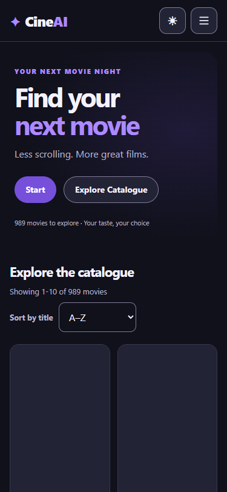
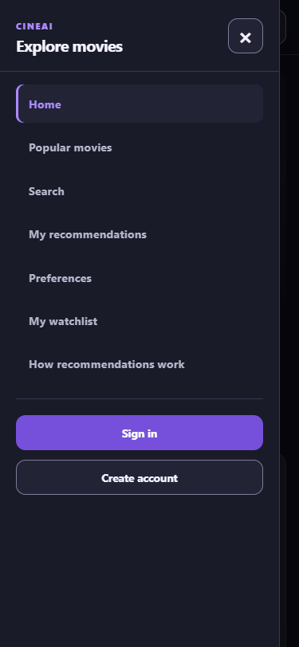

# Post-mobile public deployment verification — 11 November 2026

Read-only checks after merged PR #267 was deployed. These observations replace
acc4924 as the latest deployment observation, while preserving all earlier
evidence at its original date/version.

| Source | Actual result |
| --- | --- |
| [Render](render-observation.json) | Confirmed My Workspace/CineAI, Free/Singapore/main, after-CI auto-deploy. Deployment `dep-dbq9pjoqidvc73etjt4g` is Live at `80b15f705ca64752a346a636490b80be347487bd`, completed 16:53:03 UTC |
| [GitHub/release comparison](release-observation.json) | Same main commit has green CI [43062004407](https://github.com/SE-FDA-NEU/ai66a_group3_C1_SE/actions/runs/43062004407). **v1.0 still targets acc4924, so Live/tag do not match**. No retag is claimed |
| [Process/CI](process-check.json) | All five CI jobs pass; @hoang3003 approved PR #267's final head before merge. C02 is closed. Effective rules return PR/deletion/non-fast-forward rules but no required-status-check entry; admin verification/screenshot remains outstanding |
| [Public read-only probe](post-mobile-probe.json) | 14/14 pass: source-head health, real catalogue, themes, ordering/paging/detail-return, submit-only Search, real media/Similar and US/GB/SG provider/link consistency. Source commit is 80b15f7; the probe's deployedSha remains null because deployment identity comes from authenticated Render evidence instead |
| [Public mobile navigation](public-mobile-navigation.json) | 6/6 checks pass at emulated 375x812: header 69px, seven guest nav destinations, account links, focus/Escape, light theme, guest Preferences-to-login, no script errors or horizontal overflow |
| [Monitoring](monitoring.json) | Complete two-page window 16:53:04–16:58:04 UTC; 118 deduplicated completions, 71 health, 7 four-hundreds, 0 five-hundreds. Server error rate 0%; app p50 30.52ms, p95 698.30ms, max 1855.45ms |

Monitoring uses app request-completion logs, not build/startup messages. Count
5xx/completions for error rate; sort appMs and select nearest-rank quantiles at
ceil(n*p)-1. Health and verifier traffic are included. This short window does
not establish uptime, real-user latency or load capacity.

The public probe ran from source 80b15f7 using the existing read-only verifier:

```powershell
$env:S5_T07_PUBLIC_URL = 'https://cineai-o9tf.onrender.com'
$env:S5_T07_PROBE_LABEL = 'post-mobile'
$env:S5_T07_OUTPUT_DIR = '.venv/m5-audit/post-mobile'
node frontend/scripts/s5-t07-public-probe.mjs
```

These checks did not register users, save ratings, change preferences/reset,
modify provider data, trigger deployment or change release tags. Real authenticated
journeys/device/PO evidence for acc4924 remains historical; full new-candidate
acceptance is not invented. Mobile checks use Edge emulation, not a physical
phone. Opening the trailer dialog does not assert external YouTube playback.

## Current public screenshots

Both screenshots were captured from the real deployed website and imported
catalogue in a fresh guest browser context. They have no OS address bar and
are not a claim of physical-phone testing.

| Home | Navigation |
| --- | --- |
|  |  |

Before final M5 submission, accept the new candidate and reconcile v1.0 with
the exact Render Live SHA. Preserve the previous tag target and describe the
replacement openly in release notes. For a documentation-only merge retaining
the app, keep `[skip render]` in the actual merge/squash commit, leave CI enabled
and verify Live afterward. Update the PDF's latest-green-main CI link after
that merge; no PDF or export utility is committed.
