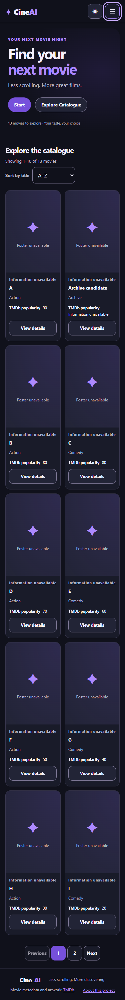
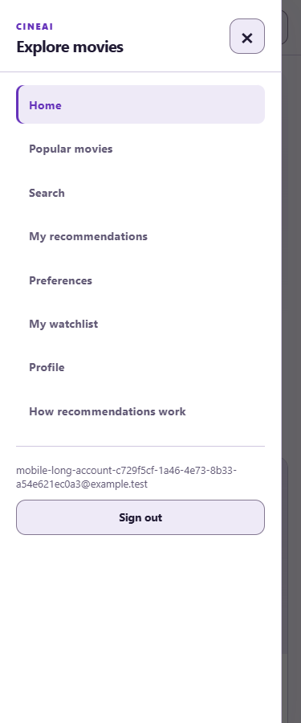
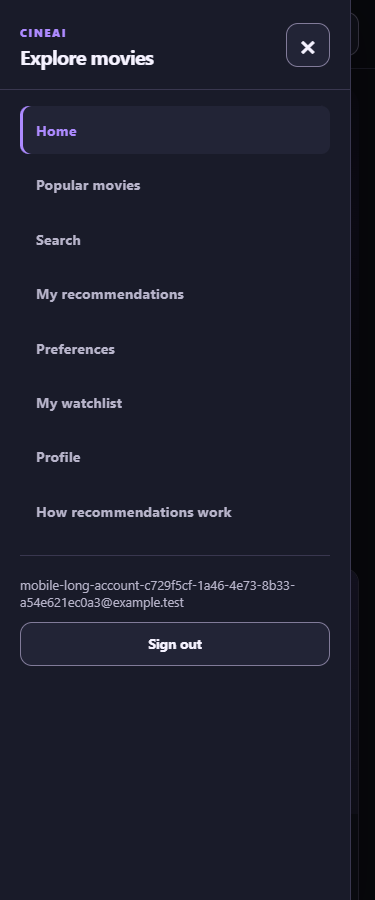
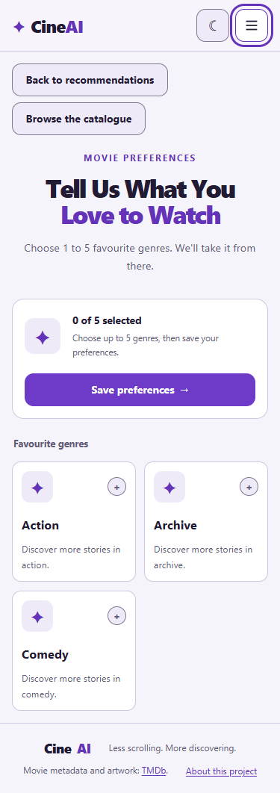

# README ownership and compact mobile navigation

This follow-up restores all five members' roles/general duties under each of
the five Sprints in the README, while retaining the M5 entry information and
chronological history. It also replaces the wrapped mobile header with a
three-line button opening a left navigation drawer at widths up to 1100 px.

The drawer contains the existing routes and account actions; the theme button
stays in the compact header. Close it with ×, Escape, backdrop or a destination.
Focus stays inside while open, page scrolling/background interactions are
blocked, and closing restores focus. Resizing to desktop releases the modal.
The session is still restored from the backend even when the drawer is closed.

Other narrow-layout changes: hide Home's decorative hero illustration, stack
Search input/submit, compact genre cards, stack detail facts, use readable form
text and enlarge carousel dot targets. Preference guidance now asks users to
clear a selection only when the five-genre limit has been reached.

## Verification

Run from the repository root after the normal SETUP dependencies are installed:

```powershell
node scripts/verify-s3-c01-docs.mjs
npm.cmd --prefix frontend run lint
npm.cmd --prefix frontend test -- src/tests/mobile-navigation.test.tsx src/tests/home-onboarding.test.tsx src/tests/movie-watch-providers.test.tsx --maxWorkers=1
npm.cmd --prefix frontend run build
$env:S04_BROWSER_CHANNEL = 'msedge'
npm.cmd --prefix frontend run test:mobile:ui
npm.cmd --prefix frontend run test:t01:ui -- --grep 'Home hero and navbar|existing public pages|Home title sort|native star keyboard'
```

On other platforms use `npm` and an installed Playwright Chromium/channel;
the `S04_BROWSER_CHANNEL` override is optional. Browser runs require unused
ports 8014/5174. The runner owns its temporary database/servers and removes them;
it does not reuse or stop unrelated development services.

Observed on 11 November 2026 (local Windows, headless Edge):

| Check | Result |
| --- | --- |
| README M5/history/roles/local-link verifier | PASS |
| Frontend lint and TypeScript/Vite build | PASS |
| Focused provider/navigation/onboarding Vitest | 54 passed |
| New mobile browser scenarios | 3 passed |
| Existing Home sort/return, public layouts, rating-save and onboarding browser regressions | 4 passed |

The new browser scenarios cover guest access, protected-page sign-in, real
isolated account APIs, a long synthetic email, focus wrapping/return, Escape,
backdrop, desktop resize, sign-out and scroll unlocking. All eight routes
(Home, Popular, Search, Preferences, Recommendations, Watchlist, Profile,
Details) were checked at 320/375/768/1440 px in light/dark themes, with no
horizontal overflow or browser script errors. Compact header height is at most
76 px; desktop retains the expanded navigation. The unit suite also verifies
same-route close and a failed sign-out remaining visible/recoverable.

These are **emulated viewport checks**, not a physical-phone acceptance claim.
Browser fixtures are synthetic and TMDb image requests are deliberately blocked
to exercise the existing missing-image UI; screenshots are not production data.
The release tag, production database and deployed application are unchanged.

## Screenshots from the browser run

| Compact Home | Light drawer |
| --- | --- |
|  |  |

| Dark drawer | Compact Preferences |
| --- | --- |
|  |  |
