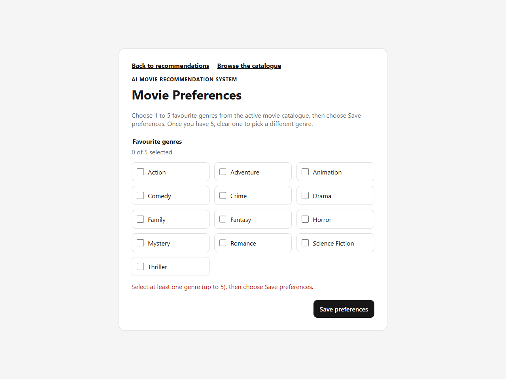
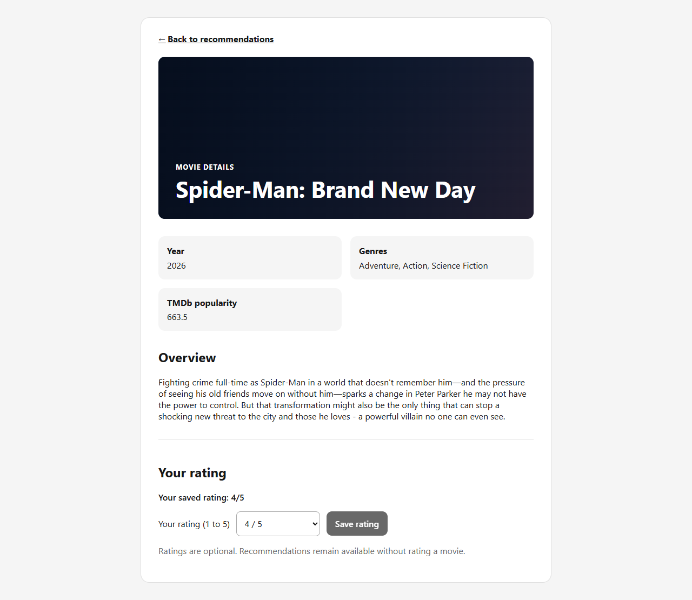

# C04 follow-up: reproducible account on the real TMDb database

Date: 2026-10-18, Sprint 3, Asia/Ho_Chi_Minh. Tester: Codex, not an independent
teammate or the instructor. Executable/application-test candidate:
`326aadf3ee32342c4e91297ee9e885663eccf565`, based on merged main `d6aff46`.
The subsequent commit only documents results and the Windows clone setting;
it does not change the verified application, account CLI, tests or dependencies.

## Authorization and implementation boundary

The PO supplied the account and explicitly confirmed in chat that it is
application-only demo access, does not reuse a Gmail/service password, and
may be published in `SETUP.md`. The TMDb token is a separate private credential:
it is not published, embedded in code, printed in logs or sent to the browser.

`app.cli.create_review_account --confirm-local-demo` reads the same
`DATABASE_URL` as the server. It requires an existing migrated SQLite file,
an active nonempty TMDb revision and TMDb movie sources. It does not create
another database or run the M2 seed. The public account is created only after
explicit opt-in; production environments are refused and app startup does not
provision it. Existing matching accounts are retained, including their IDs,
Argon2id hashes, personal data and sessions. A mismatched existing password
causes a refusal, never an implicit password reset.

## Existing configured database: no replacement catalogue

[Actual configured-DB result](s3-c04-review-account/configured-database.json),
observed at 15:17:38 UTC / 22:17:38 +07:00:

| Check | Actual result |
|---|---|
| Target | Existing configured `data/app.db`, not a separate demo runtime database |
| Catalogue | Provider `tmdb`, revision `34b442f2-f5a8-4317-9f2f-468e6ec06a20`, 255 movies / 255 distinct source IDs |
| Supplied account | Already exists with the documented credentials; two CLI invocations returned `already_exists` |
| Users | 1 before and after |
| Data preservation | Catalogue table hashes, preferences, ratings and sessions unchanged; all tables unchanged on repeated execution |
| Private safety backup | Consistent SQLite backup kept locally in an ignored folder; never committed or substituted for the runtime database |

No import, migration, seed or application restart was performed on this
existing database for the account check.

## New-clone reproduction with real TMDb, not synthetic movie fixtures

[Bootstrap result](s3-c04-review-account/clean-clone-bootstrap.json),
completed at 15:23:05 UTC / 22:23:05 +07:00.

A separate `git clone --no-hardlinks` of the committed candidate was used.
No `.env`, database, venv or `node_modules` was copied from the development
checkout. Python 3.12 created a new venv; locked backend installation, editable
backend installation, `pip check` and `npm ci` succeeded. Git's clone-local
`core.longpaths=true` setting was needed for historical Windows image paths;
the setup guide now includes it. The tested clone was clean.

| Check | Actual result |
|---|---|
| Migration | New `data/app.db`, head `c6f8a2d4e901`; no seed command |
| Account before accepted import | Safely refused; no automatic seed or substitute catalogue |
| Initial 13-page import | Timed out; no partial active catalogue accepted. This is a failed attempt, not a passing result. |
| Connectivity diagnostic | Normal DNS resolved TMDb public addresses; token-free HTTPS returned expected 401. No DNS/hosts/security setting was changed. |
| Documented default import on retry | Success: 20 TMDb movies, 13 associated genres, 20 finite popularity values, revision `475e63af-5e28-4819-ae0d-b442743353e2` |
| Import timestamps | Fetched `2026-10-18T15:22:59.950566Z`; imported `2026-10-18T15:23:04.306270Z` |
| Account provisioning | `created`, then `already_exists`, in that same imported `data/app.db` |
| Credential handling | Private token passed only to the importer child process; clone `.env` and subsequent runtime had a blank token |

The new clone's database is created by real migrations and TMDb import because
it has no previous local database. It is not a demo seed or the copied 255-film
database. The existing development environment retains all 255 imported movies.
Live provider contents/popularity and bounded import counts can differ over time.

## Real-browser P0, business-rule and restart verification

[Actual browser result](s3-c04-review-account/live-ui.json), completed at
15:26:59 UTC / 22:26:59 +07:00, Edge 155.0.4283.62:

1. Start only at Home and use the visible Sign in control. Wrong credentials
   show `Email or password is incorrect`; the documented account signs in.
2. New-account cold start shows Popular. Open Enter preferences, save zero
   choices and see the exact BR1 corrective message. Select/save three genres
   and get personalised cards through the real backend and imported database.
3. Open a visible movie card, save rating 4/5, return using the visible link,
   and sign out.
4. Stop both owned backend and frontend processes, start both again on the
   same imported database, and use a fresh browser context. Sign in via Home;
   the three genres and the same movie's saved rating 4/5 are restored.
5. Run account provisioning again while signed in. It reports `already_exists`;
   the session, preferences and rating remain valid. Runtime TMDb API requests: 0.

The verifier used ports 8019/5193 and a proxy target override only to avoid
stopping the user's existing 8000/5173 servers. No responses were mocked.
Owned verification processes were stopped afterwards. An initial local
verifier selector incorrectly assumed the link's accessible name was exactly
`View details`; the actual name is `View details for <title>`. Correcting the
verifier selector produced the complete passing replay without a product fix.

Real viewport captures (verification evidence, not address-bar PDF images):

## Automated checks and remaining limits

- Focused review-account suite: **15 passed**. Covers Argon2id, idempotence,
  mismatched existing passwords, preservation, invalid targets, missing/seed/
  empty/mixed-source catalogues, explicit opt-in, production refusal, offline
  provisioning, safe output and real API login. Test fixtures are explicitly
  synthetic and isolated; they are not presented as live-import evidence.
- Full isolated backend suite: **434 passed, 1 inherited skip**. The runner
  blanks the token, disables provider network and never uses the development DB.
- New-clone frontend: **236 passed / 20 files**; lint and production build pass.
- Backend Ruff, C01 documentation audit and C05 dossier structure/source
  verifier pass. All four required dossier sections remain in order.
- Production npm audit: **0 vulnerabilities**. The pre-existing transitive
  development-only `source-map-js` high-severity advisory remains; no dependency
  or lockfile was changed in this follow-up.

These results do not claim a fresh import on the instructor's own machine or
an unaided human acceptance session. The PO must privately arrange a valid
TMDb token/network on that machine before review. A substantive independent
teammate review, final-head hosted checks and merge are still required for
this follow-up. No secret, `.env`, database/dump, PDF tool or LMS receipt is
part of this change. Rotate a token disclosed in chat; public demo account
credentials must never be reused for real services or production access.
