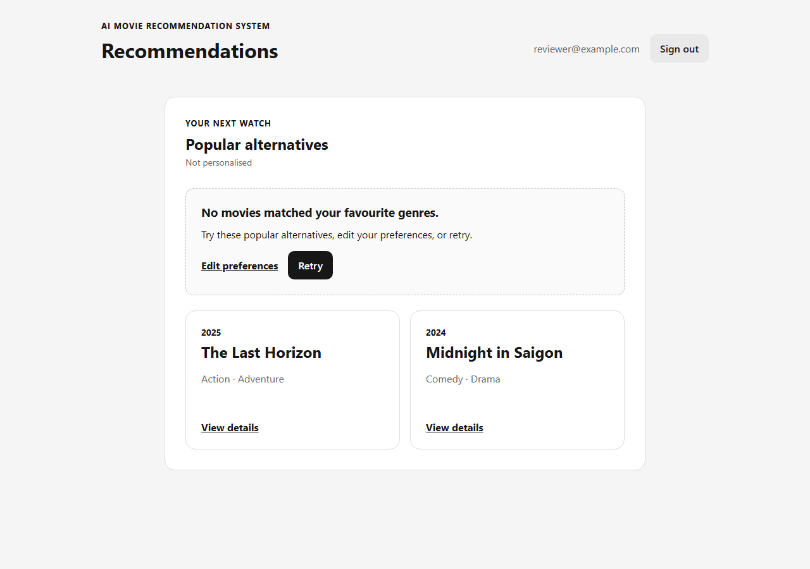
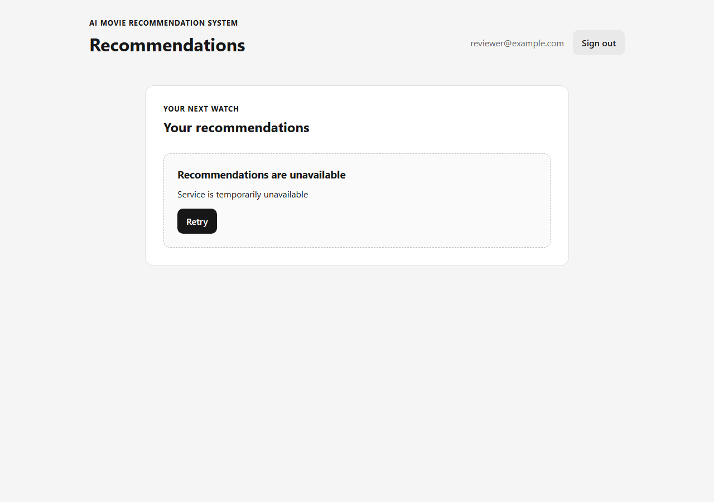

# S3-T11 no-match, retry, and request-race evidence

Issue: [#113](https://github.com/SE-FDA-NEU/ai66a_group3_C1_SE/issues/113)

Parent Story: [#18 / S02](https://github.com/SE-FDA-NEU/ai66a_group3_C1_SE/issues/18)

Branch: `113-no-match-retry-request-race`

Base: team `main` at
[`0a11da2737ef6445fb9bf9b54d82ef5dd9636034`](https://github.com/SE-FDA-NEU/ai66a_group3_C1_SE/commit/0a11da2737ef6445fb9bf9b54d82ef5dd9636034).
The required backend error/recovery contract is merged through
[T09 PR #161](https://github.com/SE-FDA-NEU/ai66a_group3_C1_SE/pull/161),
and the typed client/card container is merged through
[T10 PR #160](https://github.com/SE-FDA-NEU/ai66a_group3_C1_SE/pull/160).

Verification date: 2026-10-12. Environment: Windows, Node.js 24.15.0,
npm 11.12.1.

## Scope and implementation

`RecommendationsPage` continues to consume `data.movies` through the single
T10 `getRecommendations(10, signal)` path. T11 does not add a second popular
request or reconstruct recommendations in the browser.

The page now distinguishes these response states:

| Response/state | Browser result |
|---|---|
| `personalised=true`, `noMatch=false` | `Recommended for you`; server-ordered cards and matched-genre reasons |
| `mode=popular`, `noMatch=false` | `Popular` and `Not personalised`; this is cold start, not a failed personalisation request |
| `mode=popular`, `noMatch=true`, alternatives present | No-match guidance, `Edit preferences`, `Retry`, and the returned cards under `Popular alternatives` |
| `noMatch=true`, `movies=[]` | The same no-match guidance/actions with zero fake cards |
| Successful `movies=[]`, `noMatch=false` | The existing valid empty state; no error or no-match claim |
| API/network failure | `Recommendations are unavailable`, safe error text, and `Retry`; never empty/no-match success |
| Current request returns 401 | Existing `handleUnauthorized` transition to `/login` |

Retry clears the failed/no-match view to loading and sends the same protected
`GET /api/me/recommendations?limit=10` request for the currently authenticated
account. It never reads, clears, or writes preferences. A successful retry
replaces the error with the returned result.

Every request captures a monotonically increasing generation and the current
`user.id` effect key. Cleanup aborts the request on navigation, logout, account
change, or a newer attempt. The completion handler also checks its generation,
so correctness does not depend on `fetch` honoring abort before a response
wins the race. An obsolete success, error, or 401 is ignored.

## Focused automated coverage

Tests extend `frontend/src/tests/recommendations.test.tsx`; no parallel fake
recommendation container was introduced.

| #113 completion check | Automated evidence |
|---|---|
| 503/network failure is Error/Retry, not empty success | API 503 and rejected-network-promise cases assert the alert, retry action, zero empty-state claims, and zero preference requests |
| Retry after recovery replaces the error | First request returns 503, the retry returns a personalised list, and the alert disappears; both attempts use the exact same endpoint/query |
| `noMatch=true` shows guidance and alternatives | Separate cases cover two returned popular alternatives and zero alternatives; both retain edit/retry actions |
| Cold start is not failed personalisation | Existing popular case now explicitly rejects the no-match heading while retaining `Popular` / `Not personalised` |
| Old account responses cannot replace current data | Delayed A success after B renders is ignored; delayed A 401 cannot invoke B's unauthorized handler |
| Navigation/logout invalidates old requests | Delayed results after leaving the route or completing logout cannot render private cards |
| Current protected 401 uses the auth handler | Existing T10 test still verifies redirect to `/login`; T11 distinguishes it from an obsolete-account 401 |
| One fetch path | Retry assertions see exactly two identical recommendation URLs and no preference endpoint call |

## Reproduce automated verification

Follow the README setup, then run from the repository root in PowerShell:

```powershell
npm.cmd --prefix frontend test -- --run src/tests/recommendations.test.tsx
npm.cmd --prefix frontend test
npm.cmd --prefix frontend run lint
npm.cmd --prefix frontend run build
$env:PYTHONPATH = (Resolve-Path backend).Path
.\.venv\Scripts\python.exe -m pytest `
  backend/tests/test_personalised_recommendations_api.py -q
git diff --check
```

Recorded local results for the current implementation:

| Check | Result |
|---|---|
| Focused recommendation UI suite | **17 passed** in 1 file |
| Full frontend regression | **76 passed** across 8 files |
| Frontend ESLint | Passed |
| Frontend production build | Passed; 43 modules transformed |
| Recommendation API contract regression | **28 passed**, 1 pre-existing compatibility warning |
| Branch whitespace check | Passed with no errors |

No test uses a live TMDb token or provider response. Recommendation response
bodies are controlled fixtures, while T09 owns real SQL failure/recovery and
preference-preservation verification behind the API.

## Visual evidence

These screenshots render the real T11 page from this branch against controlled
frontend response fixtures. They demonstrate the visible states only and are
not presented as live TMDb or end-to-end backend evidence.

### No match with popular alternatives



### Recommendation service failure



## Reproducible reviewer journey

1. Sign into an account with saved genres and open `/recommendations`. Confirm
   a personalised response shows `Recommended for you`, cards, and matched
   genres. A cold-start account must instead show `Popular` / `Not
   personalised`, without no-match guidance.
2. Use a controlled API fixture returning `200`, `mode=popular`,
   `personalised=false`, `noMatch=true`, and one or more movies. Confirm the
   no-match message, `Edit preferences`, `Retry`, and all returned popular
   alternatives appear. Repeat with `movies=[]`; guidance/actions remain and
   no fake card appears.
3. Make the recommendation request return `503 SERVICE_UNAVAILABLE` or fail at
   the network boundary. Confirm Error/Retry is displayed rather than the empty
   state. Verify the account's saved selections still appear on `/preferences`.
4. Restore the same endpoint and select `Retry`. Confirm one new
   `/api/me/recommendations?limit=10` request replaces the error with its actual
   list; there must be no preference PUT or separate popular fallback request.
5. Run the focused race tests. They deliberately resolve A's ignored request
   after B, after navigation, and after logout. Confirm A's cards never replace
   the current view and an old A 401 does not sign B out.
6. Return a 401 for the current request and confirm the existing auth handler
   opens `/login` with no private cards left on screen.

## Story boundary and remaining criteria

T11 covers the no-match, failure/retry, and request-race slice only. It must
reference but not close Story #18.

| Story #18 criterion | Status after T11 |
|---|---|
| Up to 10 distinct matching movies, each sharing a selected genre | Backend T08 and deterministic tests own ranking/limit; integrated browser acceptance remains T12. |
| Cards show title, genres, and a matching reason | Implemented by T10 and regression-tested here, but final integrated Story acceptance remains T12. |
| No-match message, up to 10 popular alternatives, edit/retry actions | Implemented and focused-tested by T11; real browser/API acceptance remains T12. |
| Source failure shows error/retry and preserves preferences | Frontend never mutates preferences; T09 verifies persistence through backend failures. Integrated real-browser replay remains T12. |
| Successful retry displays results | Implemented and focused-tested by T11; final acceptance remains T12. |

Genre filtering, rating-informed ranking, and other Stories are outside T11.
Story closure also requires clean-clone execution, green CI, independent
review, merge to `main`, and applicable Definition of Done evidence.

## Publication gates

| Evidence field | Current state |
|---|---|
| Tested T11 commit SHA | Pending commit; do not substitute the base SHA. |
| Implementation/test PR | Pending publication. |
| Remote CI | Pending publication. |
| Independent review | Pending review by a teammate who did not author the change. |

Before closing #113, link the exact tested commit, PR, green CI run, and
independent approval. Rerun the commands above if implementation changes.
