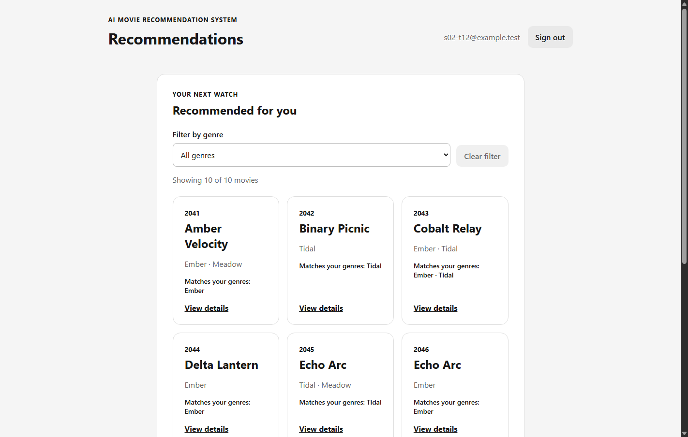
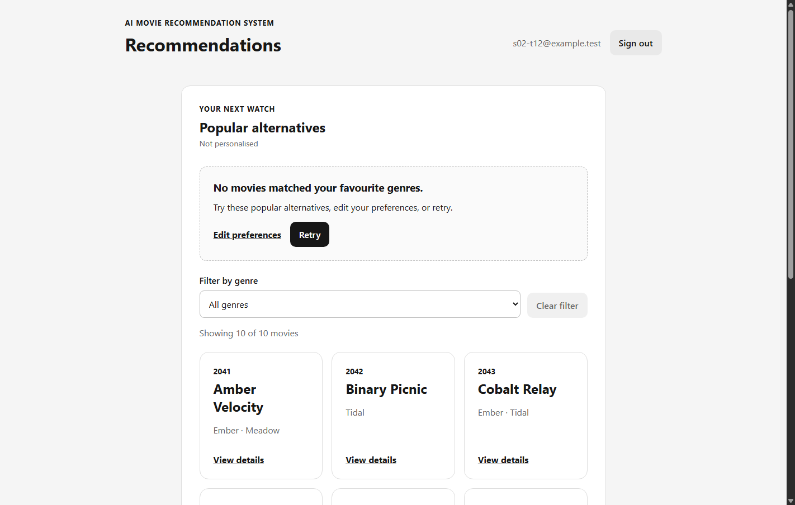
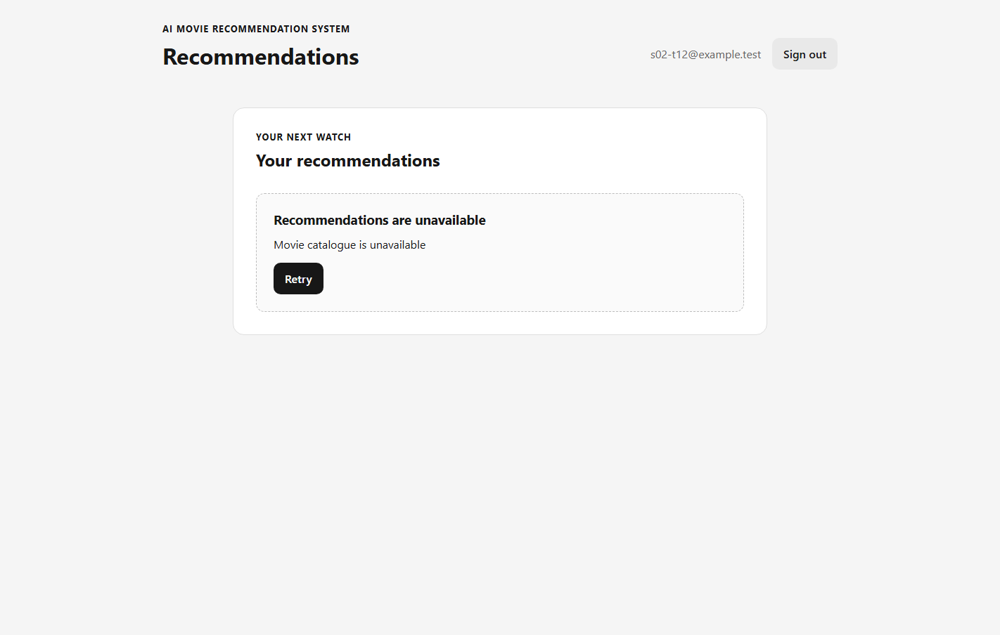
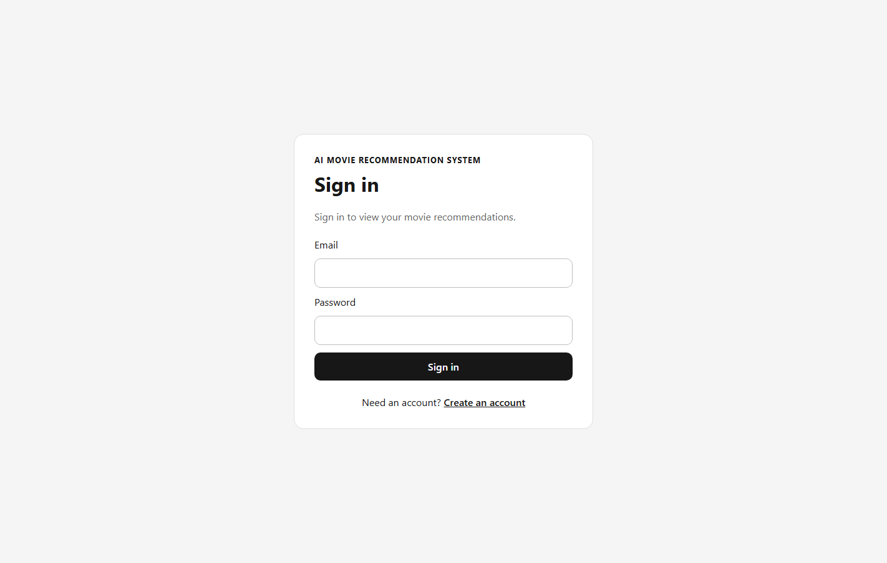

# S3-T12 integrated S02 recommendation acceptance

Run date: 2026-10-13 (Asia/Saigon)

- Task: [S3-T12 #114](https://github.com/SE-FDA-NEU/ai66a_group3_C1_SE/issues/114)
- Parent Story: [S02 #18](https://github.com/SE-FDA-NEU/ai66a_group3_C1_SE/issues/18) (reference only; this task does not close the Story)
- Reused dependencies: [T06 fixture PR #149](https://github.com/SE-FDA-NEU/ai66a_group3_C1_SE/pull/149), [T09 failure/recovery PR #161](https://github.com/SE-FDA-NEU/ai66a_group3_C1_SE/pull/161), [T10 card/client PR #160](https://github.com/SE-FDA-NEU/ai66a_group3_C1_SE/pull/160), and [T11 UI PR #164](https://github.com/SE-FDA-NEU/ai66a_group3_C1_SE/pull/164)
- Tested base commit: [`434156701373cc6763e6272ee9bfe5f52a24a552`](https://github.com/SE-FDA-NEU/ai66a_group3_C1_SE/commit/434156701373cc6763e6272ee9bfe5f52a24a552) plus uncommitted T12 verifier/evidence. This is **not** a final tested PR SHA.
- Independent review and hosted CI: pending until a T12 PR exists; do not claim them from local results.
- Scope: acceptance test/evidence only. No production backend or frontend code was changed.

## Controlled integration setup

The [T12 verifier](../../../backend/scripts/verify_s02_recommendations_ui.py)
applies real Alembic migrations to a fresh, temporary file-backed SQLite
database and loads the reviewed [T06 synthetic fixture](../../../backend/tests/fixtures/recommendations_s3_t06.json).
It starts the real FastAPI server and Vite UI, registers and signs in a
synthetic account through the API, saves preferences through the protected
API, and renders `/recommendations` in headless Chromium. Browser requests
use the Vite proxy and the real session cookie; there is no mocked `fetch`,
provider token, hardcoded success response, or development database mutation.

The fixture has 12 candidate input rows (11 unique IDs, one duplicate), so
the personalised and no-match alternatives cases both prove the ten-card
limit. The verifier compares real API IDs, order, mode, reasons, and metadata
against the T06 oracle, then checks the browser's card titles, genres,
detail links, and reasons against those same records.

## Five Story #18 acceptance criteria

| Criterion | Integrated assertion and result |
|---|---|
| Up to ten distinct movies, each sharing a saved genre | Saving Ember and Tidal through `PUT /api/me/preferences` yields ten unique IDs in oracle order. Each real API reason names a saved genre; Chromium renders the same ten cards. **PASS** |
| Cards show title, genres, and matching reason | Each rendered card's title, genre names, detail link, and `Matches your genres` text are checked against the seeded movie and API reason. **PASS** |
| No match gives message, up to ten popular alternatives, edit/retry actions | Saving Archive produces a real `200`, `noMatch=true` fallback of ten fixture alternatives; Chromium shows the no-match heading, ten cards without false match reasons, `Edit preferences`, and `Retry`. **PASS** |
| Source failure gives error/retry without changing preferences | Removing only the temporary active-catalogue pointer produces `503 CATALOGUE_UNAVAILABLE`. Chromium shows `Recommendations are unavailable` and `Retry`, with no cards or no-match claim. Committed preference rows before/after the failure are equal. **PASS** |
| Successful retry displays results | Restoring the same pointer and clicking the actual browser `Retry` button replaces the error with the ten personalised cards and matching reasons. **PASS** |

Additional boundary: after the no-match view loads, the verifier revokes the
session and clicks its `Retry` button. A current-request `401` sends Chromium
to `/login`; it does **not** show the source-failure error panel. This differs
from the `503` outcome above. **PASS**

## Actual local output

The complete machine-readable outcome is
[t12-browser-run-output.txt](t12-browser-run-output.txt). The
[backend request log](t12-backend-output.txt) records the real `200`, `503`,
and `401` API requests; the [frontend log](t12-frontend-output.txt) confirms
Vite startup.

```text
match=PASS; 10 distinct genre-matching cards with reasons
no_match=PASS; 10 popular alternatives and edit/retry controls
source_503=PASS; error/retry visible and preferences unchanged
retry=PASS; real API and UI recovered to personalised cards
current_401=PASS; login redirect, not source-error UI
result=PASS
```

Screenshots from the same browser run:










Focused local regressions:

| Command | Result |
|---|---|
| `python -m pytest backend/tests/test_recommendation_fixtures.py backend/tests/test_personalised_recommendations_api.py -q -p no:cacheprovider` | 34 passed, 1 existing Starlette warning |
| `npm --prefix frontend test -- src/tests/recommendations.test.tsx` | 1 file, 19 tests passed |
| `python -m ruff check backend --output-format=concise` | All checks passed |
| `python -m pytest backend/tests -q -p no:cacheprovider` | 370 passed, 1 skipped, 1 existing Starlette warning |
| `npm --prefix frontend test` | 10 files, 108 tests passed |
| `npm --prefix frontend run lint` | Passed |
| `npm --prefix frontend run build` | Passed; 45 modules transformed |

The zero-popular-alternative variant is already covered by T08/T11 backend
and UI tests; T12 reuses those suites rather than duplicating their unit
cases.

## Reproducible reviewer steps

1. Check out the T12 candidate commit. Confirm ports `8000` and `5173` are free; the verifier refuses to contact an existing service on either port.
2. Follow the repository README to install the locked Python 3.12 environment and `npm --prefix frontend ci`. Install Chrome, Chromium, or Edge. No TMDb token is needed.
3. From the repository root, run the focused backend and frontend commands in the table above.
4. Run `python backend/scripts/verify_s02_recommendations_ui.py --evidence-dir docs/evidence/s3-t12-recommendations-acceptance`. If browser auto-detection fails, append `--browser <absolute-path-to-browser>`.
5. Require `result=PASS`, inspect all five screenshots and the backend request log, and confirm that the script removed its temporary SQLite database and browser profile.
6. Run the full backend/frontend regression and lint/build commands in the table above, then request review from a teammate who did not write this change. Link the final tested commit, CI run, and approval in this evidence before closing #114.

## Remaining gates

- Unimplemented criteria among the five Story #18 criteria exercised here: **none identified by this integrated scenario**. This does not certify the full Story Definition of Done or other task ownership.
- Final tested T12 commit SHA, hosted CI, and independent review link: **pending**. The run above tested an uncommitted working tree on the stated base commit.
- Keep parent Story #18 open until its complete AC-to-task matrix and Story Definition of Done pass. Close only T12 when its own evidence and review gates pass.
