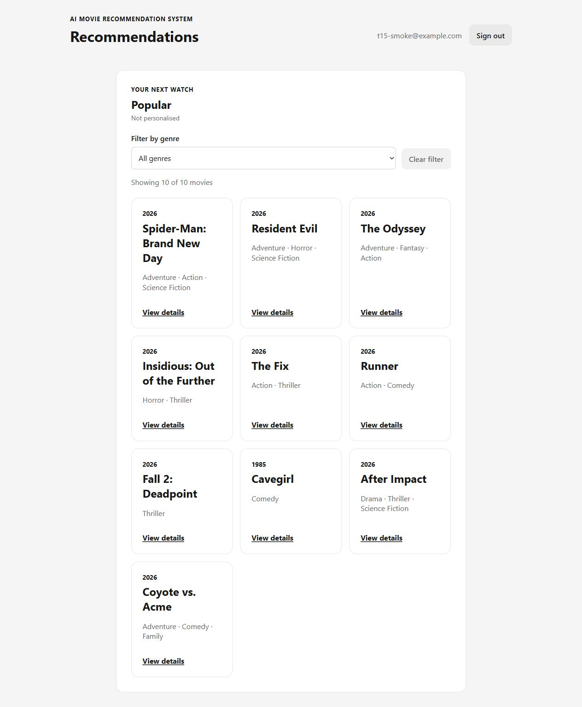
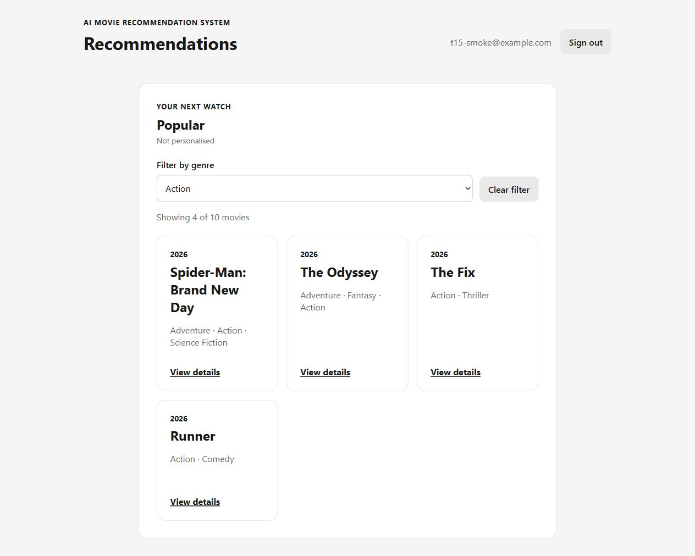
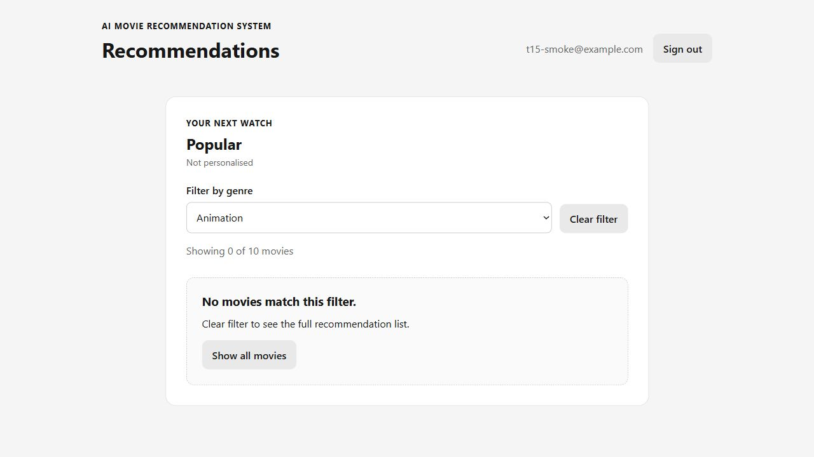
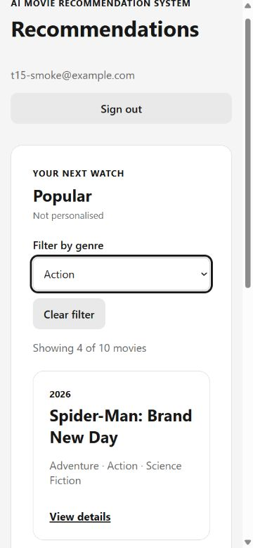
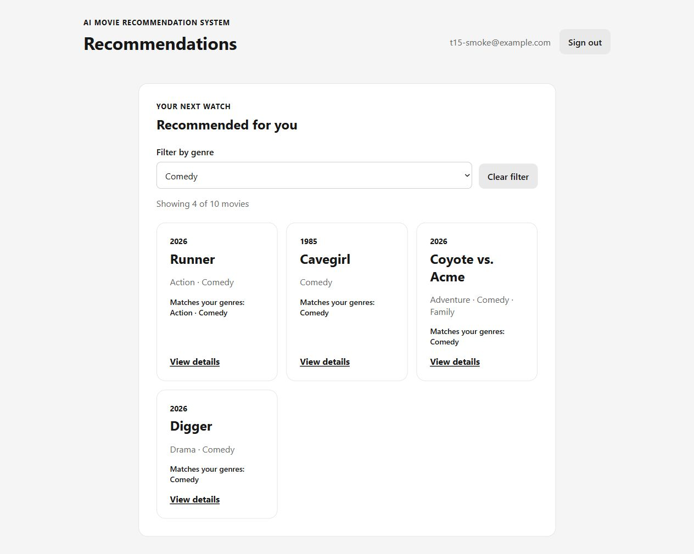

# S3-T15: Current recommendation snapshot genre filtering

## Scope and candidate

- Task: [#117](https://github.com/SE-FDA-NEU/ai66a_group3_C1_SE/issues/117).
- Parent Story: [S06 #23](https://github.com/SE-FDA-NEU/ai66a_group3_C1_SE/issues/23).
- Dependency: T10 [PR #160](https://github.com/SE-FDA-NEU/ai66a_group3_C1_SE/pull/160), merged as `5042dc0`.
- Base: `0a11da2737ef6445fb9bf9b54d82ef5dd9636034`, including merged T09/T10.
- Tested implementation and screenshot commit: `1549033d161da929308624c480995720707d43ee`.
- Verification date: 2026-10-12 (Asia/Saigon).
- Verification operator: Codex assisting @kietxuan; this is author verification,
  **not** independent teammate approval.
- No backend, migration, API schema, dependency, TMDb importer, or sprint-plan
  change is included. The evidence-only commit follows the tested candidate.

## Implementation decisions

`RecommendationsPage` retains ownership of recommendation requests and
loading/error/source-empty states. Its ready, non-empty response is handed to
`RecommendationFilter`. The child renders the existing `MovieGrid`/`MovieCard`.

The temporary filter uses canonical genre IDs from `GET /api/genres`. That
endpoint supplies genres used somewhere in the active catalogue, which can
include a genre absent from this up-to-ten recommendation snapshot. It is an
authenticated local SQLite read, not a browser TMDb call.

The unmodified response object is the snapshot identity. Selection is valid
only for that exact accepted response. A new response resets to `All genres`,
even when its catalogue revision or movie array is unchanged. An ordinary
rerender of the same response preserves selection. The original movies array
is never sorted, replaced by its filtered subset, or mutated.

`Clear filter`, `All genres`, and the empty-filter `Show all movies` button
restore the current snapshot only. Filtering and resetting make no preference
writes, recommendations requests, or browser-storage writes. Reasons, labels,
opaque movie links, and server ordering remain intact.

Genre loading/error/empty-options states retain valid cards. Retry reloads only
genres. Genre HTTP 401 invokes central auth recovery. Cleanup aborts pending
genre requests and ignores their late success/error responses. The existing
account-keyed route guard remounts temporary state on account switch.

## Automated acceptance mapping

The focused suite is `frontend/src/tests/recommendation-filter.test.tsx`.

| Obligation | Expected and observed |
|---|---|
| Exact controlled dataset | Two Action and three Comedy movies initially render five cards in server order. |
| Action filter | Exactly two cards, in original relative order. |
| Comedy filter | Exactly three cards. |
| Valid genre absent from snapshot | Zero cards; `No movies match this filter.` and a clear reset action. |
| Remove filter | All five original cards return without mutation. |
| New fetched list | New snapshot replaces the old list and resets selection; reset never restores old movies. |
| Same-snapshot rerender | Existing selection is retained without another genre read. |
| Identity semantics | Genre IDs, not names, determine membership; a multi-genre movie renders once. |
| T10 compatibility | Personalised reasons, popular labels, and per-movie links survive filtering. |
| No side effects | Filter/reset cause no extra fetch or Storage.setItem; page integration makes only session, recommendations and genre GETs. |
| Safe option loading | Loading/error/empty options do not hide valid cards; retry targets only genres. |
| Authentication | Genre 401 calls central auth recovery; account-keyed guard clears selection. |
| Stale option response | Old-snapshot successes and 401s are ignored after cleanup. |

Results on the tested source tree:

| Check | Result |
|---|---|
| Focused T15 suite | 20 passed |
| All frontend tests | 88 passed across 9 files |
| Frontend ESLint | PASS |
| TypeScript and production build | PASS |
| All backend tests, isolated migrated database | 300 passed, 1 pre-existing skipped test |
| Backend Ruff | PASS |
| Diff whitespace | PASS |

The unchanged backend emits an existing TestClient compatibility deprecation
warning. The skipped test is not claimed as implemented by this task.

## Clean-clone verification

A separate local Git clone of `1549033` was created without copying `.env`,
databases, node_modules, or a virtual environment. It uses Windows,
Python 3.12, and Node 24.

- `npm ci --no-audit --no-fund`: PASS; locked dependencies installed.
- Frontend tests: 88 passed; lint/build: PASS.
- Fresh Python venv, locked requirements, editable backend install: PASS.
- `pip check`: PASS (`No broken requirements found`).
- Fresh SQLite test-database migrations: PASS; head `b7e4c2d91f30`.
- Backend tests: 300 passed, 1 skipped; Ruff: PASS.

This verifies dependency setup and offline automated behaviour, not a new live
TMDb import. No vulnerability-audit claim is made by `npm ci --no-audit`.

## Real-browser smoke against existing TMDb data

The configured repository database was not modified. A read-only SQLite backup
of `data/app.db` supplied a separate temporary smoke database. Its active
provider was `tmdb` with 20 movie rows. No token was loaded into the smoke server,
no new provider request was made, and no database file is committed.

A synthetic test account was created only in that temporary database. The
browser ran the actual React UI at `http://127.0.0.1:5173` against the actual
FastAPI backend at port 8000; responses were not browser-mocked.

| Interaction | Observed result |
|---|---|
| Sign in with no preferences | Popular / Not personalised, 10 cards, All genres. |
| Select Action | Four of ten cards in existing order. |
| Select Animation | Zero of ten; distinct filtered-empty message and reset. |
| Show all movies | All ten original cards restored. |
| Native select ArrowDown at 375 x 812 | Action selected; four cards; controls fit viewport. DOM scroll width 360 <= viewport width 375. |
| Save Action/Comedy through the real preference picker | Fresh personalised snapshot with ten cards and All genres. This deliberate setup write is separate from filter operations. |
| Select Comedy on personalised list | Four of ten cards; matching reasons retained. |
| Clear filter | Ten personalised cards restored. |
| Compare synthetic account committed genres before/after these filter operations | `[28, 35]` before and `[28, 35]` after. |
| Server access log during personalised filter/reset | No new API requests. |
| Browser console inspection | No warning/error entries returned. |

Live titles and counts above describe the existing imported catalogue only;
the exact two-Action/three-Comedy obligation is proven with controlled tests,
not fabricated provider records. This smoke reuses existing TMDb import data;
it is not a new importer/provenance acceptance run or independent T16 review.

Screenshots captured from that browser session:







These are task UI evidence, not a replacement for the M3 PDF screenshot with
its required browser address bar.

## Reproduce automated checks

From the repository root after README dependency setup:

```powershell
npm.cmd --prefix frontend test -- src/tests/recommendation-filter.test.tsx
npm.cmd --prefix frontend test
npm.cmd --prefix frontend run lint
npm.cmd --prefix frontend run build
git diff --check
```

For backend regressions, use a separate PowerShell test terminal:

```powershell
$env:PYTHONUTF8 = "1"
$env:TMDB_READ_ACCESS_TOKEN = ""
$env:DATABASE_URL = "sqlite:///./data/t15-tests.db"
New-Item -ItemType Directory -Force data | Out-Null
.\.venv\Scripts\python.exe -m alembic -c backend/alembic.ini upgrade head
.\.venv\Scripts\python.exe -m pytest backend/tests -q
.\.venv\Scripts\python.exe -m ruff check backend
```

Close that test terminal afterwards. Do not start the development backend with
the test database override, overwrite `.env`, or seed the accepted TMDb database.

## Reproduce UI checks

1. Follow README and the existing TMDb runbook for a catalogue-ready environment.
2. Start backend and frontend normally; sign in to a test account.
3. Open `/recommendations`; record the original card IDs/order/count.
4. Choose a genre; verify only matching snapshot cards remain, in original order.
5. Choose an available genre absent from the snapshot if the data supports it;
   verify zero cards and the reset message. Controlled tests always cover this.
6. Clear the filter; verify the exact original IDs/order return.
7. In DevTools Network, verify filter/reset cause no recommendations refetch or
   preference PUT. A genre-options load/retry may call GET `/api/genres` only.
8. Save preferences through `/preferences`; verify a fresh snapshot uses
   All genres and displays the correct personalised/popular response labels.
9. Check keyboard selection/reset and a narrow mobile viewport.

## Remaining gates and handoff

- Independent review by @hoang3003: **Pending**; link its real review in the PR.
- GitHub CI: inspect the actual pushed head/PR; local PASS is not approval.
- T16 #118 owns independent S06 acceptance and committed preference comparisons.
- T11 #113 owns recommendation-source retry/no-match/race handling. The local
  `Retry filter options` button is not a recommendation retry implementation.
- T13 #115 owns full cold-start guidance and saved-preference transition work.
- Keep Story #23 open until every Story criterion and Definition of Done pass.
- AI assistance: Codex helped implement code/tests/docs and execute verification;
  the human author must review and understand the changes before declaring them.
