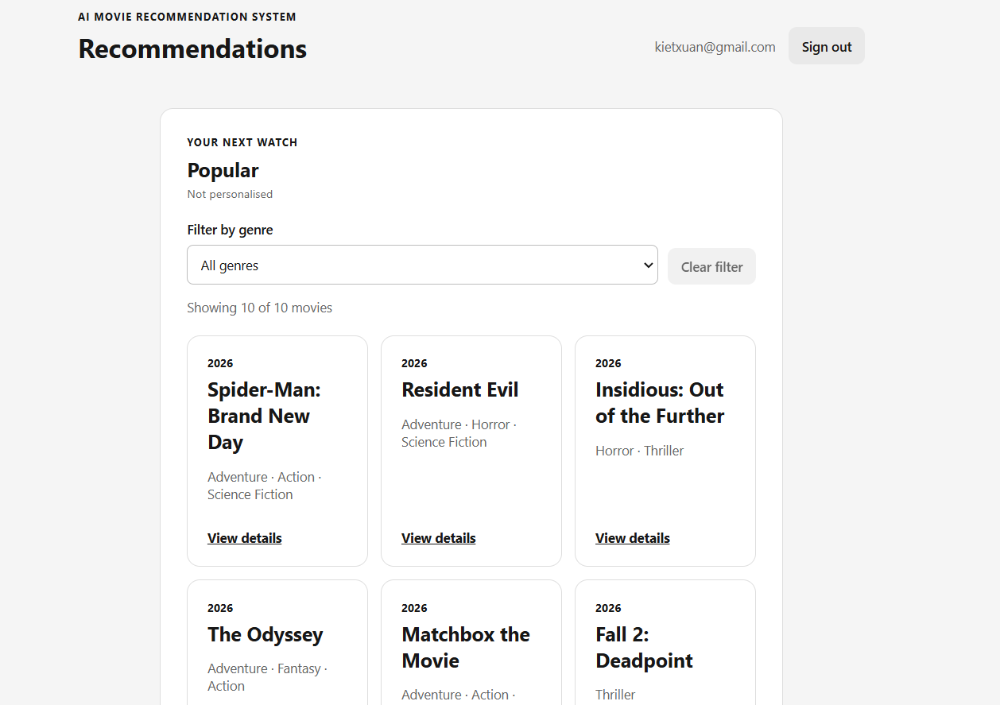
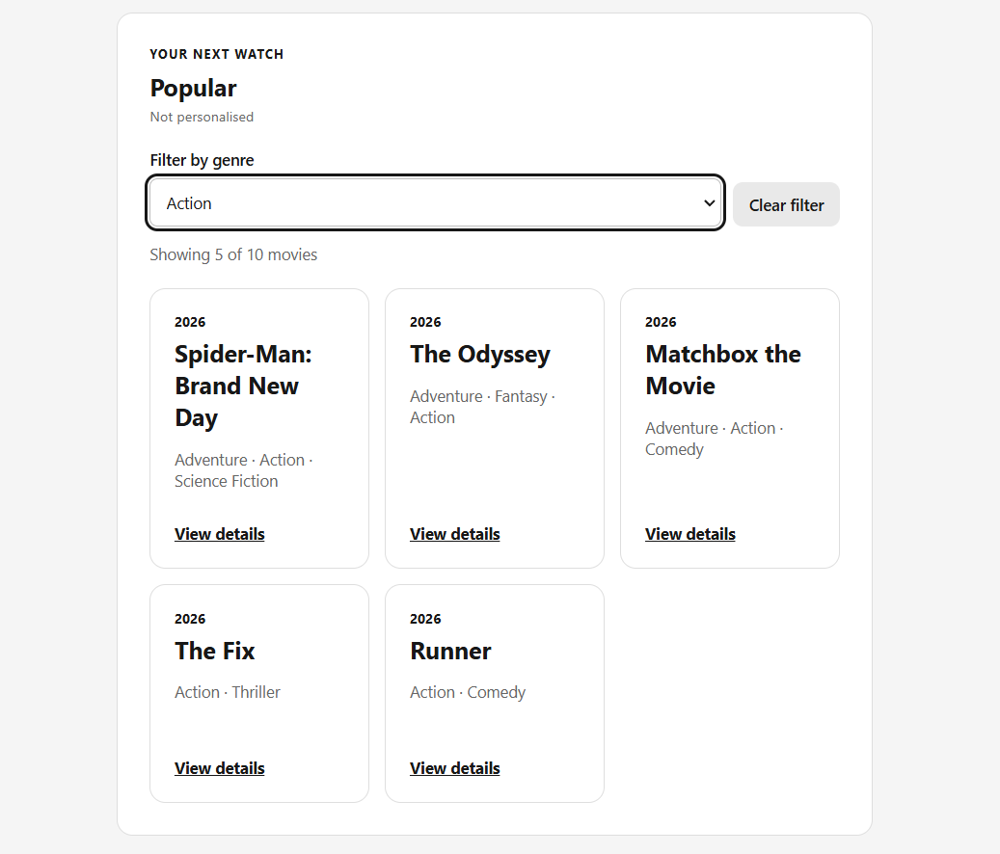
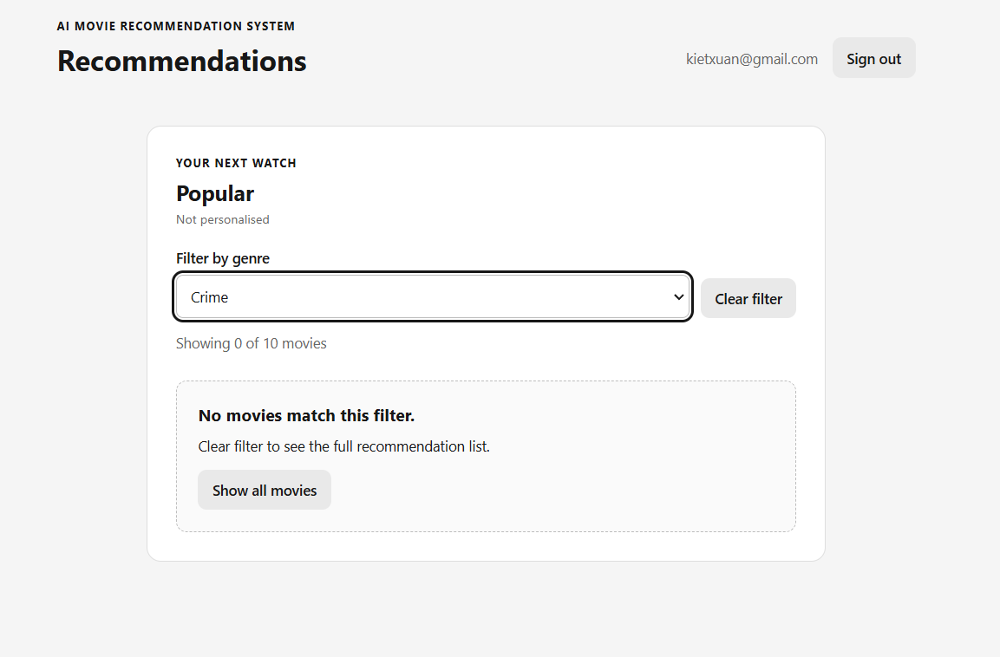

# S3-T16: filter reset and unchanged account preferences

Task: [#118](https://github.com/SE-FDA-NEU/ai66a_group3_C1_SE/issues/118)

Parent Story: [S06 / #23](https://github.com/SE-FDA-NEU/ai66a_group3_C1_SE/issues/23)

Dependency: [S3-T15 / #117](https://github.com/SE-FDA-NEU/ai66a_group3_C1_SE/issues/117), implemented by merged [PR #162](https://github.com/SE-FDA-NEU/ai66a_group3_C1_SE/pull/162)

Owner: @kietxuan

Verification date: 2026-10-13 (Asia/Ho_Chi_Minh)

Tested application baseline: `434156701373cc6763e6272ee9bfe5f52a24a552`

This change adds tests, test-only fixture/transport support, CI and evidence. It
does not change the production filter, API, ranking, authentication or schema.
The tested T16 commit is the commit containing these files; obtain its exact SHA
with `git rev-parse HEAD` on the PR branch and link it in the PR description.

## 1. Acceptance coverage

The deterministic fixture uses five recommended movies in this server order:

1. `Action Z` (Action, popularity 100)
2. `Comedy C` (Comedy, popularity 90)
3. `Action A` (Action, popularity 80)
4. `Comedy A` (Comedy, popularity 70)
5. `Comedy B` (Comedy, popularity 60)

A sixth catalogue movie, `Outside snapshot`, has genre Horror and is not in this
account's recommendation snapshot. Horror is therefore a real available genre
option with zero snapshot matches, rather than a fabricated select value.

| S06 criterion | Reproducible check | Observed result |
|---|---|---|
| Exactly 2 Action and 3 Comedy movies; select Action | Select Action on the five-movie snapshot | Exactly `Action Z`, `Action A`, in the original order; no Comedy cards |
| A selected genre has no matching movie | Select Horror without replacing the snapshot | Zero cards and `No movies match this filter.`; `Show all movies` is available |
| Removing the filter restores the original list without changing preferences | Exercise both `Clear filter` and `Show all movies` | All five original titles return in their original order; selection returns to All genres; committed preferences remain unchanged |

The journey is all five -> Action two -> clear all five -> Comedy three -> Horror
zero -> show all five. The same accepted response is used throughout each test:
filtering/resetting causes no additional recommendation fetch or preference
write. This verifies restoration, not a replacement response that happens to
contain similar titles.

## 2. What each test layer proves

### Existing T15 and neighbouring regression suites

The merged `recommendation-filter.test.tsx` suite is retained, not copied. It
covers component behaviour, new snapshots, filter-option failures, mixed genres
and related cases. Existing recommendation UI and detail-return tests also run
in the full frontend suite.

### Focused React acceptance: mocked API responses

`frontend/src/tests/recommendation-filter-acceptance.test.tsx` renders the real
App/components in jsdom. Two full acceptance journeys cover personalised results
and no-match popular alternatives. Responses are deliberately synthetic mocks;
these tests are not represented as live TMDb or database evidence.

Both journeys assert the exact title order and audit every fetch. Once the list
and genre options have loaded, neither changing nor clearing the filter adds any
request. The empty state explicitly reports `Showing 0 of 5 movies`.

### API and committed SQLite checks

`backend/tests/test_filter_preference_preservation.py` applies the real Alembic
migrations to a temporary database and creates two synthetic accounts through
the real registration/login/preferences APIs. Account A saves Action and Comedy;
account B saves Horror. The real recommendation API produces the exact five-movie
fixture. API reads leave both accounts' committed preference rows and the active
catalogue revision unchanged. SQLite foreign-key and integrity checks pass.

These API tests do not claim to execute frontend filter controls.

### Cross-runtime React -> real FastAPI -> real SQLite acceptance

`frontend/integration/t16-filter.acceptance.tsx` exercises the real App and filter
controls in jsdom. Only the fetch transport is substituted: a test-only Python
JSON-lines bridge forwards calls through the real FastAPI TestClient. Response
bodies come from the actual recommendation/genre/auth APIs and the migrated
temporary SQLite database, not mocked recommendation responses.

After each filter/reset action, a new read-only SQLite connection compares all
committed `user_genre_preferences` rows for both accounts against the baseline.
There are three rows before and after every step: A has two, B has one. The
initial requests are exactly:

```text
GET /api/auth/me
GET /api/me/recommendations?limit=10
GET /api/genres
```

No extra requests are made during filter/reset. Startup/request/shutdown timeouts
and child-process failure handling prevent a broken bridge from hanging the
suite. The bridge is test-only and does not add a production route.

This is cross-runtime component/API/database integration, not a browser-cookie,
real-HTTP or visual end-to-end test. The test account is already authenticated in
TestClient. Browser evidence is supplied separately below.

All automated checks use isolated synthetic fixtures with a blank TMDb token;
they require no TMDb network access and never seed or modify a developer's
existing database. No catalogue dump, account database, session cookie or token
is included in the commit.

## 3. Genuine screenshots supplied by the owner

The following PNG files are the original screenshots supplied by @kietxuan,
copied without editing. They show the running UI in **Popular / Not
personalised** mode, rather than the deterministic five-movie test fixture.

### Original displayed list

The filter is All genres, the UI reports `Showing 10 of 10 movies`, and Clear
filter is disabled. The screenshot shows the top of the list, not all ten cards.



### Action filter

The UI reports `Showing 5 of 10 movies`. The five displayed titles are
Spider-Man: Brand New Day, The Odyssey, Matchbox the Movie, The Fix and Runner.
Every card includes Action. A movie may also have another genre: filtering means
it contains the selected genre, not that it has only that genre.



### Genre with zero matches

Crime reports `Showing 0 of 10 movies` and displays `No movies match this
filter.` with Clear filter and Show all movies actions.



### Evidence limits

These three owner-provided screenshots do not include the browser address bar or
a post-reset screenshot. They do not, by themselves, establish a tested commit,
catalogue revision, the exact 2/3 fixture, preference persistence or successful
reset. Those acceptance assertions are supplied by the automated suites above.
They must not be reused as the address-bar-visible Milestone 3 submission
screenshot without capturing a suitable new image.

The local catalogue inspected while preparing verification contained 255 active
TMDb movies, 19 stored genres and 17 active filter options. Dynamic provider
counts are contextual only, not the exact S06 acceptance fixture or a claim that
the screenshots establish catalogue provenance. A read-only backup was used for
temporary smoke preparation; the original database was not imported into,
reseeded or written by this task. The interrupted browser-automation attempt is
not reported as a passed browser journey.

## 4. Commands and observed results

Run from the repository root after installing the locked dependencies using
[SETUP.md](../SETUP.md). Do not re-import TMDb merely to run these tests. On Windows
use the repository's Python 3.12 virtual environment:

```powershell
$env:PYTHONUTF8 = "1"
$env:TMDB_READ_ACCESS_TOKEN = ""

.\.venv\Scripts\python.exe -m pytest backend/tests/test_filter_preference_preservation.py -v
npm.cmd --prefix frontend test -- src/tests/recommendation-filter-acceptance.test.tsx src/tests/recommendation-filter.test.tsx
npm.cmd --prefix frontend run test:t16:integration
```

The integration command detects the repository `.venv` on Windows or Linux.
Alternatively set `T16_PYTHON` to an explicit Python executable with the backend
dependencies installed. CI installs Python 3.12 and Node 24, then runs the same
integration command without a live token.

For the full backend regression run, point `DATABASE_URL` at a new disposable
database first, as recommended in SETUP.md. Do not overwrite an existing `.env`.
The new T16 fixtures create and migrate their own temporary databases regardless
of this setting. Then run:

```powershell
.\.venv\Scripts\python.exe -m alembic -c backend/alembic.ini upgrade head
.\.venv\Scripts\python.exe -m pytest backend/tests -q --cov=backend/app --cov-report=term
.\.venv\Scripts\python.exe -m ruff check backend
npm.cmd --prefix frontend ci
npm.cmd --prefix frontend test
npm.cmd --prefix frontend run test:t16:integration
npm.cmd --prefix frontend run lint
npm.cmd --prefix frontend run build
git diff --check
```

| Check | Observed local result |
|---|---|
| Focused backend acceptance | 2 passed |
| New focused React acceptance | 2 passed |
| Existing T15 + new T16 focused React suites | 22 passed |
| Cross-runtime UI/API/committed SQLite | 1 passed |
| Full backend | 372 passed, 1 skipped; app coverage 91% |
| Full frontend | 11 files, 110 tests passed |
| Ruff / ESLint / TypeScript + Vite production build | Passed |
| Diff whitespace check | Passed |

The one skipped test is inherited from main:
`test_auth_catalogue_handoff.py` still marks a historical rating-write acceptance
placeholder as pending. T16 adds no skipped test. The full backend also emits the
existing Starlette/TestClient `httpx` deprecation warning. Neither is hidden or
represented as a T16 failure, and neither is changed by this testing task.

### Fresh-runtime clean-clone verification

A new local Git clone of the stated baseline received the exact T16 source files.
It had no copied `.env`, live database or existing virtual environment. A fresh
Python 3.12.6 venv installed `requirements.lock.txt` and the editable backend with
`--no-deps`; Node 24.19.0/npm 11.17.0 installed the frontend via `npm ci`. Alembic
upgraded an empty disposable database to `b7e4c2d91f30`.

The full backend (372 passed, 1 skipped), frontend (110 passed), cross-runtime
acceptance (1 passed), both linters and production build all passed in this clean
candidate checkout. Screenshot/Markdown additions do not alter the tested code.
Hosted Ubuntu CI is a separate check: use the run for the PR's exact commit,
not an older main run. Independent review remains required before merge.

## 5. Independent reviewer checklist

1. Confirm the PR targets main, links `Closes #118` and only references `#23`.
2. Run the focused suites and the cross-runtime command above.
3. Confirm the bridge creates an isolated migrated SQLite database, real API
   responses are used, and committed preference rows are compared after every
   React filter/reset action for both accounts.
4. Check both the ordinary CI and `T16 UI and database acceptance` for the exact
   PR commit, then leave a substantive independent review.
5. If desired, sign in on a TMDb-backed environment, record the current list,
   filter a present genre, filter an absent genre, then Show all movies. Check
   restoration of the exact titles/order and verify saved preferences separately.
   Runtime counts can differ from both these screenshots and the fixed fixture.

All three S06 acceptance criteria are covered by this task's deterministic tests;
no S06 criterion is reported as implemented only by these screenshots. Story #23
remains subject to the team's independent review and complete Definition of Done.
This task does not close the parent Story or claim an independent approval that
has not happened.
