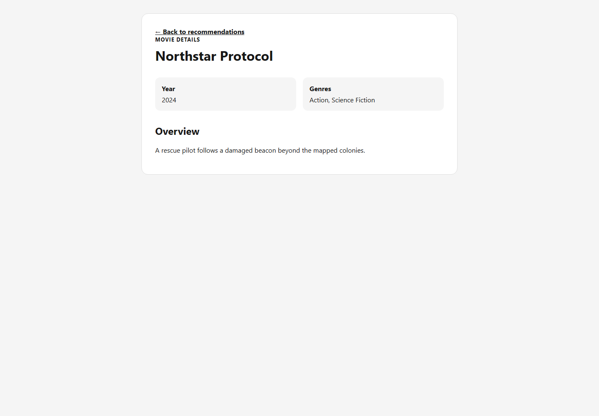
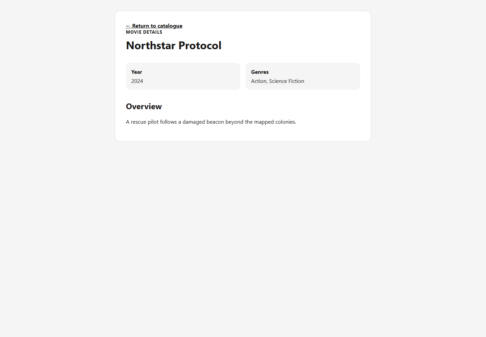

# S3-T17 detail return context and preference preservation evidence

Issue: [#119](https://github.com/SE-FDA-NEU/ai66a_group3_C1_SE/issues/119)

Parent Story: [#19 / S03](https://github.com/SE-FDA-NEU/ai66a_group3_C1_SE/issues/19)

Branch: `119-preserve-details-return-context`

Original published base: team `main` at
[`0a11da2737ef6445fb9bf9b54d82ef5dd9636034`](https://github.com/SE-FDA-NEU/ai66a_group3_C1_SE/commit/0a11da2737ef6445fb9bf9b54d82ef5dd9636034).
The post-publication integration candidate merges the tested T11 branch, which
contains team `main` through
[`3dcb51f`](https://github.com/SE-FDA-NEU/ai66a_group3_C1_SE/commit/3dcb51f)
and the merged T15 filter.

Dependencies are present in that base:

- S3-T05 preference save/restore: merged
  [PR #158](https://github.com/SE-FDA-NEU/ai66a_group3_C1_SE/pull/158),
  merge commit
  [`01db840841348ffbf2b840afc16bd883aeeff4e7`](https://github.com/SE-FDA-NEU/ai66a_group3_C1_SE/commit/01db840841348ffbf2b840afc16bd883aeeff4e7).
- S3-T10 recommendation cards/client: merged
  [PR #160](https://github.com/SE-FDA-NEU/ai66a_group3_C1_SE/pull/160),
  merge commit
  [`5042dc0c70b7ec88cf0a07ff64bd6044897d4490`](https://github.com/SE-FDA-NEU/ai66a_group3_C1_SE/commit/5042dc0c70b7ec88cf0a07ff64bd6044897d4490).
- S2-T15 catalogue/detail UI: merged
  [PR #86](https://github.com/SE-FDA-NEU/ai66a_group3_C1_SE/pull/86),
  merge commit
  [`c3a121b86feb12b52c8be018c57c6231496e0592`](https://github.com/SE-FDA-NEU/ai66a_group3_C1_SE/commit/c3a121b86feb12b52c8be018c57c6231496e0592).
- S3-T15 current-list recommendation filter: merged
  [PR #162](https://github.com/SE-FDA-NEU/ai66a_group3_C1_SE/pull/162),
  merge commit
  [`17ef831`](https://github.com/SE-FDA-NEU/ai66a_group3_C1_SE/commit/17ef831).

Verification date: 2026-10-13. Environment: Windows, Node.js 24.15.0,
npm 11.12.1.

## Scope and implementation

The existing shared `MovieCard` and `MovieGrid` carry a minimal React Router
state object when a viewer opens a detail. List pages derive `returnTo` from
their current pathname, query string, and fragment. On recommendations the
prop flows through `RecommendationsPage` -> `RecommendationFilter` ->
`MovieGrid` -> `MovieCard` -> `MovieDetailPage`, preserving the T15 filter
instead of replacing it with a direct grid. This applies both to ordinary
results and non-empty T11 popular alternatives. No recommendation data,
account ID, or genre preference is copied into that state.

`MovieDetailPage` resolves the state through the shared
`movieDetailReturn.ts` policy. Only the three implemented movie-list paths are
accepted:

| Source | Detail action |
|---|---|
| `/recommendations` | `Back to recommendations` |
| `/popular` | `Back to popular movies` |
| `/` | `Return to catalogue` |
| Direct detail URL or rejected state | `Return to catalogue` at `/` |

Allowed paths retain their query string and fragment. Absolute external URLs,
scheme-relative URLs, backslashes, malformed/non-string state, and internal
routes outside the allow-list are rejected. The validated destination is used
for successful, not-found, and unavailable detail states.

Returning to recommendations exercises the normal protected route and refetches
`GET /api/me/recommendations?limit=10` for the authenticated account. Neither
opening detail nor returning has a preference API write path. The focused UI
test keeps a stateful API fixture, permits a PUT to mutate it if one is sent,
completes the round trip, and proves the saved IDs are unchanged and no
`PUT /api/me/preferences` occurred. The focused backend regression performs
the recommendation/detail reads against an in-memory SQLite database and
compares the committed preference rows before and after.

## Focused automated coverage

`frontend/src/tests/movie-detail-return.test.tsx` covers:

- recommendation card to the correct `/movies/:movieId` route;
- no-match popular-alternative card through the T15 filter to the same return
  policy, including query and fragment context;
- route state containing only `/recommendations`;
- detail `Back to recommendations` and a fresh current-account recommendation
  read after returning;
- unchanged committed preference IDs and no preference PUT during the round
  trip;
- direct detail URL fallback to the public catalogue;
- rejection of absolute, scheme-relative, `javascript:`, backslash, and
  non-list internal return targets;
- preservation of query/fragment context for an allowed list route.

Related regression coverage exercises the catalogue, public popular list,
recommendation cards, and detail page together. Backend coverage in
`test_t17_recommendation_detail_round_trip_preserves_database_preferences`
asserts that both the preference API and fresh SQL row reads remain unchanged.

## Reproduce automated verification

From a clean clone after the README setup, run at repository root in
PowerShell:

```powershell
npm.cmd --prefix frontend test -- --run src/tests/movie-detail-return.test.tsx
npm.cmd --prefix frontend test -- --run `
  src/tests/movie-detail-return.test.tsx `
  src/tests/movies.test.tsx `
  src/tests/recommendations.test.tsx `
  src/tests/popular-movies.test.tsx
npm.cmd --prefix frontend test
npm.cmd --prefix frontend run lint
npm.cmd --prefix frontend run build
$env:PYTHONPATH = (Resolve-Path backend).Path
.\.venv\Scripts\python.exe -m pytest `
  backend/tests/test_personalised_recommendations_api.py -q
.\.venv\Scripts\python.exe -m pytest backend/tests -q
.\.venv\Scripts\python.exe -m ruff check backend
git diff --check
```

Recorded local results for this implementation:

| Check | Result |
|---|---|
| Focused T17 suite | **10 passed** in 1 file |
| Detail/list/recommendation regression | **41 passed** across 4 files |
| Full frontend regression | **108 passed** across 10 files |
| Frontend ESLint | Passed |
| Frontend production build | Passed; 45 modules transformed |
| Recommendation/detail DB persistence regression | **29 passed**, 1 pre-existing TestClient compatibility warning |
| Full backend regression | **370 passed, 1 skipped**, 1 pre-existing TestClient compatibility warning |
| Backend Ruff | Passed |

## Visual evidence

Both images use the real Vite UI and FastAPI movie-detail endpoint against the
controlled local catalogue fixture; neither image contains a live provider
token or private account data.

### Recommendation-origin detail



### Direct detail URL



## Reproducible reviewer journey

1. Start the backend and frontend using the README, sign into an account, save
   at least one genre, and open `/recommendations`.
2. Record the selected genres shown by `/preferences`, return to
   `/recommendations`, and select `View details` on any recommendation.
3. Confirm the browser opens the matching `/movies/:movieId` and the detail
   link reads `Back to recommendations`. Select it and confirm the protected
   recommendation list returns for the same signed-in account.
4. Reopen `/preferences` and confirm the same genres remain selected. In the
   browser Network panel, confirm the round trip sent no
   `PUT /api/me/preferences` request.
5. Open a detail URL directly in a new tab, for example `/movies/<valid-id>`.
   Confirm its return link is `Return to catalogue` with `href="/"`.
6. In an automated review, run the focused suite. Its external-state case
   supplies `https://evil.example/steal-session` and asserts that the rendered
   link is `/`; the parameterised cases cover the other rejected forms.

## Story boundary and remaining criteria

T17 closes only the recommendation/detail return-context slice of Story #19.
It must reference, not close, the parent Story.

| Story #19 criterion | Status after T17 |
|---|---|
| Valid ID opens the correct detail and renders title/year/genres/summary | Implemented by S2-T15 and regression-tested; T17 adds the originating-list context. |
| Unknown ID shows `Movie not found` and a list return link | Implemented by S2-T15; T17 applies the validated origin/fallback to this state. |
| Missing summary/year show `Information unavailable` | Implemented by S2-T15 and unchanged here. |
| Signed-in return preserves account preferences | Implemented and focused-tested by T17; independent browser review remains a closure gate. |

Rating UI, related/similar movies, backdrop work, and changes to preference
storage are outside T17.

## Publication gates

| Evidence field | Current state |
|---|---|
| Original published T17 SHA | [`371e2d45a6acba85d8413b7b026e04ddbb794d84`](https://github.com/SE-FDA-NEU/ai66a_group3_C1_SE/commit/371e2d45a6acba85d8413b7b026e04ddbb794d84) |
| Tested post-merge implementation SHA | `c3896c8431e6e2f896ecc970f67eb0b6f10e3256`; the following evidence-only commit does not change implementation |
| Implementation/test PR | Published as [PR #165](https://github.com/SE-FDA-NEU/ai66a_group3_C1_SE/pull/165). |
| Remote CI on published SHA | [Python tests and Node build/tests passed](https://github.com/SE-FDA-NEU/ai66a_group3_C1_SE/actions/runs/38291931173); the post-merge candidate requires a new run after push. |
| Independent review on published SHA | Approved by [hoang3003](https://github.com/SE-FDA-NEU/ai66a_group3_C1_SE/pull/165#pullrequestreview-5495083353), [vu-huzy](https://github.com/SE-FDA-NEU/ai66a_group3_C1_SE/pull/165#pullrequestreview-5498204235), and [anotify-vie](https://github.com/SE-FDA-NEU/ai66a_group3_C1_SE/pull/165#pullrequestreview-5498701692); the updated candidate still requires the normal post-push review/CI gates. |

Before closing #119, confirm the PR checks and approval apply to the current
post-merge candidate. Rerun all commands above if implementation changes.
