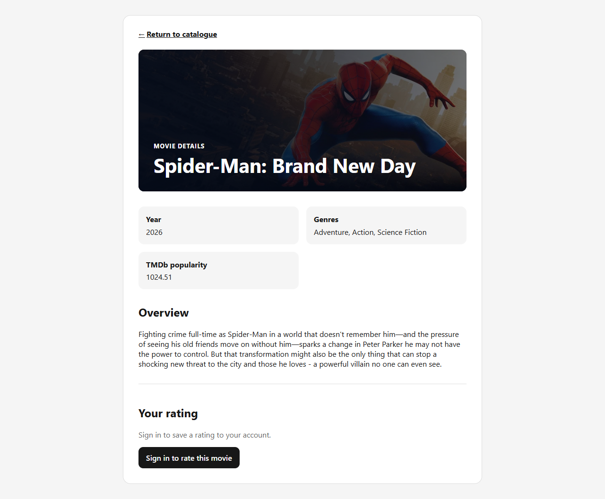
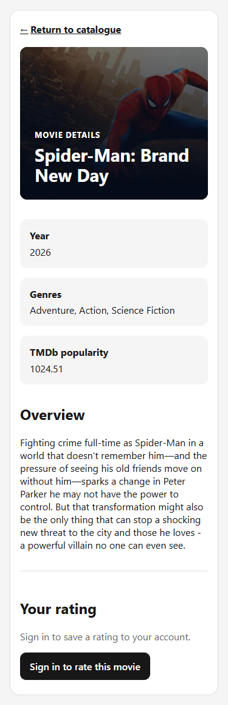

# S3-T28 independent backdrop acceptance

Task: [#131](https://github.com/SE-FDA-NEU/ai66a_group3_C1_SE/issues/131).
Parent reference: [S03 #19](https://github.com/SE-FDA-NEU/ai66a_group3_C1_SE/issues/19).
Tester: @kietxuan, using OpenAI Codex for test implementation and execution.
Date: 17 October 2026, Asia/Saigon. Human PR review is still required.

## Scope, admission and executable identity

The PO previously confirmed PO/SM agreement to open G3; see the recorded
[T26 admission](../s3-t26-backdrop-storage.md#admission-and-evidence-identity).
The implementation dependencies are merged: #129 / PR #180 (storage),
#130 / PR #181 (import/API), and #179 / PR #182 (UI). This verification starts
from `83d689da4e13b6e9fa5f58f55db1b1b59817b887`.

The committed JSON/screenshots describe the actual pre-amend candidate over
that implementation base, **not** an invented future commit or an independent
GitHub approval. Their `testedCommit` is the local HEAD at capture time and
`workingTree: modified` explicitly identifies the uncommitted verifier fix.
Both runs identify the executable source with normalized UTF-8/LF SHA-256:
`3034351f76bc3cc5b6e32b8243f66b0abaf1b800ee87830e5cd1047de5f75065`.
The runner records its manifest and computes that digest before making output.
Evidence/docs/images are excluded from the executable digest so recording the
result does not change the identity being tested. The delivery PR supplies the
single final commit SHA; the same executable is rerun after committing, with
fresh final-SHA reports in ignored `frontend/test-results/`, without amending
historical evidence or pretending a file can contain its own commit hash.

No production file under `backend/app/`, no frontend component, no applied
migration and no Story/point baseline changes. Test controls are in a dedicated
loopback harness and are never mounted by production startup. #135, #127 and
#136 consume this handoff; their closure is not a start dependency for #131.

## What is independently verified

| Case | Expected | Actual |
|---|---|---|
| Fresh DB and populated upgrade | One head; nullable TEXT; all existing IDs, rows and constraints survive | PASS: reuse 15 T26 foundation cases plus 3 independent T28 integration cases |
| Populated fixture | 2 accounts, 2 initial sessions, 3 preferences, 2 ratings, active/inactive movies | PASS: compare every non-media row in all 9 application tables |
| Valid/null media, explicit clear, missing/invalid provider fields | Valid values update; explicit null clears; absent/invalid media preserves previous values | PASS: real gateway with synthetic HTTP transport and actual SQLite transactions |
| Repeat enrichment | No duplicate or changed ID/revision; second identical update changes zero rows | PASS: service counts, all-row snapshots, API responses and rankings compared |
| Provider failure after first update | First successful write is rolled back on request 2 / HTTP 429 | PASS: different first path, full pre/post snapshot equality |
| Database failure after first update | Real SQLite trigger aborts write 2; write 1 is rolled back | PASS: actual IntegrityError; observed A/B write order; all rows preserved |
| Legacy M2 fixture | Seeded old movies still list/open after migrations without image fields/data | PASS: 12 stored movies, nullable media, real API list and details |
| API with/without media and unknown ID | Correct safe URL/null; unknown remains 404/MOVIE_NOT_FOUND | PASS: public API and recorded browser/API cases; no raw path/credential field |
| Ranking and personal data after media update | A90/B80/C80 order, selected genres, own ratings and revision unchanged | PASS: both accounts' DTOs, all-row snapshots and real UI before/after/reload/return |
| Deterministic actual browser/API/DB | Synthetic images only; correct own image, null/broken fallback | PASS: 18 cases; real Chromium/React/FastAPI, migrated file-backed DB |
| Desktop/mobile, bright/dark | Readable permanent gradient/overlay; no horizontal overflow | PASS: 1280px/375px measurements and inspected screenshots |
| Keyboard and return navigation | Tab focuses return link with visible 3px outline; safe list return survives | PASS: actual keyboard, links and recommendation navigation |
| Old detail/image response after navigation | A cannot replace B/C or poison its fallback | PASS: delayed real SQL/API response, held image request and old load/error events |
| Old account/movie rating | A's 5/5 cannot appear for B (2/5), or unrated movie Beta | PASS: real login/logout and delayed actual rating API responses |
| Manual live image | Imported movie's image really loads; not a synthetic picture | PASS: public CDN HTTP 200 at 1280px and 375px; natural width 780 |
| Network/secrets | No metadata/configuration requests, CDN credential/header/query or DB dump in delivery | PASS: restrictive browser routing, sanitized outputs and changed-file secret scan |

Existing exact-shape, invalid-path/URL and core-import failure tests remain in
`test_movies_api.py`, `test_tmdb_import.py` and `test_backdrop_storage.py`.
They are reused, not weakened or replaced with another set of component mocks.

## Reproduce

Use [SETUP.md](../../SETUP.md), Python 3.12, Node 24 and locked dependencies.
Run from the repository root. The synthetic verifier prepares everything itself:

```powershell
.\.venv\Scripts\python.exe -m pytest backend/tests/test_backdrop_acceptance.py backend/tests/test_backdrop_storage.py -q
npm.cmd --prefix frontend run test:t28:acceptance
```

Expected: **18 pytest cases pass**, then **18 synthetic browser/audit cases
pass**, `result: PASS` and `temporaryDatabaseRemoved: true` in
`frontend/test-results/t28-synthetic/results.json`. Ports 8000 and 5173 must be
free; the runner refuses occupied ports and never stops another app. It starts
and stops only its own servers, validates its temporary cleanup directory,
uses a blank token, and stubs/denies external networking. Failures exit nonzero.

Browser discovery supports installed Windows Chrome/Edge, or Playwright's
Chromium (install once with `npx playwright install chromium` in `frontend/`).
Optional overrides: `T28_PYTHON` and `T28_BROWSER`. No new dependency is added.
The CI workflow installs Chromium on Ubuntu and runs only the offline mode;
there is no live provider secret or live image requirement in CI.

Additional regression commands:

```powershell
npm.cmd --prefix frontend test
npm.cmd --prefix frontend run test:t16:integration
npm.cmd --prefix frontend run test:t33:integration
npm.cmd --prefix frontend run test:s04:e2e
.\.venv\Scripts\python.exe backend/scripts/verify_s13_rating_ui.py --evidence-dir frontend/test-results/t28-regression/t34
npm.cmd --prefix frontend run lint
npm.cmd --prefix frontend run build
.\.venv\Scripts\python.exe -m ruff check backend
git diff --check
```

For the full backend run, use a separate terminal and disposable migrated DB:

```powershell
$oldDatabase = $env:DATABASE_URL
$oldToken = $env:TMDB_READ_ACCESS_TOKEN
$testDatabase = Join-Path $env:TEMP ('t28-regression-' + [guid]::NewGuid().ToString('N') + '.db')
try {
    $env:PYTHONUTF8 = '1'
    $env:DATABASE_URL = 'sqlite:///' + $testDatabase.Replace('\', '/')
    $env:TMDB_READ_ACCESS_TOKEN = ''
    .\.venv\Scripts\python.exe -m alembic -c backend/alembic.ini upgrade head
    if ($LASTEXITCODE -ne 0) { throw 'Migration failed' }
    .\.venv\Scripts\python.exe -m pytest backend/tests -q
    if ($LASTEXITCODE -ne 0) { throw 'Backend tests failed' }
} finally {
    $env:DATABASE_URL = $oldDatabase
    $env:TMDB_READ_ACCESS_TOKEN = $oldToken
    if (Test-Path -LiteralPath $testDatabase) { Remove-Item -LiteralPath $testDatabase }
}
```

Observed: **417 backend passed, 1 inherited skip**, **236 frontend passed**;
T16/T33 each passed, lint/build/Ruff passed. S04/S13 baseline: **10 passed,
1 intentional live-mode skip**; T34 real browser rating regression passed.
The old rating placeholder skip and Starlette/httpx deprecation warning are
inherited; neither is silently counted as new coverage or a new failure.

The first hosted T28 run exposed a verifier-only navigation race: its generic
heading selector could match a catalogue card h2 before a null-media details
page was ready. The verifier now waits specifically for the detail hero h1
and a coherent hero snapshot, and records a named failed case on error. No
production workaround or blanket retry was added. The corrected matrix was
repeated successfully on installed Edge/Chromium 155 before updating this
single delivery commit; hosted checks still require verification on that SHA.

## Separate manual TMDb smoke

Use an already migrated/enriched accepted catalogue. Do **not** core-import,
reseed or enrich a valuable existing DB just to run this verifier:

```powershell
npm.cmd --prefix frontend run test:t28:acceptance -- --live-database data/app.db --evidence-dir frontend/test-results/t28-live
```

This command first opens the source read-only and backs it up through SQLite
into its own temporary directory. Public details/images are then exercised on
the **copy**, with no account writes or real token. The original SHA-256 is
checked before/after. The API uses local rows; only public image-CDN traffic is
allowed. No raw provider payload is copied into a fixture. If a usable imported
backdrop or network image is unavailable, the run is FAIL/blocked, never Pass.

Actual accepted catalogue:

| Property | Observed |
|---|---|
| Active revision/provider | `34b442f2-f5a8-4317-9f2f-468e6ec06a20` / `tmdb` |
| Active / stored movies | 255 / 267 |
| Valid backdrops | 254 (not a promise that every movie has an image) |
| Imported at (stored UTC) | `2026-10-12 12:00:46.899609` |
| Sample | Spider-Man: Brand New Day; source ID `969681`; internal ID `18ae3a02-bbb5-4dbd-b038-057441fb77a5` |
| Sample source fetched at (stored UTC) | `2026-10-12 12:00:42.372954` |
| Live absent image | Blaze of Love, `642ec215-228a-41f1-a947-3270d3f96dee`; correct gradient/null |
| Source DB SHA-256 before/after | `a0488d0bf5f8ef63ac58e174a3749d705c35cd5efcbab1229893259489931776` (unchanged) |
| Live CDN | HTTP 200 at both viewports; no credential headers/query or unexpected hosts |

The real source DB had zero accounts/preferences/ratings before testing; that
is not evidence of account preservation. The populated **synthetic** DB/API
and browser tests above supply the non-empty account/isolation evidence.

## Actual screenshots and machine-readable records

Real imported movie images, captured by the running browser against the copy:




- [Live null/fallback](live/live-null-375.png).
- [Manual provenance, CDN checks and measurements](live/results.json).
- [18 deterministic synthetic case results](synthetic/results.json).
- Synthetic screenshots (not live TMDb): [bright desktop](synthetic/synthetic-bright-desktop.png),
  [bright mobile](synthetic/synthetic-bright-mobile.png), [dark mobile](synthetic/synthetic-dark-mobile.png),
  [broken image](synthetic/synthetic-broken-mobile.png), [null media](synthetic/synthetic-null-mobile.png).

The evidence has expected/actual results, UTC timestamps, executable identity,
runtime versions and sanitized public response data. It contains no database,
`.env`, password/session dump, HAR, private token or raw upstream movie payload.

## Handoff / remaining process checks

Local implementation and verification pass. Hosted CI and a teammate's formal
Review changes approval are separate requirements, not claimed by these local
results. The reviewer should rerun the final PR commit and verify the digest,
then hand #131 results to #135 clean-clone/CI, #127 M3 acceptance and #136 package.
Close only #131 after review/merge; do not close or re-estimate Story #19 here.
Trailer remains Sprint 4; watch providers remain optional.

PR linkage: `Closes #131` and `Refs #19, #129, #130, #179`.
