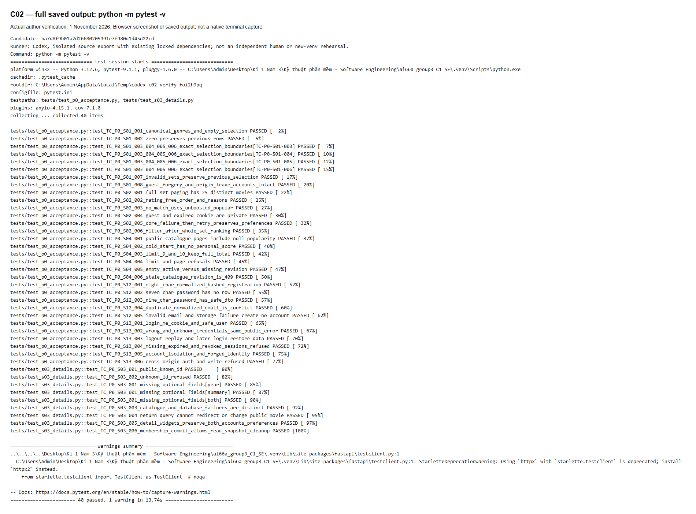

# C02 integration after merged C05 — 1 November 2026

Historical integration record for `ba7d8f9` / `186deb5`. The later
[C02 finalization](s4-c02-finalization-20261101.md) supersedes the Pending
Planning/commitment, event, PO acceptance, identity and member-test statements
below. Earlier counts/results remain tied to this original source snapshot.
PR #244 now proposes `Closes #196` after its remaining independent gates.

Refs [C02 #196](https://github.com/SE-FDA-NEU/ai66a_group3_C1_SE/issues/196),
PR [#244](https://github.com/SE-FDA-NEU/ai66a_group3_C1_SE/pull/244).
Tester: Codex assisting implementation, Windows, Python 3.12.6. This is author
verification with existing locked dependencies, not independent human review
or another clean-venv application rehearsal.

## Candidate and conflict resolution

- Merged main: **`0d2378d5f0c44889ca93c8cff7c8bc9c568b43c5`**, containing
  C05 PR #243. It merged at **11:26 +07:00 on 1 November**.
- Tested integration: **`ba7d8f9b01a2d26680205991e7f980d1d45d22cd`**.
  Relative to merged main, production backend/frontend, workflows, root
  bootstrap and discovery are unchanged. The only executable test addition is
  six lines for S02 recommendation limits 9/10/11 in an existing case.
- Resolved conflicts in `docs/testing.md` and the C03 acceptance matrix by
  retaining the compact four-section report and both historical fingerprints.
  C05's real commit-failure, cookie-security and refused-write assertions are
  preserved; no test/ID is deleted, skipped or renamed.
- The morning [receipt](s4-wrap-up-20261101.json) and
  [5.70-second log](s4-t05-compact-20261101.log) remain unchanged historical
  evidence for `b1e8c1e` plus their pinned test patch. They are not relabelled
  as this later integration run.

## Actual compact verification

From a disposable export of the committed integration, using the root config:

```text
python -m pytest -v
```

**40 passed, 0 failed/skipped/xfail, 13.74 seconds**, with one inherited
Starlette/httpx deprecation warning. All **37 Section 2 IDs** map to the
40 passing items. The fixtures migrate temporary SQLite, override inherited
configuration and block provider HTTP; no running server or real database
was used. The owned source export was removed afterward.

[Full output](s4-c02-integration-pytest-20261101.log) ·
[Current receipt and ID/node/source hashes](s4-c02-integration-20261101.json).
The screenshot displays the complete saved real command output in a browser;
it does not fabricate a native terminal session.



Traceability, final document fingerprints/LF/CRLF and focused Ruff passed.
The final local check found **205 links/anchors, 0 missing**. Full backend,
frontend/browser and script regressions are optional and were not rerun.
The existing [C05 clean-clone/setup/recovery evidence](s4-c05/compact-m4.md)
remains applicable to its unchanged production code; no new live import,
build, storage rehearsal or deployment is claimed by C02.

## Correct M4 contribution thresholds

| Scope | Minimum | Current observable record |
|---|---|---|
| Team in Sprint 4 | Four merged PRs each reviewed by someone else; five Closed issues | 24 delivery PRs #220–#243 with formal non-PR-author approvals; 21 Closed work items |
| Each member | One merged PR, one review given, one Closed issue and one actually authored pytest in `tests/` | PR/review/issue records exist; pytest authorship gaps remain as recorded in the Sprint log |

Four PRs and five Closed issues are **team minima**, not individual quotas.
Repository-wide counts from earlier sprints do not replace Sprint 4 totals.
Formal approvals do not prove substantive independent reproduction. In
particular, C05's approval by a contributor does not establish its independent
rehearsal/acceptance. GitHub currently resolves `TuanAnh0608` and
`NguyenTuanAnh0608` to different account IDs; person equivalence still needs
confirmation, rather than fabricated attribution or an extra test PR quota.

## Current handoff and incomplete human records

C05 **PR #243 is merged**, and compact defaults/CI and `storage_snapshot` are
implemented. **Issue #219 remains Open** because its PR used `Refs`; merge
does not itself close independent acceptance. The 25-item plan still has
21 Closed work items and four Open Chores (#216/#196/#218/#219).

Actual committed Story Points, Review/Retro attendance and decisions,
whole-Story acceptance for #22/#24/#30/#33, remaining member-test evidence and
SM5 acknowledgement remain Pending unless supplied. Newly accepted points
are currently 0; the four Stories total at most 18, without recounting S3.
The previously reported PO G4 Go remains recorded in T19/T20 history; missing
dated repository/capacity evidence is separate, not a request to approve Go
again. C04's PDF/submission/receipt is not a dependency of C02 closure.

At this historical integration cutoff the delivery used `Refs #196`.
The later finalization records the PO's actual decisions and current closing
intent; no old receipt or test result is relabelled as that later execution.
