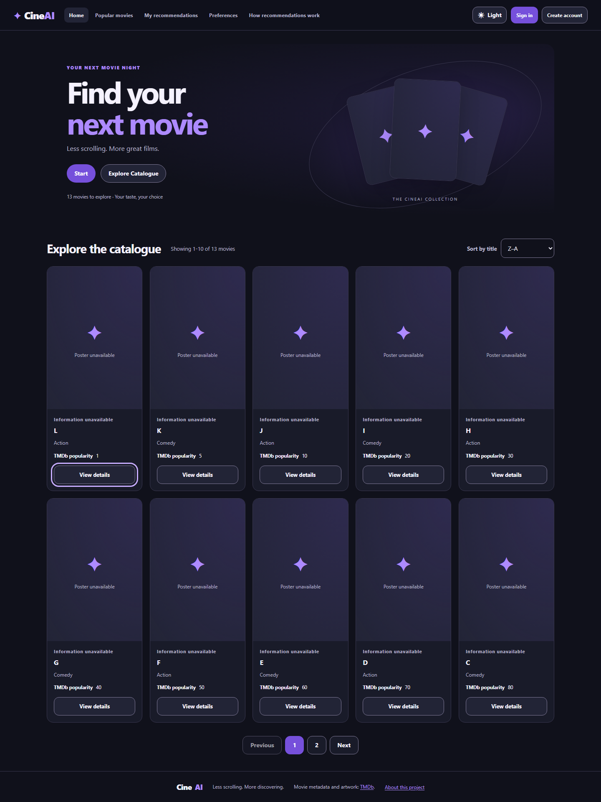
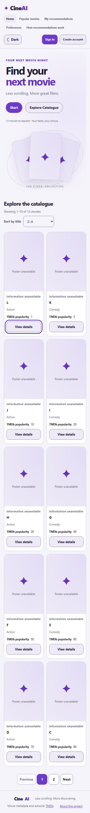
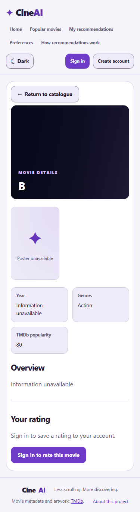
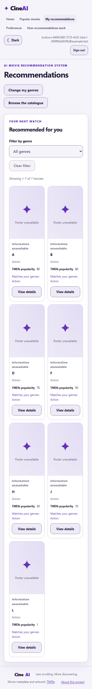
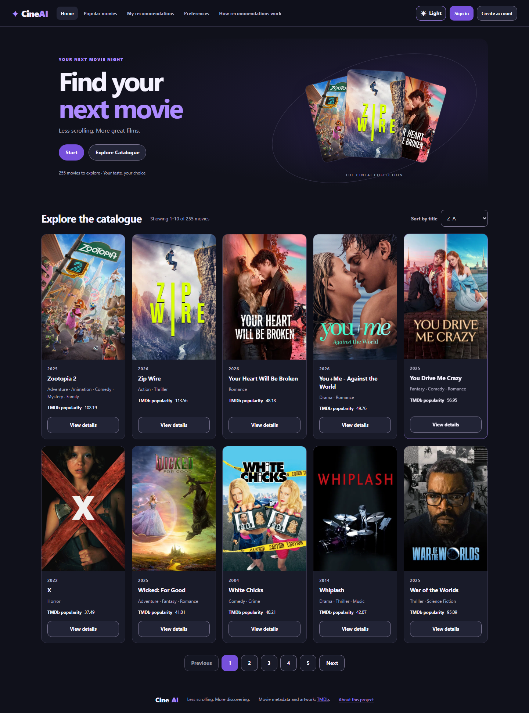
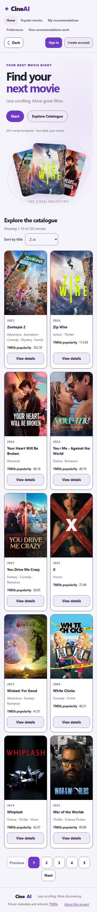

# T01 action buttons and Home title sort

PO-authorized follow-up for [#195](https://github.com/SE-FDA-NEU/ai66a_group3_C1_SE/issues/195)
in [PR #224](https://github.com/SE-FDA-NEU/ai66a_group3_C1_SE/pull/224).
Local execution: 2026-10-24, Asia/Ho_Chi_Minh. Capture base: `8c2210d`;
the changes and evidence belong to its single follow-up commit, not that base.

## Behaviour and boundaries

- Movie-card View details, catalogue/recommendation returns, Change my genres,
  preference guidance/navigation and auth cross-links use shared secondary
  button styles. They remain native links with existing labels, routes and
  safe return state; footer attributions remain ordinary links.
- Home defaults to A–Z. Sort by title offers Z–A through the optional allowlisted
  `sort=title_desc` on `GET /api/movies`. SQLite orders the entire active
  catalogue before LIMIT/OFFSET, including movies without popularity.
  Case-folded title and original title follow the selected direction; exact
  title ties use internal ID ascending. Invalid sorts return 400.
- Changing sort resets page 1. Sort survives paging, reload, retry, catalogue
  revision recovery and details return. Pagination now also retains the hash.
  Old-sort successes/errors/409s cannot overwrite a later selected sort.
- Popular/recommendation ranking, preference writes, ratings, auth, TMDb
  importer and the database schema are unchanged. No new dependency or migration.
  Default Home clients still request `/api/movies?limit=10`.

## Executed local checks

| Check | Actual result |
|---|---|
| New backend sort regression before implementation | RED: 11 failed, 2 passed, 529 deselected; descending order and invalid-sort validation failed for the intended reasons |
| New backend sort regression after implementation, including repository validation | 14 passed, 528 deselected |
| Full isolated backend suite | 541 passed, 1 skipped; disposable SQLite migrated through `d8a4e6f20195`; existing TestClient/httpx deprecation warning |
| Full frontend suite | 308 passed in 29 files |
| ESLint, Ruff, TypeScript/Vite build | Passed |
| T16 filter integration and T33 rating integration | 1 passed each |
| T01 browser suite | 11 passed, 1 skipped (separate imported-DB mode); disposable real backend/database |
| T01 imported-TMDb read-only smoke | 1 passed, 11 fixture cases skipped in this separate mode |
| S04/S13 browser acceptance | 10 passed, 1 separate live-environment smoke skipped |
| C03 contract verifier and LF/CRLF regression | Passed; 195 local link targets, 0 missing |

The new backend boundary cases cover 0/1/10/11/25/255 movies, all descending
pages concatenated without duplicate IDs, exact/case-only title ties, missing
popularity, unchanged Popular and revision conflicts. Frontend tests cover
page reset, full server order, reload/detail return, malformed URL normalization,
stale success/error/409 rejection and retry/revision recovery.

Browser checks use real navigation, native select, keyboard Tab/Enter and
computed button styles in dark/light at 375/1440px. Each action link has no
underline, a visible border, rounded corners and height at least 44px. The
authenticated navigation test confirms restored genres and zero additional
preference writes. Existing tests retain their 375/768/1440 layout, theme,
onboarding, feedback and explicit-save checks. Fixture image requests are
deliberately aborted to test honest unavailable artwork; these captures are
not live TMDb acceptance.

## Screenshots from the fixture browser run









## Imported catalogue smoke

The separate browser mode used the existing QA copy of the imported TMDb
catalogue, opened with SQLite `mode=ro&uri=true`; it did not import or write to
the developer's actual database. There were **255 active movies across 26
pages**, revision `34b442f2-f5a8-4317-9f2f-468e6ec06a20`.
Both directions were fetched page by page with the same revision; the full
descending title sequence equalled the reversed full ascending sequence,
and each response retained total 255. Chromium selected Z–A, rendered the
expected first ten, opened details and restored the selected sort on return.
The run also verified real CDN posters, both themes and mobile width.

The read-only QA database SHA-256 was identical before and after:
`43315326c6a7917401052cf5831db9bf17a5870051c06a7660aa81b0f5022b22`.
No database, credentials, cookie, HAR or trace is committed. Preview servers
were stopped after the run.





## Reproduction

From the repository root, after the existing SETUP prerequisites:

```powershell
.\.venv\Scripts\python.exe backend/scripts/run_isolated_tests.py -q
.\.venv\Scripts\python.exe -m ruff check backend
npm.cmd --prefix frontend test
npm.cmd --prefix frontend run lint
npm.cmd --prefix frontend run build
npm.cmd --prefix frontend run test:t16:integration
npm.cmd --prefix frontend run test:t33:integration
npm.cmd --prefix frontend run test:t01:ui
```

For a manual check, open Home, select Z–A, open page 2 and a movie, then use
Return to catalogue: the selected sort and page remain. Choose A–Z: page 1 is
restored. Repeat in both themes/mobile. Popular has no new sort control.

These author-side results do not claim a clean-clone run on another person's
machine, reviewer approval, a merge or a fresh LMS submission.
