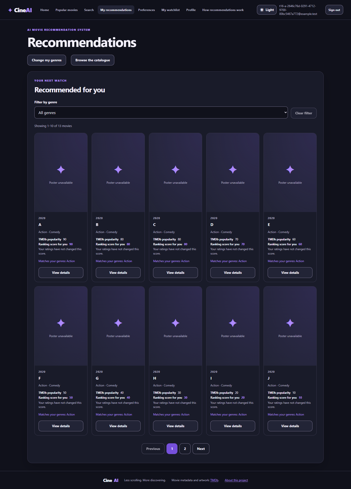
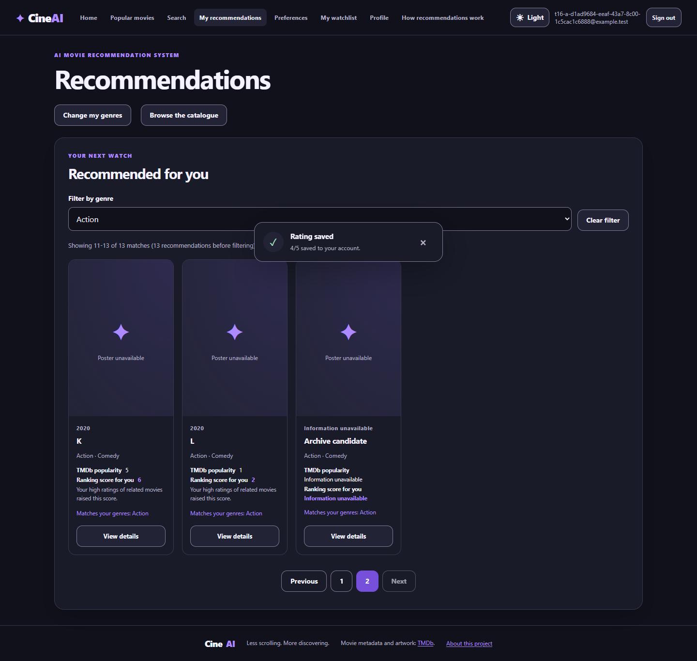
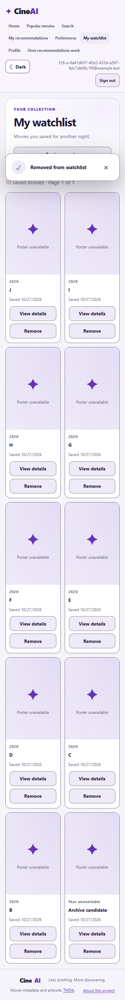
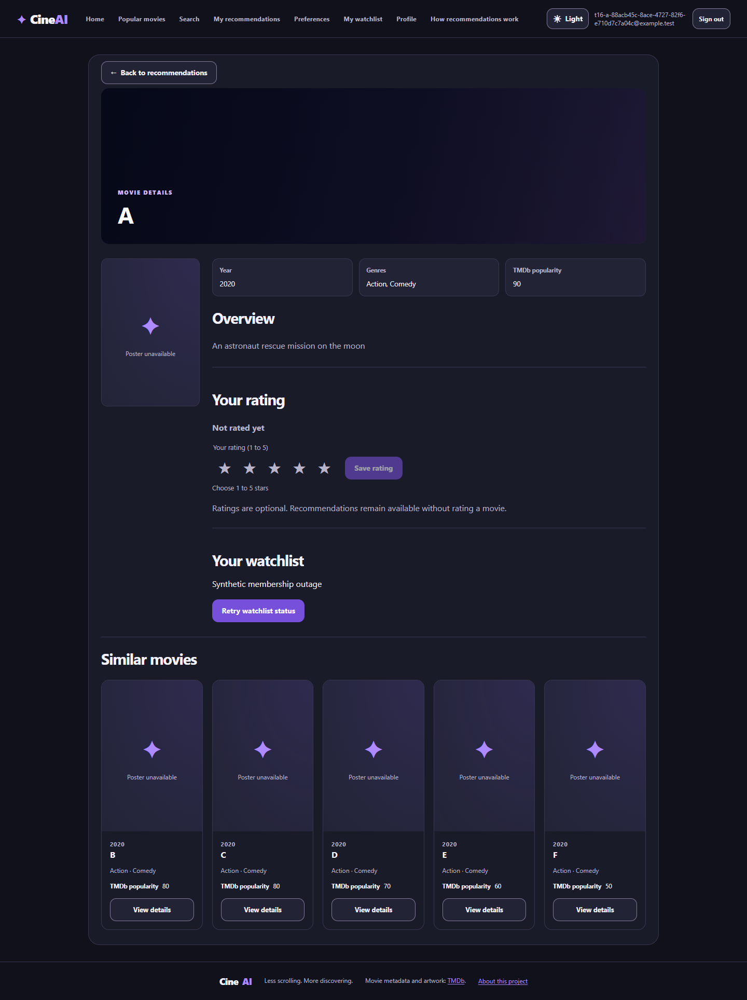
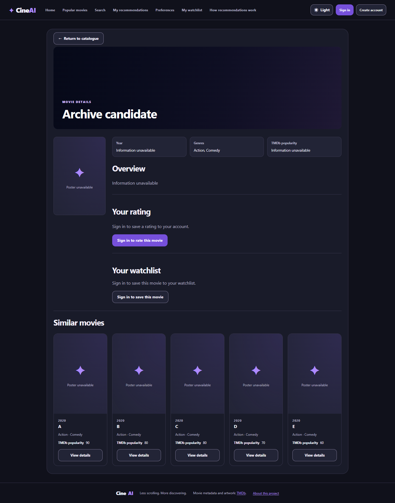
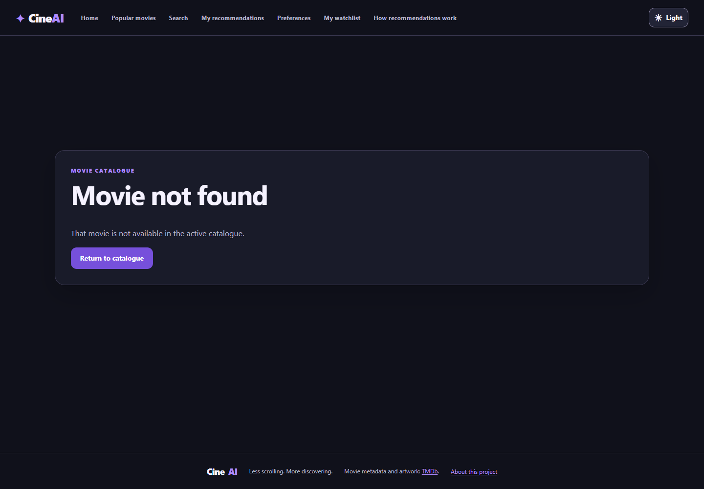

# S4-T16 — Detail return and widget request boundaries

The original T16 results below describe the detail-boundary candidate. The PO
subsequently authorized catalogue capacity, half-star ratings and submit-only
Search in this same PR; its current results and scope are recorded separately
in [the T16 extension evidence](s4-t16-extensions.md).

Issue: [#211](https://github.com/SE-FDA-NEU/ai66a_group3_C1_SE/issues/211).
Parent: [S03 #19](https://github.com/SE-FDA-NEU/ai66a_group3_C1_SE/issues/19).
Author: @kietxuan, assisted by Codex. Independent reviewer: @NguyenTuanAnh0608.
Date: 2026-10-27 (Asia/Saigon). Base: `486adabf3d2b33805082c5a7a236e52c119c29a8`.

## Scope and findings

T04 #199, T08 #203, T10 #205 and T12 #207 were Closed/merged before work.
T14 is not a dependency. Existing S3/S4 implementation and regression cases
are reused; no Story Points, new feature, algorithm or visual redesign is added.

Three production regressions were verified by failing assertions before their fixes:

1. After a details return detected `CATALOGUE_CHANGED`, Recommendations went to
   page 1 but retained the old `genreId`. The current S03 amendment requires the
   stale filter to be cleared. Recovery now preserves unrelated query/fragment
   values while dropping `genreId` and loading the new first page.
2. An account-B Watchlist opened with account A's historical return context could
   request B's page 2. Both accounts can have a valid page 2, so total-page
   clamping is insufficient. The old account context is now discarded before
   the first private list read; B starts at page 1 with no A revision.

3. A strict Linux CI run on `34ba7b4` reproduced the preparatory membership
   503. A new deterministic test reproduced the cause without a browser or
   network: on a single ASGI event loop, the async membership route blocked at
   SQLite COMMIT while a read snapshot needed that same loop to be released.
   The new `TC-P0-S03-006` failed with actual HTTP 503, then passed with HTTP
   200 after moving synchronous DB work into FastAPI's worker handler. Raw-body
   presence is still read asynchronously after account authentication; no
   payload/auth/transaction/response contract, timeout or retry policy changes.

The two new assertions failed on the inherited production code (`2 failed,
18 passed`), then passed with the fixes. Later added cases broaden write/error
coverage without changing those two production fixes. RED here means actual
regressions, not the earlier test-harness setup/selector corrections.

The inherited T01 browser gate also reproduced `Expected: 1, Received: 2` for
StrictMode's physical Similar requests. The shared test harness now records
path/method and active/completed requests. Assertions require the correct
successful GET identity and drain every held response; all UI/order/stale-state
assertions remain. Both suites release gates in teardown even after failure,
and an unknown gate returns 404 rather than causing a KeyError/500. StrictMode
is retained; no new skip, retry or timing sleep hides the scenario.

## Evidence integrity and environment

All committed screenshots below are actual Playwright Chrome captures of a
**synthetic migrated SQLite fixture** with the real FastAPI routes, repositories
and shared TF-IDF index. They are not screenshots of the user's 255 TMDb movies.
External image requests are deliberately aborted, so poster fallback is expected.
Only the membership-error companion injects an explicitly labelled HTTP 503;
the other route/DB/gate payloads are real production responses.

The fixture supports a changed catalogue revision, 13 matching movies for a
filtered page 2, missing year/overview, and real account-owned ratings/watchlists.
Tests need no live TMDb call/token. Browser servers use 8014/5174; the parent
runner reports `s04_temporary_database_removed=true` after shutdown. Pytest
uses in-process TestClient and per-case migrated temporary SQLite with foreign
keys; it blocks dotenv loading and real HTTP transports and closes/disposes
resources before removing each case directory. `/health` is also bound to the
temporary default engine. The user's `.env`, imported DB and accounts were not
seeded, reset or reimported by this work.

Final tested executable commit:
[`fd826e66990118169079571430b0f53fc211c687`](https://github.com/SE-FDA-NEU/ai66a_group3_C1_SE/commit/fd826e66990118169079571430b0f53fc211c687).
Python 3.12.6, Node 24.19.0, Windows, installed Chrome. A following
documentation/images-only commit packages this evidence; executable paths
remain identical. [Manifest and source hashes](s4-t16/manifest.json),
[full final command output](s4-t16/verification.txt) and
[actual regression RED excerpts](s4-t16/regression-red.txt) are committed.
Logs preserve output content with UTF-8/LF and line-end whitespace normalization.

| Check on the executable commit | Observed result |
|---|---|
| Root S03 `python -m pytest` | 9 passed, 0 skipped; 2.52s |
| Root S03 direct `pytest` selection | 9 passed, 0 skipped; 2.71s |
| Full frontend | 407 passed in 36 files; 34.84s |
| Full isolated backend | 656 passed, 1 inherited skip; 161.07s |
| T16 Chrome / real API + SQLite + index | 12 passed, 0 skipped/retries/flaky; 27.4s |
| T01 full Chrome regression | 16 passed, 1 optional live-mode skip; 49.6s |
| T12 Watchlist browser regression | 2 passed, 0 skipped; 10.3s |
| Frontend lint / production build | Passed |
| Ruff backend + root S03 | Passed |
| C03 structure / independent LF + CRLF exports | Passed; 37 unique P0 matrix IDs and all local links valid |

The backend skip is the inherited Sprint 2 placeholder
`test_rating_write_requires_the_signed_in_account` in
`test_auth_catalogue_handoff.py`; its old reason says the rating API is pending.
That reason is obsolete: current rating suites and the new S03 A/B case exercise
the implemented API. It is not a skipped T16/P0 case, nor evidence that ratings
are still unimplemented; baseline cleanup belongs to the T05/C05 audit. The
T01 skip is the optional read-only live-TMDb screenshot mode, deliberately
separate from synthetic/token-free acceptance.

The earlier local candidate `31c5bf7` passed 8 root cases, 407 frontend cases,
656 backend cases plus the inherited skip, 12 T16 browser cases and 16 T01
cases plus the optional live-mode skip. Fresh local browser passes did not
reveal the membership concurrency bug reliably. The
[Linux CI failure](https://github.com/SE-FDA-NEU/ai66a_group3_C1_SE/actions/runs/40487936557/job/122134327129)
was therefore investigated rather than retried to manufacture green. The new
same-loop SQLite RED/GREEN test proves the fixed contention mechanism. The
test-only `S04_SQL_DIAGNOSTICS=1` flag records underlying DB exceptions; it does
not retry, alter timeouts or replace production behaviour.
The [original failing CI output](s4-t16/ci-initial-failure.txt) is retained.

## Reproduce the author checks

From the repository root, after the existing locked Python 3.12/Node 24 setup:

```powershell
$env:PYTHONUTF8 = '1'
$caseTemp = Join-Path $env:TEMP ('s03-' + [guid]::NewGuid().ToString('N'))
.\.venv\Scripts\python.exe -m pytest tests/test_s03_details.py -v -p no:cacheprovider --basetemp "$caseTemp"
npm.cmd --prefix frontend test
npm.cmd --prefix frontend run lint
npm.cmd --prefix frontend run build
.\.venv\Scripts\python.exe -m ruff check backend tests/test_s03_details.py

$env:S04_PYTHON = (Resolve-Path '.\.venv\Scripts\python.exe').Path
$env:S04_BROWSER_CHANNEL = 'chrome'
npm.cmd --prefix frontend run test:s4:t16:ui
npm.cmd --prefix frontend run test:t01:ui
```

Omit the browser-channel override to use installed Playwright Chromium.
The existing `test:t16:integration` script is the **S3 filter suite**, not this
S4 detail suite. Preserve existing extended backend/frontend CI tiers. The new
workflow explicitly runs the root S03 cases and T16 component/browser cases.

Root S03 supplies nine items for `TC-P0-S03-001` through `006`, including three
missing-field variants. Full TC-ID/production-node/interface mapping is in
[testing.md](../testing.md#s03--s4-t16-scoped-execution). TestClient proves HTTP,
DTOs and persistence; actual React labels and navigation are proven separately.

## Reviewer walkthrough and expected outcomes

Use the isolated browser command for deterministic fixtures. To inspect the
normal app separately, follow SETUP and use its existing TMDb database; never
activate the synthetic browser fixture in that real database.

| Journey | Expected result / automated proof |
|---|---|
| Guest Home Z-A or Popular page 2 -> exact detail -> app return and browser Back | Same page/query/sort/fragment; public details make no private widget reads. Browser `RET-001`, dark desktop/light mobile, keyboard Enter on return. |
| Recommendations Action-filtered page 2 -> details -> select 4 stars -> Save -> return | Draft alone leaves saved rating null; confirmed save refreshes ranking and preserves valid page/filter; persisted preferences unchanged. `RET-003`. |
| Same return after catalogue revision changes | First old-revision request gets 409, then page 1/all genres with the new catalogue; saved preferences unchanged. Component/browser `RET-002`. |
| Save Comedy preferences, Browser Back through historical details, return | Old recommendation scope/filter is discarded and the new saved genre remains Comedy. `RET-005` and existing context tests. |
| Search query/fragment -> exact detail -> exact Similar movie -> return | Correct selected movie and original safe search URL. `RET-004`. |
| A's historical Watchlist details -> sign out -> B -> Browser Back -> Watchlist | B starts page 1; no B list GET carries A's page/revision. Both accounts have two valid pages in the browser case. `WATCH-001`. |
| Eleven saved movies -> Watchlist page 2 -> exact details -> return -> remove last row | Total 10, one page, ten actual remaining cards; removed ID absent. `WATCH-004`. |
| Hold A's real details/rating/membership/Similar responses, navigate in the SPA to B, release A | B's route/content/widgets remain B; stale Similar cannot include B as its own result. `ASYNC-001`. |
| Hold private reads or an already committed membership PUT, switch account in the SPA, release | New account stays authenticated with its own null rating/membership; no old success notification. `ASYNC-002`, component write/401/503 companions. |
| Membership 503, then Retry | Details, rating, Similar and recommendation return remain usable; Retry restores membership. `FAIL-001`. |
| Missing fields / unknown ID / external return state | Rendered `Information unavailable` / `Movie not found`; safe catalogue return; no external navigation. `PUBLIC-001`. |

## Actual screenshots













Additional desktop/mobile public-return and stale-response captures are in the
[same image directory](../images/sprint4/t16-detail/).

## Review and remaining ownership

- Independent substantive review on the final PR head: **pending**. If the named
  reviewer coauthors any change, request another non-coauthor reviewer.
- Story #19's appended post-M3 AC is **not checked or otherwise changed here**.
  PO should tick it only after the mapped evidence and independent review support
  it. The Story remains Closed; this work neither reopens nor recloses it.
- C05 #219 still owns the shared six-P0 root default discovery/fixtures, complete
  M4 CI/setup and independent clean-clone rehearsal. The scoped S03 module is
  executable now; it does not claim all other Section 2 cases already exist/pass.
- C04 #218 consumes this traceability/evidence; it is not a reverse dependency
  of T16, T05 #200, or completed C03 #217.
- PR merge/closure is permitted only after applicable CI and independent review
  pass. No approval, instructor result, review event or Story acceptance is fabricated.

Later PO-authorized follow-up: [current-page Popular carousel, compact collection
headings and updated execution](s4-t16-spotlight.md). Earlier counts above remain
historical; the linked evidence records the current source and checks.
