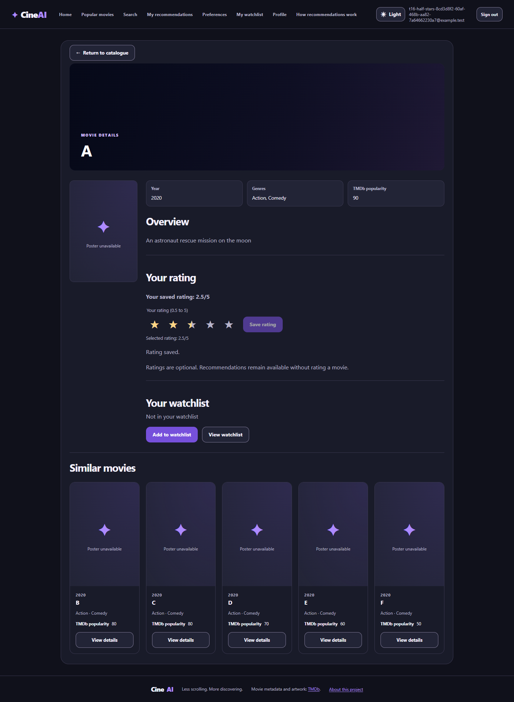
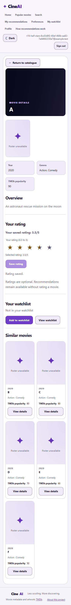
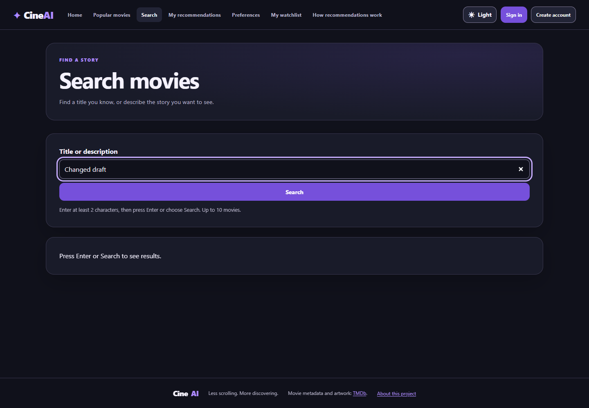

# S4-T16 consumer amendment — catalogue capacity, half stars and explicit Search

The subsequent [full-result Search paging amendment](s4-t16-search-pagination.md)
extends Search beyond the historical top-ten total limit. The results below
remain the record of this earlier verified candidate.

Date: 2026-10-27. Issue: [#211](https://github.com/SE-FDA-NEU/ai66a_group3_C1_SE/issues/211).
PR: [#235](https://github.com/SE-FDA-NEU/ai66a_group3_C1_SE/pull/235).
This additional scope was explicitly requested by the PO in the working session.
It supersedes integer-only rating expectations for current consumers; historical
S3/C03 evidence and the original [T16 results](s4-t16-detail-boundaries.md) remain history.
It does not claim independent teammate review, Story closure or final C05 acceptance.

## Delivered behaviour

- Import accepts 1–50 popular pages, with 50 also the default. Setup uses the
  explicit budget and rebuilds/checks the shared overview index after import.
  One-page fixture tests now declare that budget; the default-budget integration
  test really imports 1,000 synthetic rows, deduplicates and preserves personal data.
- Five visual stars expose ten native radio options: 0.5 through 5 in exact
  half steps. A star's midpoint/left half selects the half step; its right end
  selects the whole value. Arrow/Space work without a write. Explicit Save
  persists only a validated server response. Unrated is still null, never zero.
- Migration `f2c7e4a91b60` follows `e9b6f0a42c17`, changes the rating column to
  REAL and enforces exact half steps. It preserves IDs, timestamps, foreign keys,
  unique account/movie pairs and other tables. Downgrade refuses fractional
  rows instead of rounding or deleting them.
- Existing ranking signs are unchanged: <=2 negative, >=4 positive; 2.5–3.5
  neutral. Raw TMDb popularity and integer rating adjustment remain separate.
- Search drafts stay local. Only Enter/Search commits a new URL query and
  requests results. Valid deep links, retry, Back, detail return and stale
  request protection remain supported. Typing hides old results behind an
  explicit submit prompt, without requesting suggestions.

## Verification on the final working tree

| Check | Actual result |
|---|---|
| `python backend/scripts/run_isolated_tests.py -q` with unique temp base/cache disabled | 675 passed, 1 pre-existing skip; 190.04s |
| `python -m pytest tests/test_s03_details.py -q` with temp base/cache disabled | 9 passed |
| `python -m ruff check backend tests` | Pass |
| `npm --prefix frontend run lint` and `run build` | Pass |
| `npm --prefix frontend run test` | 418 passed, 36 files |
| `npm --prefix frontend run test:s4:t16:ui` | 14 passed; no retries/flaky results; temporary DB removed |
| `npm --prefix frontend run test:t01:ui` | 16 passed, 1 live-only skip; temporary DB removed |
| `npm --prefix frontend run test:s04:e2e -- --config playwright.t12.config.ts` | 2 passed; temporary DB removed |
| `test:t33:integration`, `test:t04:integration`, `test:t16:integration` | Each 1 passed against its real temporary API/SQLite bridge |
| `python scripts/verify_s4_c03_contract.py` | Pass; 224 local links, 37 P0 IDs, four testing sections |
| `python scripts/test_s4_c03_contract_line_endings.py` | LF/CRLF fingerprints agree |

Automated checks use synthetic temporary SQLite with TMDb network disabled;
no test writes to the developer catalogue. The backend skip is the historical
S2 auth-handoff rating placeholder; current rating API/privacy tests execute.
The existing Starlette/httpx deprecation warning is non-fatal. T01's skipped
live-only browser case is not claimed as a real-catalogue browser run.

The first full regression exposed two old test assumptions: a poster fixture
implicitly using the former one-page default, and a backdrop-only constraint
assertion being applied across all later migrations. They now explicitly test
one page and the backdrop revision respectively, with separate current-head
row-preservation checks. The final full regression above passed.

Chrome pointer checks exercise both halves of every star at 1440px/dark and
375px/light, save 2.5/3.5 and reload the committed value. Search checks record
zero requests while typing, then test Enter/button, URL state and browser Back.
The original twelve detail/widget request-boundary browser cases also pass.
Sanitized browser identities, statistics and source hashes are in
[browser-results.json](s4-t16-extensions/browser-results.json).

## Actual local TMDb import (outside CI)

Before changing the real configured database, SQLite's backup API created
`data/backups/pre-t16-half-stars-20261027T114855Z.db` (ignored by Git).
Migrations were applied, followed by the documented `--pages 50` import.
The server-side token and `.env` were not changed or published.

```text
provider=tmdb
active_revision=af225655-a600-41a9-be74-0d97959edaa9
inserted=746
updated=234
rejected=20
movies=980
associated_genres=19
finite_popularity_movies=980
source_fetched_at=2026-10-27T11:49:27.295328Z
imported_at=2026-10-27T11:49:42.830249Z
```

Read-only comparison to the backup confirmed unchanged users, preferences,
ratings and watchlist rows. `PRAGMA foreign_key_check` returned no errors.
There are 980 distinct active TMDb source IDs, 979 poster paths and 974 backdrop
paths. Missing media retains its normal UI fallback.

Index rebuild/check both returned `ready=true`: 980 movie mappings, 978 usable
overview documents and 7,853 vocabulary terms. Two missing/empty overviews do
not fabricate text and retain the existing missing-text fallback behaviour.
Real local `/health`, Home page 98, Popular page 98 and an `astronaut` search
all returned HTTP 200. Both unfiltered lists reported total 980 / 98 pages.
Future live imports may return a different count after provider changes,
deduplication and validation; 1,000 is a target, not an exact invariant.

## Browser screenshots

These are real Chrome captures of the isolated synthetic test application,
not imported film artwork or fabricated production evidence. Synthetic posters
are deliberately blocked, so labelled media fallbacks are expected.







## Reproduce locally

Use the same root `.env` and database for both servers. For an existing valuable
database, back up consistently before the migration. Follow [SETUP](../SETUP.md)
for a fresh clone; do not replace the local database just to make a test account.

```powershell
.\.venv\Scripts\python.exe -m alembic -c backend/alembic.ini upgrade head
.\.venv\Scripts\python.exe -m app.cli.import_tmdb_catalogue --pages 50
.\.venv\Scripts\python.exe -m app.cli.rebuild_overview_index rebuild
.\.venv\Scripts\python.exe -m app.cli.rebuild_overview_index check
```

Restart the backend after upgrading/importing. In details, select the midpoint
of the third star (2.5), then its right end (3); selection alone must not issue
a PUT. Save 2.5, reload and verify it remains. Search typing alone must issue no
search GET; Enter/Search should do so. Returning from details must restore the
last submitted query. These commands have already completed on this machine;
re-import is only needed for an intentional catalogue refresh.
