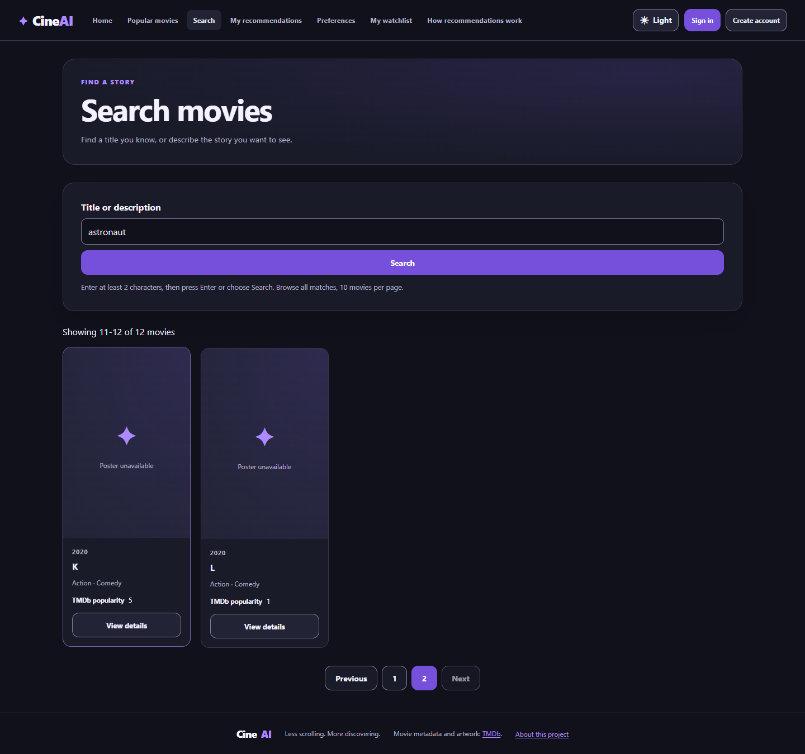

# S4-T16 — Search through the complete result set

Date: 2026-10-27. PR [#235](https://github.com/SE-FDA-NEU/ai66a_group3_C1_SE/pull/235),
Refs [S4-T16 #211](https://github.com/SE-FDA-NEU/ai66a_group3_C1_SE/issues/211)
and [S08 #30](https://github.com/SE-FDA-NEU/ai66a_group3_C1_SE/issues/30).
The PO explicitly replaced Search's historical top-ten-total limit with the
same paginated access used by the other lists. Story #30's unchecked AC/task
wording was synchronized; points, ownership, status and acceptance checkboxes
were not changed. This does not claim independent review or Story closure.

## Behaviour and implementation

- Title matching returns the complete ordered literal/case-insensitive result.
  Only zero title matches across the full set activates overview search. An
  empty late title page must not switch to unrelated description results.
- Description search retains every strictly positive cosine match, ranked by
  descending cosine, normalized title and opaque ID before any slicing. Missing
  text/zero scores never invent related movies. Public ownership is unchanged.
- The API accepts `page` (default 1, range 1–10000), `limit` (default 10, range
  1–10), and optional `catalogueRevision`. It returns `MovieListMeta` with full
  totals. No top-ten total-result cutoff remains. A stale revision returns 409;
  invalid paging returns 400; index/catalogue errors remain distinct from empty.
- React uses shared `PageControls` and result counts. The URL stores submitted
  `q` and page; history state carries the revision through details/Similar and
  back. A new submitted query resets page 1. Typing alone still sends no request.
  Revision changes restart page 1, and a past-the-end page reconciles to the
  last valid page. Old query/page responses cannot replace the current result.
- Runtime uses the local database/index. No dependency, migration, re-import,
  auth/theme/feedback store or live TMDb request was added.

## Actual verification

| Check | Result |
|---|---|
| Focused offline API Search suite | 35 passed |
| Full isolated backend suite | 684 passed, 1 inherited skip; 182.90s |
| Root `tests/test_s03_details.py` | 9 passed |
| Frontend full suite | 420 passed, 36 files |
| Focused frontend movie/Search suite | 27 passed |
| Lint / TypeScript / Vite build / Ruff | Pass |
| T16 Chrome suite | 15 passed, no retries/flaky results; temporary SQLite removed |
| T01 Chrome regression | 16 passed, 1 optional live-only skip; temporary SQLite removed |
| C03 structure and LF/CRLF normalized fingerprints | Pass |

Automated suites use temporary synthetic SQLite and disabled TMDb access. The
existing backend skip/deprecation warning and optional live-only T01 skip are
retained, not new exclusions. The initial build found an unsupported `exact`
option in two new Testing Library selectors; it was removed, the build passed,
and the focused Search suite was rerun. No production assertion was removed.

API tests collect every page of 27 title hits without duplicates/gaps, verify
cosine ordering globally across 25 matches, and exercise final/empty pages,
invalid selectors and revision rejection. UI tests cover totals, Next, query
reset, no typing request and 409 recovery. The real browser visits the second
page, opens details, returns through both app navigation and Back, verifies
the same cards/query/page, then submits a new query and checks page 1.

Sanitized [browser results](s4-t16-search-pagination/browser-results.json) and
[source hashes](s4-t16-search-pagination/source-hashes.json) identify the tested
working tree based on `e8e319e39b19f9775fc54066a963961ef0e76581`. Previous T16
evidence remains historical; it must not be read as a current top-ten-total cap.

## Real imported catalogue smoke (read-only, outside CI)

On the existing 980-movie TMDb catalogue and already-ready NLP artifact:

| Query | Page | Observed |
|---|---:|---|
| `the` (title matches) | 1 | HTTP 200, count 10, total 330, totalPages 33 |
| `the` with the page-1 catalogue revision | 2 | HTTP 200, count 10, total 330; no IDs shared with page 1 |
| `astronaut rescue moon` (overview matches) | 2 | HTTP 200, count 10, total 20, totalPages 2 |

Index check remains ready with 980 mappings, 978 usable overviews and 7,853
terms. No real user/account rows, environment file, token or catalogue were
changed by this Search amendment. Live counts can vary after a future import.

## Screenshot and reproduction

This is a real Chrome screenshot of the isolated synthetic fixture. Its image
CDN is intentionally blocked; poster fallbacks are expected and are not
evidence that the real imported films lack posters.

Use the existing setup, then restart the backend and frontend. Search `the`
on the current imported catalogue, choose Next, open a movie and return to
Search. It should keep the query/page. Submit a different query to restart at
page 1. A search with fewer than eleven qualifying matches correctly has one
page; Search does not promise to match every movie in the catalogue.
