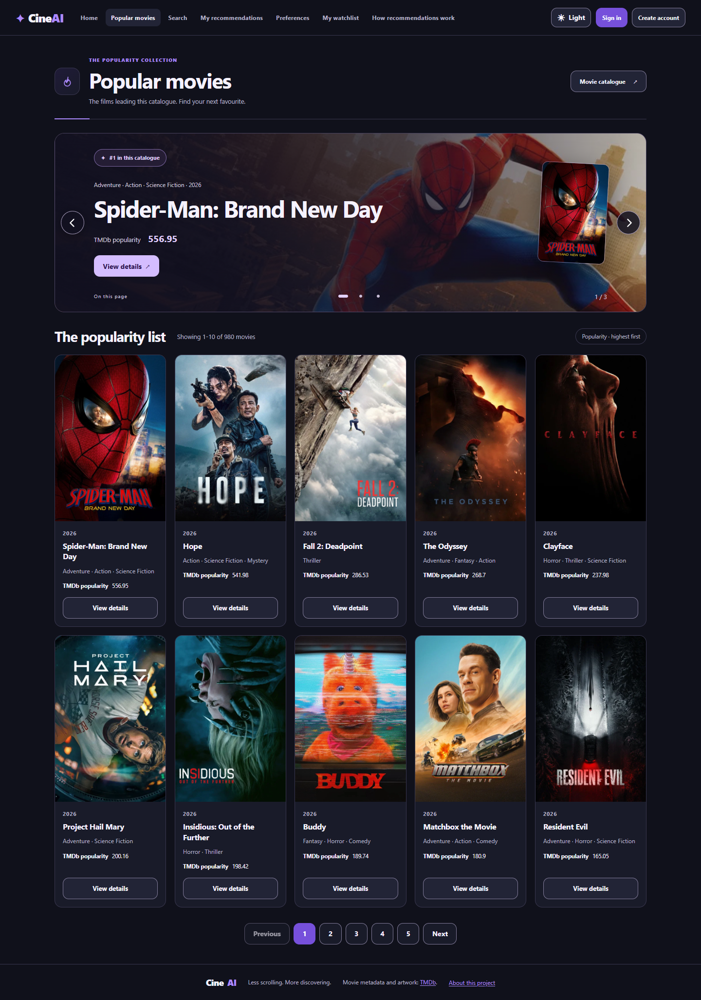
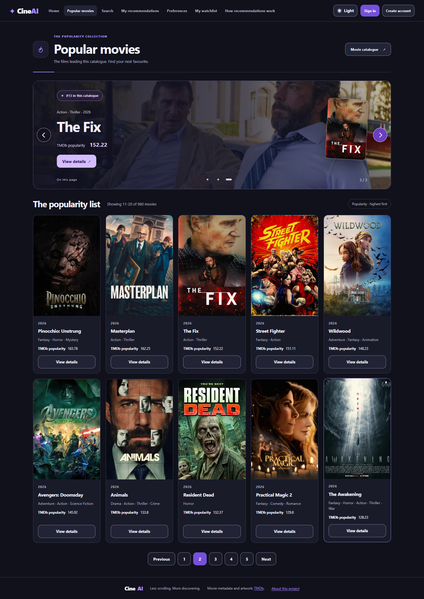
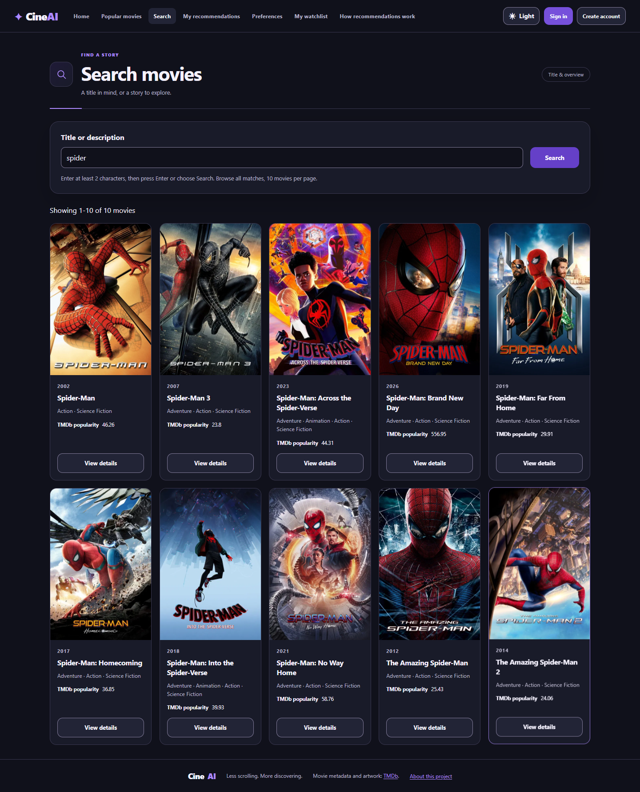
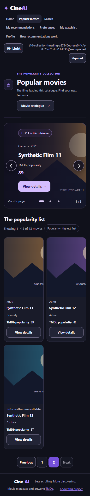
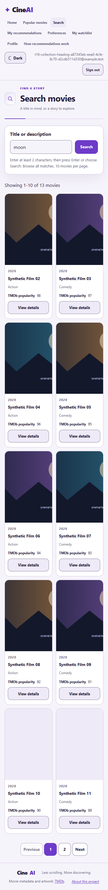
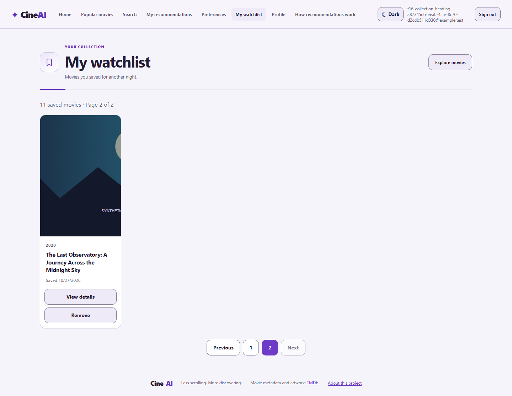

# S4-T16 — Current-page Popular carousel and collection headings

Date: 2026-10-27. PR [#235](https://github.com/SE-FDA-NEU/ai66a_group3_C1_SE/pull/235),
Refs [T16 #211](https://github.com/SE-FDA-NEU/ai66a_group3_C1_SE/issues/211),
[S09 #31](https://github.com/SE-FDA-NEU/ai66a_group3_C1_SE/issues/31),
[S08 #30](https://github.com/SE-FDA-NEU/ai66a_group3_C1_SE/issues/30) and the
[T01 UI contract](../s4-t01-ui-contract.md). The PO explicitly requested this
follow-up inside the open T16 PR. It does not claim teammate approval, Story
acceptance, a merge or issue closure.

## Delivered behavior

- Every nonempty Popular page features its own first three API-ordered movies.
  Page 2's badges are catalogue ranks #11–#13 with the normal limit of ten;
  `1 / 3` is a separate local slide counter. The grid keeps all page entries.
- Circular high-contrast arrows sit at the two side edges, vertically centered.
  They are 48px on desktop and 44px on mobile. Dots and Left/Right keys also
  work; selection wraps, with no autoplay. One/two-entry pages have exactly
  one/two slides; empty pages have none.
- Clicking a slide control makes no API request, changes no ranking, and adds
  no history entry. Existing safe list-return state retains the selected slide
  through View details, app return and browser Back. Another page starts at
  that page's first entry.
- Summary DTOs now add nullable `backdropUrl`, projected from existing local
  storage through the same validated HTTPS/w780 helper as details. Missing,
  unsafe or failed URLs leave a gradient; a later valid slide can load normally.
  No migration, import, account mutation or NLP rebuild is needed.
- Popular, Search and My watchlist share a compact icon/title/description/action
  heading. Search has a compact input/button row. Existing explicit submission,
  pagination, session state, persistence and protected request boundaries stay
  intact. Home and Recommendations retain their existing layouts.

## Actual verification

Tested source is based on `64dc41b1cb72c90d1199d586544e1de5a1afed68`;
[source hashes](s4-t16-spotlight/source-hashes.json) identify the changed code
and relevant harness/configuration. Documentation-only updates followed the
successful application test runs.

| Check | Result |
|---|---|
| Full isolated backend suite | 693 passed, 1 inherited skip; 166.48s |
| Root S03/detail/widget API regressions | 9 passed |
| Full frontend Vitest suite | 428 passed, 37 files |
| T16 Chrome browser suite | 18 passed, no skipped/flaky/retried cases |
| T01 Chrome regression | 16 passed, 1 optional live-only skip |
| T12 Watchlist Chrome regression | 2 passed |
| ESLint / TypeScript / production Vite build / Ruff | Pass |
| C03 structure and normalized LF/CRLF contract checks | Pass |
| Real imported catalogue preview | 980 movies; real backdrop decoded for all six featured entries on pages 1/2; Search returned ten first-page cards |

The inherited backend skip and Starlette/httpx deprecation warning were retained.
Automated tests use migrated synthetic temporary SQLite, isolated accounts and
offline artwork. The responsive case checks 375/768/1440px in both themes, title
wrapping, no horizontal overflow, edge/center arrow geometry and watchlist page
2. Existing T16 cases still verify half-star saves, submit-only/full Search
paging, revision recovery, account isolation and late responses.

The initial compatibility run found legacy expectations that summaries could
never contain a backdrop and that media enrichment left the entire serialized
recommendation response identical. Those expectations now permit the authorized
media field: all ordered IDs, scores, ownership, totals and other fields still
compare exactly, and each summary backdrop is checked against its detail URL.
A synthetic scenario initially changed overview text without rebuilding its
index; the isolated fixture now rebuilds before Search. Final runs passed.

Sanitized results:
[T16](s4-t16-spotlight/t16-browser.json),
[T01](s4-t16-spotlight/t01-browser.json),
[T12](s4-t16-spotlight/t12-browser.json),
[frontend](s4-t16-spotlight/frontend-tests.json),
[real-catalogue checks](s4-t16-spotlight/real-catalogue.json).
These are author-local execution records, not independent review or GitHub CI.

## Real browser captures

The real-catalogue preview used a read-only SQLite backup of the user's
TMDb-imported database, a temporary backend and the production frontend build.
It made no import or source database/account write, used no fixture image
interception and loaded real public TMDb image bytes. Its temporary database
and servers were removed/stopped afterwards.







The responsive captures below are explicitly synthetic offline fixtures,
including synthetic SVG artwork and temporary accounts. They prove UI layout
and interaction; they are not evidence of live film metadata or real accounts.







The adjacent image folder also retains the three page headings at tablet width
and in both themes.

## Reproduce and hand off

Restart the updated backend and frontend; no new import/migration is required
for this presentation follow-up. See the [SETUP guide](../SETUP.md) for the
existing environment and database prerequisites.

```powershell
$env:PYTHONUTF8 = "1"
.\.venv\Scripts\python.exe backend/scripts/run_isolated_tests.py -q
.\.venv\Scripts\python.exe -m pytest tests/test_s03_details.py -q
.\.venv\Scripts\python.exe -m ruff check backend tests
npm.cmd --prefix frontend test
npm.cmd --prefix frontend run lint
npm.cmd --prefix frontend run build
$env:S04_BROWSER_CHANNEL = "chrome"
npm.cmd --prefix frontend run test:s4:t16:ui
npm.cmd --prefix frontend run test:t01:ui
npm.cmd --prefix frontend run test:s04:e2e -- --config playwright.t12.config.ts
.\.venv\Scripts\python.exe scripts/verify_s4_c03_contract.py
.\.venv\Scripts\python.exe scripts/test_s4_c03_contract_line_endings.py
```

For an author screenshot run, set `S4_T16_SCREENSHOT_DIR` to a local output
folder before the T16 browser command. The browser runner owns its temporary
database; do not point it at the user's real database.

Manual review: open Popular page 2 from page 1's pagination, select slides 2/3
and check badges #12/#13. Open details and return through the visible link and
Back. Check Search and Watchlist headings in Light/Dark, including a narrow
viewport; verify Search still waits for Enter/Search. Missing artwork should
leave readable titles/actions. Obtain teammate review on the final PR head
before merging. Current local success does not automatically close T16 or any
parent Story.
