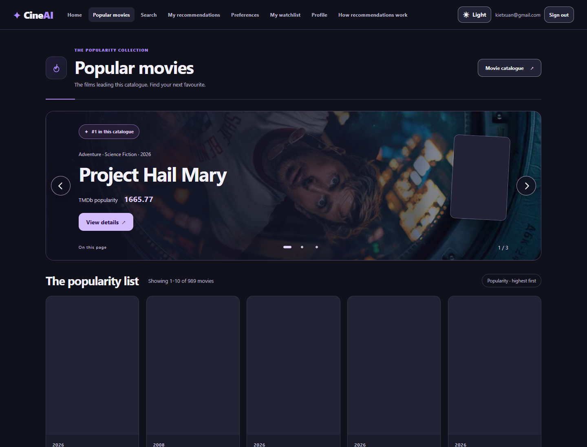
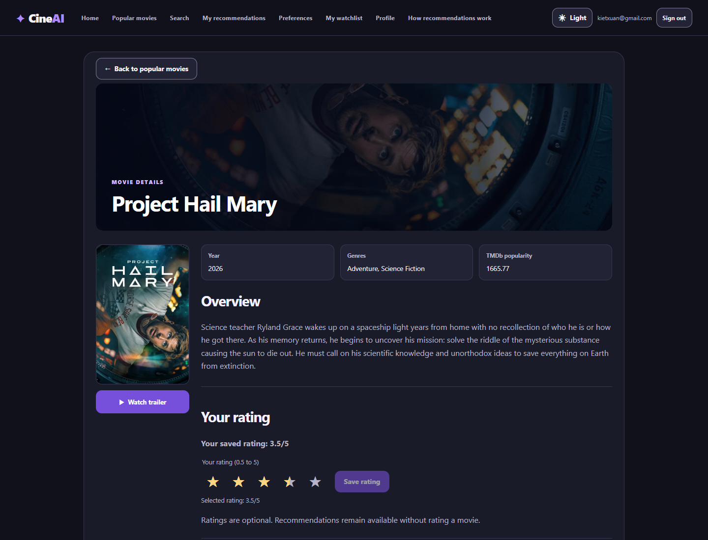

# S5-T02 Neon live acceptance

Issue [#249](https://github.com/SE-FDA-NEU/ai66a_group3_C1_SE/issues/249) and PR [#259](https://github.com/SE-FDA-NEU/ai66a_group3_C1_SE/pull/259).

The live run took place on 9 November 2026 on the team's local Windows machine, using Python 3.12.6 and the locked backend dependencies. Application source was `96d4f3b9c799838f8b657d424ca17ded830222b2`. This delivery also exercises the revised readiness query and provisioning instructions. The environment is a local backend connected to Neon AWS `ap-southeast-1` in Singapore.

## Targets and effective access

| Target | Database | Access used |
| --- | --- | --- |
| Public runtime candidate | `neondb` | `cineai_runtime` for application requests |
| Development | `cineai_development` | 989-movie public catalogue and empty account tables |
| Integration tests | `cineai_test` | Temporary test schemas created by the operator fixture |
| Migration/import | Intended database above | `neondb_owner` |

These are separate databases on the supplied Neon endpoint. They share its compute. The PostgreSQL test fixture creates and removes a unique schema for each integration test.

Nguyễn Xuân Kiệt is the primary operator. On 9 November, he confirmed that backup operator Nguyễn Tuấn Anh had received the Neon invitation and independently connected using `neondb_owner`. The automated local run directly verified that role's database access and a `CREATE TABLE` probe inside a rolled-back transaction.

The server reported PostgreSQL `18.6 (ac70818)`. The client connected with `sslmode=verify-full`, a CA bundle from `certifi`, and `channel_binding=require`. Psycopg reported `ssl_in_use=True`. PostgreSQL 18 `psql` reported TLS 1.3, cipher `TLS_AES_256_GCM_SHA384`, and 256 key bits.

The backend's `pg_stat_ssl.ssl` reported false on this endpoint. The readiness query now names that diagnostic `backend_tls_active` and also runs `\conninfo` to expose the actual client's SSL information. Certificate verification and client-side TLS were checked together.

Runtime permission checks passed for catalogue reads and account-owned writes. Schema creation and catalogue updates were denied to `cineai_runtime`. The five granted write tables are `users`, `auth_sessions`, `user_genre_preferences`, `user_movie_ratings`, and `user_movie_watchlist`.

## Migration and catalogue

Migration `heads` and `current` both returned `a3d1f8b72c44`. `upgrade head` completed on the initially empty database. `alembic check` reported `No new upgrade operations detected`. Pre-import readiness found zero movies and zero account-owned rows.

| Operation | Actual result |
| --- | --- |
| First explicit `--pages 50` import | 989 inserted, 0 updated, 11 rejected, 989 active movies |
| Rejection reason | 11 duplicate TMDb IDs across popular pages |
| First active revision | `d98e3532-4dcb-4b95-afea-00e0720fe3b9` |
| Repeated explicit `--pages 50` import | 0 inserted, 989 updated, 11 duplicates rejected, 989 active movies |
| Repeated active revision | `1ee08003-bc00-4888-b35c-8c6cbe599062` |
| Stable identity comparison | All 989 common TMDb IDs retained their app movie IDs |
| Account comparison across repeated import | Exact ordered row fingerprints matched for all five account-owned tables |
| Whole-catalogue poster enrichment | 989 processed, 1 updated, 988 unchanged, 0 missing/invalid, 0 remaining |
| Whole-catalogue backdrop enrichment | 989 processed, 989 unchanged, 0 missing/invalid, 0 remaining |
| Whole-catalogue official trailer enrichment | 989 processed, 882 with official trailer, 107 without, 0 failed, 0 remaining |

Final SQL availability was 989 posters, 986 backdrops and 882 official trailers across 989 distinct active TMDb IDs. Three backdrop values were legitimately null. All 989 trailer checks completed with successful request statuses. The five account-owned table fingerprints matched the pre-enrichment baseline before browser login verification.

Development migration reached `a3d1f8b72c44` and passed `alembic check`. Its public-data copy contained two catalogue revisions, 19 genres, 989 movies, 2,756 movie/genre associations and one catalogue-state row. Its five account tables were checked empty before and after the copy. An automatic approval review rejected a proposed complete database transfer because it would include account/session data. The implemented transfer used the public catalogue whitelist.

## App accounts and restart

Two app-only review accounts were provisioned through `app.cli.provision_account`, with explicit host/database guards and separate password environment values. A used Action/Adventure preferences and a 3.5-star rating. B used Comedy/Drama preferences and a 4.5-star rating. Their Watchlists held different films.

Both accounts authenticated through the real HTTP API using the restricted runtime role. Sign out, rejected unauthenticated access, later sign in, independent preferences, half-star ratings, Watchlist ownership and recommendations passed. Existing session cookies authenticated after backend restarts.

The valid artifact was reused with the same file modification time. Deleting the derived file caused a successful startup rebuild. A checksum-valid artifact carrying a deliberately stale config failed `check` before restart and passed after automatic startup recovery. Account-row fingerprints remained identical across these restarts.

NLP readiness used 989 movies and 988 usable documents. The corpus digest was `714148f40f7c7788af159a2707804e23a5de47fc7b44e187a9aaa183a4ad2ec4`. The config fingerprint was `41785781f34ba44091ac64f3b1c0503402ee760c518af1429d0acb94bbc31c99`.

| Startup state | Process start to successful health, s | NLP preparation, s | CPU time, s | Working set, MiB | Peak working set, MiB |
| --- | --- | --- | --- | --- | --- |
| Valid artifact | 3.203 | 1.875 | 0.969 | 92.54 | 98.45 |
| Missing artifact | 3.250 | 2.078 | 1.188 | 92.93 | 100.79 |
| Stale config | 3.766 | 2.234 | 1.406 | 94.49 | 100.38 |

CPU is cumulative process CPU time at measurement. Memory is the working set and the peak observed by Windows up to that measurement. PowerShell `Get-NetTCPConnection` identified the actual listener PID, which was matched to Uvicorn's server PID before `Get-Process` collected resources.

Description Search for `mysterious` returned 73 matches. The catalogue had zero title matches for that word. Pages 1 and 2 each returned 10 distinct movies. Similar returned five movies. These checks passed for every measured startup state while TMDb network access was disabled in the runtime process.

## Focused automated checks

| Command or check | Actual result |
| --- | --- |
| Six affected startup/index/Search/restart/import suites | 116 passed in 11.74 s |
| Default `python -m pytest -v` P0 suite | 40 passed in 12.65 s |
| Default P0 after private Neon `.env` configuration | 40 passed again in 12.12 s through the isolated temporary-database setup |
| PostgreSQL integration suite on `cineai_test` | 11 passed in 69.15 s |
| Ruff on affected backend paths | Passed |
| Frontend locked dependency install and production build | Passed |
| Frontend production-dependency audit | 0 reported vulnerabilities |
| Fresh remote clone with a new locked backend environment | Startup, health, 989-movie catalogue, 73-result description Search and five-result Similar passed with a new index |
| Fresh remote clone frontend | Locked dependency installation and production build passed |

The Python runs reported the inherited Starlette TestClient/httpx deprecation warning. The complete npm installation reported 16 development-dependency advisories, with 12 moderate and four high. The production-only audit returned zero.

## Handoff and final review

The package for T03 includes the runtime environment contract, migration head, measured startup results and Neon database layout. T04 can use the active revision and real TMDb identity samples for provider enrichment. The reproducible setup results support T08's documentation. The primary operator holds app-only review credentials for the private T08 handoff. Database credentials and tokens are held outside Git. [Provisioning runbook](../../s5-t02-neon-provisioning.md)

## Browser verification

Headless Microsoft Edge used the real frontend at `http://localhost:5173` and the Neon-backed runtime API. The journey started at Home, signed A in, verified stored preferences, opened Popular and followed its details link. The details page displayed A's saved 3.5-star rating and the official-trailer control below the poster. Opening that control displayed the embedded trailer dialog within the app. A separate real imported movie displayed `Trailer unavailable`.

Description Search required submission and displayed 73 results. A's Watchlist contained its saved film. B's sign-in restored Comedy/Drama preferences with Action unselected. The run recorded zero page errors and zero browser requests to the TMDb metadata API. The runtime process also had TMDb network access disabled.

These viewport screenshots were captured after data loaded and the sign-in notice was dismissed.

Command output, startup measurements, identity samples and account comparison summaries are attached in the checks log. [Recorded checks](checks.log)

At evidence capture, the available approval on `96d4f3b` contained `okay`. The issue requires substantive formal feedback from an eligible teammate on the updated version before merge. The PR's review events record that final decision.
