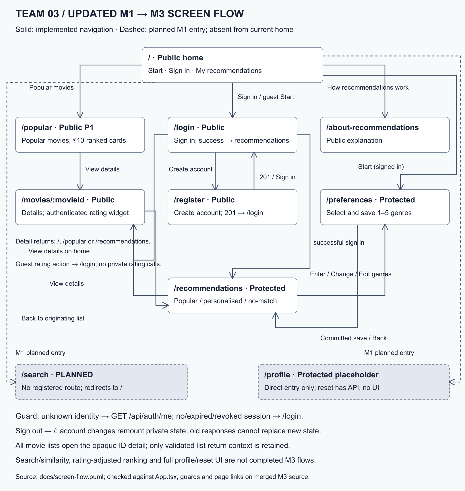

# M1 requirements document - AI Movie Recommendation System

This document is the M1 requirements baseline. It draws on the research in
docs/user-research.md, personas in docs/personas.md, scenarios in
docs/scenarios.md, scope in docs/product-scope.md, and the fourteen GitHub
Story issues #17 to #24, #30 to #33, #44, and #45. Route mapping is maintained
in docs/traceability.md.

## 1. Product vision

For university students facing choice overload, the AI Movie Recommendation
System lets each account save a small set of preferences and optional ratings
to receive transparent movie recommendations, rather than showing every viewer
the same generic popularity list.

## 2. Personas

Interview and research note: an anonymous, consented questionnaire collected
8 valid responses from university students aged 18 to 20 between 00:47 and
22:26 on 2026-09-16. Four respondents volunteered for a possible short
follow-up conversation. The evidence below uses anonymous respondents only;
quotations are faithful English translations of free-text answers, not
verbatim English originals.

### Persona 1: Frequent Explorer

Role: a student who watches movies at least twice a week.

Goal: find a relevant movie quickly when there are many possible choices.

Blocked by: too many movies to decide between and recommendations that feel
unrelated to current interests. This persona may know a preferred genre and
still struggle to find a suitable title.

In their words: "I want to watch a detective movie but I can't see any that
fit my taste right then."

Evidence: 4 of 8 respondents watch at least twice a week, 6 of 8 reported
choice overload, and favourite genres, personalised recommendations, and genre
filtering each scored 4.125 out of 5.

### Persona 2: Occasional Undecided Viewer

Role: a student who watches movies rarely and does not know what to search for
when opening a movie service.

Goal: start exploring immediately and find a reasonable movie without
building a full preference profile first.

Blocked by: not knowing where to start, spending a long time choosing, and
getting no suitable result after picking a genre. This persona may give up,
rewatch an old movie, or choose at random.

In their words: "I usually give up or rewatch an old movie."

Evidence: 4 of 8 respondents watch less than once a month, 5 of 8 wanted both
popular movies and genre selection when no preferences exist, 6 of 8 preferred
popular alternatives after a no-match result, and no respondent rated movies
frequently.

### Persona 3: Detail-Oriented Chooser

Role: a student who has a rough idea of what to watch but needs more
information before deciding.

Goal: confirm that a recommended movie suits them before committing to it.

Blocked by: not knowing whether a movie fits their current interests or mood,
recommendations that look relevant without enough information to trust them,
and no easy way to find similar options after liking a title.

In their words: "After watching one good movie I wanted another with exactly
the same content, but I couldn't find one."

Evidence: 5 of 8 respondents were unsure whether a movie would suit their
current mood, 6 of 8 named genre as important before choosing, and viewing
similar movies scored 3.625 out of 5.

## 3. Scenarios

The scenarios describe complete use in plain language. They do not name
screens, routes, or buttons.

### Scenario 1: A Frequent Explorer returns to a personal list

1. The Frequent Explorer wants to find a new movie without long browsing.
2. They identify themselves using the account they used previously.
3. The service restores their saved favourite genres for that account.
4. They receive a short list of movies related to those genres.
5. They read why each suggested movie is relevant to their interests.
6. They narrow the current list to the genre they want that evening.
7. They choose a movie and read its year, genres, and overview.
8. They explore similar alternatives, then choose a more suitable movie.

### Scenario 2: An Occasional Undecided Viewer begins safely

1. The Occasional Undecided Viewer wants to watch a movie but does not know
   what to search for.
2. They explore a ranked selection of popular movies without providing
   personal data.
3. They decide to receive suggestions that can be kept for a later visit.
4. They create an account with an email and password, then identify
   themselves to the service.
5. They select several favourite genres.
6. They request suggestions based on those selections.
7. The catalogue contains no movie matching the current preferences.
8. They receive popular alternatives instead of reaching a dead end.
9. They adjust genres, receive matching recommendations, and choose a movie.

### Scenario 3: A Detail-Oriented Chooser compares similar options

1. The Detail-Oriented Chooser wants a film that fits their interests but
   needs enough information to decide.
2. They identify themselves and choose a small set of favourite genres.
3. They receive a relevant list and read a recommendation reason.
4. They choose one movie and review its title, year, genres, and summary.
5. They decide that its summary is not right for the evening.
6. They look at films sharing a genre with descriptions related to the
   original film.
7. They open one alternative and read its information.
8. They find a suitable option and decide whether to watch it.

## 4. User stories

The product backlog contains 14 Stories: six P0, six P1, and two P2. This
meets the team-of-five minimum of 12 Stories and the required range of 4 to 6
P0 Stories. The total estimate is 54 Story Points.

| ID | Story | Priority | Points | Issue | Route |
|---|---|---:|---:|---:|---|
| S01 | Select favourite genres to start choosing a movie | P0 | 3 | #17 | /, /preferences |
| S02 | Get a movie list based on preferences | P0 | 5 | #18 | /recommendations |
| S03 | View movie details before deciding | P0 | 3 | #19 | /movies/:movieId |
| S04 | Explore movies without preferences | P0 | 5 | #20 | /, /recommendations |
| S05a | Rate a movie and save feedback | P1 | 3 | #21 | /movies/:movieId |
| S05b | Use movie ratings to improve recommendations | P1 | 5 | #22 | /movies/:movieId, /recommendations |
| S06 | Filter recommendations by genre | P1 | 3 | #23 | /recommendations |
| S07 | Find content-similar movies from the details page | P1 | 5 | #24 | /movies/:movieId |
| S08 | Search for a movie by title or description | P1 | 5 | #30 | /search |
| S09 | Browse popular movies | P1 | 3 | #31 | /popular |
| S10 | Learn how recommendations are personalised | P2 | 3 | #32 | /about-recommendations |
| S11 | Reset my personalisation profile | P2 | 3 | #33 | /profile |
| S12 | Register an account | P0 | 3 | #44 | /register |
| S13 | Sign in and sign out securely | P0 | 5 | #45 | /login, authenticated navigation |

GitHub is the working backlog. Each later requirement change must be made in
the issue and this document before exporting the M1 PDF.

### S01 Select favourite genres (P0, 3 points)

As a signed-in viewer who wants to choose a movie quickly, I want to select my
favourite genres so that I can receive relevant recommendations without viewing
history.

- Given I am signed in and on the home page, when I select Start, then the
  system opens /preferences and displays available genres.
- Given I select 1 to 5 valid genres, when I confirm, then choices are saved
  to my current account and I am taken to recommendations.
- Given I select no genre, when I confirm, then I am asked to select at least
  one and stay on the same page.
- Given I selected 5 genres, when I select a sixth, then the limit is shown
  and the previous 5 selections are kept.
- Given my account has preferences, when I return to edit them, then my
  selections are shown and another signed-in account cannot see them.

### S02 Get a movie list based on preferences (P0, 5 points)

As a signed-in viewer with selected genres, I want personalised
recommendations with clear reasons so that I can narrow down what to watch.

- Given my account has 25 distinct matching movies, when I browse recommendations,
  then pages of 10, 10 and 5 expose all 25 without repeats; the complete set
  is ranked before slicing and each movie shares a saved genre.
- Given results are displayed, when I view a movie card, then it shows title,
  genres, and a reason naming at least one matching selected genre.
- Given no movie matches selected genres in the complete base set, when
  recommendations are requested, then a no-match message, paginated popular
  alternatives, and actions to change preferences or retry are shown.
- Given the recommendation source fails, when recommendations are requested,
  then an error and retry action are shown and current-account preferences stay
  unchanged.
- Given I retry after a source failure, when the request succeeds, then
  recommendation results are displayed.
- Given I return from a movie detail, when the result context is still valid,
  then the recommendation page and view genre are restored.

### S03 View movie details before deciding (P0, 3 points)

As someone considering a movie, I want detailed information so that I can
decide whether to watch it.

- Given a movie card has a valid ID, when I select View details, then the
  correct /movies/:movieId location opens and title, year, genres, and summary
  are displayed.
- Given a movie ID does not exist, when I open its details location, then
  "Movie not found" and a link back to the movie list are shown.
- Given a movie has no summary or year, when I open details, then
  "Information unavailable" is shown for each missing field and other fields
  remain visible.
- Given I am signed in and viewing details, when I return to the list, then my
  account preferences are preserved.
- Given I open details from page 2 of a catalogue, popular, or recommendation
  list with a genre view filter, when I return and the list context is still
  valid, then the same page and filter are restored. If the catalogue revision,
  account, or recommendation preferences changed, the list starts at page 1
  without carrying a stale recommendation filter into the new context.

### S04 Explore movies without preferences (P0, 5 points)

As a viewer without preferences, I want to browse the public catalogue and
receive popular guidance after signing in so that I can choose immediately.

- Given I am signed out and the active catalogue contains 25 movies, when I
  open Home, then all 25 are reachable alphabetically across pages of 10, 10
  and 5 without signing in.

- Given my newly signed-in account has no preferences and fallback data holds
  Movie A with popularity 90, Movie B with 80, and Movie C with 80, when I
  open recommendations, then A appears first, B and C follow in title order,
  at most 10 movies appear per page, and they are marked not personalised.
- Given more than 10 usable fallback movies, when I select Next, then the next
  globally ranked movies appear without repeating page 1.
- Given I am viewing the fallback list, when I select Enter preferences, then
  I am taken to genre selection.
- Given popular-movie data is empty, when I open recommendations with an
  account having no preferences, then a no-data message and guidance to enter
  preferences are shown and no fake movies are displayed.
- Given valid preferences are saved to my account, when I open recommendations
  again, then S02 behaviour is used and BR4 applies if results are empty.

### S05a Rate a movie and save feedback (P1, 3 points)

As a signed-in viewer who has watched a movie, I want to give and update a
rating so that I can save my feedback.

- Given I am signed in and open a valid movie, when I submit a numeric rating
  from 0.5 to 5 in exact 0.5 steps, then the system confirms it was saved and shows my current
  account rating.
- Given my account rated a movie, when I change the rating, then only one
  current rating is kept for that movie.
- Given I submit 0, 6, a non-half-step such as 3.25, or a nonnumeric rating, when processed, then it is
  rejected and an earlier account rating is kept.
- Given saving fails, when I submit a valid rating, then the system says the
  rating was not saved, keeps the selection for retry, and shows no success.
- Given my account has no ratings, when I request recommendations, then the
  recommendation flow still works.
- Given Account A rated a movie, when Account B opens it, then Account B does
  not display Account A's rating as its own.

Half-star amendment authorized during S4-T16: five visual stars expose ten
keyboard/pointer choices. Midpoint/left half selects the half step; right end
selects the whole star. Only Save persists the draft. Existing integer ratings
remain valid. Ranking thresholds stay <=2 negative, >=4 positive, otherwise neutral.

### S05b Use movie ratings to improve recommendations (P1, 5 points)

As a signed-in viewer who has provided ratings, I want future recommendations
to use my feedback so that they become more relevant.

- Given Action and Comedy candidates both have popularity 80, when my account
  rated an Action movie 5 and requests recommendations, then Action appears
  above Comedy.
- Given the same candidates, when my account rated an Action movie 1, then
  Comedy appears above Action.
- Given an Action candidate has popularity 90 and Comedy has 80, when my
  account rates an Action movie 3, then Action stays above Comedy because 3 is
  neutral.
- Given ratings affect ranking, when recommendations are generated, then all
  eligible movies are ranked before pages of at most 10 distinct movies are
  sliced and BR2 is still satisfied.
- Given a rating signal cannot be applied, when recommendations are generated,
  then the system returns a valid preference-based result and no false success.

### S06 Filter recommendations by genre (P1, 3 points)

As a signed-in viewer choosing a movie, I want to filter the complete current
recommendation result set by genre before pagination.

- Given a list has exactly 2 Action and 3 Comedy movies, when I select Action,
  then exactly the 2 Action movies and no Comedy movie are shown.
- Given 35 base recommendations with 12 Action matches beyond the unfiltered
  first page, when I select Action, then two filtered pages contain 10 and 2
  movies in the original ranking order.
- Given a valid selected genre has no movie in the complete base set, when I
  apply the filter, then a filtered-empty message and clear action appear;
  the base recommendation mode does not change.
- Given a filter is active, when I remove it, then page 1 of the complete
  unfiltered result returns; saved preferences and ratings are unchanged.
- Given I return from details or use browser Back, then the page and genre
  restore for the same valid account/result context.

### S07 Find content-similar movies from the details page (P1, 5 points)

As someone interested in a movie, I want similar movies ranked using themes in
their descriptions so that I can discover related content, not only the same
genre.

- Given an original movie has other movies sharing a genre, when I view Similar
  movies, then up to 5 different movies are shown, none is the original, and
  each shares at least one genre with it.
- Given no suitable candidate exists, when I open Similar movies, then a
  message says no similar movies are available and original details stay
  visible.
- Given similar movies are displayed, when I select one, then its details
  location opens for the selected movie ID.
- Given two eligible movies share a genre with the original and Movie A has a
  higher TF-IDF cosine similarity for its overview than Movie B, when similar
  movies are displayed, then Movie A appears before Movie B.
- Given the original movie or an eligible candidate has no overview, when
  similar movies are requested, then the system does not fail and uses the
  documented genre-and-popularity fallback ordering.

### S08 Search for a movie by title or description (P1, 5 points)

Typing only edits a local draft and sends no search request. Enter or the
Search button commits the trimmed query into the URL. Deep links and Back
restore the submitted query; pending old responses cannot replace a new result.

As a viewer who knows a movie title or a kind of story, I want to search the
catalogue by title or description so that I can find relevant movies without
browsing a long list.

- Given the catalogue contains "Inception", when I search for "Inception", then
  results include "Inception".
- Given a search has more than 10 matches, when results are displayed, then
  each page shows at most 10 and pagination exposes every matching movie
  in the same global order; details return restores the query and page.
- Given I enter fewer than 2 characters, when I submit, then the system shows
  "Enter at least 2 characters".
- Given "Moon Rescue" has an astronaut rescue mission overview and "City
  Robot" has a detective overview, when I search "astronaut rescue moon", then
  "Moon Rescue" appears before "City Robot".
- Given no overview has a positive TF-IDF cosine score for a valid description
  query, when I search, then "No movies found" is shown and unrelated movies
  are not displayed.

### S09 Browse popular movies (P1, 3 points)

As an undecided viewer, I want to browse popular movies so that I can start
choosing without signing in or setting preferences.

- Given 25 active movies with finite popularity, when I open Popular, then all
  25 are reachable in globally ranked pages of 10, 10 and 5.
- Given two movies have popularity 95 and 80, when the list is displayed, then
  the movie with 95 appears first.
- Given no popularity data is available, when I open the list, then the system
  shows "Popular movies are not available yet".
- Given I am signed out, when I browse Popular, then the list remains public;
  a confirmed session updates shared navigation with account and Sign out.

### S10 Learn how recommendations are personalised (P2, 3 points)

As a viewer, I want a short explanation of sign-in, genres, and ratings so
that I can decide whether to provide preference data.

- Given I open the explanation, when it loads, then it has exactly 3 steps:
  register or sign in, choose genres, and receive recommendations with
  optional movie ratings.
- Given I have not signed in or supplied preferences, when I read it, then it
  states "You can browse popular movies without signing in or providing preferences".

### S11 Reset my personalisation profile (P2, 3 points)

As a signed-in viewer, I want to reset my saved genres and ratings so that I
can start without previous preference data.

- Given my account has 3 selected genres and 2 ratings, when I confirm reset,
  then it has 0 genres and 0 ratings.
- Given I select reset but do not confirm, when I return to profile, then my
  account genres and ratings are unchanged.
- Given the reset succeeds, when the operation finishes, then the system
  displays "Your personalisation profile was reset".
- Given Account A has 3 selected genres and 2 ratings and Account B has 1
  selected genre and 1 rating, when Account A confirms reset, then Account B
  still has 1 selected genre and 1 rating.

### S12 Register an account (P0, 3 points)

As a new viewer, I want to register an account so that I can keep preferences
and ratings for later visits.

- Given a valid email and a password of at least 8 characters, when I submit
  registration, then an account is created and I am directed to /login.
- Given an account uses "viewer@example.com", when I register
  "VIEWER@example.com", then registration is rejected with
  "This email is already registered".
- Given my email is invalid or password has fewer than 8 characters, when I
  submit registration, then the invalid field is identified and no account is
  created.
- Given registration succeeds, when the account is stored, then the password
  is stored only as a secure hash and is never returned by an API response.

### S13 Sign in and sign out securely (P0, 5 points)

As a registered viewer, I want to sign in and sign out so that only I can
access saved preferences and ratings.

Sprint 4 navigation amendment for T01/C03: the first acceptance criterion
below replaces the earlier automatic `/recommendations` landing. The Sprint 3
implementation/evidence remains historical; Story #45 on GitHub must carry
the same replacement before this amendment is accepted there.

- Given I sign in from Home or directly from /login with valid credentials,
  when authentication succeeds, then an authenticated session is created and
  Home opens with authenticated navigation, without automatically opening
  preferences or recommendations or changing saved genres/ratings.
- Given I explicitly request Start, Preferences or My recommendations while
  signed out, when I successfully sign in, then I return to the requested
  internal protected route. Start returns to /preferences; a recommendation
  page/filter/hash is retained. A registration detour preserves this intent;
  absent, external or unsafe return destinations instead open Home.
- Given I enter an unregistered email or wrong password, when I sign in, then
  "Email or password is incorrect" is shown without revealing which field
  failed.
- Given I am not signed in, when I open /preferences, /recommendations, or
  /profile, or try to save a rating, then I am directed to /login and no
  personal data is read or saved.
- Given I am signed in, when I sign out, then the current session is
  invalidated, / opens, and a later /preferences request is directed to /login.
- Given Account A has saved preferences or ratings, when Account B signs in,
  then Account B cannot view, update, reset, or receive recommendations from
  Account A's personalisation data.
- Given I load Home or Popular directly, when session verification is pending,
  then the header shows a checking state; after success it shows my account,
  My recommendations and Sign out, while a 401 shows Sign in/Create account.
- Given session verification fails due to network or service error, then public
  lists remain usable and the header offers Retry without claiming sign-out.

## 5. Business rules

The rules below are enforced constraints. Each worked example uses concrete
numbers or an exact expected value.

| ID | Rule | Worked example | Stories | Routes |
|---|---|---|---|---|
| BR1 | A signed-in viewer selects 1 to 5 favourite genres for their account. | Action, Comedy, Drama (3) is accepted. A sixth is refused; 0 is refused. | S01 | /preferences |
| BR2 | A personal recommendation matches at least one genre selected by the current account. | With Action selected, an Action/Thriller movie may appear; a Documentary-only movie may not. | S02, S05b | /recommendations |
| BR3 | Recommendation pages contain at most 10 distinct movies; complete-set ranking and deduplication precede slicing. | 25 candidates produce pages of 10, 10 and 5. | S02, S05b | /recommendations |
| BR4 | Zero complete saved-genre matches produce a no-match message and paginated popular alternatives; a zero view-filter result remains filtered-empty. | 35 base matches but 0 Horror view matches do not trigger fallback. | S02, S04 | /recommendations |
| BR5 | Finite-popularity popular and fallback sets rank globally by popularity descending, title ascending, ID ascending, with at most 10 per page. | 25 candidates produce 3 pages. | S04, S09 | /recommendations, /popular |
| BR6 | A movie ID opens only its own details; an unknown ID opens no other movie. | ID 42 opens movie 42; ID 999 shows "Movie not found". | S03 | /movies/:movieId |
| BR7 | A rating is a number from 0.5 to 5 in exact 0.5 steps; invalid input does not replace a saved rating. | 4 and 4.5 are accepted; 3.25, 0, and 6 are rejected. | S05a | /movies/:movieId |
| BR8 | Preferences and ratings belong only to their authenticated account and persist after a later sign-in. | Account A saves 3 genres and 2 ratings, signs out, then sees 3 and 2 after sign-in; B sees 0 and 0. | S01, S05a, S05b, S11, S13 | protected routes |
| BR9 | Ratings 4-5 are positive, 1-2 negative, and 3 neutral ranking signals. | With Action and Comedy at 80, an Action 5 puts Action first; 1 puts it below Comedy. | S05b | /recommendations |
| BR10 | A view genre filters the complete recommendation base before pagination, preserving ranking/mode and never writing preferences or ratings. Change and clear reset to page 1. | 12 Action matches among 35 candidates produce pages of 10 and 2. | S06 | /recommendations |
| BR11 | Similar movies exclude the source, share a genre, and number at most 5. | Source M10 is excluded; up to 5 other eligible movies may appear. | S07 | /movies/:movieId |
| BR12 | Title search needs at least 2 characters, is case-insensitive, and paginates all matching results, at most 10 per page. | "a" is rejected; "in" and "IN" match alike; 14 matches produce pages of 10 and 4. | S08 | /search |
| BR13 | The explanation has exactly 3 steps and says popular movies need no preferences. | It lists sign in, choose genres, then receive recommendations with optional ratings. | S10 | /about-recommendations |
| BR14 | Reset needs confirmation and clears only that account's genres and ratings. | 3 genres and 2 ratings become 0 and 0 after confirmation; cancellation changes neither. | S11 | /profile |
| BR15 | S07: usable candidates rank by cosine descending, popularity descending, title ascending, then ID; missing-text candidates follow by popularity/title/ID. With no usable source vector, all eligible candidates use popularity/title/ID. S08: trimmed query length >=2; literal case-insensitive title matches take precedence and sort by title/ID. Only if no title matches exist, use overview cosine >0 sorted by cosine descending, title ascending, then ID. No popularity fallback for search. | S07: A=0.68, B=0.21, C=no overview returns A,B,C. S08: no title matches and scores A=0.4, B=0 returns only A; all zero returns "No movies found". | S07, S08 | /movies/:movieId, /search |
| BR16 | Account email is unique after case-insensitive normalization. | viewer@example.com blocks registration with VIEWER@example.com and shows "This email is already registered". | S12 | /register |
| BR17 | A password has at least 8 characters and is stored only as a cryptographic hash. | "movie123" is accepted; "movie7" is rejected; no API response returns password or hash. | S12 | /register |
| BR18 | A personal-data action needs a valid authenticated session and accesses only that account's data. | An unsigned /preferences request goes to /login; B cannot read or write A's ratings. | S13 | /login, protected routes |
| BR19 | Sign-out invalidates the current session without deleting account data. | After sign-out, /profile goes to /login; signing into the same account restores its data. | S13 | authenticated navigation |
| BR20 | Home lists all active movies by SQLite `lower(title)`, original title and internal ID ascending, regardless of popularity. | Alpha/5 precedes Zulu/95; missing popularity remains on Home. | S04 | / |
| BR21 | List requests use positive pages and limit 1-10; totals cover the whole eligible set and stale revisions return 409. | 255 candidates yield 26 pages; an old revision returns `CATALOGUE_CHANGED`. | S02, S04, S09 | /, /popular, /recommendations |

## 6. Screens and flow

Access codes: G = guest, U = authenticated user, A = administrator. Public
movie discovery is available to G. Account-specific preferences,
recommendations, ratings, and profile controls require U.

| Route | Purpose | Access | Priority |
|---|---|---|---|
| / | Start public discovery; reach account access, popular movies, search, and explanation. | G | P0 |
| /register | Create an account with a unique email and secure password. | G | P0 |
| /login | Sign in to an existing account; signed-in navigation offers sign-out. | G | P0 |
| /preferences | Select, save, and revisit 1 to 5 favourite genres for the current account. | U | P0 |
| /recommendations | Show personal recommendations, no-match alternatives, fallback, and filtering. | U | P0 and P1 |
| /movies/:movieId | View public details; a signed-in viewer can save a rating. | G; rating U | P0 details; P1 additions |
| /search | Search catalogue titles or descriptions. | G | P1 |
| /popular | Browse ranked popular movies. | G | P1 |
| /about-recommendations | Explain the 3-step account, genre, and optional-rating model. | G | P2 |
| /profile | Confirm and reset current-account genres and ratings. | U | P2 |

Every route is reachable from /. A guest can browse popular movies, search,
movie details, and the explanation, then register or sign in before entering
the protected preference and recommendation journey. A signed-in viewer with
no saved preferences sees popular fallback movies and an action to choose
genres. A viewer whose genres match nothing sees popular alternatives with
actions to edit preferences or retry. Rating, profile reset, and saved
recommendations always act on the current authenticated account; signing out
returns the viewer to public discovery.

### S4-T16 catalogue capacity amendment

Standard setup imports 50 popular pages from TMDb (also the CLI default),
targeting about 1,000 movies before deduplication and validation. Record the
actual accepted count; do not require an identical catalogue on every machine.
Ranking/filtering still happen before local pagination, with ten results per
page. Rebuild/check the shared overview index after changing the snapshot.
