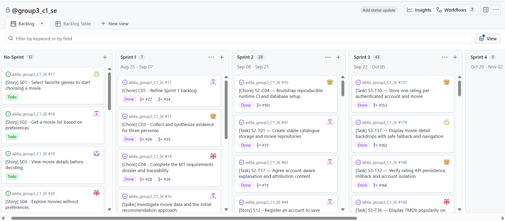

# Sprint 3 backlog refinement and closeout — C01 #132

PO: @kietxuan. Sprint 3 SM: @vu-huzy. Reviewer for this C01 change: @hoang3003,
or another teammate who did not author it.

**Actual Sprint 3: 05–18 October 2026**, confirmed by the PO in chat.
The board's Sep 22–Oct 05 label is an outdated shared calendar setting; the PO
asked that it remain unchanged. The seven-day execution plan is not a different
Sprint date range and is not proof of member-confirmed capacity.

## 1. Recording boundary and decision

This reconciliation was prepared on 2026-10-18 from live GitHub issue/PR records
and two original PO-supplied screenshots. Source snapshot:
[evidence/s3-c01-backlog/snapshot.json](evidence/s3-c01-backlog/snapshot.json).
Application/main base is `4ff81ab30df8cf448c3796f748b9451496e403c5`; product application files remain
equivalent to merged C04 main `0c4273ab792becb060fefd5e7341e755ed28d0a5`.

While this work was in progress, [PR #184](https://github.com/SE-FDA-NEU/ai66a_group3_C1_SE/pull/184) merged externally at
`4ff81ab30df8cf448c3796f748b9451496e403c5` and [#127](https://github.com/SE-FDA-NEU/ai66a_group3_C1_SE/issues/127) closed. C01 was fast-forwarded to that
main before its own commit. No C01 action closed/reopened a Story, Task or Chore.

**C01 remains open pending independent review and truthful completion of its
unconfirmed planning checks.** A merged implementation or green CI is not by
itself proof of Story DoD, an unfamiliar-human trial, capacity or submission.

## 2. Fixed scope and boundaries

- Six P0: [#17](https://github.com/SE-FDA-NEU/ai66a_group3_C1_SE/issues/17), [#18](https://github.com/SE-FDA-NEU/ai66a_group3_C1_SE/issues/18), [#19](https://github.com/SE-FDA-NEU/ai66a_group3_C1_SE/issues/19), [#20](https://github.com/SE-FDA-NEU/ai66a_group3_C1_SE/issues/20), [#44](https://github.com/SE-FDA-NEU/ai66a_group3_C1_SE/issues/44), [#45](https://github.com/SE-FDA-NEU/ai66a_group3_C1_SE/issues/45); all unchanged AC remain required.
  No narrower M3 scope or instructor exception is proposed by this change.
- S06 [#23](https://github.com/SE-FDA-NEU/ai66a_group3_C1_SE/issues/23) and S09 [#31](https://github.com/SE-FDA-NEU/ai66a_group3_C1_SE/issues/31) are recorded separately from the six-P0 gate.
  Rating storage/UI [#21](https://github.com/SE-FDA-NEU/ai66a_group3_C1_SE/issues/21) is implemented by its tasks, but the parent Story
  is not silently accepted by this planning audit.
- Mandatory data path: server-side TMDb import → migrated SQLite → local API.
  Runtime browsing/recommendations do not call the TMDb API. Automated tests
  stay synthetic/offline/token-free; live provenance is separate.
- Sprint 3 ranking uses genre + popularity. Rating-adjusted ranking [#22](https://github.com/SE-FDA-NEU/ai66a_group3_C1_SE/issues/22)
  stays in Sprint 4. NLP Spike [#43](https://github.com/SE-FDA-NEU/ai66a_group3_C1_SE/issues/43) is completed investigation, not completed
  S07/S08 production functionality.
- Ratings belong to authenticated accounts. The implementation tasks are
  [#137](https://github.com/SE-FDA-NEU/ai66a_group3_C1_SE/issues/137), [#138](https://github.com/SE-FDA-NEU/ai66a_group3_C1_SE/issues/138), [#139](https://github.com/SE-FDA-NEU/ai66a_group3_C1_SE/issues/139), [#142](https://github.com/SE-FDA-NEU/ai66a_group3_C1_SE/issues/142); [#140](https://github.com/SE-FDA-NEU/ai66a_group3_C1_SE/issues/140), [#141](https://github.com/SE-FDA-NEU/ai66a_group3_C1_SE/issues/141), [#125](https://github.com/SE-FDA-NEU/ai66a_group3_C1_SE/issues/125)
  verify them. Verification task #125 is not implementation coverage.
- Reset has an atomic authenticated backend under [#142](https://github.com/SE-FDA-NEU/ai66a_group3_C1_SE/issues/142). Full profile/reset
  UI [#33](https://github.com/SE-FDA-NEU/ai66a_group3_C1_SE/issues/33) is not claimed complete.
- Backdrop chain: [#129](https://github.com/SE-FDA-NEU/ai66a_group3_C1_SE/issues/129) storage → [#130](https://github.com/SE-FDA-NEU/ai66a_group3_C1_SE/issues/130) importer/API → [#179](https://github.com/SE-FDA-NEU/ai66a_group3_C1_SE/issues/179) UI →
  [#131](https://github.com/SE-FDA-NEU/ai66a_group3_C1_SE/issues/131) independent acceptance. Popularity display is [#168](https://github.com/SE-FDA-NEU/ai66a_group3_C1_SE/issues/168).
  These additions do not add a Story or change S03 AC/points.
- Trailer remains Sprint 4; watch providers remain optional/stretch. They are
  not new M3 conditions and are not silently marked done here.
- Existing M2 implementations are reused. No duplicate auth/catalogue Task is
  created during this closeout. Prior tracked TMDb decision: [PR #143](https://github.com/SE-FDA-NEU/ai66a_group3_C1_SE/pull/143);
  [runbook](tmdb-sprint3-runbook.md).

## 3. Planning images and what they actually show

[Project board](https://github.com/orgs/SE-FDA-NEU/projects/9)

### Beginning-of-Sprint-3 status board — PO identification

The PO identifies this as the start-of-Sprint-3 image. It shows all four columns:
**Todo 53, In Progress 0, In Review 0, Done 35**. It is a global, unfiltered board:
visible Done cards include Sprint 2 work. These are **not** 53 committed Sprint 3
items, 35 Sprint 3 completions, or Story Points. No capture timestamp is visible;
none is invented from the file's copy/download time.

### Later iteration snapshot

Sprint 3 shows **43** items, consistent in count with the current 37 Task +
5 Chore + 1 Spike inventory. Count equality alone does not prove the identity
of all 43 items; only part of each scrollable column is visible. The image is
grouped by iteration, not workflow status, and visibly places #17–#20 in
**No Sprint**. Reconcile Story iterations with actual commitment/acceptance rather
than moving them retroactively merely to improve the screenshot.

The old Sep 22–Oct 05 board label is intentionally preserved; actual dates above
come from the PO. Do not edit the image or treat it as the submission-day
four-column capture. C02/C05 own the final appropriately filtered board capture.

Project API access lacks `read:project`; the available browser was unauthenticated
and GitHub returned 404 for the private project. No token scopes, project access,
calendar settings or item fields were changed. Full enumeration/status/points
verification remains a manual PO/SM step. Keep the board private/public access
arrangement suitable for the instructor without sharing credentials.

## 4. Current inventory and dependency map

**43 work items: 37 Task, 5 Chore, 1 Spike.** After the T25 merge: **39 closed /
4 open**. Open items are [#132](https://github.com/SE-FDA-NEU/ai66a_group3_C1_SE/issues/132), [#133](https://github.com/SE-FDA-NEU/ai66a_group3_C1_SE/issues/133), [#134](https://github.com/SE-FDA-NEU/ai66a_group3_C1_SE/issues/134), [#136](https://github.com/SE-FDA-NEU/ai66a_group3_C1_SE/issues/136).
Parent Stories are not counted again as work-item completion or per-task points.

Owner means current GitHub assignee, after actual handoffs; it is not an invented
original planning assignment or sole-authorship claim. Recorded reviewers/receipts
are in the JSON snapshot and live issue metadata. Historical per-task planned
completion days were not supplied/recorded in the retrieved issue bodies;
actual merge times below must not be relabelled planned dates.

| Issue / work | Parent or scope | Current owner | Reviewer / requested reviewer | Hard prerequisites | Milestone / coordination | Actual state and PR |
|---|---|---|---|---|---|---|
| [#43](https://github.com/SE-FDA-NEU/ai66a_group3_C1_SE/issues/43) Validate TF-IDF text similarity for movie discovery | Cross-cutting | @kietxuan | @anotify-vie | No task prerequisite; see milestone | Merged prerequisites before final integration | closed; [PR #146](https://github.com/SE-FDA-NEU/ai66a_group3_C1_SE/pull/146) — 2026-10-09 14:57 +07:00 |
| [#103](https://github.com/SE-FDA-NEU/ai66a_group3_C1_SE/issues/103) S3-T01 — Create account-owned preference storage and reads | #17 | @vu-huzy | @kietxuan | [#49](https://github.com/SE-FDA-NEU/ai66a_group3_C1_SE/issues/49), [#56](https://github.com/SE-FDA-NEU/ai66a_group3_C1_SE/issues/56) | #134 initial account/schema contract | closed; [PR #147](https://github.com/SE-FDA-NEU/ai66a_group3_C1_SE/pull/147) — 2026-10-10 10:55 +07:00 |
| [#104](https://github.com/SE-FDA-NEU/ai66a_group3_C1_SE/issues/104) S3-T02 — Validate and atomically replace favourite genres | #17 | @kietxuan | @hoang3003 | [#103](https://github.com/SE-FDA-NEU/ai66a_group3_C1_SE/issues/103) | Merged prerequisites before final integration | closed; [PR #152](https://github.com/SE-FDA-NEU/ai66a_group3_C1_SE/pull/152) — 2026-10-10 23:02 +07:00 |
| [#105](https://github.com/SE-FDA-NEU/ai66a_group3_C1_SE/issues/105) S3-T03 — Verify preference API persistence and account isolation | #17 | @NguyenTuanAnh0608 | @hoang3003 | [#104](https://github.com/SE-FDA-NEU/ai66a_group3_C1_SE/issues/104) | Merged prerequisites before final integration | closed; [PR #159](https://github.com/SE-FDA-NEU/ai66a_group3_C1_SE/pull/159) — 2026-10-12 12:44 +07:00 |
| [#106](https://github.com/SE-FDA-NEU/ai66a_group3_C1_SE/issues/106) S3-T04 — Build home Start and genre-selection controls | #17 | @NguyenTuanAnh0608 | @hoang3003 | [#103](https://github.com/SE-FDA-NEU/ai66a_group3_C1_SE/issues/103) | #134 initial UI contract | closed; [PR #151](https://github.com/SE-FDA-NEU/ai66a_group3_C1_SE/pull/151) — 2026-10-10 23:18 +07:00 |
| [#107](https://github.com/SE-FDA-NEU/ai66a_group3_C1_SE/issues/107) S3-T05 — Integrate preference save restore and navigation | #17 | @anotify-vie | @hoang3003 | [#104](https://github.com/SE-FDA-NEU/ai66a_group3_C1_SE/issues/104), [#106](https://github.com/SE-FDA-NEU/ai66a_group3_C1_SE/issues/106) | Merged prerequisites before final integration | closed; [PR #158](https://github.com/SE-FDA-NEU/ai66a_group3_C1_SE/pull/158) — 2026-10-12 00:41 +07:00 |
| [#108](https://github.com/SE-FDA-NEU/ai66a_group3_C1_SE/issues/108) S3-T06 — Define deterministic recommendation fixtures and examples | #18 | @NguyenTuanAnh0608 | @anotify-vie | No task prerequisite; see milestone | #134 initial fixture contract | closed; [PR #149](https://github.com/SE-FDA-NEU/ai66a_group3_C1_SE/pull/149) — 2026-10-10 13:08 +07:00 |
| [#109](https://github.com/SE-FDA-NEU/ai66a_group3_C1_SE/issues/109) S3-T07 — Implement genre matching and bounded baseline ranking | #18 | @vu-huzy | @kietxuan | [#108](https://github.com/SE-FDA-NEU/ai66a_group3_C1_SE/issues/108), [#47](https://github.com/SE-FDA-NEU/ai66a_group3_C1_SE/issues/47) | Merged prerequisites before final integration | closed; [PR #154](https://github.com/SE-FDA-NEU/ai66a_group3_C1_SE/pull/154) — 2026-10-10 23:30 +07:00 |
| [#110](https://github.com/SE-FDA-NEU/ai66a_group3_C1_SE/issues/110) S3-T08 — Serve personalised recommendations and alternatives | #18 | @hoang3003 | @anotify-vie | [#104](https://github.com/SE-FDA-NEU/ai66a_group3_C1_SE/issues/104), [#109](https://github.com/SE-FDA-NEU/ai66a_group3_C1_SE/issues/109) | #134 approved initial recommendation contract | closed; [PR #156](https://github.com/SE-FDA-NEU/ai66a_group3_C1_SE/pull/156) — 2026-10-11 20:51 +07:00 |
| [#111](https://github.com/SE-FDA-NEU/ai66a_group3_C1_SE/issues/111) S3-T09 — Separate recommendation failures from valid empty results | #18 | @kietxuan | @NguyenTuanAnh0608 | [#110](https://github.com/SE-FDA-NEU/ai66a_group3_C1_SE/issues/110) | Merged prerequisites before final integration | closed; [PR #161](https://github.com/SE-FDA-NEU/ai66a_group3_C1_SE/pull/161) — 2026-10-12 15:48 +07:00 |
| [#112](https://github.com/SE-FDA-NEU/ai66a_group3_C1_SE/issues/112) S3-T10 — Render popular and personalised recommendation cards | #18 | @vu-huzy | @NguyenTuanAnh0608 | [#110](https://github.com/SE-FDA-NEU/ai66a_group3_C1_SE/issues/110), [#58](https://github.com/SE-FDA-NEU/ai66a_group3_C1_SE/issues/58), [#59](https://github.com/SE-FDA-NEU/ai66a_group3_C1_SE/issues/59) | #134 response contract; popular scaffolding can precede #110 final integration | closed; [PR #160](https://github.com/SE-FDA-NEU/ai66a_group3_C1_SE/pull/160) — 2026-10-12 15:35 +07:00 |
| [#113](https://github.com/SE-FDA-NEU/ai66a_group3_C1_SE/issues/113) S3-T11 — Implement no-match error retry and request-race states | #18 | @NguyenTuanAnh0608 | @kietxuan | [#111](https://github.com/SE-FDA-NEU/ai66a_group3_C1_SE/issues/111), [#112](https://github.com/SE-FDA-NEU/ai66a_group3_C1_SE/issues/112) | Merged prerequisites before final integration | closed; [PR #164](https://github.com/SE-FDA-NEU/ai66a_group3_C1_SE/pull/164) — 2026-10-13 15:15 +07:00 |
| [#114](https://github.com/SE-FDA-NEU/ai66a_group3_C1_SE/issues/114) S3-T12 — Verify five recommendation acceptance criteria | #18 | @hoang3003 | @kietxuan | [#108](https://github.com/SE-FDA-NEU/ai66a_group3_C1_SE/issues/108), [#111](https://github.com/SE-FDA-NEU/ai66a_group3_C1_SE/issues/111), [#113](https://github.com/SE-FDA-NEU/ai66a_group3_C1_SE/issues/113) | Merged prerequisites before final integration | closed; [PR #169](https://github.com/SE-FDA-NEU/ai66a_group3_C1_SE/pull/169) — 2026-10-14 20:09 +07:00 |
| [#115](https://github.com/SE-FDA-NEU/ai66a_group3_C1_SE/issues/115) S3-T13 — Complete cold-start transitions after saving preferences | #20 | @anotify-vie | @kietxuan | [#107](https://github.com/SE-FDA-NEU/ai66a_group3_C1_SE/issues/107), [#110](https://github.com/SE-FDA-NEU/ai66a_group3_C1_SE/issues/110), [#112](https://github.com/SE-FDA-NEU/ai66a_group3_C1_SE/issues/112), [#113](https://github.com/SE-FDA-NEU/ai66a_group3_C1_SE/issues/113), [#59](https://github.com/SE-FDA-NEU/ai66a_group3_C1_SE/issues/59) | Merged prerequisites before final integration | closed; [PR #171](https://github.com/SE-FDA-NEU/ai66a_group3_C1_SE/pull/171) — 2026-10-14 22:55 +07:00 |
| [#116](https://github.com/SE-FDA-NEU/ai66a_group3_C1_SE/issues/116) S3-T14 — Verify four cold-start acceptance criteria | #20 | @anotify-vie | @kietxuan | [#107](https://github.com/SE-FDA-NEU/ai66a_group3_C1_SE/issues/107), [#108](https://github.com/SE-FDA-NEU/ai66a_group3_C1_SE/issues/108), [#112](https://github.com/SE-FDA-NEU/ai66a_group3_C1_SE/issues/112), [#113](https://github.com/SE-FDA-NEU/ai66a_group3_C1_SE/issues/113), [#115](https://github.com/SE-FDA-NEU/ai66a_group3_C1_SE/issues/115) | Merged prerequisites before final integration | closed; [PR #176](https://github.com/SE-FDA-NEU/ai66a_group3_C1_SE/pull/176) — 2026-10-16 15:31 +07:00 |
| [#117](https://github.com/SE-FDA-NEU/ai66a_group3_C1_SE/issues/117) S3-T15 — Filter only the currently displayed recommendation snapshot | #23 | @kietxuan | @vu-huzy | [#112](https://github.com/SE-FDA-NEU/ai66a_group3_C1_SE/issues/112) | Merged prerequisites before final integration | closed; [PR #162](https://github.com/SE-FDA-NEU/ai66a_group3_C1_SE/pull/162) — 2026-10-13 10:01 +07:00 |
| [#118](https://github.com/SE-FDA-NEU/ai66a_group3_C1_SE/issues/118) S3-T16 — Verify filter reset and unchanged preferences | #23 | @kietxuan | @NguyenTuanAnh0608 | [#117](https://github.com/SE-FDA-NEU/ai66a_group3_C1_SE/issues/117) | Merged prerequisites before final integration | closed; [PR #167](https://github.com/SE-FDA-NEU/ai66a_group3_C1_SE/pull/167) — 2026-10-14 18:13 +07:00 |
| [#119](https://github.com/SE-FDA-NEU/ai66a_group3_C1_SE/issues/119) S3-T17 — Preserve details return context and account preferences | #19 | @NguyenTuanAnh0608 | @kietxuan | [#107](https://github.com/SE-FDA-NEU/ai66a_group3_C1_SE/issues/107), [#112](https://github.com/SE-FDA-NEU/ai66a_group3_C1_SE/issues/112), [#61](https://github.com/SE-FDA-NEU/ai66a_group3_C1_SE/issues/61) | Merged prerequisites before final integration | closed; [PR #165](https://github.com/SE-FDA-NEU/ai66a_group3_C1_SE/pull/165) — 2026-10-13 15:10 +07:00 |
| [#120](https://github.com/SE-FDA-NEU/ai66a_group3_C1_SE/issues/120) S3-T18 — Complete movie-detail acceptance with signed-in return flow | #19 | @vu-huzy | @kietxuan | [#119](https://github.com/SE-FDA-NEU/ai66a_group3_C1_SE/issues/119), [#62](https://github.com/SE-FDA-NEU/ai66a_group3_C1_SE/issues/62) | Merged prerequisites before final integration | closed; [PR #172](https://github.com/SE-FDA-NEU/ai66a_group3_C1_SE/pull/172) — 2026-10-14 20:36 +07:00 |
| [#121](https://github.com/SE-FDA-NEU/ai66a_group3_C1_SE/issues/121) S3-T19 — Expose the public popular catalogue using shared ranking | #31 | @anotify-vie | @NguyenTuanAnh0608 | [#58](https://github.com/SE-FDA-NEU/ai66a_group3_C1_SE/issues/58) | Merged prerequisites before final integration | closed; [PR #145](https://github.com/SE-FDA-NEU/ai66a_group3_C1_SE/pull/145) — 2026-10-09 16:37 +07:00 |
| [#122](https://github.com/SE-FDA-NEU/ai66a_group3_C1_SE/issues/122) S3-T20 — Build popular-movie page and public navigation | #31 | @hoang3003 | @anotify-vie | [#121](https://github.com/SE-FDA-NEU/ai66a_group3_C1_SE/issues/121) | Merged prerequisites before final integration | closed; [PR #148](https://github.com/SE-FDA-NEU/ai66a_group3_C1_SE/pull/148) — 2026-10-10 00:41 +07:00 |
| [#123](https://github.com/SE-FDA-NEU/ai66a_group3_C1_SE/issues/123) S3-T21 — Verify popular ordering and missing-data behaviour | #31 | @hoang3003 | @anotify-vie | [#122](https://github.com/SE-FDA-NEU/ai66a_group3_C1_SE/issues/122) | Merged prerequisites before final integration | closed; [PR #155](https://github.com/SE-FDA-NEU/ai66a_group3_C1_SE/pull/155) — 2026-10-10 23:30 +07:00 |
| [#124](https://github.com/SE-FDA-NEU/ai66a_group3_C1_SE/issues/124) S3-T22 — Verify full account preference recommendation journey | #17 | @NguyenTuanAnh0608 | @vu-huzy | [#105](https://github.com/SE-FDA-NEU/ai66a_group3_C1_SE/issues/105), [#107](https://github.com/SE-FDA-NEU/ai66a_group3_C1_SE/issues/107), [#114](https://github.com/SE-FDA-NEU/ai66a_group3_C1_SE/issues/114) | Merged prerequisites before final integration | closed; [PR #174](https://github.com/SE-FDA-NEU/ai66a_group3_C1_SE/pull/174) — 2026-10-16 14:43 +07:00 |
| [#125](https://github.com/SE-FDA-NEU/ai66a_group3_C1_SE/issues/125) S3-T23 — Complete S13 authentication and account-isolation acceptance | #45 | @anotify-vie | @hoang3003 | [#105](https://github.com/SE-FDA-NEU/ai66a_group3_C1_SE/issues/105), [#114](https://github.com/SE-FDA-NEU/ai66a_group3_C1_SE/issues/114), [#116](https://github.com/SE-FDA-NEU/ai66a_group3_C1_SE/issues/116), [#140](https://github.com/SE-FDA-NEU/ai66a_group3_C1_SE/issues/140), [#141](https://github.com/SE-FDA-NEU/ai66a_group3_C1_SE/issues/141), [#142](https://github.com/SE-FDA-NEU/ai66a_group3_C1_SE/issues/142) | Merged prerequisites before final integration | closed; [PR #178](https://github.com/SE-FDA-NEU/ai66a_group3_C1_SE/pull/178) — 2026-10-17 11:42 +07:00 |
| [#126](https://github.com/SE-FDA-NEU/ai66a_group3_C1_SE/issues/126) S3-T24 — Check keyboard mobile and recoverable preference controls | #17 | @vu-huzy | @hoang3003 | [#107](https://github.com/SE-FDA-NEU/ai66a_group3_C1_SE/issues/107), [#113](https://github.com/SE-FDA-NEU/ai66a_group3_C1_SE/issues/113) | Merged prerequisites before final integration | closed; [PR #173](https://github.com/SE-FDA-NEU/ai66a_group3_C1_SE/pull/173) — 2026-10-15 09:02 +07:00 |
| [#127](https://github.com/SE-FDA-NEU/ai66a_group3_C1_SE/issues/127) S3-T25 — Record M3 route-to-story acceptance handoff | Cross-cutting | @anotify-vie | @hoang3003 | [#114](https://github.com/SE-FDA-NEU/ai66a_group3_C1_SE/issues/114), [#116](https://github.com/SE-FDA-NEU/ai66a_group3_C1_SE/issues/116), [#118](https://github.com/SE-FDA-NEU/ai66a_group3_C1_SE/issues/118), [#120](https://github.com/SE-FDA-NEU/ai66a_group3_C1_SE/issues/120), [#123](https://github.com/SE-FDA-NEU/ai66a_group3_C1_SE/issues/123), [#124](https://github.com/SE-FDA-NEU/ai66a_group3_C1_SE/issues/124), [#125](https://github.com/SE-FDA-NEU/ai66a_group3_C1_SE/issues/125), [#126](https://github.com/SE-FDA-NEU/ai66a_group3_C1_SE/issues/126), [#128](https://github.com/SE-FDA-NEU/ai66a_group3_C1_SE/issues/128), [#131](https://github.com/SE-FDA-NEU/ai66a_group3_C1_SE/issues/131), [#135](https://github.com/SE-FDA-NEU/ai66a_group3_C1_SE/issues/135) | Merged prerequisites before final integration | closed; [PR #184](https://github.com/SE-FDA-NEU/ai66a_group3_C1_SE/pull/184) — 2026-10-18 16:37 +07:00 |
| [#128](https://github.com/SE-FDA-NEU/ai66a_group3_C1_SE/issues/128) S3-T29 — Make TMDb catalogue import the required Sprint 3 data source | Cross-cutting | @kietxuan | @vu-huzy | No task prerequisite; see milestone | #134 initial source contract + #135 setup guidance, not whole-Chore closure | closed; [PR #150](https://github.com/SE-FDA-NEU/ai66a_group3_C1_SE/pull/150) — 2026-10-10 10:39 +07:00 |
| [#129](https://github.com/SE-FDA-NEU/ai66a_group3_C1_SE/issues/129) S3-T26 — Add nullable backdrop storage without changing catalogue identity | #19 | @kietxuan | @NguyenTuanAnh0608 | [#103](https://github.com/SE-FDA-NEU/ai66a_group3_C1_SE/issues/103), [#104](https://github.com/SE-FDA-NEU/ai66a_group3_C1_SE/issues/104), [#137](https://github.com/SE-FDA-NEU/ai66a_group3_C1_SE/issues/137), [#128](https://github.com/SE-FDA-NEU/ai66a_group3_C1_SE/issues/128), [#114](https://github.com/SE-FDA-NEU/ai66a_group3_C1_SE/issues/114), [#116](https://github.com/SE-FDA-NEU/ai66a_group3_C1_SE/issues/116), [#120](https://github.com/SE-FDA-NEU/ai66a_group3_C1_SE/issues/120), [#124](https://github.com/SE-FDA-NEU/ai66a_group3_C1_SE/issues/124), [#125](https://github.com/SE-FDA-NEU/ai66a_group3_C1_SE/issues/125) | Recorded G3: PO/SM confirmation, P0 verification, accepted #128, #134 media contract and #135 baseline; original capacity record not supplied | closed; [PR #180](https://github.com/SE-FDA-NEU/ai66a_group3_C1_SE/pull/180) — 2026-10-17 14:38 +07:00 |
| [#130](https://github.com/SE-FDA-NEU/ai66a_group3_C1_SE/issues/130) S3-T27 — Import backdrop paths and expose safe detail image URLs | #19 | @NguyenTuanAnh0608 | @hoang3003 | [#128](https://github.com/SE-FDA-NEU/ai66a_group3_C1_SE/issues/128), [#129](https://github.com/SE-FDA-NEU/ai66a_group3_C1_SE/issues/129) | #134 additive media contract and G3; does not wait for #131 | closed; [PR #181](https://github.com/SE-FDA-NEU/ai66a_group3_C1_SE/pull/181) — 2026-10-17 20:27 +07:00 |
| [#131](https://github.com/SE-FDA-NEU/ai66a_group3_C1_SE/issues/131) S3-T28 — Verify backdrop migration import and detail compatibility independently | #19 | @kietxuan | @hoang3003 | [#129](https://github.com/SE-FDA-NEU/ai66a_group3_C1_SE/issues/129), [#130](https://github.com/SE-FDA-NEU/ai66a_group3_C1_SE/issues/130), [#179](https://github.com/SE-FDA-NEU/ai66a_group3_C1_SE/issues/179) | Final UI verification after #179; no circular prerequisite on #131 for UI | closed; [PR #183](https://github.com/SE-FDA-NEU/ai66a_group3_C1_SE/pull/183) — 2026-10-17 23:58 +07:00 |
| [#132](https://github.com/SE-FDA-NEU/ai66a_group3_C1_SE/issues/132) S3-C01 — Refine the Sprint 3 backlog | Cross-cutting | @kietxuan | @hoang3003 | No task prerequisite; see milestone | Planning first; truthful final backlog reconciliation; not blocked by PDF export | open; No closeout PR yet |
| [#133](https://github.com/SE-FDA-NEU/ai66a_group3_C1_SE/issues/133) S3-C02 — Complete the Sprint 3 wrap-up | Cross-cutting | @vu-huzy | @kietxuan | [#127](https://github.com/SE-FDA-NEU/ai66a_group3_C1_SE/issues/127), [#136](https://github.com/SE-FDA-NEU/ai66a_group3_C1_SE/issues/136) | #132 planning evidence + actual Review and submission receipt; #133 log milestone is supplied to #136 earlier | open; No closeout PR yet |
| [#134](https://github.com/SE-FDA-NEU/ai66a_group3_C1_SE/issues/134) S3-C03 — Reconcile account recommendation and popularity contracts | Cross-cutting | @hoang3003 | @vu-huzy | No task prerequisite; see milestone | Initial PR #144 is merged; final API/schema/UI/design reconciliation remains open; coordinate design change with #136 | open; [PR #144](https://github.com/SE-FDA-NEU/ai66a_group3_C1_SE/pull/144) — 2026-10-09 13:47 +07:00 |
| [#135](https://github.com/SE-FDA-NEU/ai66a_group3_C1_SE/issues/135) S3-C04 — Maintain isolated integration tests and clean-clone setup | Cross-cutting | @NguyenTuanAnh0608 | @anotify-vie | [#128](https://github.com/SE-FDA-NEU/ai66a_group3_C1_SE/issues/128), [#131](https://github.com/SE-FDA-NEU/ai66a_group3_C1_SE/issues/131) | Final application candidate and #131, if shipping backdrop; early setup milestone precedes #128 | closed; [PR #185](https://github.com/SE-FDA-NEU/ai66a_group3_C1_SE/pull/185) — 2026-10-18 15:40 +07:00 |
| [#136](https://github.com/SE-FDA-NEU/ai66a_group3_C1_SE/issues/136) S3-C05 — Package M3 UI flow and accessibility evidence | Cross-cutting | @anotify-vie | @hoang3003 | [#127](https://github.com/SE-FDA-NEU/ai66a_group3_C1_SE/issues/127), [#128](https://github.com/SE-FDA-NEU/ai66a_group3_C1_SE/issues/128), [#135](https://github.com/SE-FDA-NEU/ai66a_group3_C1_SE/issues/135) | #134 design milestone + #133 log/evidence milestone, not their whole-Chore closures | open; No closeout PR yet |
| [#137](https://github.com/SE-FDA-NEU/ai66a_group3_C1_SE/issues/137) S3-T30 — Store one rating per authenticated account and movie | #21 — supporting S13 #45 AC3/AC5. | @anotify-vie | @kietxuan | [#103](https://github.com/SE-FDA-NEU/ai66a_group3_C1_SE/issues/103) | #134 rating-schema contract; current Alembic head | closed; [PR #153](https://github.com/SE-FDA-NEU/ai66a_group3_C1_SE/pull/153) — 2026-10-11 11:42 +07:00 |
| [#138](https://github.com/SE-FDA-NEU/ai66a_group3_C1_SE/issues/138) S3-T31 — Implement protected atomic rating reads and writes | #21 — supporting S13 #45 AC3/AC5. | @vu-huzy | @NguyenTuanAnh0608 | [#137](https://github.com/SE-FDA-NEU/ai66a_group3_C1_SE/issues/137) | #134 payload/error/auth contract | closed; [PR #157](https://github.com/SE-FDA-NEU/ai66a_group3_C1_SE/pull/157) — 2026-10-12 09:36 +07:00 |
| [#139](https://github.com/SE-FDA-NEU/ai66a_group3_C1_SE/issues/139) S3-T33 — Add a safe account rating control and recoverable saved state | #21 — supporting S13 #45 AC3/AC5. | @kietxuan | @NguyenTuanAnh0608 | [#138](https://github.com/SE-FDA-NEU/ai66a_group3_C1_SE/issues/138), [#119](https://github.com/SE-FDA-NEU/ai66a_group3_C1_SE/issues/119) | #134 component contract; shared detail-shell coordination | closed; [PR #170](https://github.com/SE-FDA-NEU/ai66a_group3_C1_SE/pull/170) — 2026-10-14 18:32 +07:00 |
| [#140](https://github.com/SE-FDA-NEU/ai66a_group3_C1_SE/issues/140) S3-T32 — Verify rating API persistence, rollback and account isolation | #21 — supporting S13 #45. | @anotify-vie | @NguyenTuanAnh0608 | [#138](https://github.com/SE-FDA-NEU/ai66a_group3_C1_SE/issues/138) | Merged prerequisites before final integration | closed; [PR #166](https://github.com/SE-FDA-NEU/ai66a_group3_C1_SE/pull/166) — 2026-10-13 10:26 +07:00 |
| [#141](https://github.com/SE-FDA-NEU/ai66a_group3_C1_SE/issues/141) S3-T34 — Verify rating UI authentication guards and account-switch recovery | #45 — related rating capability #21. | @hoang3003 | @vu-huzy | [#140](https://github.com/SE-FDA-NEU/ai66a_group3_C1_SE/issues/140), [#139](https://github.com/SE-FDA-NEU/ai66a_group3_C1_SE/issues/139) | Merged prerequisites before final integration | closed; [PR #177](https://github.com/SE-FDA-NEU/ai66a_group3_C1_SE/pull/177) — 2026-10-16 14:53 +07:00 |
| [#142](https://github.com/SE-FDA-NEU/ai66a_group3_C1_SE/issues/142) S3-T35 — Implement an authenticated atomic personalisation-reset boundary | #33 - supporting S13 #45 AC5. | @hoang3003 | @vu-huzy | [#104](https://github.com/SE-FDA-NEU/ai66a_group3_C1_SE/issues/104), [#138](https://github.com/SE-FDA-NEU/ai66a_group3_C1_SE/issues/138) | #134 reset contract | closed; [PR #163](https://github.com/SE-FDA-NEU/ai66a_group3_C1_SE/pull/163) — 2026-10-13 02:29 +07:00 |
| [#168](https://github.com/SE-FDA-NEU/ai66a_group3_C1_SE/issues/168) S3-T36 — Display TMDb popularity on movie cards and details | #31 | @vu-huzy | @kietxuan | [#112](https://github.com/SE-FDA-NEU/ai66a_group3_C1_SE/issues/112), [#119](https://github.com/SE-FDA-NEU/ai66a_group3_C1_SE/issues/119), [#121](https://github.com/SE-FDA-NEU/ai66a_group3_C1_SE/issues/121), [#122](https://github.com/SE-FDA-NEU/ai66a_group3_C1_SE/issues/122) | Merged prerequisites before final integration | closed; [PR #175](https://github.com/SE-FDA-NEU/ai66a_group3_C1_SE/pull/175) — 2026-10-16 19:08 +07:00 |
| [#179](https://github.com/SE-FDA-NEU/ai66a_group3_C1_SE/issues/179) S3-T37 — Display movie-detail backdrops with safe fallback and navigation | #19 | @hoang3003 | @NguyenTuanAnh0608 | [#129](https://github.com/SE-FDA-NEU/ai66a_group3_C1_SE/issues/129), [#130](https://github.com/SE-FDA-NEU/ai66a_group3_C1_SE/issues/130) | #134 media contract, admitted G3 and a coordinated single-writer slot | closed; [PR #182](https://github.com/SE-FDA-NEU/ai66a_group3_C1_SE/pull/182) — 2026-10-17 23:08 +07:00 |

Dependency links describe final integration/acceptance order, not a ban on
contract-based scaffolding. Documentation Chores have separate milestones:

1. #134 initial contract and #135 early setup guidance can unblock consumers
   without either whole Chore closing.
2. #128 provides accepted import/provenance. Preferences, recommendations,
   auth/rating/reset and UI tests consume their own merged prerequisites.
3. Backdrop final chain is #129 → #130 → #179 → #131. #179 does **not** wait for
   #131, avoiding a UI/verifier cycle.
4. #135 final environment verification consumes the final candidate and #131;
   #127 consumes that verification and the acceptance suites.
5. #136 consumes #127, #135, #134's design milestone and #133's log/evidence
   milestone. #133 final wrap-up follows #136 and the actual Review/submission;
   #136 does not wait for whole-Chore #133 closure.
6. C01 can reconcile backlog truthfully without waiting for PDF export. Closing
   C01 does not close the other handoffs or assert that all P0 are `works`.

## 5. All six P0 AC mapped to implementation and verification

AC wording follows the unchanged Story bodies; correcting #19's BR reference to
BR6 does not alter its AC. Existing Sprint 2 implementation files are linked
where a new Task would duplicate completed work. The complete executable
acceptance report is [T25](evidence/s3-m3-p0-handoff/README.md), now on main.

| Story / AC | Unchanged criterion | Implementation coverage | Verification coverage |
|---|---|---|---|
| [#17](https://github.com/SE-FDA-NEU/ai66a_group3_C1_SE/issues/17) AC1 | Given I am signed in on the home page, when I select Start, then the system opens `/preferences` and displays the available genres. | [#106](https://github.com/SE-FDA-NEU/ai66a_group3_C1_SE/issues/106) | [#105](https://github.com/SE-FDA-NEU/ai66a_group3_C1_SE/issues/105), [#124](https://github.com/SE-FDA-NEU/ai66a_group3_C1_SE/issues/124); [#127](https://github.com/SE-FDA-NEU/ai66a_group3_C1_SE/issues/127) |
| [#17](https://github.com/SE-FDA-NEU/ai66a_group3_C1_SE/issues/17) AC2 | Given I select 1 to 5 valid genres while signed in, when I confirm my selection, then the system saves the choices for my account and navigates to `/recommendations`. | [#103](https://github.com/SE-FDA-NEU/ai66a_group3_C1_SE/issues/103), [#104](https://github.com/SE-FDA-NEU/ai66a_group3_C1_SE/issues/104), [#107](https://github.com/SE-FDA-NEU/ai66a_group3_C1_SE/issues/107) | [#105](https://github.com/SE-FDA-NEU/ai66a_group3_C1_SE/issues/105), [#124](https://github.com/SE-FDA-NEU/ai66a_group3_C1_SE/issues/124); [#127](https://github.com/SE-FDA-NEU/ai66a_group3_C1_SE/issues/127) |
| [#17](https://github.com/SE-FDA-NEU/ai66a_group3_C1_SE/issues/17) AC3 | Given I have not selected any genre, when I confirm, then the system asks me to select at least one genre and keeps me on the same screen. | [#104](https://github.com/SE-FDA-NEU/ai66a_group3_C1_SE/issues/104), [#106](https://github.com/SE-FDA-NEU/ai66a_group3_C1_SE/issues/106), [#107](https://github.com/SE-FDA-NEU/ai66a_group3_C1_SE/issues/107) | [#105](https://github.com/SE-FDA-NEU/ai66a_group3_C1_SE/issues/105), [#124](https://github.com/SE-FDA-NEU/ai66a_group3_C1_SE/issues/124); [#127](https://github.com/SE-FDA-NEU/ai66a_group3_C1_SE/issues/127) |
| [#17](https://github.com/SE-FDA-NEU/ai66a_group3_C1_SE/issues/17) AC4 | Given I have selected 5 genres, when I try to select a sixth genre, then the system shows the limit and keeps the previous 5 selections. | [#104](https://github.com/SE-FDA-NEU/ai66a_group3_C1_SE/issues/104), [#106](https://github.com/SE-FDA-NEU/ai66a_group3_C1_SE/issues/106), [#107](https://github.com/SE-FDA-NEU/ai66a_group3_C1_SE/issues/107) | [#105](https://github.com/SE-FDA-NEU/ai66a_group3_C1_SE/issues/105), [#124](https://github.com/SE-FDA-NEU/ai66a_group3_C1_SE/issues/124); [#127](https://github.com/SE-FDA-NEU/ai66a_group3_C1_SE/issues/127) |
| [#17](https://github.com/SE-FDA-NEU/ai66a_group3_C1_SE/issues/17) AC5 | Given my signed-in account already has preferences, when I return to edit them, then the system shows my current selections and another account cannot see them. | [#103](https://github.com/SE-FDA-NEU/ai66a_group3_C1_SE/issues/103), [#104](https://github.com/SE-FDA-NEU/ai66a_group3_C1_SE/issues/104), [#107](https://github.com/SE-FDA-NEU/ai66a_group3_C1_SE/issues/107) | [#105](https://github.com/SE-FDA-NEU/ai66a_group3_C1_SE/issues/105), [#124](https://github.com/SE-FDA-NEU/ai66a_group3_C1_SE/issues/124); [#127](https://github.com/SE-FDA-NEU/ai66a_group3_C1_SE/issues/127) |
| [#18](https://github.com/SE-FDA-NEU/ai66a_group3_C1_SE/issues/18) AC1 | Given the signed-in account has selected valid favourite genres and matching movies exist, When recommendations are requested, Then the system displays up to 10 distinct movies that each match at least one selected genre. | [#109](https://github.com/SE-FDA-NEU/ai66a_group3_C1_SE/issues/109), [#110](https://github.com/SE-FDA-NEU/ai66a_group3_C1_SE/issues/110), [#112](https://github.com/SE-FDA-NEU/ai66a_group3_C1_SE/issues/112) | [#114](https://github.com/SE-FDA-NEU/ai66a_group3_C1_SE/issues/114); [#127](https://github.com/SE-FDA-NEU/ai66a_group3_C1_SE/issues/127) |
| [#18](https://github.com/SE-FDA-NEU/ai66a_group3_C1_SE/issues/18) AC2 | Given recommendation results are displayed, When the user views a movie card, Then the card shows the movie title, genres, and a clear reason that names at least one matching selected genre. | [#110](https://github.com/SE-FDA-NEU/ai66a_group3_C1_SE/issues/110), [#112](https://github.com/SE-FDA-NEU/ai66a_group3_C1_SE/issues/112) | [#114](https://github.com/SE-FDA-NEU/ai66a_group3_C1_SE/issues/114); [#127](https://github.com/SE-FDA-NEU/ai66a_group3_C1_SE/issues/127) |
| [#18](https://github.com/SE-FDA-NEU/ai66a_group3_C1_SE/issues/18) AC3 | Given no movies match the selected genres, When recommendations are requested, Then the system shows a no-match message, up to 10 popular alternative movies, and actions to change preferences or retry. | [#110](https://github.com/SE-FDA-NEU/ai66a_group3_C1_SE/issues/110), [#111](https://github.com/SE-FDA-NEU/ai66a_group3_C1_SE/issues/111), [#113](https://github.com/SE-FDA-NEU/ai66a_group3_C1_SE/issues/113) | [#114](https://github.com/SE-FDA-NEU/ai66a_group3_C1_SE/issues/114); [#127](https://github.com/SE-FDA-NEU/ai66a_group3_C1_SE/issues/127) |
| [#18](https://github.com/SE-FDA-NEU/ai66a_group3_C1_SE/issues/18) AC4 | Given the recommendation source fails, When recommendations are requested, Then the system shows an error message and a retry action while keeping the selected preferences unchanged. | [#111](https://github.com/SE-FDA-NEU/ai66a_group3_C1_SE/issues/111), [#113](https://github.com/SE-FDA-NEU/ai66a_group3_C1_SE/issues/113) | [#114](https://github.com/SE-FDA-NEU/ai66a_group3_C1_SE/issues/114); [#127](https://github.com/SE-FDA-NEU/ai66a_group3_C1_SE/issues/127) |
| [#18](https://github.com/SE-FDA-NEU/ai66a_group3_C1_SE/issues/18) AC5 | Given the user retries after a recommendation-source failure, When the request succeeds, Then the system displays the recommendation results. | [#113](https://github.com/SE-FDA-NEU/ai66a_group3_C1_SE/issues/113) | [#114](https://github.com/SE-FDA-NEU/ai66a_group3_C1_SE/issues/114); [#127](https://github.com/SE-FDA-NEU/ai66a_group3_C1_SE/issues/127) |
| [#19](https://github.com/SE-FDA-NEU/ai66a_group3_C1_SE/issues/19) AC1 | Given a movie card has a valid ID, when I select View details, then the system opens the correct route and displays the movie title, year, genres, and summary. | Existing Sprint 2 implementation; [main.py](../backend/app/main.py), [movies.py](../backend/app/repositories/movies.py), [MovieDetailPage.tsx](../frontend/src/pages/MovieDetailPage.tsx) | [#120](https://github.com/SE-FDA-NEU/ai66a_group3_C1_SE/issues/120); [#127](https://github.com/SE-FDA-NEU/ai66a_group3_C1_SE/issues/127) |
| [#19](https://github.com/SE-FDA-NEU/ai66a_group3_C1_SE/issues/19) AC2 | Given the movie ID does not exist, when I open the details URL, then the system shows “Movie not found” and a link back to the movie list. | Existing Sprint 2 implementation; [main.py](../backend/app/main.py), [movies.py](../backend/app/repositories/movies.py), [MovieDetailPage.tsx](../frontend/src/pages/MovieDetailPage.tsx) | [#120](https://github.com/SE-FDA-NEU/ai66a_group3_C1_SE/issues/120); [#127](https://github.com/SE-FDA-NEU/ai66a_group3_C1_SE/issues/127) |
| [#19](https://github.com/SE-FDA-NEU/ai66a_group3_C1_SE/issues/19) AC3 | Given the movie is missing a summary or year, when I open the details page, then the system shows “Information unavailable” for the missing field and still displays the remaining fields. | Existing Sprint 2 implementation; [main.py](../backend/app/main.py), [movies.py](../backend/app/repositories/movies.py), [MovieDetailPage.tsx](../frontend/src/pages/MovieDetailPage.tsx) | [#120](https://github.com/SE-FDA-NEU/ai66a_group3_C1_SE/issues/120); [#127](https://github.com/SE-FDA-NEU/ai66a_group3_C1_SE/issues/127) |
| [#19](https://github.com/SE-FDA-NEU/ai66a_group3_C1_SE/issues/19) AC4 | Given I am viewing movie details, when I return to the movie list, then I can continue the recommendation flow with the signed-in account's saved preferences preserved. | [#107](https://github.com/SE-FDA-NEU/ai66a_group3_C1_SE/issues/107), [#112](https://github.com/SE-FDA-NEU/ai66a_group3_C1_SE/issues/112), [#119](https://github.com/SE-FDA-NEU/ai66a_group3_C1_SE/issues/119); [main.py](../backend/app/main.py), [movies.py](../backend/app/repositories/movies.py), [MovieDetailPage.tsx](../frontend/src/pages/MovieDetailPage.tsx) | [#120](https://github.com/SE-FDA-NEU/ai66a_group3_C1_SE/issues/120); [#127](https://github.com/SE-FDA-NEU/ai66a_group3_C1_SE/issues/127) |
| [#20](https://github.com/SE-FDA-NEU/ai66a_group3_C1_SE/issues/20) AC1 | Given a newly signed-in account has no preferences and the fallback dataset contains Movie A with popularity score 90, Movie B with score 80, and Movie C with score 80, when I open the recommendations page, then Movie A appears first and Movies B and C are ordered alphabetically by title, with at most 10 movies displayed and marked as not personalised. | [#110](https://github.com/SE-FDA-NEU/ai66a_group3_C1_SE/issues/110), [#112](https://github.com/SE-FDA-NEU/ai66a_group3_C1_SE/issues/112), [#115](https://github.com/SE-FDA-NEU/ai66a_group3_C1_SE/issues/115) | [#116](https://github.com/SE-FDA-NEU/ai66a_group3_C1_SE/issues/116); [#127](https://github.com/SE-FDA-NEU/ai66a_group3_C1_SE/issues/127) |
| [#20](https://github.com/SE-FDA-NEU/ai66a_group3_C1_SE/issues/20) AC2 | Given I am viewing the fallback movie list, when I select Enter preferences, then the system navigates to `/preferences`. | [#106](https://github.com/SE-FDA-NEU/ai66a_group3_C1_SE/issues/106), [#115](https://github.com/SE-FDA-NEU/ai66a_group3_C1_SE/issues/115) | [#116](https://github.com/SE-FDA-NEU/ai66a_group3_C1_SE/issues/116); [#127](https://github.com/SE-FDA-NEU/ai66a_group3_C1_SE/issues/127) |
| [#20](https://github.com/SE-FDA-NEU/ai66a_group3_C1_SE/issues/20) AC3 | Given the popular movie data is empty, when I open the recommendations page in a newly signed-in account, then the system shows a no-data message and guidance to enter preferences without displaying fake movies. | [#111](https://github.com/SE-FDA-NEU/ai66a_group3_C1_SE/issues/111), [#112](https://github.com/SE-FDA-NEU/ai66a_group3_C1_SE/issues/112), [#113](https://github.com/SE-FDA-NEU/ai66a_group3_C1_SE/issues/113), [#115](https://github.com/SE-FDA-NEU/ai66a_group3_C1_SE/issues/115) | [#116](https://github.com/SE-FDA-NEU/ai66a_group3_C1_SE/issues/116); [#127](https://github.com/SE-FDA-NEU/ai66a_group3_C1_SE/issues/127) |
| [#20](https://github.com/SE-FDA-NEU/ai66a_group3_C1_SE/issues/20) AC4 | Given valid preferences have been saved, when I open the recommendations page again, then the system uses the personalized behavior from S02 and follows BR4 if the result is empty. | [#104](https://github.com/SE-FDA-NEU/ai66a_group3_C1_SE/issues/104), [#107](https://github.com/SE-FDA-NEU/ai66a_group3_C1_SE/issues/107), [#110](https://github.com/SE-FDA-NEU/ai66a_group3_C1_SE/issues/110), [#112](https://github.com/SE-FDA-NEU/ai66a_group3_C1_SE/issues/112), [#113](https://github.com/SE-FDA-NEU/ai66a_group3_C1_SE/issues/113), [#115](https://github.com/SE-FDA-NEU/ai66a_group3_C1_SE/issues/115) | [#116](https://github.com/SE-FDA-NEU/ai66a_group3_C1_SE/issues/116); [#127](https://github.com/SE-FDA-NEU/ai66a_group3_C1_SE/issues/127) |
| [#44](https://github.com/SE-FDA-NEU/ai66a_group3_C1_SE/issues/44) AC1 | Given I enter a valid email address and a password with at least 8 characters, when I submit the registration form, then the system creates one account and sends me to `/login`. | Existing Sprint 2 implementation; [main.py](../backend/app/main.py), [users.py](../backend/app/repositories/users.py), [passwords.py](../backend/app/security/passwords.py), [RegisterPage.tsx](../frontend/src/pages/RegisterPage.tsx) | Existing registration/session suites; [#127](https://github.com/SE-FDA-NEU/ai66a_group3_C1_SE/issues/127) |
| [#44](https://github.com/SE-FDA-NEU/ai66a_group3_C1_SE/issues/44) AC2 | Given `user@example.com` is already registered, when I register `USER@example.com`, then the system does not create another account and shows `This email is already registered`. | Existing Sprint 2 implementation; [main.py](../backend/app/main.py), [users.py](../backend/app/repositories/users.py), [passwords.py](../backend/app/security/passwords.py), [RegisterPage.tsx](../frontend/src/pages/RegisterPage.tsx) | Existing registration/session suites; [#127](https://github.com/SE-FDA-NEU/ai66a_group3_C1_SE/issues/127) |
| [#44](https://github.com/SE-FDA-NEU/ai66a_group3_C1_SE/issues/44) AC3 | Given I enter an invalid email address or a password shorter than 8 characters, when I submit the form, then the system shows a validation message and does not create an account. | Existing Sprint 2 implementation; [main.py](../backend/app/main.py), [users.py](../backend/app/repositories/users.py), [passwords.py](../backend/app/security/passwords.py), [RegisterPage.tsx](../frontend/src/pages/RegisterPage.tsx) | Existing registration/session suites; [#127](https://github.com/SE-FDA-NEU/ai66a_group3_C1_SE/issues/127) |
| [#44](https://github.com/SE-FDA-NEU/ai66a_group3_C1_SE/issues/44) AC4 | Given registration succeeds, when the account is stored, then the password is stored only as a secure hash and is never returned by an API response. | Existing Sprint 2 implementation; [main.py](../backend/app/main.py), [users.py](../backend/app/repositories/users.py), [passwords.py](../backend/app/security/passwords.py), [RegisterPage.tsx](../frontend/src/pages/RegisterPage.tsx) | Existing registration/session suites; [#127](https://github.com/SE-FDA-NEU/ai66a_group3_C1_SE/issues/127) |
| [#45](https://github.com/SE-FDA-NEU/ai66a_group3_C1_SE/issues/45) AC1 | Given I enter the correct registered email and password, when I sign in, then the system creates an authenticated session and opens `/recommendations`. | Existing Sprint 2 implementation; [main.py](../backend/app/main.py), [sessions.py](../backend/app/security/sessions.py), [AuthContext.tsx](../frontend/src/auth/AuthContext.tsx), [RequireAuth.tsx](../frontend/src/auth/RequireAuth.tsx) | [#125](https://github.com/SE-FDA-NEU/ai66a_group3_C1_SE/issues/125), [#140](https://github.com/SE-FDA-NEU/ai66a_group3_C1_SE/issues/140), [#141](https://github.com/SE-FDA-NEU/ai66a_group3_C1_SE/issues/141); [#127](https://github.com/SE-FDA-NEU/ai66a_group3_C1_SE/issues/127) |
| [#45](https://github.com/SE-FDA-NEU/ai66a_group3_C1_SE/issues/45) AC2 | Given I enter an unknown email or an incorrect password, when I sign in, then the system shows `Email or password is incorrect` without stating which field was wrong. | Existing Sprint 2 implementation; [main.py](../backend/app/main.py), [sessions.py](../backend/app/security/sessions.py), [AuthContext.tsx](../frontend/src/auth/AuthContext.tsx), [RequireAuth.tsx](../frontend/src/auth/RequireAuth.tsx) | [#125](https://github.com/SE-FDA-NEU/ai66a_group3_C1_SE/issues/125), [#140](https://github.com/SE-FDA-NEU/ai66a_group3_C1_SE/issues/140), [#141](https://github.com/SE-FDA-NEU/ai66a_group3_C1_SE/issues/141); [#127](https://github.com/SE-FDA-NEU/ai66a_group3_C1_SE/issues/127) |
| [#45](https://github.com/SE-FDA-NEU/ai66a_group3_C1_SE/issues/45) AC3 | Given I am signed out and open `/preferences` or try to save a rating, when the protected action is requested, then the system sends me to `/login` and does not read or save personalisation data. | [#137](https://github.com/SE-FDA-NEU/ai66a_group3_C1_SE/issues/137), [#138](https://github.com/SE-FDA-NEU/ai66a_group3_C1_SE/issues/138), [#139](https://github.com/SE-FDA-NEU/ai66a_group3_C1_SE/issues/139); [main.py](../backend/app/main.py), [sessions.py](../backend/app/security/sessions.py), [AuthContext.tsx](../frontend/src/auth/AuthContext.tsx), [RequireAuth.tsx](../frontend/src/auth/RequireAuth.tsx) | [#125](https://github.com/SE-FDA-NEU/ai66a_group3_C1_SE/issues/125), [#140](https://github.com/SE-FDA-NEU/ai66a_group3_C1_SE/issues/140), [#141](https://github.com/SE-FDA-NEU/ai66a_group3_C1_SE/issues/141); [#127](https://github.com/SE-FDA-NEU/ai66a_group3_C1_SE/issues/127) |
| [#45](https://github.com/SE-FDA-NEU/ai66a_group3_C1_SE/issues/45) AC4 | Given I am signed in, when I select Sign out, then the system invalidates the current authenticated session, opens `/`, and a later request to `/preferences` sends me to `/login`. | [#139](https://github.com/SE-FDA-NEU/ai66a_group3_C1_SE/issues/139); [main.py](../backend/app/main.py), [sessions.py](../backend/app/security/sessions.py), [AuthContext.tsx](../frontend/src/auth/AuthContext.tsx), [RequireAuth.tsx](../frontend/src/auth/RequireAuth.tsx) | [#125](https://github.com/SE-FDA-NEU/ai66a_group3_C1_SE/issues/125), [#140](https://github.com/SE-FDA-NEU/ai66a_group3_C1_SE/issues/140), [#141](https://github.com/SE-FDA-NEU/ai66a_group3_C1_SE/issues/141); [#127](https://github.com/SE-FDA-NEU/ai66a_group3_C1_SE/issues/127) |
| [#45](https://github.com/SE-FDA-NEU/ai66a_group3_C1_SE/issues/45) AC5 | Given Account A has saved preferences or ratings, when Account B signs in, then Account B cannot view, update, reset, or receive recommendations from Account A's personalisation data. | [#103](https://github.com/SE-FDA-NEU/ai66a_group3_C1_SE/issues/103), [#104](https://github.com/SE-FDA-NEU/ai66a_group3_C1_SE/issues/104), [#110](https://github.com/SE-FDA-NEU/ai66a_group3_C1_SE/issues/110), [#137](https://github.com/SE-FDA-NEU/ai66a_group3_C1_SE/issues/137), [#138](https://github.com/SE-FDA-NEU/ai66a_group3_C1_SE/issues/138), [#139](https://github.com/SE-FDA-NEU/ai66a_group3_C1_SE/issues/139), [#142](https://github.com/SE-FDA-NEU/ai66a_group3_C1_SE/issues/142); [main.py](../backend/app/main.py), [sessions.py](../backend/app/security/sessions.py), [AuthContext.tsx](../frontend/src/auth/AuthContext.tsx), [RequireAuth.tsx](../frontend/src/auth/RequireAuth.tsx) | [#125](https://github.com/SE-FDA-NEU/ai66a_group3_C1_SE/issues/125), [#140](https://github.com/SE-FDA-NEU/ai66a_group3_C1_SE/issues/140), [#141](https://github.com/SE-FDA-NEU/ai66a_group3_C1_SE/issues/141); [#127](https://github.com/SE-FDA-NEU/ai66a_group3_C1_SE/issues/127) |

Registration/session verification reuses backend registration/password/session
suites, frontend register/auth suites and T25's real-browser replay. Security
attacks/reset rollback use API/DB tests; this does not imply a completed reset UI.

### Story result reconciliation

| Story | Points | GitHub issue state | M3 acceptance status | Boundary |
|---|---:|---|---|---|
| [#17](https://github.com/SE-FDA-NEU/ai66a_group3_C1_SE/issues/17) S01 - Select favorite genres to start choosing a movie | 3 | open | partly works | Functional assertions recorded; final AC + DoD/human review gates remain explicit |
| [#18](https://github.com/SE-FDA-NEU/ai66a_group3_C1_SE/issues/18) S02 - Get a movie list based on preferences | 5 | open | partly works | Functional assertions recorded; final AC + DoD/human review gates remain explicit |
| [#19](https://github.com/SE-FDA-NEU/ai66a_group3_C1_SE/issues/19) S03 - View movie details before deciding | 3 | open | partly works | Functional assertions recorded; final AC + DoD/human review gates remain explicit |
| [#20](https://github.com/SE-FDA-NEU/ai66a_group3_C1_SE/issues/20) S04 - Explore movies without preferences | 5 | open | partly works | Functional assertions recorded; final AC + DoD/human review gates remain explicit |
| [#44](https://github.com/SE-FDA-NEU/ai66a_group3_C1_SE/issues/44) S12 - Register an account to save personalisation | 3 | closed | partly works | Functional assertions recorded; final AC + DoD/human review gates remain explicit |
| [#45](https://github.com/SE-FDA-NEU/ai66a_group3_C1_SE/issues/45) S13 - Sign in and sign out of my account | 5 | closed | partly works | Functional assertions recorded; final AC + DoD/human review gates remain explicit |

S06 #23 and S09 #31 remain `partly works` under the same final DoD rule and are
reported separately in T25. #21 remains open pending its own full acceptance;
a closed rating Task is not a parent-Story closure.

#44/#45 were closed before this C01 work. Their state is recorded, not used as
automatic proof of M3 sign-off. No already-completed Story points are counted
again. The PO should reconcile the final table with actual AC + DoD results.

PR184 is merged, but the observed approval is Kiet's on older `4f3b2d2`; Kiet
also contributed follow-up `aed85fb`. PR185's observed approval is likewise by
Kiet, a follow-up contributor. No later independent final-head review was
observed. Obtain genuine non-contributor inspection/sign-off and link it with
its actual date; do not backdate it or claim an old approval covers new work.
Trang's unaided walkthrough was confirmed by the PO, but session version/date
and per-journey results remain unspecified in the linked T25 human record.

## 6. Points, capacity and admission changes

| Measure | Recorded value |
|---|---|
| Whole product backlog | 14 Stories / 54 points |
| Six-P0 product estimate sum | 24 points; not automatically Sprint 3 commitment |
| Sprint 3 committed Story Points | Not recorded in supplied Planning evidence; confirm actual baseline |
| Sprint 3 completed points / velocity | Pending accepted Story reconciliation and C02; no invented figure |
| Work-item counts | 37 Task + 5 Chore + 1 Spike; never summed as Story Points |
| Original seven-day execution commitment / capacity | Member-confirmed hours and original record not supplied |

An estimate in an issue or local plan is **not** member-confirmed availability,
actual time spent, or proof of capacity before commitment. Do not reconstruct
historical availability from commit timestamps or alter commitment to match
completion. If the original record was not captured, say so and obtain an
explicit truthful closeout decision rather than filling fictional hours.

| Member | Remaining ownership / handoff | Confirmed available hours | Remaining effort / actual target |
|---|---|---|---|
| @kietxuan | C01 #132, product/backlog reconciliation | Not supplied | Confirm before promising a closeout time |
| @hoang3003 | C03 #134 final contract reconciliation; C01/C05 review if independent | Not supplied | Confirm remaining docs/review work |
| @anotify-vie | C05 #136 dossier/PDF; T25 follow-up sign-off if needed | Not supplied | Confirm remaining dossier/review work |
| @vu-huzy | C02 #133 log/evidence milestone and final wrap-up; C03 review | Not supplied | Log milestone before C05; final wrap-up after actual outcomes |
| @NguyenTuanAnh0608 | C04 already closed; review-machine setup clarification if needed | Not supplied | No new implementation task assigned by this audit |

G3: the PO previously confirmed that PO and SM agreed to implement backdrops.
All implementation/verification PRs are now merged. The original decision
timestamp and contemporaneous capacity record were not supplied; later test
evidence cannot prove that all prerequisites were available earlier. Preserve
that distinction and the real handoffs instead of inventing a past admission
meeting. No new enhancement admission or scope reduction is made here.

## 7. Per-member contribution receipts

| Member | Authored merged PR | Closed assigned issue | Review given on another author's PR |
|---|---|---|---|
| @kietxuan | [PR #183](https://github.com/SE-FDA-NEU/ai66a_group3_C1_SE/pull/183) | [#131](https://github.com/SE-FDA-NEU/ai66a_group3_C1_SE/issues/131) | [Review of #182](https://github.com/SE-FDA-NEU/ai66a_group3_C1_SE/pull/182#pullrequestreview-5558585526) |
| @hoang3003 | [PR #182](https://github.com/SE-FDA-NEU/ai66a_group3_C1_SE/pull/182) | [#179](https://github.com/SE-FDA-NEU/ai66a_group3_C1_SE/issues/179) | [Review of #183](https://github.com/SE-FDA-NEU/ai66a_group3_C1_SE/pull/183#pullrequestreview-5558919091) |
| @anotify-vie | [PR #178](https://github.com/SE-FDA-NEU/ai66a_group3_C1_SE/pull/178) | [#125](https://github.com/SE-FDA-NEU/ai66a_group3_C1_SE/issues/125) | [Review of #182](https://github.com/SE-FDA-NEU/ai66a_group3_C1_SE/pull/182#pullrequestreview-5558658388) |
| @vu-huzy | [PR #175](https://github.com/SE-FDA-NEU/ai66a_group3_C1_SE/pull/175) | [#168](https://github.com/SE-FDA-NEU/ai66a_group3_C1_SE/issues/168) | [Review of #177](https://github.com/SE-FDA-NEU/ai66a_group3_C1_SE/pull/177#pullrequestreview-5547564818) |
| @NguyenTuanAnh0608 | [PR #174](https://github.com/SE-FDA-NEU/ai66a_group3_C1_SE/pull/174) | [#124](https://github.com/SE-FDA-NEU/ai66a_group3_C1_SE/issues/124) | [Review of #182](https://github.com/SE-FDA-NEU/ai66a_group3_C1_SE/pull/182#pullrequestreview-5558661763) |

Each linked review is a real formal GitHub review; received approvals were checked
against returned PR author/commit-author accounts. An APPROVED flag alone does
not prove substantive feedback or manual reproduction. The separate C04/T25
review limitations above are not hidden by these contribution examples.
C01's own reviewer must leave substantive feedback using **Review changes**.

## 8. Metadata corrections and protected history

[Issue mutation receipts](evidence/s3-c01-backlog/issue-updates.json) record body
hashes/timestamps and unchanged state/assignee for this reconciliation:

The [final API audit](evidence/s3-c01-backlog/final-issue-audit.json) rechecks all
43 issue metadata entries after the later reviewer clarifications and external
T25 merge, and confirms all 27 original P0 AC and points are unchanged.

- Replace local S2/S3 dependency names with real issue references; keep initial
  versus final Chore milestones and the UI/verifier direction.
- #110 already depends on #104 + #109; retain both and fix `#18=` to `#18`.
- #127 is cross-cutting, no functional parent; align Owner with current assignee
  @anotify-vie while preserving Kiet's contributor role.
- #128 is infrastructure with Related stories, not several fake parents.
- Align stale Owner wording such as #125/#126 with current assignees and link
  actual review receipts instead of leaving self-review metadata.
- #125 uses #140/#141/#142 rather than unresolved T32/T34/T35 names.
- #19's wrong BR5 reference becomes BR6; all Story AC and points stay unchanged.
- #19/#31 already have unchecked AC. Do not tick them merely because planning
  or task completion is recorded.
- #134 PR144 is the **initial contract** review, not full-Chore final acceptance.
- No task is recreated/reassigned to make historical workloads look equal.
  No issue is closed/reopened by this metadata-only batch.

Required-TMDb setup was shared through tracked [PR #143](https://github.com/SE-FDA-NEU/ai66a_group3_C1_SE/pull/143), [PR #150](https://github.com/SE-FDA-NEU/ai66a_group3_C1_SE/pull/150) and
[the runbook](tmdb-sprint3-runbook.md), not only ignored local `sprint/` files.
No separate team-chat acknowledgement is invented; link one if it exists.

## 9. Remaining owner handoffs and close-C01 conditions

- **PO/SM:** manually verify Project item identities/iterations/status/points
  and reconcile visible No Sprint Stories with actual commitment. Confirm
  capacity/remaining effort or record explicitly that original evidence is absent.
- **C04/setup follow-up:** settle review-machine token/network preparation and
  a clear disposable test-account arrangement. Existing SETUP uses self-registration,
  not a pre-created account. Staging is not automatically a local clean-clone pass.
- **C03 #134:** reconcile rating/reset/backdrop contracts with final source;
  coordinate the UI-driven design change with C05, not duplicate it in this PR.
- **C05 #136:** finish the exact four-section `docs/ui.md`, wireframes, error
  table, same-PR design update, address-bar captures and reviewed merged PDF export.
- **C02 #133:** consume this inventory/contribution evidence, record true
  committed/completed/velocity, Review/retro/next-SM, final board and actual receipt.
  This C01 change does not concurrently edit the SM's `docs/sprint-log.md`.
- **Reviewer:** inspect unchanged AC/points, all metadata receipts, image provenance
  and missing records. Review/approve the actual C01 head independently.

Close #132 only after its reviewed documentation PR is merged and outstanding
C01 checklist items have truthful evidence or an explicit documented resolution.
Do not merge a `Closes #132` PR while unresolved capacity/board checks are merely
assumed done. C05 PDF export and whole-Chore C02 closure are not C01 prerequisites.

## 10. Reproduction and verification

Run `node scripts/verify-s3-c01-docs.mjs` for local structural checks. It verifies
all 43 inventory entries, six P0/27 complete AC, five contribution rows, dependency
acyclicity, first-screen README entry points, links, both original PNG hashes and
the issue-change invariants. It does not query private Project data or manufacture
a human approval. Review the [verification note](evidence/s3-c01-backlog/README.md)
for actual regression outcomes and limitations.

Only README, C01 evidence/docs, supplied images, a read-only docs validator and
its narrow CI workflow
belong to this PR. Product code, Story requirements, credentials/database and
ignored `sprint/`, scoring/setup requirements remain outside this change.
