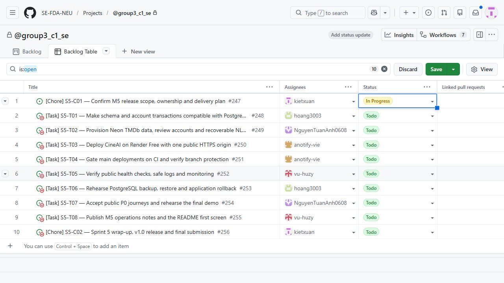
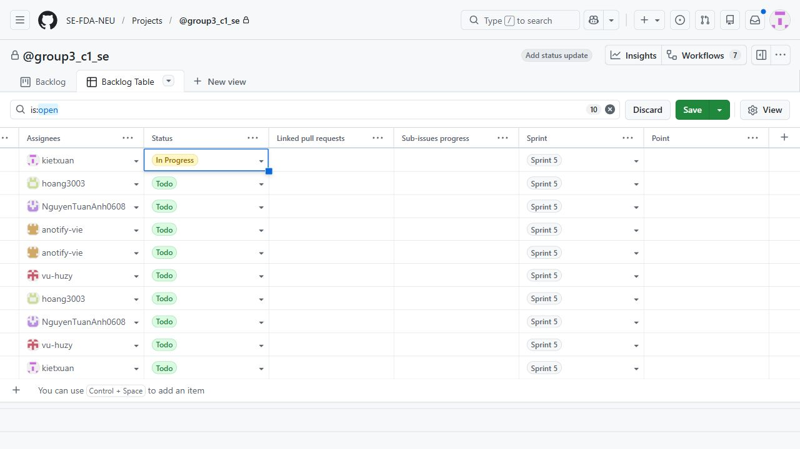
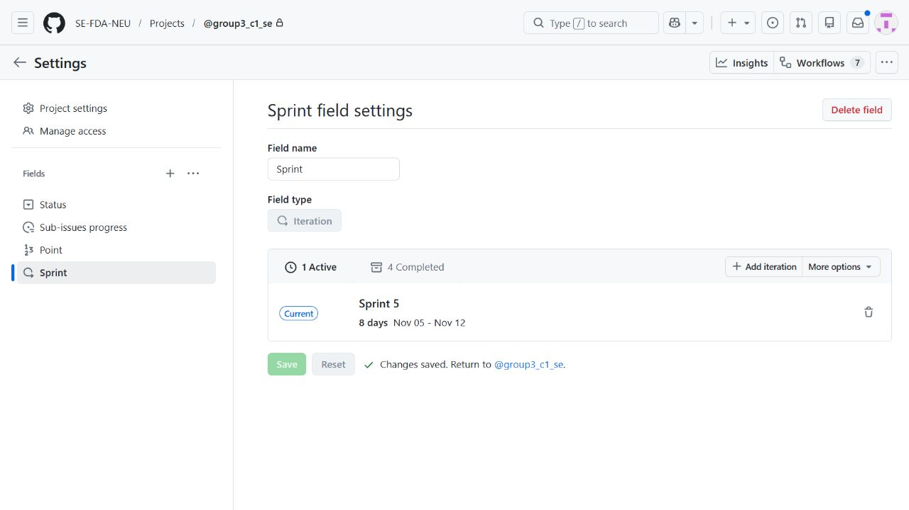

# Sprint 5 Planning and release commitment

C01 [#247](https://github.com/SE-FDA-NEU/ai66a_group3_C1_SE/issues/247).
PO and SM5 are **@kietxuan**. The planned independent reviewer is
**@hoang3003**, with another non-contributing member taking over if needed.

## Current scope and delivery map (amended 7, 8 and 10 November 2026)

Reconciled by S5-T08 [#255](https://github.com/SE-FDA-NEU/ai66a_group3_C1_SE/issues/255)
against the live issues on 11 November 2026 and the amendments recorded in
[C01 #247](https://github.com/SE-FDA-NEU/ai66a_group3_C1_SE/issues/247).
The sprint still has exactly the same ten work issues, owners and review coordinators.

| Amendment | Current decision |
|---|---|
| 7 November | Regional watch providers are committed Sprint 5 scope (replacing the original deferral). T03 absorbed CI/protection and basic health/logging, T04 became the providers backend, T05 the providers UI and T08 absorbed monitoring plus final documentation |
| 8 November | Standardise on **PostgreSQL 18.x** (replacing PostgreSQL 17) and add exactly one validated **View watch options on TMDb ↗** action below the provider groups. Badges remain informational |
| 10 November | Supported markets are **US (default), GB and SG** with one compact browser-persisted selector, replacing the VN-only policy. The actual VN run (989 movies, no data) is historical evidence |
| 11 November, closure ownership | PO requests T07/T08 closure on their reviewed technical/documentation deliveries. C02 explicitly owns all remaining deployment, final public/device/PO/demo acceptance, required-check settings/screenshot, durable recovery handoff and final monitoring, in addition to wrap-up/v1.0/submission. No M5 requirement or issue is removed |

| Issue | Current delivery | Owner | Review coordinator | Blocked by (live 11 Nov) | State 11 Nov |
|---|---|---|---|---|---|
| [C01 #247](https://github.com/SE-FDA-NEU/ai66a_group3_C1_SE/issues/247) | Confirm full feature scope, ownership and M5 release plan | @kietxuan | @hoang3003 | none | Closed |
| [T01 #248](https://github.com/SE-FDA-NEU/ai66a_group3_C1_SE/issues/248) | Preserve application behaviour on PostgreSQL 18 | @hoang3003 | @kietxuan | #247 | Closed |
| [T02 #249](https://github.com/SE-FDA-NEU/ai66a_group3_C1_SE/issues/249) | Provision Neon PostgreSQL 18, TMDb data and NLP startup | @NguyenTuanAnh0608 | @hoang3003 | #248 | Closed |
| [T03 #250](https://github.com/SE-FDA-NEU/ai66a_group3_C1_SE/issues/250) | Gate PostgreSQL 18 CI and deploy a healthy public application | @anotify-vie | @NguyenTuanAnh0608 | #249 | Closed |
| [T04 #251](https://github.com/SE-FDA-NEU/ai66a_group3_C1_SE/issues/251) | Import regional providers and validated TMDb watch-options links | @anotify-vie | @hoang3003 | #248, #249 | Closed |
| [T05 #252](https://github.com/SE-FDA-NEU/ai66a_group3_C1_SE/issues/252) | Display regional providers with a country selector and TMDb button | @vu-huzy | @NguyenTuanAnh0608 | #251 | Closed |
| [T06 #253](https://github.com/SE-FDA-NEU/ai66a_group3_C1_SE/issues/253) | Rehearse PostgreSQL recovery and rollback including provider data | @hoang3003 | @NguyenTuanAnh0608 | #250, #251 | Closed |
| [T07 #254](https://github.com/SE-FDA-NEU/ai66a_group3_C1_SE/issues/254) | Deliver acceptance tooling, actual technical evidence and final execution checklist to C02 | @NguyenTuanAnh0608 | @vu-huzy | #250, #252, #253 technical handoffs | Open; closes at reviewed #265 merge |
| [T08 #255](https://github.com/SE-FDA-NEU/ai66a_group3_C1_SE/issues/255) | Deliver monitoring baseline, operations/portable docs and release handoff to C02 | @vu-huzy | @hoang3003 | #250, #253, #254 technical handoffs | Open; closes at reviewed #264 merge |
| [C02 #256](https://github.com/SE-FDA-NEU/ai66a_group3_C1_SE/issues/256) | Sprint 5 wrap-up, complete-feature v1.0 release and submission | @kietxuan | @anotify-vie | #247 to #255 | Open |

The live graph has 23 blocked-by edges and no cycle. The "Closed" states record
GitHub issue state only; several closed issues still list pending operator steps
in their own evidence (for example durable backup storage and an independent
recovery reproduction in [T06](s5-t06-postgresql-recovery.md), and the public
runtime rollout of the regional migration). The operator roster below,
retention date and monitoring owners are unchanged. The current public runtime
status and risks are in [operations](operations.md).

**11 November readiness amendment:** the PO deferred production deploy,
migration and enrichment until the remaining readiness PRs are prepared, aiming
for one Manual Deploy of a frozen green-main candidate. Under the PO's closure
amendment, the T07/T08 PRs use Closes #254 / Closes #255 after technical delivery,
green checks and independent formal review. C02's PR uses Refs #256; all remaining
public/human/operational release acceptance stays Pending under C02 until
evidenced. Technical issue closure does not certify release acceptance.
Correct Render access is now verified;
actual live SHA is `f24ef54699efb2fa26f363107bd31401f9b12e58`, not the newer
regional main candidate. Auto-deploy remains After CI Checks Pass; the
[release handoff](s5-t08-c02-handoff.md#one-batch-release-plan) explains the
explicit merge-commit skip phrase and exact-SHA/CI checks. No service settings,
original Planning screenshots were changed. The dependency topology is retained;
T07/T08 require technical handoffs, while C02 owns final operational completion.
This is a
batching preference, not permission to invent final results or ignore a defect.

> **Historical record.** Everything from here to "Author verification" is the
> 6 November Planning snapshot. Its issue titles, the T04 CI / T05 monitoring
> assignment, the PostgreSQL 17 reference in older logs and the VN deferral are
> superseded by the table above. The three Planning screenshots show that
> original inventory (all ten items Open) and were deliberately not altered.

## Planning facts and evidence

| Fact | Recorded value and source |
|---|---|
| Sprint dates | **5–12 November 2026**, confirmed by the PO in the project conversation on 6 November |
| Planning date | **6 November 2026**, confirmed by the PO |
| Attendance | All five members participated, as reported by the PO |
| Commitment and capacity | The PO confirmed that all five members accepted the two-issue allocation below |
| Participants | Nguyen Xuan Kiet, Tran Minh Hoang, Tran Tuan Anh, Vu Quoc Huy and Nguyen Tuan Anh |
| Baseline main | [`16ff4cc`](https://github.com/SE-FDA-NEU/ai66a_group3_C1_SE/commit/16ff4cc4927315a32b6864281faa80f8e52a58e5), including merged M4 report PR #246 |
| Work inventory | Ten Open work issues, eight Tasks and two Chores, in [Sprint 5](https://github.com/SE-FDA-NEU/ai66a_group3_C1_SE/milestone/1) at this capture |

Planning occurred on the second calendar day of the confirmed Sprint.
The PO's confirmation supplies the meeting and capacity facts. The
[dated inventory](evidence/s5-c01-planning.json) supplies the GitHub issue,
dependency and image records. Formal PR approval is the remaining C01 review gate.

The ten existing items in [Project 9](https://github.com/orgs/SE-FDA-NEU/projects/9)
were assigned to Sprint 5 through its authenticated interface on 6 November.
The saved iteration now displays **Nov 05–Nov 12**. C01 is In Progress and the
other nine items are Todo at capture. Native issue state is Open for all ten.

The companion capture scrolls the same ordered table horizontally to show the
Sprint assignment of all ten rows.

## Sprint goal and release scope

Publish CineAI at a public HTTPS URL where a new visitor can complete every
P0 journey from Home, with persistent TMDb and account data, deployment after
green CI, an exercised recovery path and an identifiable v1.0 release.

The commitment covers PostgreSQL compatibility, live catalogue provisioning,
same-origin hosting, CI/protection, health/monitoring, backup/rollback,
public acceptance/demo, operations documentation and final wrap-up.
The PO's release-focused ten-issue plan defers VN watch providers to a future
enhancement decision. The accepted S4 UI, Search, Similar, rating, watchlist,
reset, filtering/pagination and trailer outcomes are release acceptance inputs.

## Technical decisions and data policy

| Decision | Selected plan | Delivery owner |
|---|---|---|
| Public runtime | Render Free serves the React build, FastAPI `/api` and `/health` through one HTTPS origin | T03 |
| Public database | Neon Free, **PostgreSQL 18**, with TLS and an appropriately bounded connection pool | T01/T02 |
| Region | **Singapore** for Render and Neon AWS `aws-ap-southeast-1` | T02/T03 |
| Version alignment | PostgreSQL 18 for Neon, integration development and the isolated CI service | T01/T02/T03/T04 |
| Catalogue | A fresh PostgreSQL catalogue imported from TMDb using `--pages 50`, targeting about 1,000 valid movies after validation/deduplication | T02 |
| Account data | Dedicated public application-review accounts, with persisted sessions, preferences, half-star ratings and watchlists | T01/T02 |
| Media | Stored validated metadata/paths for posters, backdrops and official trailers, enriched across the active catalogue | T02 |
| NLP artifact | Check the stored corpus/config fingerprints at startup and rebuild a missing or stale derived index from PostgreSQL | T02 |
| Release path | Reviewed PR, required checks, merge to main, green main CI, then deployment of that SHA | T04/T03 |
| Release identity | Final wrap-up content is merged before the deployed commit is tagged v1.0 | C02 |

PostgreSQL 18 and Singapore are selected implementation defaults under the PO's
delegated planning request. Platform documentation supports these choices.
The provisioning owner verifies their availability in the account before
creating resources. [Neon PostgreSQL 18 availability](https://neon.com/blog/postgres-18),
[Neon versions API](https://api-docs.neon.tech/reference/createproject),
[Neon regions](https://neon.com/docs/introduction/regions),
[Render regions](https://render.com/docs/regions).

T02 should provision the Neon database on major 18. T03 should use major 18
for the isolated CI PostgreSQL service and deployment checks. The older C01
planning record and sprint log retain the superseded major-17 decision as history.

Catalogue import/enrichment is an explicit operator action. Startup uses the
stored catalogue and prepares its derived index. T02 records actual imported
counts, media availability, startup time and index readiness. Public user data
must survive service restart/redeploy. The release data policy starts with
fresh review users and the imported catalogue.

T01 owns PostgreSQL driver/lockfile changes, full empty-database migrations,
email uniqueness, rating constraints, account-write concurrency, consistent
catalogue reads and production-safe review-user provisioning. T02 consumes
these interfaces after their reviewed merge.

## Ownership, capacity and review

| Issue | Deliverable | Owner | Review coordinator | Completion depends on |
|---|---|---|---|---|
| [C01 #247](https://github.com/SE-FDA-NEU/ai66a_group3_C1_SE/issues/247) | Planning, scope and commitment | @kietxuan | @hoang3003 | Start immediately |
| [T01 #248](https://github.com/SE-FDA-NEU/ai66a_group3_C1_SE/issues/248) | PostgreSQL schema, migrations and transactions | @hoang3003 | @kietxuan | #247 |
| [T02 #249](https://github.com/SE-FDA-NEU/ai66a_group3_C1_SE/issues/249) | Neon, TMDb, review users and index startup | @NguyenTuanAnh0608 | @hoang3003 | #248 |
| [T03 #250](https://github.com/SE-FDA-NEU/ai66a_group3_C1_SE/issues/250) | Public same-origin Render deployment | @anotify-vie | @NguyenTuanAnh0608 | #249, #251 |
| [T04 #251](https://github.com/SE-FDA-NEU/ai66a_group3_C1_SE/issues/251) | PostgreSQL CI, deploy gate and protection | @anotify-vie | @kietxuan | #248 |
| [T05 #252](https://github.com/SE-FDA-NEU/ai66a_group3_C1_SE/issues/252) | Public health, logs and monitoring | @vu-huzy | @anotify-vie | #250 |
| [T06 #253](https://github.com/SE-FDA-NEU/ai66a_group3_C1_SE/issues/253) | PostgreSQL restore and code rollback rehearsal | @hoang3003 | @NguyenTuanAnh0608 | #250 |
| [T07 #254](https://github.com/SE-FDA-NEU/ai66a_group3_C1_SE/issues/254) | Public acceptance and demo rehearsal | @NguyenTuanAnh0608 | @vu-huzy | #250, #252, #253 |
| [T08 #255](https://github.com/SE-FDA-NEU/ai66a_group3_C1_SE/issues/255) | Operations, README and SETUP | @vu-huzy | @hoang3003 | #251, #252, #253, #254 |
| [C02 #256](https://github.com/SE-FDA-NEU/ai66a_group3_C1_SE/issues/256) | Wrap-up, v1.0, manual submission and handoff | @kietxuan | @anotify-vie | #247–#255 |

The PO confirmed two accepted work items per member. Each owner plans an owned
PR for each item and gives at least one substantive formal review on another
member's PR. The reviewer uses Review changes, comments on the actual change
and approves the final candidate before merge. Implementation contributors
select another independent reviewer for their own changes.

Primary file ownership follows the issue scope. T01 owns models, Alembic and
account transactions. T02 owns provisioning/index startup. T03 owns production
serving/build/start configuration. T04 owns CI. T05 owns health/logging.
T06 owns recovery instructions. T07 owns acceptance/demo evidence. T08 owns
operations/README/SETUP. C01 and C02 own Planning and final sprint-log entries.

## Working order and target dates

These dates are delivery targets. Owners record actual completion in GitHub.

| Target | Delivery |
|---|---|
| 6 November | Review C01 and begin T01 compatibility work |
| 7 November | Complete T01, then T02 provisioning and T04 CI/protection in parallel |
| 8 November | Complete T03 and establish the first public URL |
| 9 November | Complete T05 monitoring and T06 recovery in parallel |
| 10 November | Complete T07 public acceptance and demo rehearsal |
| 11 November | Complete T08 operations/README review |
| 12 November | Complete C02 wrap-up merge, final deployment, v1.0 and manual submission |

Runtime/CI scaffolding, cloud-account preparation, monitoring design, recovery
instructions and documentation outlines can start from the agreed plan while
their final prerequisites are being implemented. Native Blocked by relations
record the completion dependencies above. The inventory has 23 edges and an
acyclic graph. A schedule slip triggers a PO reforecast and reassignment within
the ten-item scope, with updated targets recorded in C01.

## Commitment and point accounting

| Measure | Planning baseline |
|---|---|
| Committed engineering work | **10 items**, eight Tasks and two Chores |
| Accepted allocation | **2 items per member**, confirmed by the PO |
| Newly committed product Story Points | **0** under this release-only Task/Chore scope |
| Completed engineering items at this capture | **0**, with all ten native issues Open |
| Final technical throughput | C02 records the actual Closed items against the ten-item commitment |
| Final Story Point velocity | C02 records 0 for this scope and explains the release/operations work alongside technical throughput |

All 14 existing product Story issues were Closed in the GitHub inventory.
Historical accepted points are attributed to their actual acceptance Sprint.
C02 reconciles committed/completed/velocity for all five Sprints from their
recorded sources. Future scope changes carry an explicit PO decision and unit.

## Operators, retention and access handoff

| Responsibility | Primary | Backup | Required access/handoff |
|---|---|---|---|
| Render and deployment | @anotify-vie | @kietxuan | T03 verifies service access, build/start settings and environment permissions |
| Neon and provisioning | @NguyenTuanAnh0608 | @hoang3003 | T02 verifies project access, connection roles and provisioning credentials |
| Backup and restore | @hoang3003 | @NguyenTuanAnh0608 | T06 verifies private backup access and an independently reproduced restore |
| Monitoring and operations notes | @vu-huzy | @kietxuan | T05 supplies logs, error-rate/latency observation and escalation |
| Release and service retention | @kietxuan | @anotify-vie | C02 records release identity and maintenance handoff |
| Main protection | @anotify-vie coordinates | @kietxuan | T04 identifies the repository administrator and verifies effective PR/approval/check rules |

These are named operator responsibilities. Cloud-resource creation and effective
access confirmation are pending delivery evidence under T02/T03/T04.

The PO authorized at least one month of availability, with a longer period
permitted. The selected minimum calendar date is **12 December 2026**, one
month after the planned Sprint end. Service retention also covers **one calendar
month after the actual v1.0 release** and continues **until grades are published**,
using whichever deadline is later. The instructor's publication date is still
to be announced in the supplied brief. @kietxuan tracks that announcement and
extends the recorded maintenance date when required.

The selected operating policy is a daily public health/quota check and a check
before demonstrations. T05 records observed error rate, response time,
thresholds and incident escalation. T06 establishes daily logical backups after
public data writes, a backup before schema/data changes, and retention of the
latest seven successful backups in private storage outside the Render service.
The selected location is a private backup directory on the primary operator's
machine outside the repository, replicated to the backup operator's storage.
T06 records the absolute paths, access controls and successful restore. Restore and
rollback rehearsals are completed before T07 public acceptance.

## M5 evidence and release handoff

| M5 requirement | Owner and completion evidence |
|---|---|
| Public HTTPS, real data and every P0 by clicking | T03/T07 deployed SHA, phone/laptop/private-window results and persistence |
| Health 200/503, logs, error rate and response time | T05 public healthy result and isolated outage/recovery evidence |
| Green main CI and protected main | T04 run link, actual duration, effective settings screenshot and failed-deploy gate experiment |
| At least four reviewed green merged S5 PRs | Each owner supplies owned PRs, CI and substantive pre-merge reviews, audited by C02 |
| Each member has a merged PR, review given and Closed issue | The ownership/review rotation supplies work opportunities, with actual evidence audited by C02 |
| Operations and README first screen | T08 reviewed document, five risks, five maintenance areas, three lessons and required first-screen fields |
| Sprint metrics and five-Sprint table | C02 evidence-backed sprint-log reconciliation |
| v1.0 equals the running commit | C02 matches the final green main SHA, deployed SHA and tag target |
| Manual M5 PDF and receipt | C02 exports Team03_M5.pdf manually and records the actual submission receipt |

The supplied M5 brief says seven operations sections but enumerates six. T08
prepares all six enumerated sections in order, observes the 800-word prose
limit outside tables and records any instructor clarification.

The final ordering is T08 documentation merge, C02 wrap-up merge, green main
CI, deployment of that SHA, final public checks, v1.0 tag/release, manual PDF
submission and C02 completion comment. The wrap-up PR uses Refs #256 while
those external release steps are outstanding. This places the final recorded
wrap-up in the demonstrated release commit.

C01 closes after its planning PR has green checks, a substantive independent
approval and a merge. Implementation, cloud access and public acceptance have
their named delivery gates above.

## Author verification

Checks on 6 November used the selected working tree based on `16ff4cc`.
The [inventory](evidence/s5-c01-planning.json) records the actual results.

| Check | Result |
|---|---|
| `python -m pytest -v` | **40 passed** in **13.78 seconds**, with one inherited Starlette/httpx deprecation warning |
| `python scripts/verify_s4_t05_trace.py` | **37 P0 IDs mapped to 40 default nodes** |
| Planning record audit | **53 local links/anchors**, ten issues, five two-item allocations and **23 acyclic dependencies** verified |
| Screenshot audit | All three JPEG files match their recorded byte counts and SHA-256 values |
| `git diff --check` | Passed |

AI assistance was provided by OpenAI Codex for planning reconciliation, GitHub
board alignment, screenshots, documentation and author verification. The PO
supplied meeting facts and commitment confirmations. Human PR review is
recorded through GitHub Review changes.
