# Milestone 3 — UI dossier

**Submission status: DRAFT — final export pending merge and missing evidence.**
Markdown is authoritative; if this PDF differs from the repository, use the repository.

### Cover

| Field | Recorded value |
|---|---|
| Product / team | AI Movie Recommendation System / Team 03, AI66A Group 3 C1 |
| Assigned topic | [HUMAN REQUIRED: confirm the instructor's exact assigned-topic wording] |
| Product Owner | Nguyen Xuan Kiet — `@kietxuan` |
| Sprint 3 Scrum Master | Vu Quoc Huy — `@vu-huzy` |
| Sprint 3 | 05–18 October 2026; PO-confirmed dates, Asia/Ho_Chi_Minh |
| Repository | [SE-FDA-NEU/ai66a_group3_C1_SE](https://github.com/SE-FDA-NEU/ai66a_group3_C1_SE) |
| Project board | [@group3_c1_se — Project 9](https://github.com/orgs/SE-FDA-NEU/projects/9) |
| Setup guide | [docs/SETUP.md on main](https://github.com/SE-FDA-NEU/ai66a_group3_C1_SE/blob/main/docs/SETUP.md) |
| Submitter | [HUMAN REQUIRED: actual submitter] |

| Member (README spelling) | GitHub | Student ID |
|---|---|---|
| Nguyen Xuan Kiet | `@kietxuan` | [HUMAN REQUIRED: student ID] |
| Tran Minh Hoang | `@hoang3003` | [HUMAN REQUIRED: student ID] |
| Tran Tuan Anh | `@anotify-vie` | [HUMAN REQUIRED: student ID] |
| Vu Quoc Huy | `@vu-huzy` | [HUMAN REQUIRED: student ID] |
| Nguyen Tuan Anh | `@NguyenTuanAnh0608` | [HUMAN REQUIRED: student ID] |

Names, roles and links: [README](../README.md). IDs, exact topic and submitter
are absent from the inspected tracked Markdown and must be supplied by the team.
The dossier owner is not automatically the LMS submitter.

Documentation base: merged `main` at
`f9774cbe7248c29915086d29bf2b9f99c2aa528a` (PR #186).
This document has no independent review, approval, merge or LMS receipt yet.

<!-- pdf:page -->

### Submission page 2 — Sprint boards

**After Sprint Planning — original PO-supplied image.**

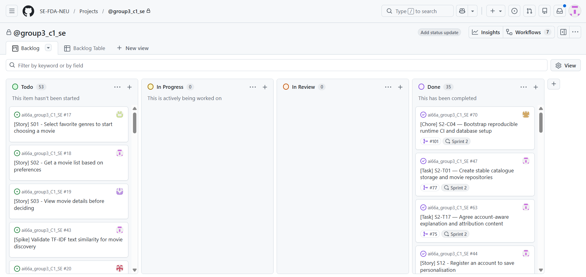

Source: [C01 planning-image record](sprint3-backlog-refinement.md#3-planning-images-and-what-they-actually-show).
The PO identifies this as the beginning-of-Sprint-3 board. It has no visible
capture timestamp. Todo 53 / In Progress 0 / In Review 0 / Done 35 are global,
unfiltered totals including Sprint 2 cards; they are not Sprint 3 points or
accepted Story counts. The original file is copied unchanged, not reconstructed.

**On submission day — missing actual asset.**

[HUMAN REQUIRED: capture the real submission-day board with visible workflow
columns and the relevant Sprint 3 filter; record capture date/time, filter and
board URL. Store the unaltered image under docs/images/ui/.]

The [later iteration snapshot](images/sprint3/iteration-board-snapshot.png)
is a different grouping and is not submission-day evidence. Board access and
its outdated iteration date label are explained in the C01 record. The PO/SM
must verify that the submitted board link opens for the instructor.

<!-- pdf:page -->

### Submission page 3 — Running P0 UI and visible error

**Real local database data — viewport preview; address-bar asset still required.**

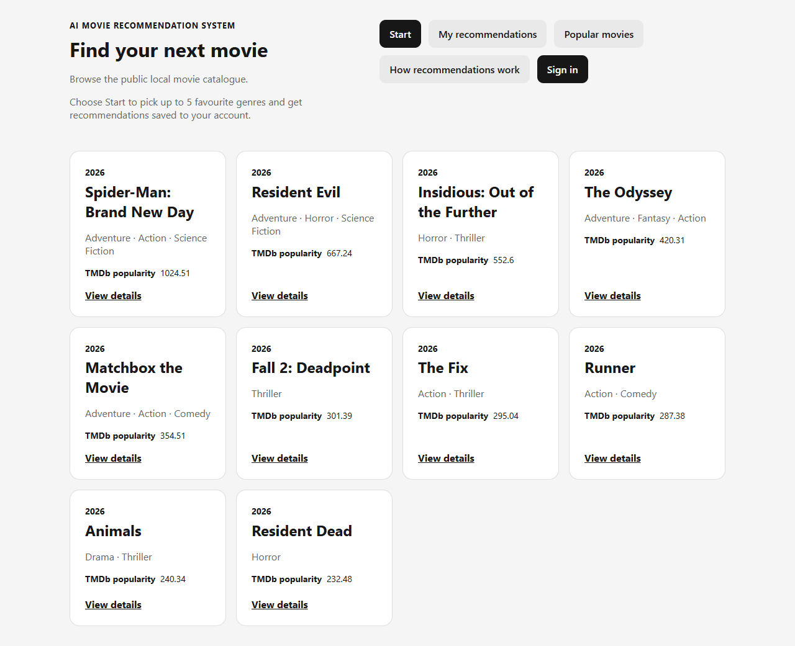

T25 latest live run: `/`, accepted 255-movie TMDb snapshot, local FastAPI/SQLite;
[source report](evidence/s3-m3-p0-handoff/latest/live/results.json). This is a
real reused capture, with no browser chrome. It does not satisfy the address-bar requirement.

**Visible API error — historical synthetic viewport preview; replacement required.**

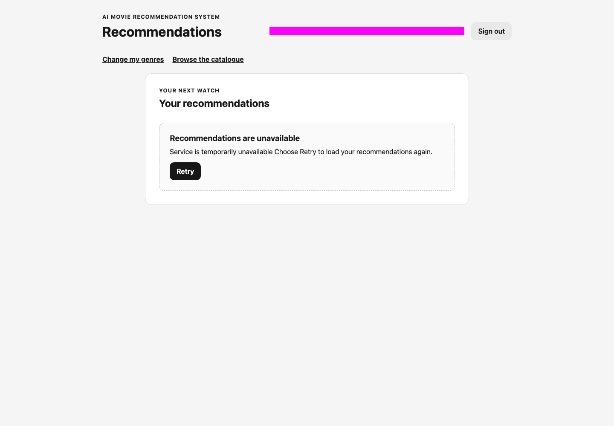

`/recommendations`: `SERVICE_UNAVAILABLE`; exact text is recorded in
[the original capture transcript](evidence/s3-m3-p0-handoff/synthetic/actual-error-message.txt).
This is the historical T25 synthetic run over application base
`86a758eb2468f3e23357b69adf3c3183e5110a40`, not a new live failure or final-candidate
browser-chrome capture. The magenta privacy mask is already in the source file.

[HUMAN REQUIRED: replace BOTH preview images on this page with unaltered
OS/browser-chrome captures on the final tested candidate, each including the
actual browser address bar. Capture a running P0 screen reading the accepted
TMDb-imported local DB and a real visible user-facing API error; record URL,
SHA, date, trigger and provenance. Never draw or paste an address bar.]

<!-- pdf:page -->

## 1. P0 Stories and status

| Story | Screen(s) | Route | Status | Issue |
|---|---|---|---|---|
| S01 — Select favourite genres | Home; Movie Preferences; Recommendations | `/` → `/preferences` → `/recommendations` | [partly works](evidence/s3-m3-p0-handoff/README.md#complete-p0-ac-to-evidence-matrix) | [#17](https://github.com/SE-FDA-NEU/ai66a_group3_C1_SE/issues/17) |
| S02 — Get recommendations from preferences | Movie Preferences; Recommendations | `/preferences` → `/recommendations` | [partly works](evidence/s3-m3-p0-handoff/README.md#complete-p0-ac-to-evidence-matrix) | [#18](https://github.com/SE-FDA-NEU/ai66a_group3_C1_SE/issues/18) |
| S03 — View movie details | Catalogue; Recommendations; Movie detail | `/`, `/recommendations` → `/movies/:movieId` | [partly works](evidence/s3-m3-p0-handoff/README.md#complete-p0-ac-to-evidence-matrix) | [#19](https://github.com/SE-FDA-NEU/ai66a_group3_C1_SE/issues/19) |
| S04 — Explore without preferences | Home; popular cold-start Recommendations | `/` → `/login` → `/recommendations` | [partly works](evidence/s3-m3-p0-handoff/README.md#complete-p0-ac-to-evidence-matrix) | [#20](https://github.com/SE-FDA-NEU/ai66a_group3_C1_SE/issues/20) |
| S12 — Register an account | Create your account; Sign in | `/register` → `/login` | [partly works](evidence/s3-m3-p0-handoff/README.md#complete-p0-ac-to-evidence-matrix) | [#44](https://github.com/SE-FDA-NEU/ai66a_group3_C1_SE/issues/44) |
| S13 — Sign in and sign out | Sign in; Recommendations; guarded screens | `/login` → `/recommendations` → `/` | [partly works](evidence/s3-m3-p0-handoff/README.md#complete-p0-ac-to-evidence-matrix) | [#45](https://github.com/SE-FDA-NEU/ai66a_group3_C1_SE/issues/45) |

Every functional P0 AC has passing assertions in the T25 matrix. These statuses
preserve the accepted handoff's conservative AC + [DoD](definition-of-done.md)
boundary: unaided participant session date/version/per-journey outcomes and
final sign-off remain incomplete. Issue closure (#44/#45, or #127) alone is
not a new Story acceptance result. No partial Story is labelled `works`.

### Candidate and evidence boundary

- Exact T25 executed integration snapshot: `05a78c1f503c10f6f5047655acb3800b21966e99`,
  explicitly unpublished. Its public application base is
  `0c4273ab792becb060fefd5e7341e755ed28d0a5`. The published T25 head is
  `aed85fb4133f413a2cf147ff1bd7cbc7ff78bc8f`, merged by PR #184 at
  `4ff81ab30df8cf448c3796f748b9451496e403c5`. Do not relabel the unpublished
  executed SHA as the later merged SHA.
- The [original verification manifest](evidence/s3-m3-p0-handoff/verification.json)
  pins executable digest `2985bd56d5ff942f87e8e7f31a96f98fcb1689f9ad681c233203a0cd91f20ccf`.
  All 202 recorded file hashes match this dossier's merged base after CRLF→LF
  normalization; [comparison and audit](evidence/s3-c05-ui/verification.json).
  This proves source correspondence, not a newly executed full acceptance run
  of the future merged documentation SHA.
- [T29 live import](evidence/t29-tmdb-live-smoke.md) is the required provider
  foundation. T25's latest live snapshot is provider `tmdb`, revision
  `34b442f2-f5a8-4317-9f2f-468e6ec06a20`: 255 distinct movies/source IDs,
  255 finite popularity values/fetch timestamps, 17 associated genres.
  Tests write only to disposable backup copies. M2 seed is not live M3 evidence.
- [C04 fresh-clone verification](evidence/s3-c04-clean-clone.md) tested committed
  executable SHA `05dda34900fd0fa80cfff323b353a8d4c220a4d8`. Its separate
  20-movie imported revision is `6988eeeb-79e0-41ad-ab7a-5248f06a0659`;
  it is not the 255-movie source. [Restart/browser report](evidence/s3-c04-final/live/results.json).
- Reused offline results: 419 backend passes / 1 inherited skip; 236 frontend
  passes; S04/S13 10 synthetic browser passes / 1 intentional live skip;
  separate S13 live case passes. These are recorded T25 results, not new runs
  performed for this documentation change.
- [#131 backdrop acceptance](evidence/s3-t28-backdrop-acceptance/README.md)
  covers the shipped media chain. [C04 live CDN report](evidence/s3-c04-final/backdrop-live/results.json)
  separately proves image loading at 1280px and 375px.

The [GitHub snapshot](evidence/s3-c05-ui/github-state.json) records actual merged
PRs #144/#184/#185/#186, final heads, formal reviews and checks observed on
2026-10-18. Later @hoang3003 approvals exist for
[T25](https://github.com/SE-FDA-NEU/ai66a_group3_C1_SE/pull/184#pullrequestreview-5562707423)
and [C04](https://github.com/SE-FDA-NEU/ai66a_group3_C1_SE/pull/185#pullrequestreview-5562668940).
Their review bodies say `ok`; they are not detailed reproduction reports.
Historical handoff files are preserved, including their then-pending review notes.

T33's first bridge run failed at logout (`/login` versus `/`); a standalone rerun
and five repetitions passed. The cause remains unproved. Keep the first failure
visible; browser S13 logout/replay separately passed. See [T25 limitations](evidence/s3-m3-p0-handoff/README.md#limitations-and-final-gates).

### Separate P1 acceptance — outside the six-P0 gate

| Story | Acceptance result and scope | Status | Evidence |
|---|---|---|---|
| S06 #23 — Filter the current recommendation list | Filter, zero-match guidance, clear/reset and unchanged committed preferences pass. T16 is React/API/SQLite integration, not browser E2E; T15/T16 browser evidence is separate. | [partly works](evidence/s3-m3-p0-handoff/verification.json) | [Latest T16 run](evidence/s3-m3-p0-handoff/latest/checks/t16.txt); [T16 detailed acceptance](evidence/s3-t16-filter-verification.md) |
| S09 #31 — Browse popular movies | T21 synthetic browser exact ordering/top-ten/empty assertions pass; T25 live list matches the imported DB oracle. Final DoD remains open. | [partly works](evidence/s3-m3-p0-handoff/verification.json) | [Latest T21 run](evidence/s3-m3-p0-handoff/latest/checks/t21.txt); [T21 matrix](evidence/s3-t21-popular-acceptance/README.md); [live report](evidence/s3-m3-p0-handoff/latest/live/results.json) |

<!-- pdf:page -->

### Updated M1 screen flow

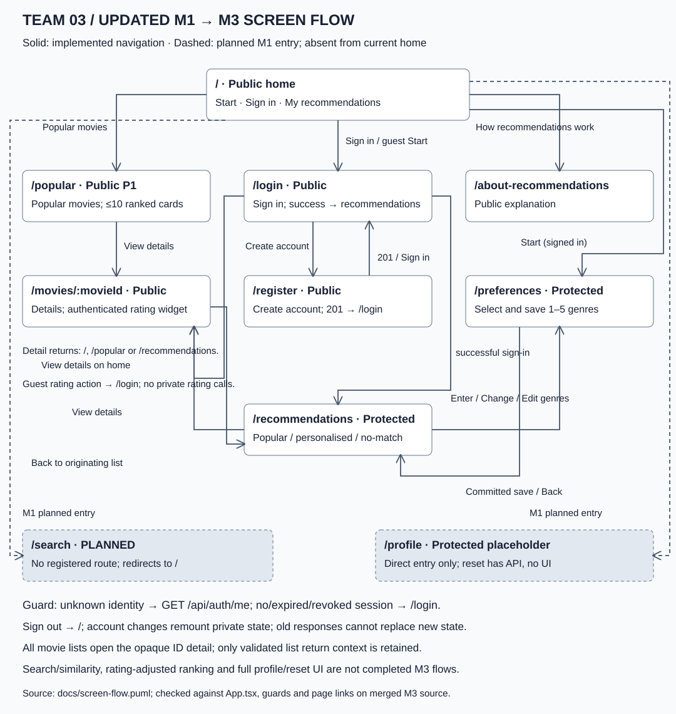

Source: [screen-flow.puml](screen-flow.puml); PNG: [screen-flow.png](images/screen-flow.png).
Solid arrows describe existing controls and guarded navigation. Dashed entries
retain M1 `/search` and `/profile` scope without claiming current home links:
`/search` is not registered and falls back to `/`; `/profile` is a protected
placeholder. Similarity and reset UI are not implemented. A guest rating CTA
opens `/login` without a private rating request. Direct detail visits return
to `/`; list-origin visits use the validated catalogue/popular/recommendation
return context. Recommendations refetch current-account data on return.

<!-- pdf:page -->

## 2. Wireframes

These are authored low-fidelity schematics of the inspected final application
source, not screenshots or acceptance results. Bracketed text denotes data
slots. All six P0 screens appear below; S04's cold start shares the
Recommendations screen. The public popular screen is included separately for P1.
Endpoints are local backend calls; no screen calls the TMDb metadata API.

### Public catalogue — `/` (S01/S03/S04 entry)

The user comes here to … browse the local catalogue and start choosing movies.

API endpoints: `GET /api/movies?limit=10`. Home itself does not check the
session; Start opens the guarded preference route.

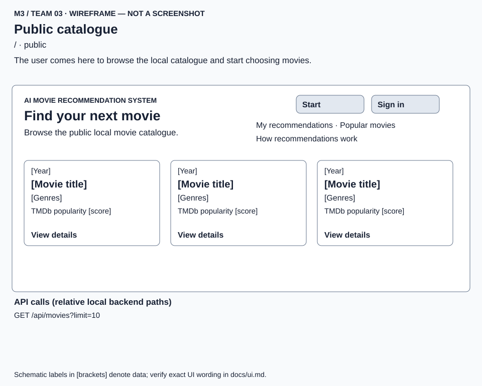

Source: [HomePage.tsx](../frontend/src/pages/HomePage.tsx),
[MovieCard.tsx](../frontend/src/components/MovieCard.tsx).
Cards contain title, year, genres, TMDb popularity and View details; at most
ten cards. Source loading/empty/error/data states remain distinct.
Actual data capture: [T25 live catalogue](images/ui/live-catalogue-viewport.png).

<!-- pdf:page -->

### Sign in — `/login` (S13)

The user comes here to … sign in to the current account.

API endpoints: `POST /api/auth/login`. Successful sign-in sets central account
state and opens `/recommendations`; that screen owns its recommendation call.

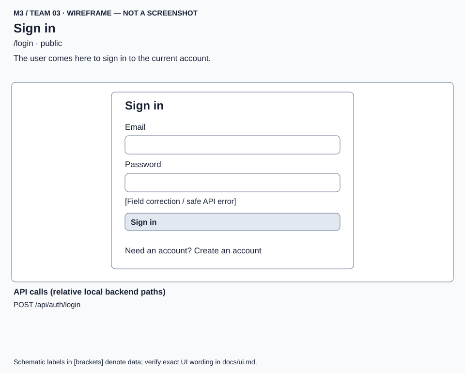

Source: [LoginPage.tsx](../frontend/src/pages/LoginPage.tsx).
Email/password labels, disabled `Signing in...`, inline API error and
`Create an account` match the implemented form. Invalid credentials retain the
form and exact Story message. Sign-out is a Recommendations action.

<!-- pdf:page -->

### Create your account — `/register` (S12)

The user comes here to … create an account to save preferences.

API endpoints: `POST /api/auth/register`; success `201` navigates to `/login`,
without automatically signing in. Invalid local fields send no request.

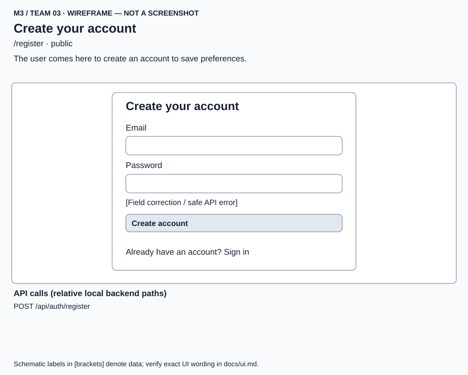

Source: [RegisterPage.tsx](../frontend/src/pages/RegisterPage.tsx).
Empty/invalid email and passwords shorter than eight characters have field
corrections. `Creating account...` disables duplicate submits. Duplicate email
shows exactly `This email is already registered`; other request failures use
the implemented safe service message. No password or credential appears in an asset.

<!-- pdf:page -->

### Movie Preferences — `/preferences` (S01)

The user comes here to … select, save and revisit 1 to 5 favourite genres.

API endpoints: `GET /api/auth/me` when guard identity is unknown;
`GET /api/genres` and `GET /api/me/preferences` on load;
`PUT /api/me/preferences` with 1–5 distinct canonical `genreIds` on save.

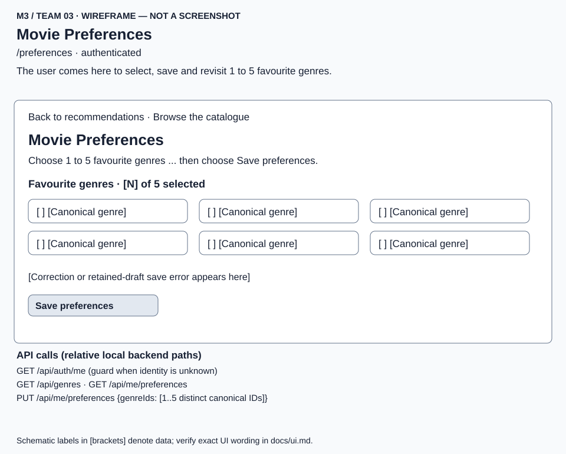

Source: [PreferencesPage.tsx](../frontend/src/pages/PreferencesPage.tsx).
Saved selections restore; unavailable saved genres are labelled and remain
selected/count toward five until cleared. Loading, no genres and load-error
Retry replace the picker. A failed save retains the draft and offers Save retry.
Only a committed save invalidates recommendations and navigates onward.

Client-only corrections (not API error rows):
`Select at least one genre (up to 5), then choose Save preferences.`
and `You can select up to 5 genres. Your previous 5 selections are still selected. Clear one genre to choose a different one.`
Actual [mobile correction capture](images/ui/live-preferences-correction-viewport.png).

<!-- pdf:page -->

### Recommendations — data (S02/S04; S06 separately)

The user comes here to … view recommendations and recover from unavailable data.

API endpoints for all four following wireframes: `GET /api/auth/me` when guard
identity is unknown; `GET /api/me/recommendations?limit=10` on entry/retry;
`GET /api/genres` for filter options on a ready non-empty list;
`POST /api/auth/logout` only on Sign out. Genre filtering sends no preference write.

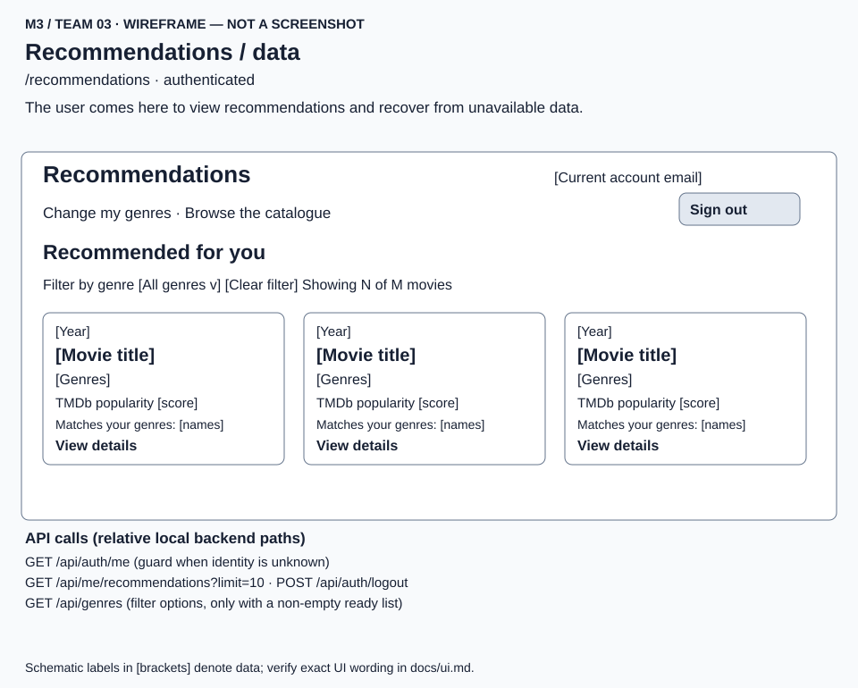

Source: [RecommendationsPage.tsx](../frontend/src/pages/RecommendationsPage.tsx),
[RecommendationGuidance.tsx](../frontend/src/components/RecommendationGuidance.tsx),
[RecommendationFilter.tsx](../frontend/src/components/RecommendationFilter.tsx).
Personalised cards show `Recommended for you` and `Matches your genres: <names>`.
At most ten distinct cards retain server order.

The S04 data variant uses `Popular`, `Not personalised`,
`Recommendations based on popular movies`,
`Add your favourite genres to get personalised recommendations.` and
`Enter preferences →`. No-match is a valid response: `Popular alternatives`,
`No movies matched your favourite genres.`, Edit preferences and Retry, with
any returned alternatives rendered once. It is different from an API error.
Real [T25 personalised capture](images/ui/live-personalised-viewport.png).

<!-- pdf:page -->

### Recommendations — empty

The user comes here to … understand why the current recommendation list has no cards.

API endpoints: same Recommendations boundary above; `GET /api/me/recommendations?limit=10`
returns `200`, `movies: []`, `noMatch: false`. No filter-options request is
mounted for the empty list. The session guard and Sign out retain their endpoints.

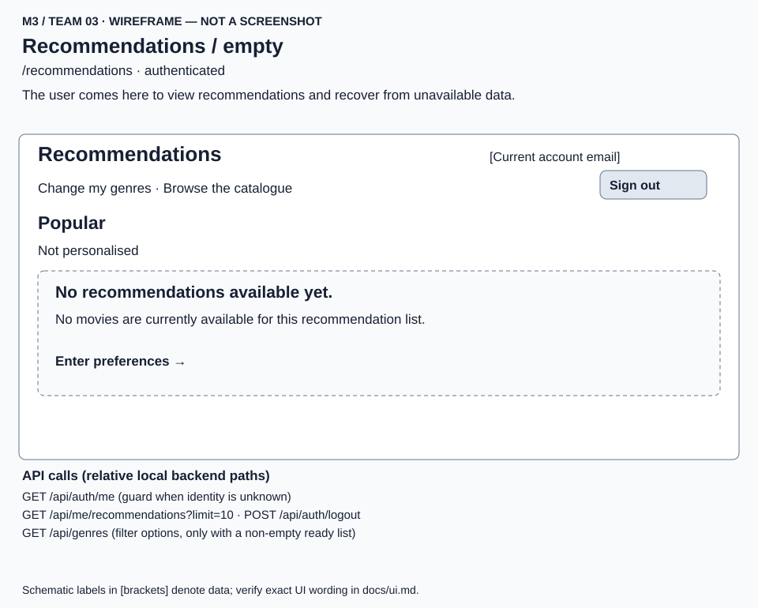

Exact current text: `No recommendations available yet.` and
`No movies are currently available for this recommendation list.`;
`Enter preferences →` opens `/preferences`.
Zero cards is a valid data state, not `SERVICE_UNAVAILABLE` or a no-match claim.
[Historical synthetic capture](images/ui/recommendations-empty-historical-viewport.png);
[latest repeated assertions](evidence/s3-m3-p0-handoff/latest/synthetic-results.json).

<!-- pdf:page -->

### Recommendations — loading

The user comes here to … wait for the current account's recommendation request.

API endpoints: `GET /api/me/recommendations?limit=10` is pending;
`GET /api/auth/me` may precede it if identity is unknown;
`POST /api/auth/logout` remains the Sign out action. No filter-options request
is mounted until a non-empty ready result is accepted.

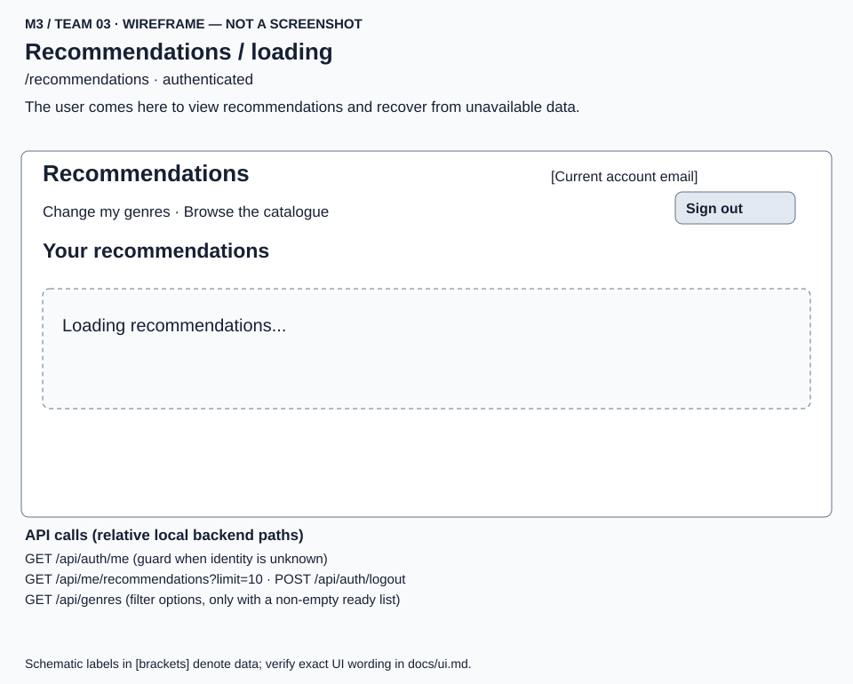

Exact text: `Loading recommendations...`; section heading `Your recommendations`.
No previous-account cards or false empty/error guidance is shown.
[Historical synthetic capture](images/ui/recommendations-loading-historical-viewport.png);
[latest repeated assertions](evidence/s3-m3-p0-handoff/latest/synthetic-results.json).

<!-- pdf:page -->

### Recommendations — error

The user comes here to … understand a failed recommendation request and retry it.

API endpoints: failed `GET /api/me/recommendations?limit=10`; Retry issues the
same GET. The guard and Sign out endpoints remain as above; no filter-options
request is mounted in the error state.

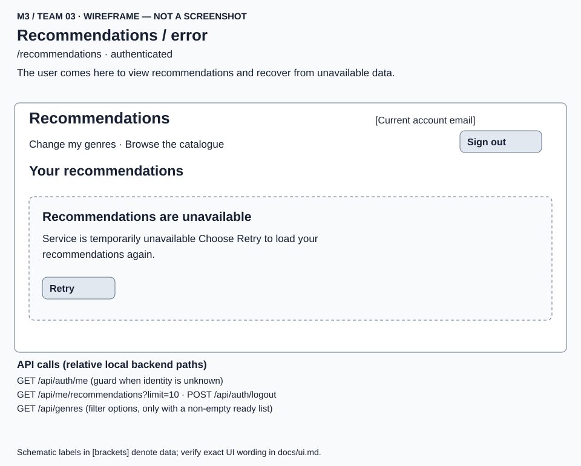

For `503 SERVICE_UNAVAILABLE`, exact heading and paragraph:
`Recommendations are unavailable`;
`Service is temporarily unavailable Choose Retry to load your recommendations again.`
The button is `Retry`. A protected `401` instead clears central account state
and opens `/login`. Delayed responses from obsolete attempts/accounts are ignored.
[Historical error capture](images/ui/recommendations-error-historical-viewport.png)
and [exact transcript](evidence/s3-m3-p0-handoff/synthetic/actual-error-message.txt).

These four schematics show states required for one P0 screen. Synthetic
empty/loading/error captures keep their historical origin; the latest T25
synthetic suite repeats the assertions but does not recapture those files.

<!-- pdf:page -->

### Movie detail — `/movies/:movieId` (S03)

The user comes here to … read a selected movie and return to the originating list.

API endpoints: `GET /api/movies/{movieId}`; `GET /api/auth/me` if the rating
widget needs to resolve identity. Only authenticated users call
`GET /api/me/ratings/{movieId}`; Save rating calls
`PUT /api/me/ratings/{movieId}` with strict integer `rating` 1–5.
A guest sees the sign-in CTA and makes no private rating call.

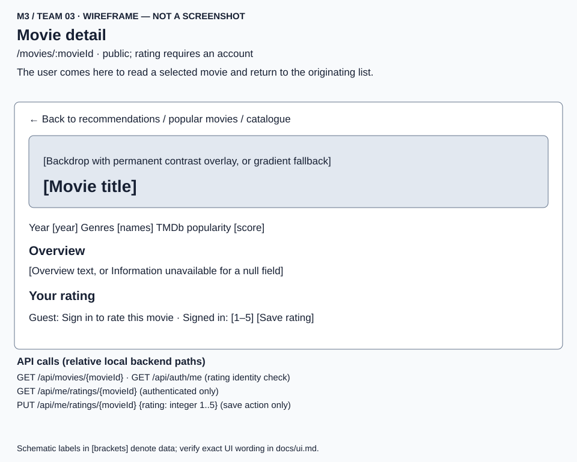

Source: [MovieDetailPage.tsx](../frontend/src/pages/MovieDetailPage.tsx),
[MovieBackdropHero.tsx](../frontend/src/components/MovieBackdropHero.tsx),
[MovieRating.tsx](../frontend/src/components/MovieRating.tsx).
A null year/overview shows `Information unavailable`; unknown IDs show
`Movie not found` with a return link. Backdrop omission/null/broken images retain
a readable gradient/title. Ratings display `Not rated yet`,
`Your saved rating: N/5`, `Saving...` and `Rating saved.` as appropriate.
Failed saves preserve the committed value and draft. Ratings are optional and
do not change Sprint 3 ranking. Real [C04 backdrop capture](images/ui/detail-backdrop-live-viewport.png).

<!-- pdf:page -->

### Popular movies — `/popular` (P1 S09)

The user comes here to … browse the top ten eligible movies in popularity order.

API endpoints: `GET /api/movies/popular?limit=10`; this is a public dedicated
finite-popularity subset, separate from the public catalogue endpoint.

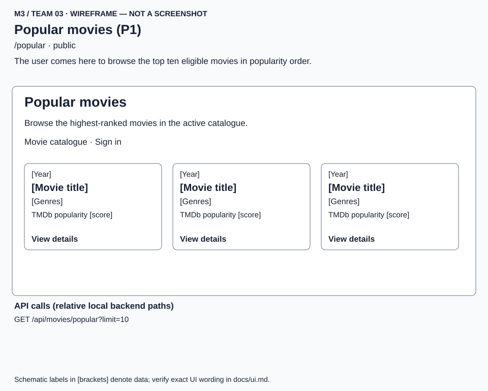

Source: [PopularMoviesPage.tsx](../frontend/src/pages/PopularMoviesPage.tsx).
Popularity descending, title ascending, ID tie-break; at most ten distinct
eligible movies. Exact empty text: `Popular movies are not available yet`.
Loading: `Loading popular movies...`; error heading:
`Popular movies are unavailable`, safe API message and Retry.

### Accessibility and ownership checks

Forms have associated labels; registration corrections use `aria-invalid`
and `aria-describedby`. Loading uses status regions, API failures use alerts,
and correction text explains the next action. Button disabled states prevent
duplicate saves. T28 records keyboard focus, mobile width and overlay contrast
checks. These are source and executable assertions, not a newly completed
human accessibility audit. Account-keyed remounts and request generations
prevent delayed account/movie data from replacing current state.

<!-- pdf:page -->

## 3. Error messages

These four cases use implemented API codes and actual rendered messages.
HTTP status is context within the code cell; it is not exposed as raw UI error
text. Business rules refer to [business-rules.md](business-rules.md) and the
unchanged Story AC. Error envelope details: [api.md](api.md).

| API error code | Business Rule | Exact message the user sees |
|---|---|---|
| `INVALID_CREDENTIALS` (401, login) | BR18; S13 AC2: unknown email and wrong password use the same non-disclosing response. | `Email or password is incorrect` |
| `EMAIL_ALREADY_REGISTERED` (409, registration) | BR16; S12 AC2: case-insensitive email uniqueness; create no second account. | `This email is already registered` |
| `MOVIE_NOT_FOUND` (404, detail) | BR6; S03 AC2: an unknown opaque ID must never show another film. | Heading: `Movie not found`. Paragraph: `That movie is not available in the active catalogue.` |
| `SERVICE_UNAVAILABLE` (503, recommendations) | S02 AC4/AC5 and BR2–BR4 recommendation boundary: failed reads preserve saved preferences and offer retry; do not show an empty/no-match result. | Heading: `Recommendations are unavailable`. Paragraph: `Service is temporarily unavailable Choose Retry to load your recommendations again.` |

Exact Story messages above are preserved without extra punctuation in the
rendered message. Login recovery is editing the form and Sign in; duplicate
registration recovery is Sign in or another email. Detail exposes the validated
return link (direct visit: `Return to catalogue`). Recommendations exposes `Retry`.

Proof: [T25 S12/S13/S03 matrix](evidence/s3-m3-p0-handoff/README.md#complete-p0-ac-to-evidence-matrix),
[latest S13 live run](evidence/s3-m3-p0-handoff/latest/s13-live-results.json),
[T12 error/retry rerun](evidence/s3-m3-p0-handoff/latest/checks/t12.txt),
[exact error capture transcript](evidence/s3-m3-p0-handoff/synthetic/actual-error-message.txt).
Code: [LoginPage](../frontend/src/pages/LoginPage.tsx),
[RegisterPage](../frontend/src/pages/RegisterPage.tsx),
[MovieDetailPage](../frontend/src/pages/MovieDetailPage.tsx),
[RecommendationsPage](../frontend/src/pages/RecommendationsPage.tsx).

Client validation (zero/six genre selection, invalid email, short password) is
separate from API errors. `200` empty results, filtered zero matches, no-match
popular alternatives and `Information unavailable` for null provider fields
are not API error rows. Protected `AUTHENTICATION_REQUIRED` normally navigates
to `/login`; it is not falsely counted as a visible error-message row.
Network/non-JSON failures use [implemented safe fallbacks](../frontend/src/api/requestFailure.ts),
not raw status pages or exception text. No raw HTTP response, SQL error, stack
trace, token, password or session cookie is reproduced in this dossier.

<!-- pdf:page -->

## 4. What changed since M2

### Saved preferences required persistent state and a fresh result generation

M2's recommendation landing used only the popular cold-start response. The
Sprint 3 UI must save a current account's 1–5 genres, restore them after revisit
or restart, then show new recommendations immediately after a successful save.
A component-only selection could neither survive a new session nor distinguish
accounts; a late pre-save response could restore a stale popular list.

The implemented change adds `user_genre_preferences`, composite primary key
`(user_id, genre_id)` (migration `9d2f5a1c3b84`), authenticated genre/preference
GETs, and atomic `PUT /api/me/preferences`. The session supplies the owner;
strict validation happens before replacement and failures roll back. Only a
committed response increments the account's recommendation version and opens
`/recommendations`. That page accepts a response only for the current account,
recommendation version, retry generation and active request. Old results and
old `401`s cannot overwrite or sign out a newer account.

The recommendation response preserves `data.movies`, `mode`, `personalised`,
`noMatch` and `reason.matchedGenres`. Sprint 3 ranking uses saved genres and
local popularity, not ratings. S06 filtering applies locally to one accepted
snapshot; it neither saves genres nor refetches recommendations.

Evidence: [T02 atomic preferences](evidence/s3-t02-atomic-preferences.md),
[T22 preference acceptance](evidence/s3-t22-preferences-acceptance/README.md),
[latest T22 rerun](evidence/s3-m3-p0-handoff/latest/checks/t22-live.txt),
[S04 transition/race rerun](evidence/s3-m3-p0-handoff/latest/checks/s04-s13-synthetic.txt),
[AuthContext](../frontend/src/auth/AuthContext.tsx),
[PreferencesPage](../frontend/src/pages/PreferencesPage.tsx),
[RecommendationsPage](../frontend/src/pages/RecommendationsPage.tsx).
The matching design rationale is updated in [design.md §8](design.md#8-ui-driven-design-changes-with-repository-evidence)
in this same documentation change.

### Public detail acquired an optional backdrop and an account-scoped rating widget

The shipped backdrop chain adds nullable TEXT `catalog_movies.backdrop_path`
(migration `c6f8a2d4e901`) and safe nullable `backdropUrl` in the public detail
DTO. Import/enrichment owns provider calls; the UI displays a permanent
contrast layer and falls back on omitted/null/failed images. Images come from
the public allowed CDN; metadata still comes from local SQLite. This is
additive media scope and does not alter movie identity, revision, ranking or
S03 AC/points. [#131 verification](evidence/s3-t28-backdrop-acceptance/README.md)
and [C04 desktop/mobile live proof](evidence/s3-c04-final/backdrop-live/results.json)
are reused because the enhancement shipped.

The rating widget now exists under T33/T34, with account/movie-keyed committed
and draft values. The actual failure copy is
`Your rating was not confirmed as saved. Service is temporarily unavailable Please retry.`
for a `SERVICE_UNAVAILABLE` API error; the committed value remains visible.
The old draft's `Rating was not saved. Try again.` wording is superseded by
the implemented [MovieRating](../frontend/src/components/MovieRating.tsx) and
[T34 evidence](evidence/s3-t34-rating-acceptance/README.md).
The reset endpoint exists, but `/profile` remains a protected placeholder;
there is no completed reset flow, search or similarity UI claim.

### Contract and wrap-up handoffs

The source of truth is #134's [approved initial PR #144](https://github.com/SE-FDA-NEU/ai66a_group3_C1_SE/pull/144)
and [HTTP DTO/error contracts](api.md), reconciled here against shipped source
and T25/C04/T28 evidence. Initial
[formal approval](https://github.com/SE-FDA-NEU/ai66a_group3_C1_SE/pull/144#pullrequestreview-5466721572)
is real; **final #134 reconciliation/independent review remains open**.
This dossier updates the matching design explanation; it does not close #134.

C02 [#133](https://github.com/SE-FDA-NEU/ai66a_group3_C1_SE/issues/133) is open.
[sprint-log.md](sprint-log.md) currently stops at Sprint 2. The merged
[C01 reconciliation](sprint3-backlog-refinement.md) supplies original planning
images, inventory, contribution links and unresolved point/board questions;
it is supporting evidence, not a completed C02 Sprint 3 log. C02's log/evidence
milestone is missing. Do not wait for its whole-Chore closure to draft this
package, and do not invent committed/completed points, Review feedback,
retrospective, handoff or submission receipt.

<!-- pdf:page -->

### Publication and remaining human work

1. Supply member IDs, exact assigned topic and submitter. PO/SM supplies the
   real submission-day board and verifies instructor access. Preserve the
   original planning screenshot and its stated limitations.
2. Record Trang's actual session date, tested version, catalogue revision and
   per-journey outcomes in [human-validation.md](evidence/s3-m3-p0-handoff/human-validation.md).
   PO confirmation that the trial occurred is not an all-AC pass. Resolve the
   T33 intermittency if it recurs on the final candidate.
3. The #134 owner/reviewer signs off the final contract reconciliation; #133 owner
   supplies the actual Sprint 3 log/evidence milestone and repository-minimum
   audit. Do not award points for partial Stories or count Tasks as points.
4. Capture both final-candidate application images with the browser address
   bar. All current viewport previews fail this specific submission requirement.
5. A real non-contributing teammate uses Review changes, leaves a substantive
   comment on this dossier PR, reproduces relevant checks, and approves after
   findings are resolved. No review has been generated on their behalf.
6. Merge the documentation PR. From a clean checkout of that merged `main`,
   verify executable correspondence and required evidence/assets, then export
   `Team03_M3.pdf`. Recheck pages 1–3, all text/images/links and agreement with
   that exact merged SHA. A draft PDF exported now is not final submission.
7. Confirm the actual LMS deadline in the course, submit before it, and save
   the genuine receipt. No authorized LMS session/deadline/receipt is available
   here. Finally C02 records actual Review/submission outcomes and SM handoff.

Draft build and final-release conditions:
[PDF export instructions](evidence/s3-c05-ui/README.md).
No final export, approval, dossier merge, LMS submission or receipt is claimed.
