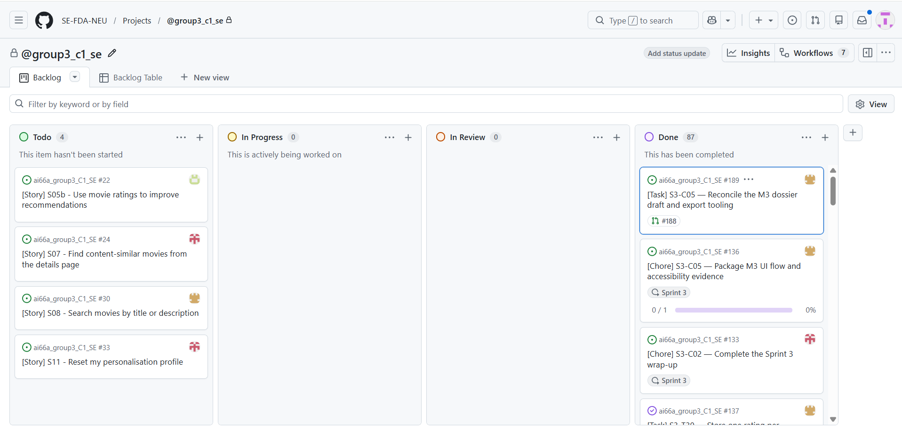
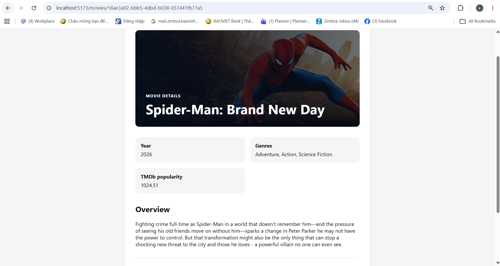
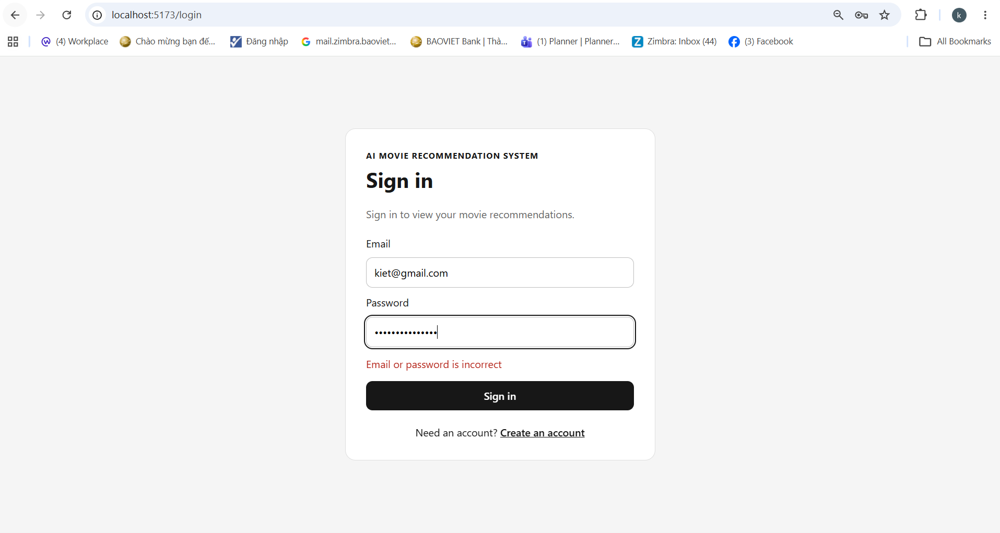

# Milestone 3 — UI dossier

**Team:** Team 03 — AI Movie Recommendation System

**Topic:** AI Movie Recommendation System

**Members:**

- Nguyen Xuan Kiet (11247306)
- Tran Minh Hoang (11247292)
- Tran Tuan Anh (11247264)
- Vu Quoc Huy (11247301)
- Nguyen Tuan Anh (11247260)

**Product Owner:** `@kietxuan`

**Scrum Master:** `@vu-huzy` (Sprint 3)

**Repository:** [SE-FDA-NEU/ai66a_group3_C1_SE](https://github.com/SE-FDA-NEU/ai66a_group3_C1_SE)

**Project board:** [@group3_c1_se — Project 9](https://github.com/orgs/SE-FDA-NEU/projects/9)

**Setup guide:** [docs/SETUP.md on main](https://github.com/SE-FDA-NEU/ai66a_group3_C1_SE/blob/main/docs/SETUP.md)

**Submitted by:** Nguyen Xuan Kiet

<!-- pdf:page -->

### Submission page 2 — Sprint boards

**After Sprint Planning — original PO-supplied image.**

PO-identified beginning-of-Sprint-3 image; global, unfiltered totals:
Todo 53 / In Progress 0 / In Review 0 / Done 35, including Sprint 2.
These are not Sprint 3 points or accepted Story counts.

**On submission day — original PO-supplied image.**

PO-supplied on 2026-10-18; no visible filter or capture timestamp.
Global totals: Todo 4 / In Progress 0 / In Review 0 / Done 87.
Project Done does not prove issue closure, acceptance or submission.
Both images are unaltered. [Provenance and access limits](evidence/s3-c05-ui/supplied-captures.md).

<!-- pdf:page -->

### Submission page 3 — Running P0 UI and visible error

**S03 — movie details with the actual browser address bar.**

PO-supplied: `/movies/18ae3a02-bbb5-4dbd-b038-057441fb77a5`,
Spider-Man: Brand New Day; 2026; TMDb popularity 1024.51.

**S13 — rejected sign-in with the actual browser address bar.**

PO-supplied: `/login`, **Email or password is incorrect**.
Contract: `INVALID_CREDENTIALS`, HTTP 401; the image itself is not a network log.
Both original PNGs are preserved. [Capture provenance and version limits](evidence/s3-c05-ui/supplied-captures.md).

<!-- pdf:page -->

## 1. P0 Stories and status

| Story | Screen(s) | Route | Status | Issue |
|---|---|---|---|---|
| S01 — Select favourite genres | Home; Movie Preferences; Recommendations | `/` → `/preferences` → `/recommendations` | [partly works](evidence/s3-m3-p0-handoff/README.md#complete-p0-ac-to-evidence-matrix) | [#17](https://github.com/SE-FDA-NEU/ai66a_group3_C1_SE/issues/17) |
| S02 — Get recommendations from preferences | Movie Preferences; Recommendations | `/preferences` → `/recommendations` | [partly works](evidence/s3-m3-p0-handoff/README.md#complete-p0-ac-to-evidence-matrix) | [#18](https://github.com/SE-FDA-NEU/ai66a_group3_C1_SE/issues/18) |
| S03 — View movie details | Catalogue; Recommendations; Movie detail | `/`, `/recommendations` → `/movies/:movieId` | [partly works](evidence/s3-m3-p0-handoff/README.md#complete-p0-ac-to-evidence-matrix) | [#19](https://github.com/SE-FDA-NEU/ai66a_group3_C1_SE/issues/19) |
| S04 — Explore without preferences | Home; popular cold-start Recommendations | `/` → `/login` → `/recommendations` | [partly works](evidence/s3-m3-p0-handoff/README.md#complete-p0-ac-to-evidence-matrix) | [#20](https://github.com/SE-FDA-NEU/ai66a_group3_C1_SE/issues/20) |
| S12 — Register an account | Create your account; Sign in | `/register` → `/login` | [partly works](evidence/s3-m3-p0-handoff/README.md#complete-p0-ac-to-evidence-matrix) | [#44](https://github.com/SE-FDA-NEU/ai66a_group3_C1_SE/issues/44) |
| S13 — Sign in and sign out | Sign in; Recommendations; guarded screens | `/login` → `/recommendations` → `/` | [partly works](evidence/s3-m3-p0-handoff/README.md#complete-p0-ac-to-evidence-matrix) | [#45](https://github.com/SE-FDA-NEU/ai66a_group3_C1_SE/issues/45) |

Every functional P0 AC has passing assertions in the T25 matrix. These statuses
preserve the accepted handoff's conservative AC + [DoD](definition-of-done.md)
boundary: unaided participant session date/version/per-journey outcomes and
final sign-off remain incomplete. Issue closure (#44/#45, or #127) alone is
not a new Story acceptance result. No partial Story is labelled `works`.

### Candidate and evidence boundary

- Exact T25 executed integration snapshot: `05a78c1f503c10f6f5047655acb3800b21966e99`,
  explicitly unpublished. Its public application base is
  `0c4273ab792becb060fefd5e7341e755ed28d0a5`. The published T25 head is
  `aed85fb4133f413a2cf147ff1bd7cbc7ff78bc8f`, merged by PR #184 at
  `4ff81ab30df8cf448c3796f748b9451496e403c5`. Do not relabel the unpublished
  executed SHA as the later merged SHA.
- The [original verification manifest](evidence/s3-m3-p0-handoff/verification.json)
  pins executable digest `2985bd56d5ff942f87e8e7f31a96f98fcb1689f9ad681c233203a0cd91f20ccf`.
  The original 202-path comparison remains historical after CRLF→LF
  normalization; [original audit](evidence/s3-c05-ui/verification.json).
  Concurrent follow-up `b1529d5` intentionally changed only the Scrum metadata
  workflow: 201 historical files still match, including all product/tests;
  the one workflow difference is reported and tested by six parser cases.
  [Concurrent follow-up evidence](evidence/s3-c05-ui/conflict-linkage-follow-up.json).
  This is source correspondence, not a new full product acceptance run.
- [T29 live import](evidence/t29-tmdb-live-smoke.md) is the required provider
  foundation. T25's latest live snapshot is provider `tmdb`, revision
  `34b442f2-f5a8-4317-9f2f-468e6ec06a20`: 255 distinct movies/source IDs,
  255 finite popularity values/fetch timestamps, 17 associated genres.
  Tests write only to disposable backup copies. M2 seed is not live M3 evidence.
- [C04 fresh-clone verification](evidence/s3-c04-clean-clone.md) tested committed
  executable SHA `05dda34900fd0fa80cfff323b353a8d4c220a4d8`. Its separate
  20-movie imported revision is `6988eeeb-79e0-41ad-ab7a-5248f06a0659`;
  it is not the 255-movie source. [Restart/browser report](evidence/s3-c04-final/live/results.json).
- Reused offline results from the T25 handoff: 419 backend passes / 1 inherited
  skip; 236 frontend passes; S04/S13 10 synthetic browser passes / 1 intentional
  live skip; separate S13 live case passes. These are recorded T25 results, not
  new runs performed for this documentation change, and they predate the later
  C04 follow-up below.
- **Latest C04 follow-up — [PR #190](https://github.com/SE-FDA-NEU/ai66a_group3_C1_SE/pull/190),
  merged 2026-10-18 at `c843f87`.** Tester: Codex, not an independent teammate.
  [Evidence](evidence/s3-c04-review-account.md) for executable candidate
  `326aadf3ee32342c4e91297ee9e885663eccf565`; the later commit only documents
  results and the Windows clone setting. The opt-in application-only review
  account is provisioned in the same configured TMDb database
  (`--confirm-local-demo`). On the existing 255-movie `data/app.db` it returned
  `already_exists` twice and left catalogue, preference, rating and session data
  unchanged; no import, migration or seed ran there. A separate fresh clone
  imported real TMDb data (20 movies on the successful retry; an earlier 13-page
  import timed out and is recorded as a failure), created the account in that
  database and passed a real-browser replay: sign-in, the BR1 correction,
  saving preferences, a rating and a restart of both processes. Full isolated
  backend suite **434 passed / 1 inherited skip**; new-clone frontend **236
  passed**, with lint and build passing. This is a new run on a newer
  candidate; the 419 figure above remains the T25 result with its own date and
  SHA and is not replaced. It is not an unaided human session.
- [#131 backdrop acceptance](evidence/s3-t28-backdrop-acceptance/README.md)
  covers the shipped media chain. [C04 live CDN report](evidence/s3-c04-final/backdrop-live/results.json)
  separately proves image loading at 1280px and 375px.

The [GitHub snapshot](evidence/s3-c05-ui/github-state.json) records actual merged
PRs #144/#184/#185/#186, final heads, formal reviews and checks observed on
2026-10-18. Later @hoang3003 approvals exist for
[T25](https://github.com/SE-FDA-NEU/ai66a_group3_C1_SE/pull/184#pullrequestreview-5562707423)
and [C04](https://github.com/SE-FDA-NEU/ai66a_group3_C1_SE/pull/185#pullrequestreview-5562668940).
Their review bodies say `ok`; they are not detailed reproduction reports.
Historical handoff files are preserved, including their then-pending review notes.

C03 was subsequently merged through
[PR #187](https://github.com/SE-FDA-NEU/ai66a_group3_C1_SE/pull/187), final head
`95ab003f2123ae9c8d2d7f603d0f6cc7c5829be8`, merge `bf18ab8`.
Its current architecture/ERD show nine application tables and the public image
CDN boundary; the historical M2 diagrams are separate `*-m2` assets.
The pre-merge @kietxuan approval covered the earlier `9e444ad` head, not the
later follow-up they authored. @NguyenTuanAnh0608, who did not contribute to
C03, then approved the exact final head `95ab003`
([review](https://github.com/SE-FDA-NEU/ai66a_group3_C1_SE/pull/187#pullrequestreview-5563572255),
15:00 UTC). It was submitted after the 13:13 UTC merge and its body is only
`oke`, so it is a formal final-head approval, not a detailed reproduction
report. See the [C05 follow-up record](evidence/s3-c05-ui/follow-up.md).

T33's first bridge run failed at logout (`/login` versus `/`); a standalone rerun
and five repetitions passed. The cause remains unproved. Keep the first failure
visible; browser S13 logout/replay separately passed. See [T25 limitations](evidence/s3-m3-p0-handoff/README.md#limitations-and-final-gates).

### Separate P1 acceptance — outside the six-P0 gate

| Story | Acceptance result and scope | Status | Evidence |
|---|---|---|---|
| S06 #23 — Filter the current recommendation list | Filter, zero-match guidance, clear/reset and unchanged committed preferences pass. T16 is React/API/SQLite integration, not browser E2E; T15/T16 browser evidence is separate. | [partly works](evidence/s3-m3-p0-handoff/verification.json) | [Latest T16 run](evidence/s3-m3-p0-handoff/latest/checks/t16.txt); [T16 detailed acceptance](evidence/s3-t16-filter-verification.md) |
| S09 #31 — Browse popular movies | T21 synthetic browser exact ordering/top-ten/empty assertions pass; T25 live list matches the imported DB oracle. Final DoD remains open. | [partly works](evidence/s3-m3-p0-handoff/verification.json) | [Latest T21 run](evidence/s3-m3-p0-handoff/latest/checks/t21.txt); [T21 matrix](evidence/s3-t21-popular-acceptance/README.md); [live report](evidence/s3-m3-p0-handoff/latest/live/results.json) |

<!-- pdf:page -->

### Updated M1 screen flow

Source: [screen-flow.puml](screen-flow.puml); PNG: [screen-flow.png](images/screen-flow.png).
Solid arrows describe existing controls and guarded navigation. Dashed entries
retain M1 `/search` and `/profile` scope without claiming current home links:
`/search` is not registered and falls back to `/`; `/profile` is a protected
placeholder. Similarity and reset UI are not implemented. A guest rating CTA
opens `/login` without a private rating request. Direct detail visits return
to `/`; list-origin visits use the validated catalogue/popular/recommendation
return context. Recommendations refetch current-account data on return.

<!-- pdf:page -->

## 2. Wireframes

These are authored low-fidelity schematics of the inspected final application
source, not screenshots or acceptance results. Bracketed text denotes data
slots. All six P0 screens appear below; S04's cold start shares the
Recommendations screen. The public popular screen is included separately for P1.
Endpoints are local backend calls; no screen calls the TMDb metadata API.

### Public catalogue — `/` (S01/S03/S04 entry)

The user comes here to … browse the local catalogue and start choosing movies.

API endpoints: `GET /api/movies?limit=10`. Home itself does not check the
session; Start opens the guarded preference route.

Source: [HomePage.tsx](../frontend/src/pages/HomePage.tsx),
[MovieCard.tsx](../frontend/src/components/MovieCard.tsx).
Cards contain title, year, genres, TMDb popularity and View details; at most
ten cards. Source loading/empty/error/data states remain distinct. Loading says
`Loading movies...`; empty says `No movies available` and
`The active catalogue does not contain any movies yet.`; error shows
`Movies are unavailable`, a safe API message and Retry.
Actual data capture: [T25 live catalogue](images/ui/live-catalogue-viewport.png).

<!-- pdf:page -->

### Sign in — `/login` (S13)

The user comes here to … sign in to the current account.

API endpoints: `POST /api/auth/login`. Successful sign-in sets central account
state and opens `/recommendations`; that screen owns its recommendation call.

Source: [LoginPage.tsx](../frontend/src/pages/LoginPage.tsx).
Email/password labels, disabled `Signing in...`, inline API error and
`Create an account` match the implemented form. Invalid credentials retain the
form and exact Story message. Sign-out is a Recommendations action.

<!-- pdf:page -->

### Create your account — `/register` (S12)

The user comes here to … create an account to save preferences.

API endpoints: `POST /api/auth/register`; success `201` navigates to `/login`,
without automatically signing in. Invalid local fields send no request.

Source: [RegisterPage.tsx](../frontend/src/pages/RegisterPage.tsx).
Empty/invalid email and passwords shorter than eight characters have field
corrections. `Creating account...` disables duplicate submits. Duplicate email
shows exactly `This email is already registered`; other request failures use
the implemented safe service message. No password or credential appears in an asset.

<!-- pdf:page -->

### Movie Preferences — `/preferences` (S01)

The user comes here to … select, save and revisit 1 to 5 favourite genres.

API endpoints: `GET /api/auth/me` when guard identity is unknown;
`GET /api/genres` and `GET /api/me/preferences` on load;
`PUT /api/me/preferences` with 1–5 distinct canonical `genreIds` on save.

Source: [PreferencesPage.tsx](../frontend/src/pages/PreferencesPage.tsx).
Saved selections restore; unavailable saved genres are labelled and remain
selected/count toward five until cleared. Loading, no genres and load-error
Retry replace the picker. A failed save retains the draft and offers Save retry.
Only a committed save invalidates recommendations and navigates onward.

Client-only corrections (not API error rows):
`Select at least one genre (up to 5), then choose Save preferences.`
and `You can select up to 5 genres. Your previous 5 selections are still selected. Clear one genre to choose a different one.`
Actual [mobile correction capture](images/ui/live-preferences-correction-viewport.png).

<!-- pdf:page -->

### Recommendations — data (S02/S04; S06 separately)

The user comes here to … view recommendations and recover from unavailable data.

API endpoints for all four following wireframes: `GET /api/auth/me` when guard
identity is unknown; `GET /api/me/recommendations?limit=10` on entry/retry;
`GET /api/genres` for filter options on a ready non-empty list;
`POST /api/auth/logout` only on Sign out. Genre filtering sends no preference write.

Source: [RecommendationsPage.tsx](../frontend/src/pages/RecommendationsPage.tsx),
[RecommendationGuidance.tsx](../frontend/src/components/RecommendationGuidance.tsx),
[RecommendationFilter.tsx](../frontend/src/components/RecommendationFilter.tsx).
Personalised cards show `Recommended for you` and `Matches your genres: <names>`.
At most ten distinct cards retain server order.

The S04 data variant uses `Popular`, `Not personalised`,
`Recommendations based on popular movies`,
`Add your favourite genres to get personalised recommendations.` and
`Enter preferences →`. No-match is a valid response: `Popular alternatives`,
`No movies matched your favourite genres.`, Edit preferences and Retry, with
any returned alternatives rendered once. It is different from an API error.
Real [T25 personalised capture](images/ui/live-personalised-viewport.png).

<!-- pdf:page -->

### Recommendations — empty

The user comes here to … understand why the current recommendation list has no cards.

API endpoints: same Recommendations boundary above; `GET /api/me/recommendations?limit=10`
returns `200`, `movies: []`, `noMatch: false`. No filter-options request is
mounted for the empty list. The session guard and Sign out retain their endpoints.

Exact current text: `No recommendations available yet.` and
`No movies are currently available for this recommendation list.`;
`Enter preferences →` opens `/preferences`.
Zero cards is a valid data state, not `SERVICE_UNAVAILABLE` or a no-match claim.
[Historical synthetic capture](images/ui/recommendations-empty-historical-viewport.png);
[latest repeated assertions](evidence/s3-m3-p0-handoff/latest/synthetic-results.json).

<!-- pdf:page -->

### Recommendations — loading

The user comes here to … wait for the current account's recommendation request.

API endpoints: `GET /api/me/recommendations?limit=10` is pending;
`GET /api/auth/me` may precede it if identity is unknown;
`POST /api/auth/logout` remains the Sign out action. No filter-options request
is mounted until a non-empty ready result is accepted.

Exact text: `Loading recommendations...`; section heading `Your recommendations`.
No previous-account cards or false empty/error guidance is shown.
[Historical synthetic capture](images/ui/recommendations-loading-historical-viewport.png);
[latest repeated assertions](evidence/s3-m3-p0-handoff/latest/synthetic-results.json).

<!-- pdf:page -->

### Recommendations — error

The user comes here to … understand a failed recommendation request and retry it.

API endpoints: failed `GET /api/me/recommendations?limit=10`; Retry issues the
same GET. The guard and Sign out endpoints remain as above; no filter-options
request is mounted in the error state.

For `503 SERVICE_UNAVAILABLE`, exact heading and paragraph:
`Recommendations are unavailable`;
`Service is temporarily unavailable Choose Retry to load your recommendations again.`
The button is `Retry`. A protected `401` instead clears central account state
and opens `/login`. Delayed responses from obsolete attempts/accounts are ignored.
[Historical error capture](images/ui/recommendations-error-historical-viewport.png)
and [exact transcript](evidence/s3-m3-p0-handoff/synthetic/actual-error-message.txt).

These four schematics show states required for one P0 screen. Synthetic
empty/loading/error captures keep their historical origin; the latest T25
synthetic suite repeats the assertions but does not recapture those files.

<!-- pdf:page -->

### Movie detail — `/movies/:movieId` (S03)

The user comes here to … read a selected movie and return to the originating list.

API endpoints: `GET /api/movies/{movieId}`; `GET /api/auth/me` if the rating
widget needs to resolve identity. Only authenticated users call
`GET /api/me/ratings/{movieId}`; Save rating calls
`PUT /api/me/ratings/{movieId}` with strict integer `rating` 1–5.
A guest sees the sign-in CTA and makes no private rating call.

Source: [MovieDetailPage.tsx](../frontend/src/pages/MovieDetailPage.tsx),
[MovieBackdropHero.tsx](../frontend/src/components/MovieBackdropHero.tsx),
[MovieRating.tsx](../frontend/src/components/MovieRating.tsx).
A null year/overview shows `Information unavailable`; unknown IDs show
`Movie not found` with a return link. Backdrop omission/null/broken images retain
a readable gradient/title. Ratings display `Not rated yet`,
`Your saved rating: N/5`, `Saving...` and `Rating saved.` as appropriate.
Failed saves preserve the committed value and draft. Ratings are optional and
do not change Sprint 3 ranking. Real [C04 backdrop capture](images/ui/detail-backdrop-live-viewport.png).

<!-- pdf:page -->

### Popular movies — `/popular` (P1 S09)

The user comes here to … browse the top ten eligible movies in popularity order.

API endpoints: `GET /api/movies/popular?limit=10`; this is a public dedicated
finite-popularity subset, separate from the public catalogue endpoint.

Source: [PopularMoviesPage.tsx](../frontend/src/pages/PopularMoviesPage.tsx).
Popularity descending, title ascending, ID tie-break; at most ten distinct
eligible movies. Exact empty text: `Popular movies are not available yet`.
Loading: `Loading popular movies...`; error heading:
`Popular movies are unavailable`, safe API message and Retry.

### Accessibility and ownership checks

Forms have associated labels; registration corrections use `aria-invalid`
and `aria-describedby`. Loading uses status regions, API failures use alerts,
and correction text explains the next action. Button disabled states prevent
duplicate saves. T28 records keyboard focus, mobile width and overlay contrast
checks. These are source and executable assertions, not a newly completed
human accessibility audit. Account-keyed remounts and request generations
prevent delayed account/movie data from replacing current state.

<!-- pdf:page -->

## 3. Error messages

These four cases use implemented API codes and actual rendered messages.
HTTP status is context within the code cell; it is not exposed as raw UI error
text. Business rules refer to [business-rules.md](business-rules.md) and the
unchanged Story AC. Error envelope details: [api.md](api.md).

| API error code | Business Rule | Exact message the user sees |
|---|---|---|
| `INVALID_CREDENTIALS` (401, login) | BR18; S13 AC2: unknown email and wrong password use the same non-disclosing response. | `Email or password is incorrect` |
| `EMAIL_ALREADY_REGISTERED` (409, registration) | BR16; S12 AC2: case-insensitive email uniqueness; create no second account. | `This email is already registered` |
| `MOVIE_NOT_FOUND` (404, detail) | BR6; S03 AC2: an unknown opaque ID must never show another film. | Heading: `Movie not found`. Paragraph: `That movie is not available in the active catalogue.` |
| `SERVICE_UNAVAILABLE` (503, recommendations) | S02 AC4/AC5 and BR8 current-account persistence: this is a technical failure, not a new Business Rule. Preserve saved preferences and offer retry; do not show an empty/no-match result. | Heading: `Recommendations are unavailable`. Paragraph: `Service is temporarily unavailable Choose Retry to load your recommendations again.` |

Exact Story messages above are preserved without extra punctuation in the
rendered message. Login recovery is editing the form and Sign in; duplicate
registration recovery is Sign in or another email. Detail exposes the validated
return link (direct visit: `Return to catalogue`). Recommendations exposes `Retry`.

Proof: [T25 S12/S13/S03 matrix](evidence/s3-m3-p0-handoff/README.md#complete-p0-ac-to-evidence-matrix),
[latest S13 live run](evidence/s3-m3-p0-handoff/latest/s13-live-results.json),
[T12 error/retry rerun](evidence/s3-m3-p0-handoff/latest/checks/t12.txt),
[exact error capture transcript](evidence/s3-m3-p0-handoff/synthetic/actual-error-message.txt).
Code: [LoginPage](../frontend/src/pages/LoginPage.tsx),
[RegisterPage](../frontend/src/pages/RegisterPage.tsx),
[MovieDetailPage](../frontend/src/pages/MovieDetailPage.tsx),
[RecommendationsPage](../frontend/src/pages/RecommendationsPage.tsx).

Client validation (zero/six genre selection, invalid email, short password) is
separate from API errors. `200` empty results, filtered zero matches, no-match
popular alternatives and `Information unavailable` for null provider fields
are not API error rows. Protected `AUTHENTICATION_REQUIRED` normally navigates
to `/login`; it is not falsely counted as a visible error-message row.
Network/non-JSON failures use [implemented safe fallbacks](../frontend/src/api/requestFailure.ts),
not raw status pages or exception text. No raw HTTP response, SQL error, stack
trace, token, password or session cookie is reproduced in this dossier.

<!-- pdf:page -->

## 4. What changed since M2

### Saved preferences required persistent state and a fresh result generation

M2's recommendation landing used only the popular cold-start response. The
Sprint 3 UI must save a current account's 1–5 genres, restore them after revisit
or restart, then show new recommendations immediately after a successful save.
A component-only selection could neither survive a new session nor distinguish
accounts; a late pre-save response could restore a stale popular list.

The implemented change adds `user_genre_preferences`, composite primary key
`(user_id, genre_id)` (migration `9d2f5a1c3b84`), authenticated genre/preference
GETs, and atomic `PUT /api/me/preferences`. The session supplies the owner;
strict validation happens before replacement and failures roll back. Only a
committed response increments the account's recommendation version and opens
`/recommendations`. That page accepts a response only for the current account,
recommendation version, retry generation and active request. Old results and
old `401`s cannot overwrite or sign out a newer account.

The recommendation response preserves `data.movies`, `mode`, `personalised`,
`noMatch` and `reason.matchedGenres`. Sprint 3 ranking uses saved genres and
local popularity, not ratings. S06 filtering applies locally to one accepted
snapshot; it neither saves genres nor refetches recommendations.

Evidence: [T02 atomic preferences](evidence/s3-t02-atomic-preferences.md),
[T22 preference acceptance](evidence/s3-t22-preferences-acceptance/README.md),
[latest T22 rerun](evidence/s3-m3-p0-handoff/latest/checks/t22-live.txt),
[S04 transition/race rerun](evidence/s3-m3-p0-handoff/latest/checks/s04-s13-synthetic.txt),
[AuthContext](../frontend/src/auth/AuthContext.tsx),
[PreferencesPage](../frontend/src/pages/PreferencesPage.tsx),
[RecommendationsPage](../frontend/src/pages/RecommendationsPage.tsx).
The matching design rationale is updated in [design.md §8](design.md#8-ui-driven-design-changes-with-repository-evidence)
in this same documentation change.

### Public detail acquired an optional backdrop and an account-scoped rating widget

The shipped backdrop chain adds nullable TEXT `catalog_movies.backdrop_path`
(migration `c6f8a2d4e901`) and safe nullable `backdropUrl` in the public detail
DTO. Import/enrichment owns provider calls; the UI displays a permanent
contrast layer and falls back on omitted/null/failed images. Images come from
the public allowed CDN; metadata still comes from local SQLite. This is
additive media scope and does not alter movie identity, revision, ranking or
S03 AC/points. [#131 verification](evidence/s3-t28-backdrop-acceptance/README.md)
and [C04 desktop/mobile live proof](evidence/s3-c04-final/backdrop-live/results.json)
are reused because the enhancement shipped.

The rating widget now exists under T33/T34, with account/movie-keyed committed
and draft values. The actual failure copy is
`Your rating was not confirmed as saved. Service is temporarily unavailable Please retry.`
for a `SERVICE_UNAVAILABLE` API error; the committed value remains visible.
The old draft's `Rating was not saved. Try again.` wording is superseded by
the implemented [MovieRating](../frontend/src/components/MovieRating.tsx) and
[T34 evidence](evidence/s3-t34-rating-acceptance/README.md).
The reset endpoint exists, but `/profile` remains a protected placeholder;
there is no completed reset flow, search or similarity UI claim.

### Contract and wrap-up handoffs

The source of truth is #134's [approved initial PR #144](https://github.com/SE-FDA-NEU/ai66a_group3_C1_SE/pull/144)
and the merged [C03 reconciliation PR #187](https://github.com/SE-FDA-NEU/ai66a_group3_C1_SE/pull/187).
The [HTTP DTO/error contracts](api.md), current nine-table diagrams and safe
CDN/local-read boundary are retained from that main. #134 is closed; its
final-head approval by a non-contributor is recorded above.
The C05 change adds the matching preference-persistence/UI rationale to
[design.md §8](design.md#8-ui-driven-design-changes-with-repository-evidence).
The dossier was merged to `main` through
[PR #188](https://github.com/SE-FDA-NEU/ai66a_group3_C1_SE/pull/188) at
`d6aff46` on 2026-10-18 14:34 UTC, with later fixes in
[PR #190](https://github.com/SE-FDA-NEU/ai66a_group3_C1_SE/pull/190).
[Task #189](https://github.com/SE-FDA-NEU/ai66a_group3_C1_SE/issues/189) and
parent C05 [#136](https://github.com/SE-FDA-NEU/ai66a_group3_C1_SE/issues/136)
are closed. Closing them records the merged dossier and tooling; it does not
record a final PDF export or an LMS submission.

C02 [#133](https://github.com/SE-FDA-NEU/ai66a_group3_C1_SE/issues/133) is open.
Its Sprint 3 log is in [sprint-log.md](sprint-log.md), written from the C01
reconciliation ([sprint3-backlog-refinement.md](sprint3-backlog-refinement.md))
and live GitHub records. Sprint Review feedback, the retrospective action,
the Scrum Master handoff and the submission receipt are marked "Not recorded"
there because the repository does not contain them.

<!-- pdf:page -->

### Publication and remaining human work

1. Member IDs, exact topic, submitter and the submission-day board are supplied.
   PO/SM still verifies instructor access to the private board. Preserve both
   original board images and their global/unfiltered-count limitations.
2. Record Trang's actual session date, tested version, catalogue revision and
   per-journey outcomes in [human-validation.md](evidence/s3-m3-p0-handoff/human-validation.md).
   PO confirmation that the trial occurred is not an all-AC pass. Resolve the
   T33 intermittency if it recurs on the final candidate.
3. A non-contributing teammate's approval of merged C03 head `95ab003` is
   recorded above (submitted after the merge, body `oke`). The #133 owner has
   drafted the Sprint 3 log and repository-minimum audit in
   [sprint-log.md](sprint-log.md); it is not final until that change is
   reviewed and merged. Do not award points for partial Stories or count Tasks
   as points.
4. Both PO-supplied application images now include the actual browser address
   bar and appear on page 3. Keep their provenance limits explicit: the exact
   running checkout, capture times and browser network transcript were not
   supplied. Reconfirm applicability if executable code changes before release;
   historical viewport previews are retained only as historical evidence.
5. Dossier PR #188 is merged. Its only pre-merge approval
   ([@kietxuan](https://github.com/SE-FDA-NEU/ai66a_group3_C1_SE/pull/188#pullrequestreview-5563237695),
   body `nice`) covered the earlier head `b1529d5`, and @kietxuan contributed to
   the follow-up changes. @NguyenTuanAnh0608
   ([review](https://github.com/SE-FDA-NEU/ai66a_group3_C1_SE/pull/188#pullrequestreview-5563566209))
   and @hoang3003
   ([review](https://github.com/SE-FDA-NEU/ai66a_group3_C1_SE/pull/188#pullrequestreview-5563578837))
   approved the exact final head `100fbde` at 14:59 and 15:02 UTC, after the
   14:34 UTC merge, with short comments and no reproduction report. A
   substantive, reproducible non-contributor review of the dossier is not
   recorded. No review has been generated on anyone's behalf.
6. PR #188 is merged, and Task #189 and parent #136 are closed. No clean-checkout
   verification of the merged `main` and no `Team03_M3.pdf` export is recorded
   here. To do: from a clean checkout of the merged `main`, verify executable
   correspondence and required evidence/assets, export `Team03_M3.pdf`, and
   recheck pages 1–3, all text/images/links and agreement with that exact
   merged SHA. Record the export only after it is done. Issue closure does not
   imply either.
7. Confirm the actual LMS deadline in the course, submit before it, and save
   the genuine receipt. No LMS session, deadline or receipt is recorded here.
   C02 records the actual Review/submission outcomes and SM handoff once they
   exist.

Draft build and final-release conditions:
[PDF export instructions](evidence/s3-c05-ui/README.md).
The dossier is merged to `main`. No final PDF export, LMS submission or receipt
is claimed.
